# Debit / Credit User Manual

EDCS Member Management System

Prepared: 26 November 2026 · Time zone: Asia/Colombo · Current-system manual v1.0

This manual explains member and child-account entries, account statements, salary/contribution receipts, remaining-balance allocations, Payment exceptions approvals, opposite-entry corrections and balance reports. It follows the current **Debit / Credit** module and its linked Child Deposits and Approvals screens.

Screenshots use fictional training members, accounts, payments and reviewers in a uniquely named disposable database. Completed postings, corrections, member/child balances, receipt allocation, duplicate-submission protection and two-level exception approval were verified through the real application. Forms filled in the browser illustrate the verified examples. Live accounts, users and approval policies were not changed.

### Contents

1. Choose the right workflow and check access
2. Select an account and understand saved balances
3. Add a member credit or debit
4. Add a child deposit entry and read its statement
5. Correct a mistake and edit permitted details
6. Receive a contribution and allocate the remaining balance
7. Submit and approve a below-plan payment
8. Find contribution receipts and retained allocations
9. Read balance reports and filter account history
10. Validation, protected records and completion checklist

## 1. Choose the right workflow and check access

Open **Debit / Credit** from the workspace sidebar. The initial screen is an account-statement enquiry. Select a member and account to inspect existing activity, or use one of the actions at the top.

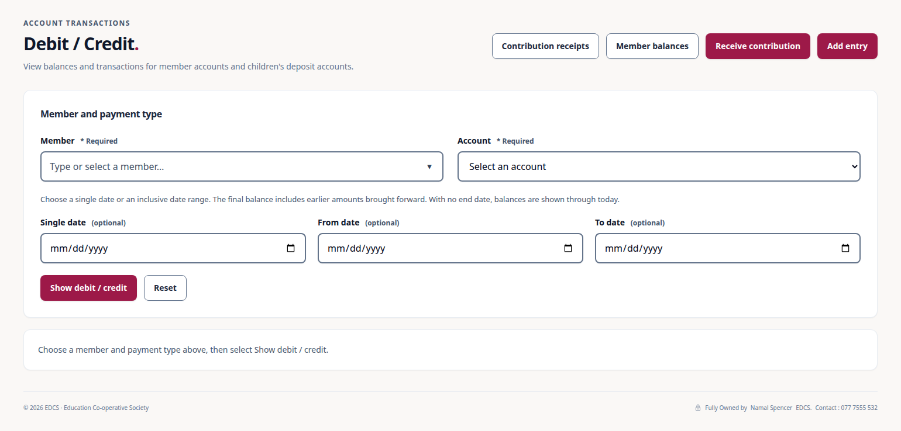

| Action                      | Use it for                                                                                    |
| --------------------------- | --------------------------------------------------------------------------------------------- |
| Add entry                   | One debit or credit to a selected member payment account or registered child deposit account. |
| Receive contribution        | Record money actually received and allocate it to plan categories and any remaining accounts. |
| Contribution receipts       | Find posted receipts, their saved allocations and available pending requests.                 |
| Member balances             | Compare saved opening amounts, debits, credits and final balances by member/payment type.     |
| Show debit / credit         | Apply account/date filters to the statement.                                                  |
| Correct with opposite entry | Reverse an eligible original movement with an exact linked opposite entry and a reason.       |

| Task                                                           | Required permission/access                                                                      |
| -------------------------------------------------------------- | ----------------------------------------------------------------------------------------------- |
| View member statements, receipts and the member balance report | Debit / Credit View and access to the selected member/Lager.                                    |
| Add an entry or receive a contribution                         | Debit / Credit Add and current member access.                                                   |
| Edit an eligible member entry                                  | Debit / Credit Edit/change. Other protections and configured approval rules still apply.        |
| Use child deposits through this module                         | Debit / Credit access plus the relevant Child Deposits View/Add/Edit permission for the action. |
| Approve an exception                                           | Assignment in the configured approval hierarchy and sufficient access to review that request.   |
| Delete a posting                                               | Unavailable. Debit/credit history is retained; use an allowed correction route.                 |

For ordinary users, member access follows the assigned Lager, active user account, EPF and required branch/zonal-office access. Module permission alone does not assign a Lager. A member awaiting initial activation approval cannot receive financial postings. Confirm the member's status and current ledger before entering money.

**Credit increases the selected deposit balance; debit reduces it.** The system accepts one positive side per entry. It does not use the sign of a negative amount to decide the transaction type.

## 2. Select an account and understand saved balances

From **Add entry**:

1. Select the **Member** by number/name.
2. Select the required member account under **Account**, or choose a **Child deposit type** for a child's account.
3. Confirm the transaction date and the balance information loaded for that date.
4. Check the selected account, not just the total across the member's accounts.

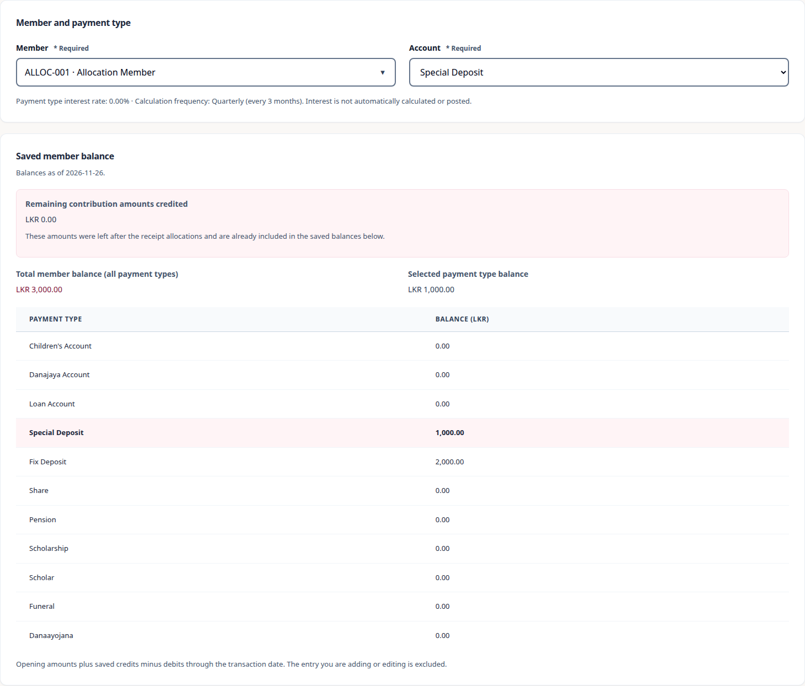

The **Saved member balance** panel shows the total across member payment types, the selected type balance and the individual account amounts. It uses saved opening amounts plus saved credits less debits through the transaction date. When editing an entry, that entry is excluded from this comparison to avoid counting it twice.

**Remaining contribution amounts credited** identifies amounts previously allocated after standard receipt allocations. These amounts are already included in the saved balances; do not add them again. The child's funds are shown in a separate panel and are not included in the member-deposit total.

The displayed interest rate and calculation frequency are reference information from the relevant account configuration. Selecting an account or saving a debit/credit does not calculate or post interest. Quarterly interest is handled through its own interest workflow and affects the balance when posted.

If balance data cannot be loaded, reselect the member/account or reload the form. Confirm the saved statement before relying on an amount. A displayed balance does not replace the bank's authorization procedure for a withdrawal or correction.

## 3. Add a member credit or debit

To add a credit:

1. Choose **Add entry** and select the member and member account.
2. Enter the **Transaction date** and a useful **Reference**.
3. Enter the money received in **Credit (LKR)**.
4. Leave Debit blank or zero.
5. Enter the **Description** explaining the movement.
6. Check the account/date/amount, then choose **Save entry**.
7. Check the saved statement or any approval outcome before treating it as posted.

To add an authorized debit, follow the same steps and put the amount in **Debit**, leaving Credit blank or zero.

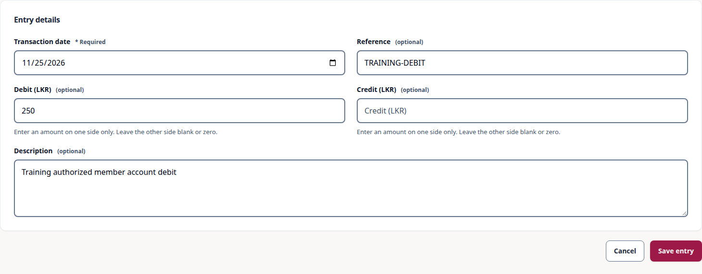

| Field            | What to enter/check                                                                                    |
| ---------------- | ------------------------------------------------------------------------------------------------------ |
| Member / Account | Required identity and payment category. Confirm both before saving.                                    |
| Transaction date | Financial date of the movement. Saved opening dates and current ledger/transfer rules can restrict it. |
| Debit or Credit  | Exactly one positive amount. Use plain nonnegative numbers with at most two decimal places.            |
| Reference        | Source voucher/receipt/correction identifier where available.                                          |
| Description      | Meaningful explanation. A correction specifically requires a reason.                                   |
| Save entry       | Saves a permitted posting or follows the applicable approval route.                                    |

For an ordinary user, a credit below the selected category's effective payment-plan contribution requires **Payment exceptions** approval. It does not become paid bank money merely because Save entry was pressed. Authorized administrators can post directly under the system's rules. Section 7 explains the approval sequence for a complete contribution receipt.

Fix Deposit monthly top-ups can be entered as credits. **Fix Deposit withdrawals must be requested and released through Fix Deposit Loans & Withdrawals.** A direct new Fix Deposit debit is blocked. Loan/withdrawal history and posted interest can also protect existing entries from changes here.

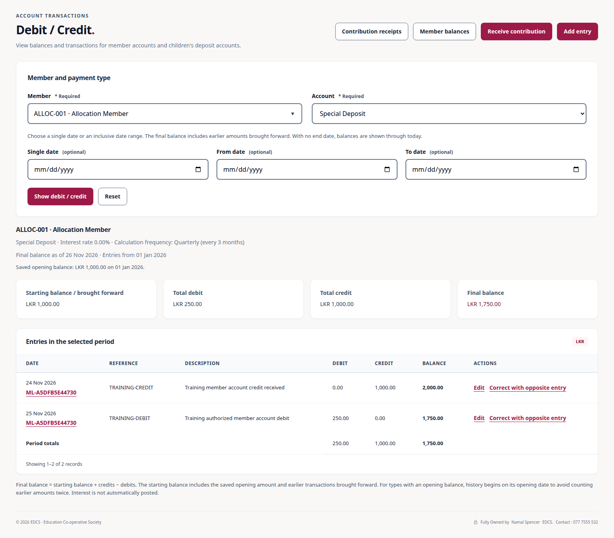

In this example, Special Deposit opens at **LKR 1,000.00**. A credit of LKR 1,000.00 and debit of LKR 250.00 leave that account at **LKR 1,750.00**. Fix Deposit has a separate LKR 2,000.00 opening, so the total across member deposits at this point is LKR 3,750.00. Child funds remain separate.

## 4. Add a child deposit entry and read its statement

A child and deposit account must already be registered under the selected member. Choosing a payment type with a child-sounding name in the **Member accounts** group does not turn it into a child deposit. Use the actual **Child deposit types** group and select the registered child account.

1. Open **Add entry** and select the parent/member.
2. Under Account, choose the required **Child deposit type**.
3. In **Child deposit account**, select the child's matching account.
4. Check the child name, account number, deposit type and saved balance.
5. Enter the date, reference, one-sided debit/credit and description.
6. Choose **Save entry** and verify the result in Child Deposits or the unified statement.

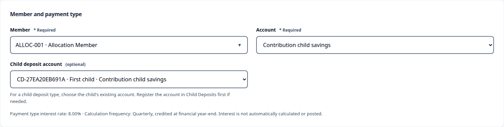

The child must belong to the selected member, and the account must match the chosen deposit type. The account/type must be available for posting, and the transaction date cannot precede its opening date. A member account selection must not have a child account attached to it.

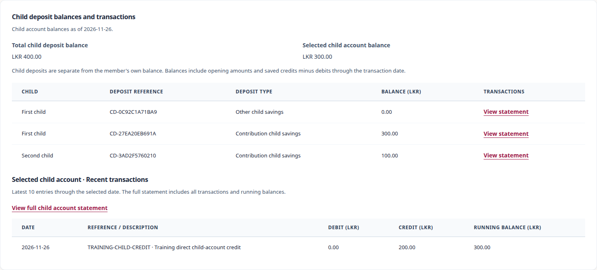

In the example, the selected child account opens at LKR 100.00. A direct credit of LKR 200.00 makes its balance **LKR 300.00**. No corresponding member-account credit is created. A later child debit of LKR 50.00 leaves **LKR 250.00**.

To view a child statement in Debit / Credit, select the parent/member, child deposit type and child account, choose dates if needed and click **Show debit / credit**. The statement identifies the child and account number and shows opening, period totals, running balance and final balance. Saved entries are also visible in the **Child Deposits** module.

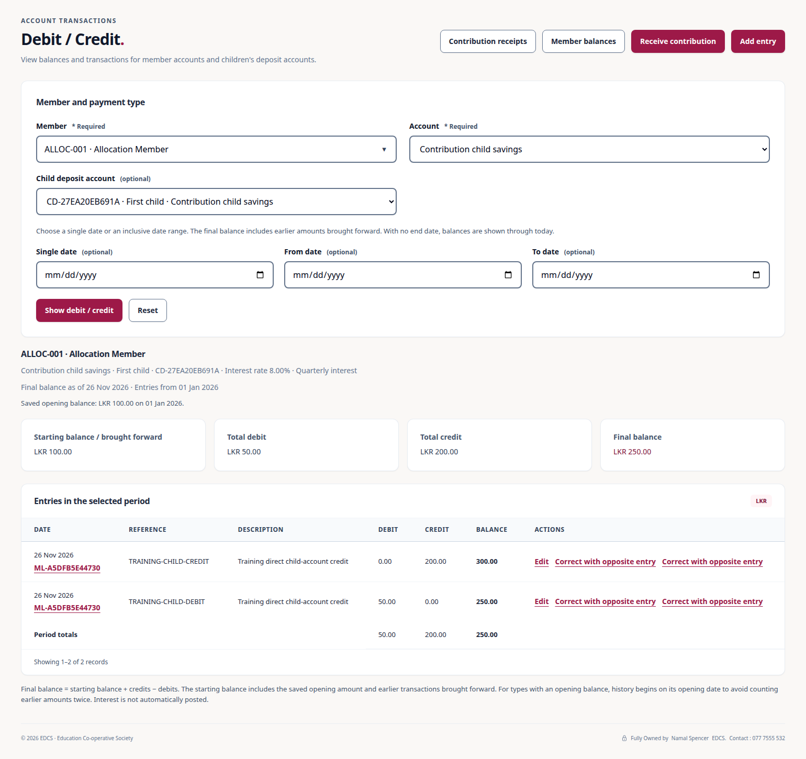

For a child correction, open the account in **Child Deposits** and use that account statement's **Correct with opposite entry** action to open the child-account correction form. Relevant Child Deposits permissions are required. The same retention and opposite-amount principles described next apply.

## 5. Correct a mistake and edit permitted details

Debit/credit entries cannot be deleted. For an eligible incorrect movement, use **Correct with opposite entry** on the statement row.

1. Identify the original account, entry, date and amount.
2. Choose **Correct with opposite entry**.
3. Confirm the automatically supplied exact opposite amount and the same account.
4. Enter a correction date on or after the original transaction date.
5. Enter a clear **Correction reason** and reference.
6. Choose **Save entry** and verify the linked original and correction on the statement.

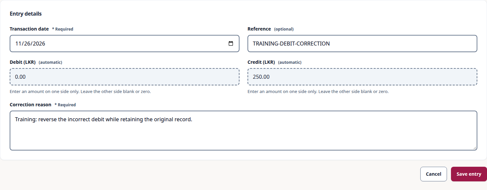

The account and opposite amount are fixed in this correction form. An original credit requires an equal debit; an original debit requires an equal credit. This action is a full linked reversal, not a partial amount replacement. If a replacement movement is required, record the authorized new entry separately after the correction.

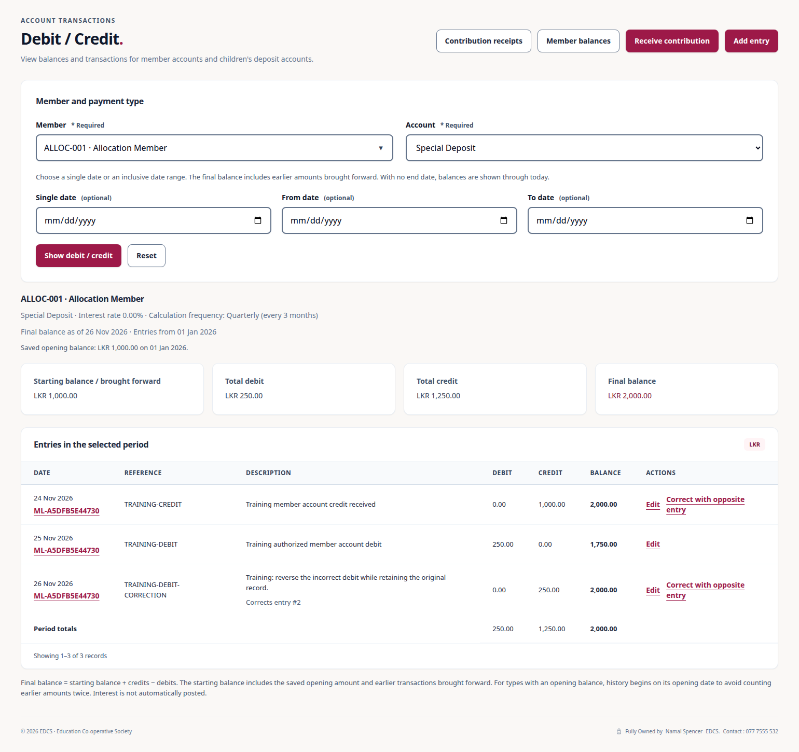

The original remains visible, and the correction identifies the entry it corrects. A particular entry cannot receive a second direct opposite correction. Amount/date/account fields on linked corrections remain protected. An available correction action still has to pass the account's validation. Fixed-deposit servicing or posted-interest rules can restrict an opposite posting. A receipt allocation remains read-only; where a separate opposite entry is permitted, it adjusts the statement without rewriting the original receipt allocation.

The worked child debit of LKR 50.00 is also corrected with a linked LKR 50.00 credit through the child correction route. Its balance returns to **LKR 300.00**, with both original and correction retained.

Where **Edit** is available on an ordinary eligible entry, open it to correct permitted details. The member and payment type remain fixed. Review allowed date/amount changes carefully, retain a useful reference/description and follow any applicable approval. Entries protected by a receipt, correction, transfer, posted interest or servicing history have additional restrictions.

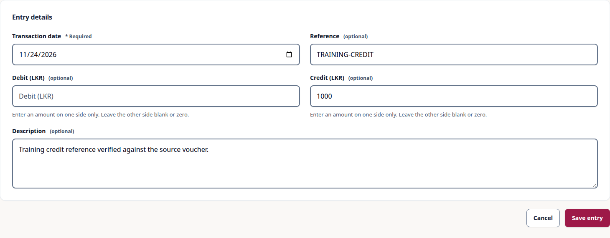

Edit permission does not override these protections. Receipt allocations cannot be edited or deleted independently, and changing one child account to another is not an allowed edit. Retained ledger references on statement rows help identify the original page, particularly after a member transfer.

## 6. Receive a contribution and allocate the remaining balance

Use **Receive contribution** for salary deductions or another payment to be distributed across the member's plan and any remaining accounts. The saved plan must contain positive usable categories and have an agreement date on or before the receipt date.

1. Choose **Receive contribution**.
2. Select the member and **Received on** date.
3. Enter the **actual amount received**, reference and description.
4. Select all plan categories or an applicable individual payment category.
5. Review the standard category allocations.
6. Allocate any remaining balance to the intended member or child accounts.
7. Choose **Preview allocation** and check that the allocation total exactly equals the amount received.
8. Choose **Save contribution**, or **Submit for approval** when a payment exception requires it.

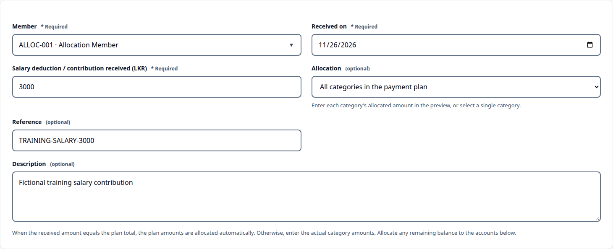

The training member's positive monthly plan totals **LKR 1,700.00**: Special Deposit 500.00, Fix Deposit 200.00, Pension 400.00, Funeral 100.00 and Scholarship 500.00. When the received amount matches the selected plan total, the plan amounts are allocated automatically. When it differs, enter/review the actual category allocations and any remainder.

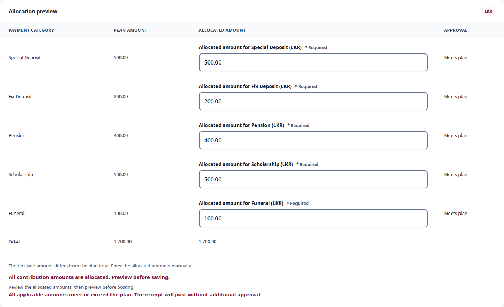

For this receipt, LKR 1,300.00 remains after the standard plan allocation. Under **Allocate remaining balance**, use **Add Another Account** for additional allocation rows. Choose the account/type and enter the allocated amount. For a child deposit type, also select the child's registered account.

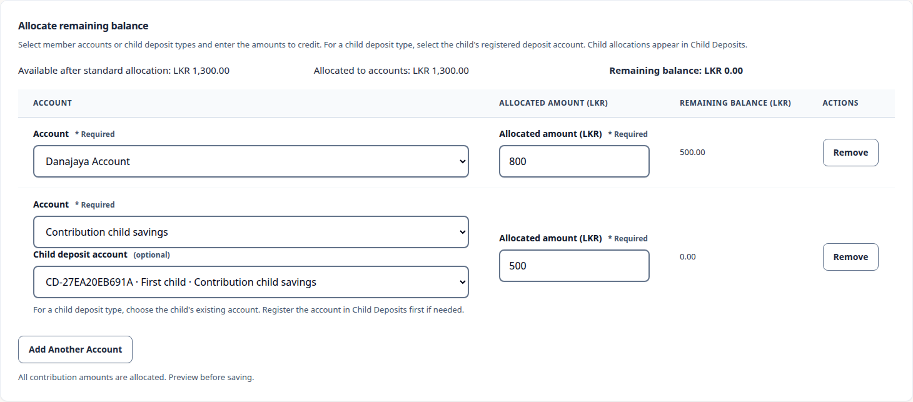

| Allocation                     | Amount (LKR) | Running remainder (LKR) |
| ------------------------------ | ------------ | ----------------------- |
| Standard plan categories       | 1,700.00     | 1,300.00                |
| Member Danajaya Account        | 800.00       | 500.00                  |
| Selected child deposit account | 500.00       | 0.00                    |
| Total received and allocated   | 3,000.00     | 0.00                    |

The training Danajaya Account is a member payment type. The child allocation uses the distinct child deposit type/account. Verify the target for every row. Remove or correct an unnecessary row before posting, and confirm the final remainder is zero. Do not create an additional manual credit for an allocation already included in this receipt.

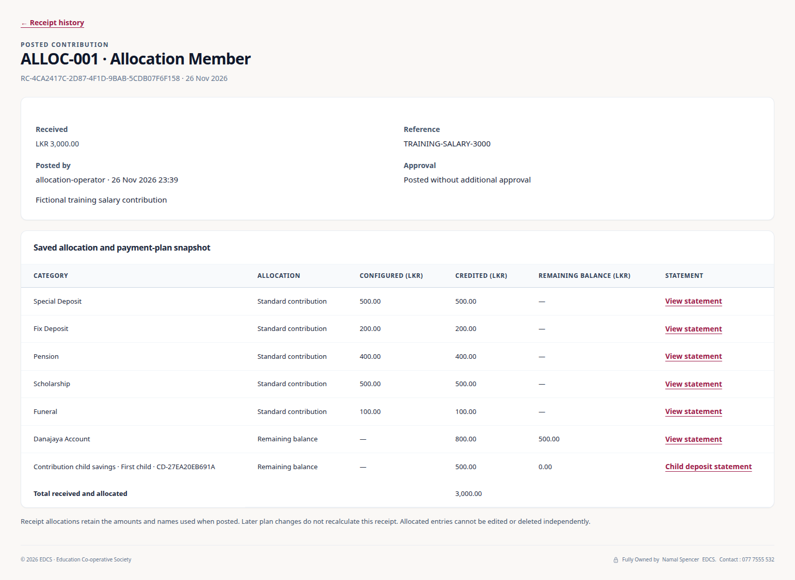

The receipt adds **LKR 2,500.00** to member deposits: LKR 1,700.00 standard plus LKR 800.00 remaining. It adds **LKR 500.00** to the child account. After the earlier corrections, member deposits rise from LKR 4,000.00 to **LKR 6,500.00**, and the selected child account rises from LKR 300.00 to **LKR 800.00**.

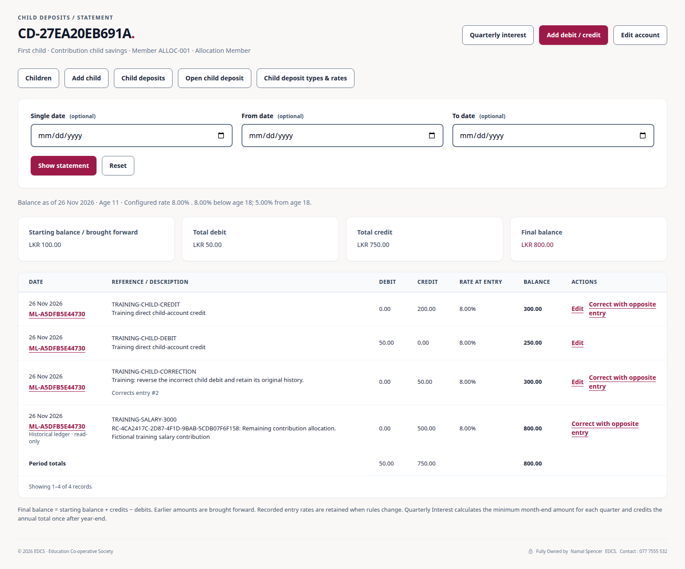

Preview is not posting. If the amount, plan, accounts or member ledger changes after preview, preview again before submitting. Check receipt history before retrying a submission. Duplicate-submit protection avoids creating the same receipt/credits again, but a genuinely separate payment still needs its own correct reference and supporting source record.

## 7. Submit and approve a below-plan payment

An ordinary user's below-plan credit or contribution requires **Payment exceptions** approval under the configured workflow. Missing required configuration blocks the submission rather than silently posting it. The system administrator chooses the actual levels and authorized reviewers.

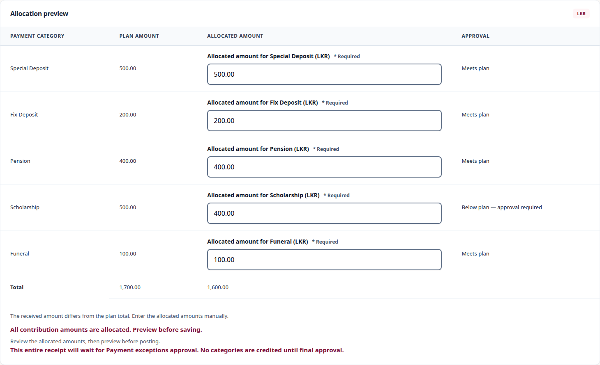

In this example, all categories meet their plan amounts except Scholarship: actual LKR 400.00 against LKR 500.00. The total is LKR 1,600.00. The requester chooses **Submit for approval** after reviewing the balanced allocation.

The **entire receipt** waits: categories that meet the plan do not receive partial credits while another category needs approval. Child allocations included in a pending exception receipt also wait with the receipt.

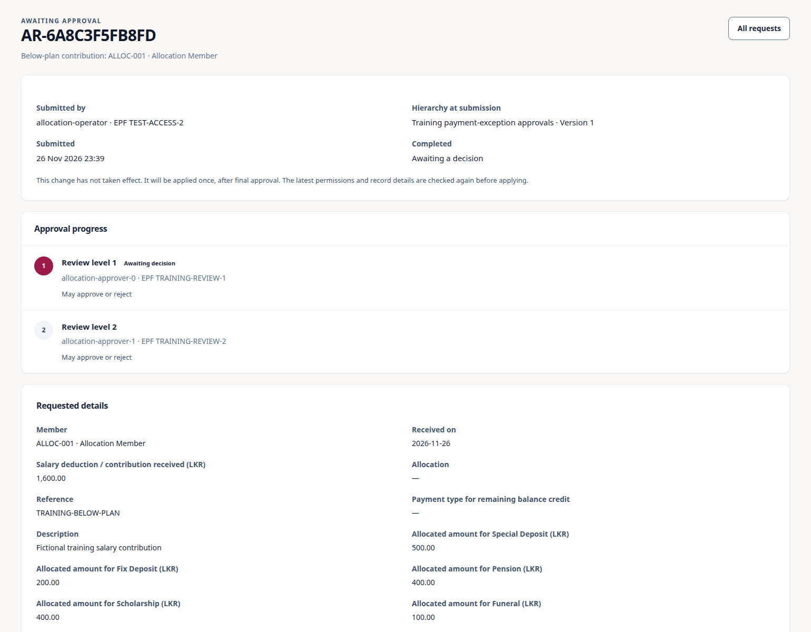

For a reviewer:

1. Open the request from **Approvals** or the available pending-request link.
2. Check the member, actual received amount, plan values, shortfall, target accounts and source reference.
3. Review the current approval level and available decision actions.
4. Record an authorized decision and meaningful reason.
5. If another level is required, follow the next-level status rather than treating the first approval as posting.

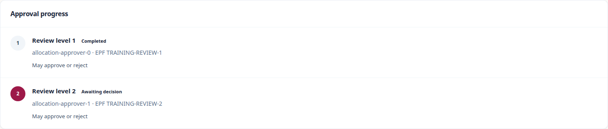

The fictional training hierarchy uses two authorized administrative reviewer accounts so both can inspect the financial request within the application's access rules. Real reviewer identities, access and level order are maintained by the system administrator. A person being named in a level does not itself grant unrestricted member/Lager access.

After successful final approval, the receipt posts with its saved allocation and approval reference. Rejected, cancelled, pending or failed-to-apply outcomes must not be treated as paid credits. A requester/reviewer should inspect both the final request outcome and the resulting receipt.

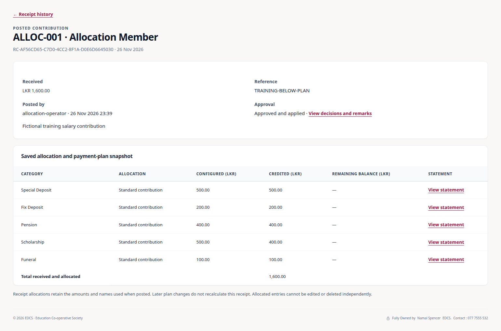

Before either approval, and after the first approval, the worked member balance remains LKR 6,500.00. After final approval and posting, the LKR 1,600.00 receipt increases member deposits to **LKR 8,100.00**. The child's balance stays LKR 800.00 because this second receipt has no child allocation.

Authorized system administrators can post directly under the system's rules. This does not remove the ordinary user's required exception checks. An ordinary requester cannot approve their own general payment-exception request.

## 8. Find contribution receipts and retained allocations

Choose **Contribution receipts** from Debit / Credit. Search by member number, member name or receipt reference, then choose **Search**. The posted receipt's date opens its detail page.

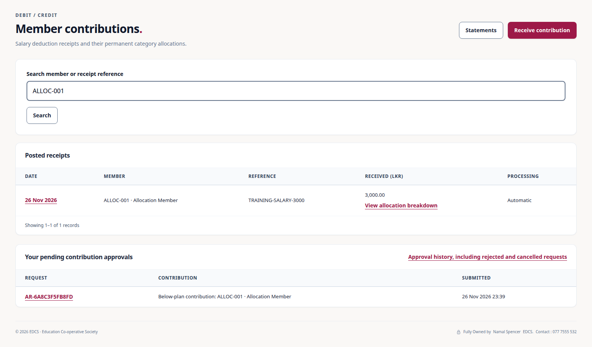

| Screen item                         | How to use it                                                               |
| ----------------------------------- | --------------------------------------------------------------------------- |
| Posted receipts                     | Review the financial date, member, reference, amount and processing status. |
| View allocation breakdown           | Expand the receipt row to see category/remaining allocations.               |
| Automatic                           | Posted without an exception approval request.                               |
| Approved exception                  | Posted after the associated payment-exception approval.                     |
| Your pending contribution approvals | Open available requests submitted by or assigned to the current user.       |
| Approval history link               | Review available rejected, cancelled and other request outcomes.            |

A receipt retains its payment-plan/category names and amounts as used when posted. A later plan or template edit does not recalculate the receipt. Standard and remaining allocations, child identity, posting actor and approval reference remain available on the receipt detail screen.

Receipt allocations cannot be edited or deleted independently. If a posted receipt is incorrect, retain the source evidence and follow the authorized accounting correction procedure. Where the application permits a linked opposite entry, it is a new adjustment: the statement balance changes while the receipt keeps its original received amount and allocation snapshot. Reconcile both records; do not edit the allocation or post duplicate money as a workaround.

## 9. Read balance reports and filter account history

From a member statement choose **Member balances** to open the member/payment-type balance report. It can include all accessible members and types or be filtered to a selected member/type and date selection. Choose **Show final balances** to apply the filters. Use **View statement** on a row to inspect that account with the same dates.

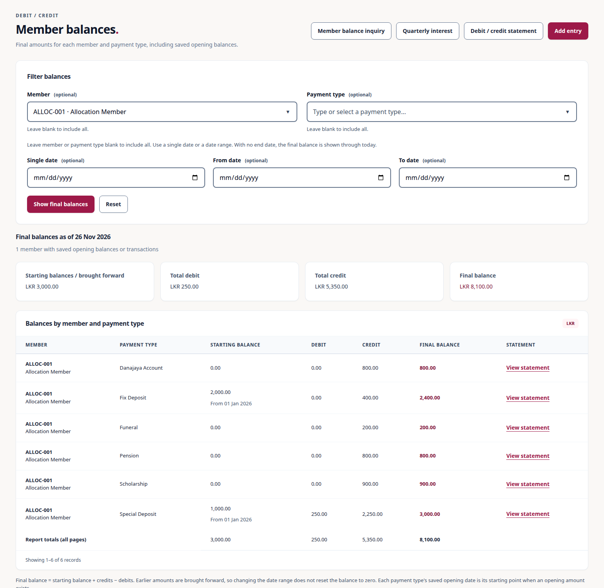

The report displays starting/brought-forward amounts, period debits, period credits and final balances. The totals cover all result pages. This report groups member payment accounts; it does not combine the child's savings into the member-deposit total. The **Member Balance** module provides a further member-level enquiry with separate child and loan positions.

On a statement, choose either:

1. **Single date**, leaving From/To blank; or
2. **From date** and/or **To date**, leaving Single date blank.

Choose **Show debit / credit**. Dates are inclusive. With no end date, balances run through today. Use **Reset** to clear the selection. Page controls retain the enquiry filters; the period totals and final balance are not limited to the currently visible page.

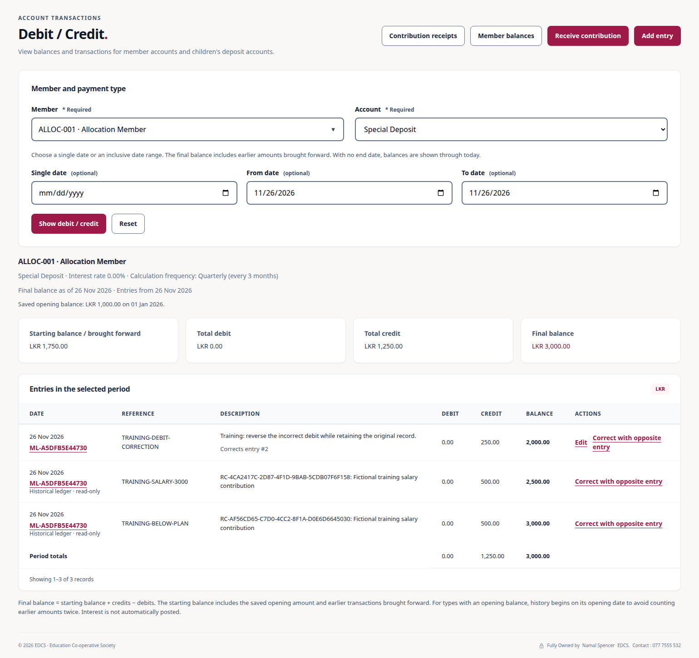

**Final balance = starting/brought forward + period credits − period debits.** Earlier movements are brought forward rather than erased by a new date range. When a saved opening amount exists, its opening date is the account's baseline; transactions represented by that opening are not added a second time.

In the one-day Special Deposit enquiry, the earlier balance brought forward is **LKR 1,750.00**. Today's LKR 250.00 opposite correction, LKR 500.00 standard receipt allocation and LKR 500.00 approved exception allocation add LKR 1,250.00, leaving **LKR 3,000.00**. This is one account's position within the member's LKR 8,100.00 total.

The statement shows the saved opening date/amount, period totals, running balance, final balance and original ledger references where available. An empty transaction period can still have a nonzero brought-forward/final balance. Use the selected account name and child identity to avoid comparing different funds.

## 10. Validation, protected records and completion checklist

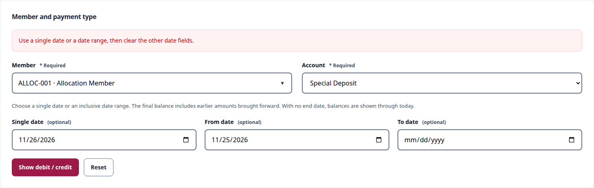

| Problem or message                                            | What to check                                                                                                                                                        |
| ------------------------------------------------------------- | -------------------------------------------------------------------------------------------------------------------------------------------------------------------- |
| Member/account is missing                                     | Module permission, active user/EPF, assigned Lager and branch/zonal-office access.                                                                                   |
| Member is awaiting activation                                 | Complete the required membership activation approval before financial posting.                                                                                       |
| Entry will not save                                           | Exactly one positive debit or credit, valid date, correct account and permitted amount precision.                                                                    |
| Both sides are filled, both zero or a negative amount is used | Correct the entry to one positive side; leave the other side blank or zero.                                                                                          |
| Child account is absent or rejected                           | Correct parent/member, actual child deposit type, matching registered account, active posting status and Child Deposits permission.                                  |
| Child amount did not increase the member total                | Expected: child funds are separate. Check the child statement/Child Deposits module.                                                                                 |
| Contribution cannot be previewed                              | Positive effective plan categories, receipt date, correct allocation rows and account eligibility.                                                                   |
| Remaining amount is not zero                                  | Standard plus all remaining allocations must equal the actual money received exactly.                                                                                |
| Preview became stale                                          | Recheck the member, plan, date and accounts, then preview again.                                                                                                     |
| Below-plan money is not in the balance                        | Inspect the entire exception request, all required levels and final posting outcome.                                                                                 |
| Reviewer cannot see a request                                 | Confirm level assignment and sufficient financial/member/Lager access; ask the administrator to correct the workflow/access setup.                                   |
| Original account cannot be changed in Edit                    | Saved member/type and child-account identity are protected. Use the authorized correction route.                                                                     |
| No correction action is available                             | Check whether an opposite correction already exists and whether interest or servicing rules restrict the action. Use the appropriate member or Child Deposits route. |
| Fix Deposit debit is rejected                                 | Request/release the withdrawal through Fix Deposit Loans & Withdrawals.                                                                                              |
| Delete is unavailable or rejected                             | Postings are retained. Use an eligible linked opposite correction, with a reason.                                                                                    |
| Date filter fails                                             | Use Single date or a range, not both. To must be on/after From; a future From needs a valid To.                                                                      |
| Interest is missing after entry                               | The rate/frequency display does not post interest. Check the separate interest workflow and posted entries.                                                          |

Before saving, confirm the member, account/child, financial date, debit-or-credit side, amount and source reference. Before posting a receipt, confirm the actual received amount, every allocation and zero remainder. After approval/posting, verify the statement, receipt and the correct member/child balance. Use **Member Ledgers**, **Approvals** and authorized **Audit Logs** to trace original references, saved changes and recorded actors.

Related manuals cover Payment Plan, Member Ledgers, Member Activation & Deactivation, and Master Data Adding. Screens and behaviour were reviewed as of 26 November 2026.
