# Financial Year-End Closing and Account Approval Guide

EDCS Member Management System

Prepared: 26 November 2026 · Time zone: Asia/Colombo · Current-system guide v1.0

This guide explains which module approves a member or child account's annual interest, how an administrator creates approval levels, and how the administrator approves a whole financial-year closing batch.

Screenshots show the current application, rendered from its actual views and templates with fictional training records in a separate temporary PostgreSQL database. Training approvals and postings were performed only in that database, which was removed afterward. Your live financial records, approval settings and scheduler were not changed. Screenshots are cropped for readability.

### Contents

1. Which approval module should you use?
2. Set up users and approval levels
3. Submit a member account for year-end approval
4. Submit a child deposit account for year-end approval
5. Review requests and understand the current access restriction
6. Approve the whole financial-year closing batch
7. Check each account's closing and next-year opening
8. Current-year and scheduled-posting rules
9. Troubleshooting and operating checklist
10. Verification and screen references
11. Per-account approval worksheet

## 1. Which approval module should you use?

**For approval levels on each account's annual interest posting, select Module = Quarterly Interest and Action = Edit existing records.** This same selection covers member Payment Types and child deposit accounts. The internal module name is `depositinterestyear`; the child account's record is separate, but its posting request uses the Quarterly Interest approval module.

**Administration → Financial year-end closing is a different path.** It lets an active system administrator approve one batch containing all established member and child accounts for the selected year. It does not send that batch through the configurable approval levels.

| What you want to approve                                                          | Module / screen                                  | Current behaviour                                                                                                                     |
| --------------------------------------------------------------------------------- | ------------------------------------------------ | ------------------------------------------------------------------------------------------------------------------------------------- |
| One member Payment Type's annual interest and carry-forward                       | Quarterly Interest → Review year-end posting     | A non-administrator's posting request follows the active Quarterly Interest / Edit hierarchy.                                         |
| One child's deposit account annual interest and carry-forward                     | Quarterly Interest, with Child Deposits selected | Uses the same Quarterly Interest / Edit hierarchy; each child account has its own request.                                            |
| All established accounts for a completed financial year                           | Administration → Financial year-end closing      | Direct system administrator approval, with a reason and confirmation checkbox. No approval-level queue.                               |
| Different approval levels for each Payment Type, child type or individual account | Not available as a hierarchy filter              | The current hierarchy is selected by module and action. One active Quarterly Interest / Edit hierarchy applies across those accounts. |

Do not choose **Child Deposits**, **Payment Types**, **Payment Plan** or **Payment exceptions** for annual interest approval. Child Deposits controls edits to child account records; Payment Types and Payment Plan control their own records; Payment exceptions controls below-plan contributions.

An explicit Quarterly Interest hierarchy takes priority over an **All modules — edits only** hierarchy. If neither matching hierarchy is active, an authorized ordinary user's annual posting can proceed without an approval queue. System administrators can post directly even when a hierarchy exists.

The current system also has two control limitations: ordinary designated approvers need current ledger ownership, and the installed scheduled interest processor can post outside the queue. Sections 5 and 8 explain the verified behaviour. Creating levels alone does not establish mandatory independent approval before every posting.

## 2. Set up users and approval levels

### 2.1 Prepare access

Sign in as a **system administrator**. A staff flag or an ordinary role is not sufficient to create approval hierarchies or approve the whole financial-year closing batch.

Open **Administration → Users & access**, edit the account officer, and review **Module permissions → Quarterly Interest**:

| Permission                           | When it is needed                                                                                                     |
| ------------------------------------ | --------------------------------------------------------------------------------------------------------------------- |
| View                                 | Read the Quarterly Interest report and saved account-year calculations.                                               |
| Add                                  | Use Calculate & save to save account-year calculations. Saving a calculation does not credit interest.                |
| Edit                                 | Open the posting review and request annual interest posting / carry-forward.                                          |
| Child Deposits → View, when relevant | Inspect the child's source account statement. The annual interest posting itself uses Quarterly Interest permissions. |

The account officer also needs an active user account, an EPF profile, the member's branch and zonal-office access, and the currently assigned member ledger. Permissions and ledger ownership are checked separately. Assigned approvers also need access to the request; see the current restriction in section 5 before planning a multi-person workflow.

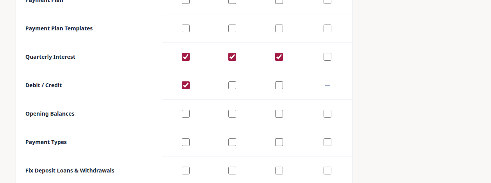

### 2.2 Create the hierarchy

1. Open **Administration → Approval hierarchies**.
2. Choose **Create hierarchy**.
3. Enter a descriptive name, for example **Quarterly Interest - Account year-end review**.
4. Select **Module: Quarterly Interest**.
5. Select **Action: Edit existing records**. Do not select Member transfer / below-plan payment.
6. Tick **Is active**.
7. Enter the mandatory **Reason for configuration**.

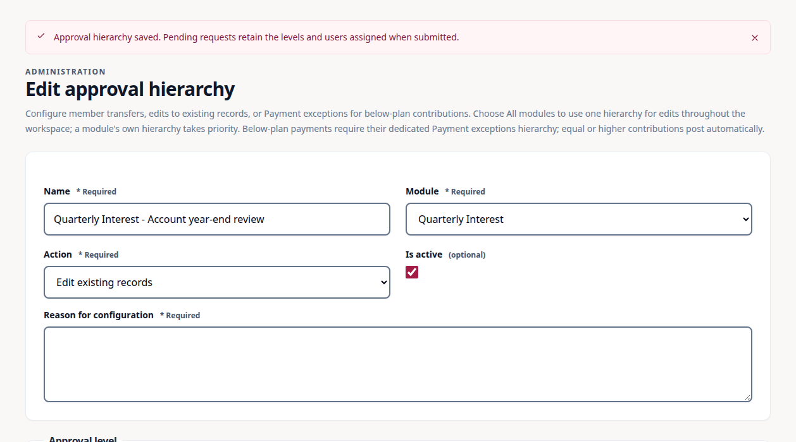

### 2.3 Add the levels

For the first level, enter **Approval order = 1**, **Level name = Finance review**, and select designated approvers. Choose **Add approval level** and enter **Approval order = 2**, **Level name = Final authorization**, with its designated approvers.

The names are examples, not built-in roles. Choose actual active users and verify their request access. One designated user can approve a level; selecting several users does not require all of them to approve. Levels run in order. Approval orders must be unique, each retained level needs designated approvers, and the form allows up to 20 levels. Tick **Assigned users may reject requests** where that level should have rejection rights.

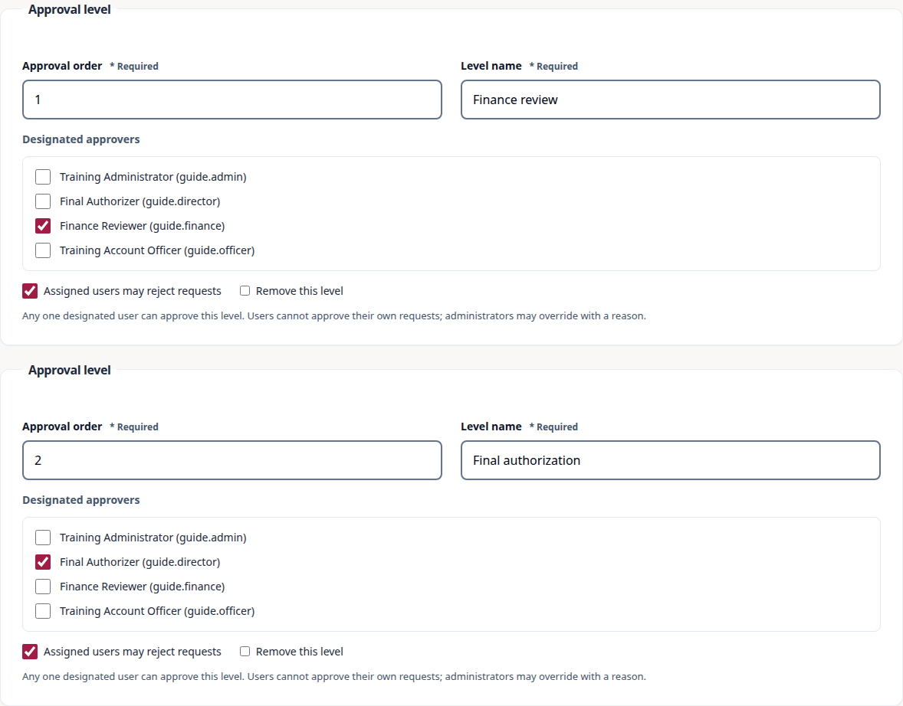

Choose **Save hierarchy**. Verify that the list shows **Quarterly Interest**, **Edit existing records**, the expected level names and **Active**. Only one active hierarchy may cover the same module and action. To change an existing one, edit it rather than create a second active duplicate.

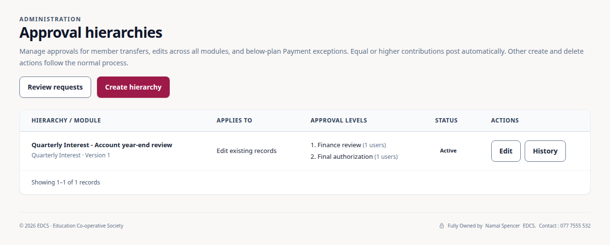

Changes to a hierarchy are audited. Pending requests keep the hierarchy version, level order and designated users captured when they were submitted; changing the hierarchy does not rewrite those pending requests.

## 3. Submit a member account for year-end approval

Use an **ordinary account officer** with the required access when you want a request to enter the hierarchy. An administrator's posting bypasses that queue.

1. Open **Quarterly Interest**.
2. Enter the **Financial year starting in**, for example **2025** for 1 January–31 December 2025 under the current January-start configuration.
3. Select **Accounts: Member Payment Types**, or use both account groups. Select the member and the member Payment Type where needed.
4. Choose **Show quarterly interest** and check the four quarters, applicable rate and annual total.
5. If the account-year calculation has not been saved, use **Calculate & save**. This saves the calculation; it does not post interest or create a year-end approval request.
6. Open the saved account-year and choose **Review year-end posting**.

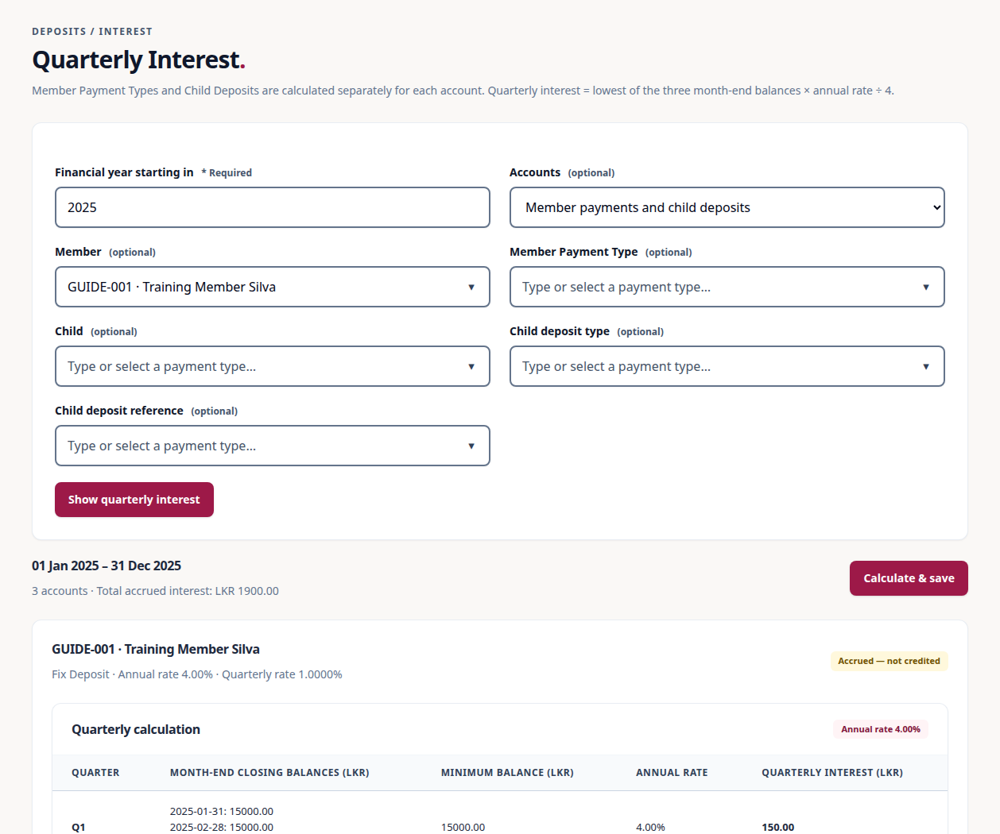

On the posting review, reconcile the **Year opening balance**, **Credits before annual interest**, **Debits during the year**, **Balance before annual interest**, **Annual interest**, and **Balance after annual interest**. The year must have ended before the posting button is available.

Choose **Post annual interest & carry forward**. With the active Quarterly Interest / Edit hierarchy and a non-administrator requester, the system creates a request in **Approvals** and redirects to its details. The button retains its posting label even when the next step is the approval queue.

Before final approval, this request has not credited the account. Record the displayed approval reference, then check **Approvals → Awaiting approval**. Do not infer that the interest has been posted merely because a saved calculation or request exists.

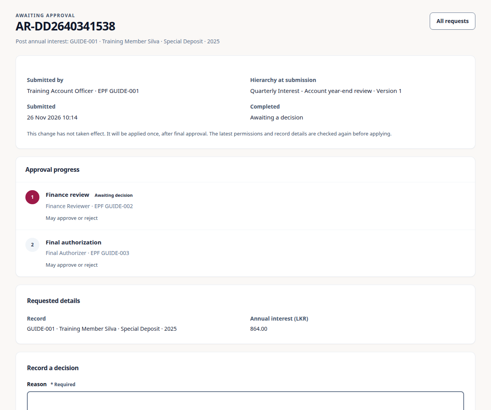

Each member/payment-type/year is a separate account-year. Request the year-end posting separately for every account you want reviewed through this path.

## 4. Submit a child deposit account for year-end approval

Use **Quarterly Interest**, not the Child Deposits approval module, for this annual interest operation.

1. Select **Accounts: Child Deposits**.
2. Select the member and, where useful, the child, child deposit type or **Child deposit reference**.
3. Choose **Show quarterly interest**. Use **Calculate & save** if that child account-year is not saved.
4. Open the child account-year and choose **Review year-end posting**.
5. Review the child's account reference, year, quarterly calculations, annual interest and final balance. Child interest uses its own account balance and age-dependent rate rules, including the system's transition-quarter exclusion.
6. Choose **Post annual interest & carry forward** as an authorized ordinary account officer.

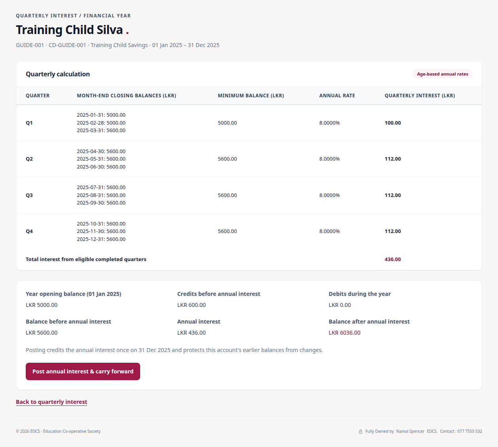

The resulting request uses **Quarterly Interest / Edit existing records**, exactly like a member account request. There is no second child-interest hierarchy to create. After posting, the credit appears in the child deposit ledger and carries into that child's next-year opening, without increasing the parent's separate member-account balance.

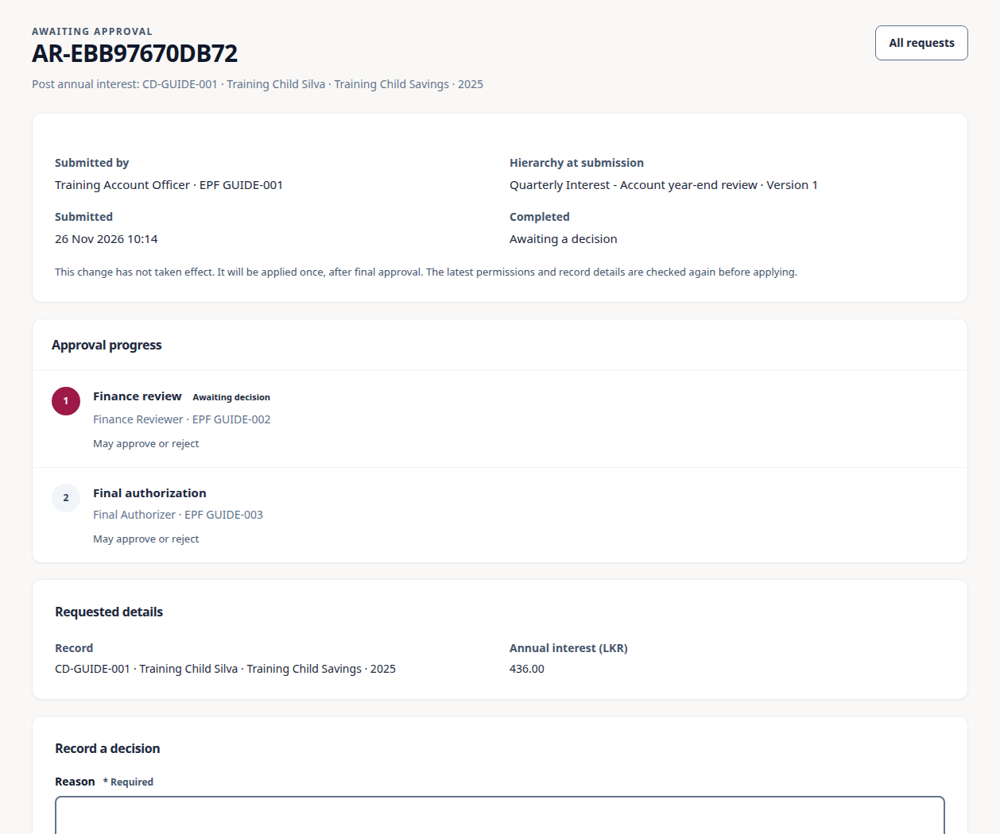

## 5. Review requests and understand the current access restriction

### 5.1 Decision screens and sequence

Open **Approvals**, then the request reference. Check the requester, account, annual interest, submitted hierarchy version, current level, requested details and audit trail.

An authorized current-level user can choose **Approve this level**. If another level remains, the request moves to it and the account is still unposted by this request. A permitted **Reject request** ends the request without applying it. Rejection needs a reason; a requester can cancel their pending request. Ordinary users cannot approve their own requests.

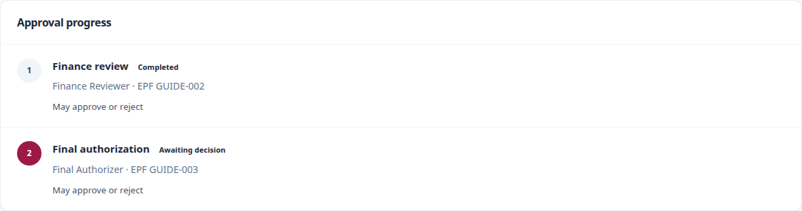

An administrator also has **Approve all remaining levels**. This is an administrator override, requires a reason, and is recorded in the audit trail. It must not be presented as independent approval by every named reviewer. Every administrator decision requires a reason.

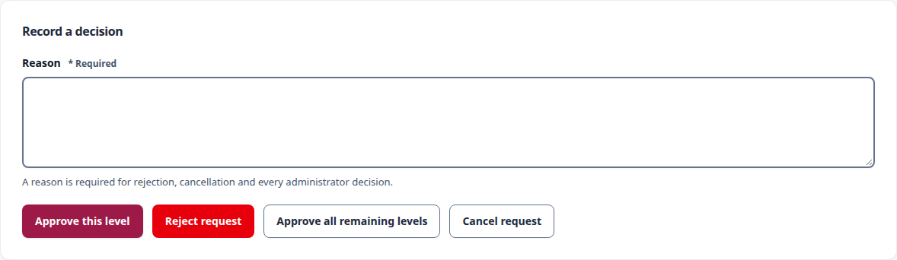

At final approval, the application rechecks the original requester's permissions, access and reviewed record/calculation before applying the operation. If validation fails, the request can become **Failed to apply** rather than post the account. When it succeeds, the request becomes approved and offers **Continue in module**.

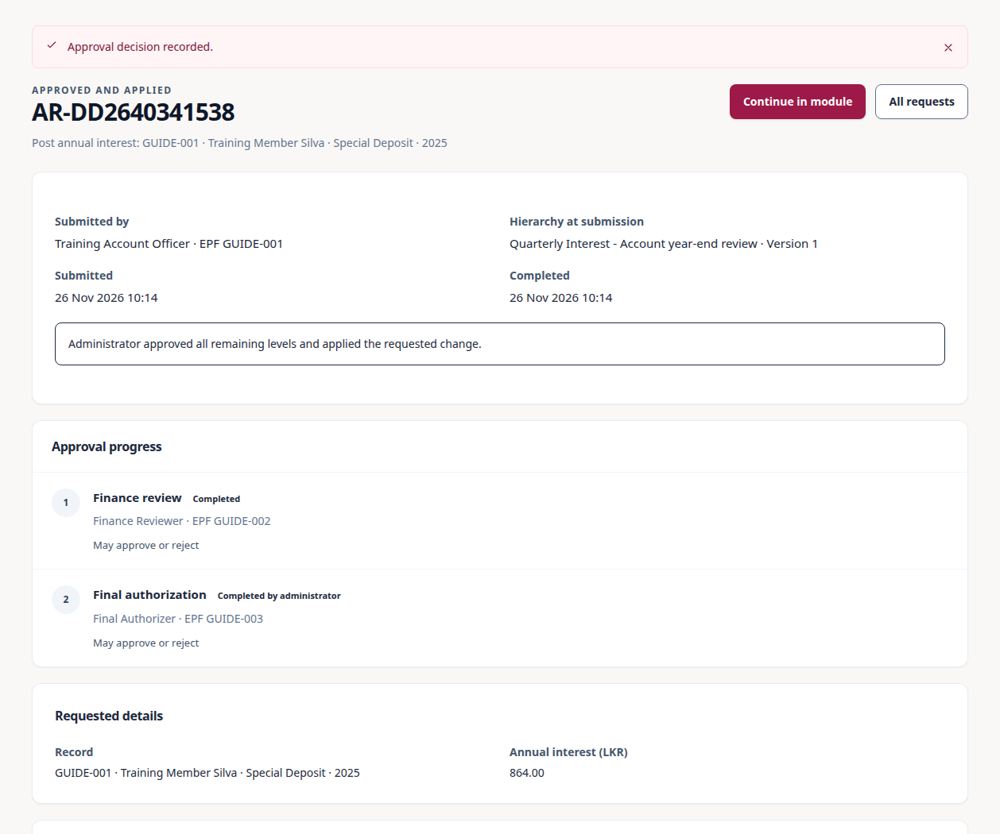

The posted account-year shows the posting date, final closing and next-year opening. Interest is credited once on the financial year-end date. Original opening amounts and existing movements are preserved.

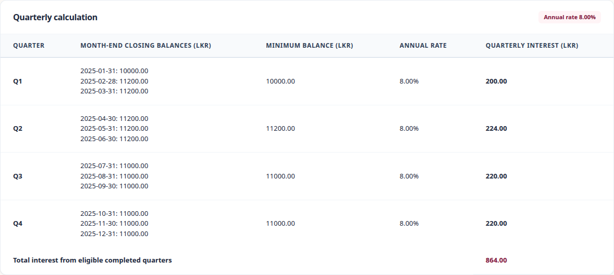

### 5.2 Verified restriction for different ordinary approvers

**Selecting a person as a designated approver does not by itself grant access to the member's request.** Current request visibility also requires the member's current ledger ownership/access. In the current model, a ledger has one maintenance officer; the ordinary requester must have that ledger access to submit and later apply the posting. A different ordinary designated approver does not acquire the same ownership simply by being selected in a level.

This was checked in the temporary training database: the Finance Reviewer was active, selected in level 1, given Quarterly Interest permissions and branch/zonal-office assignments, but was not the member ledger's current maintenance officer. The reviewer could not see or approve the request. The requester, who owned the ledger, could not approve their own request.

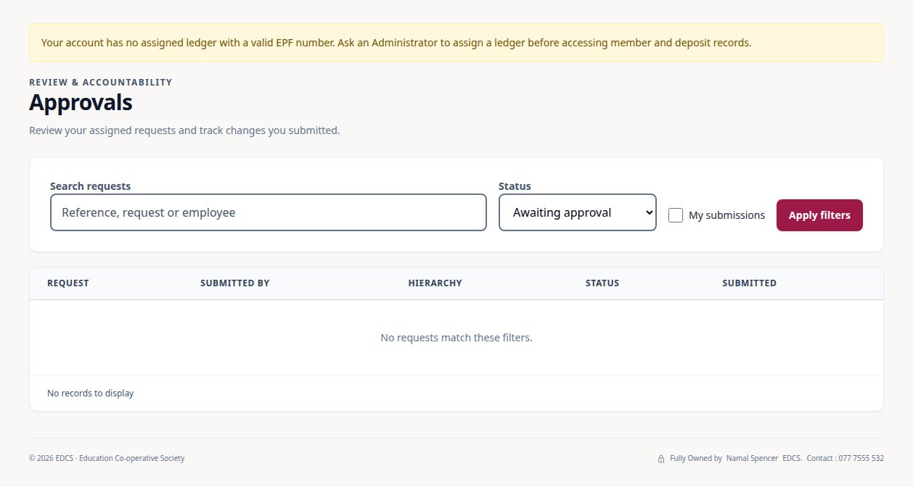

Therefore this guide does not claim that two different ordinary reviewers can complete this member-account workflow solely by configuring two levels. An administrator can currently review and approve/override such requests. If the required policy is independent finance-reviewer and director authorization, approval-specific read/decision access needs an application change and verification. Do not reassign ledger ownership or grant administrator status merely to make the example levels work.

## 6. Approve the whole financial-year closing batch

This is the **administrator batch path**, separate from the individual request hierarchy.

1. Sign in as an active system administrator.
2. Open **Administration → Year-end closing**. The page title is **Financial year-end closing**.
3. Enter the financial-year start year and choose **Preview financial year**.
4. Review every established member and child account, its opening, annual interest, final closing, next-year opening and status. Inactive and zero-interest accounts can also be part of the review.
5. Confirm that each account's final closing equals its next-year opening. Investigate missing years or mismatched prior carries before proceeding.

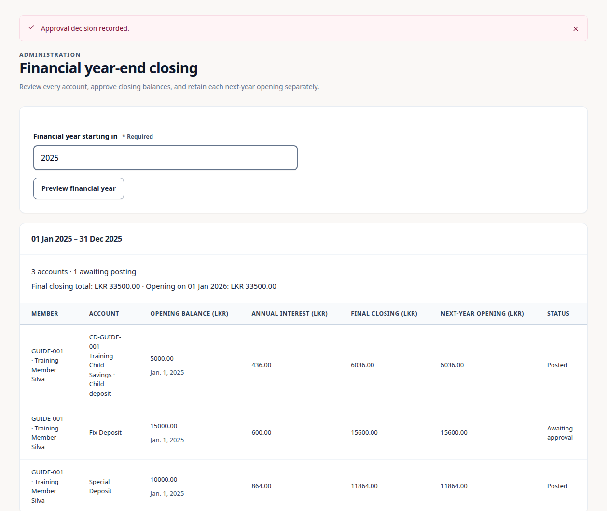

**Awaiting approval** in the batch table means that account-year has not been posted. It does not prove that an Approval request has been submitted. Check the Approvals module and request reference separately when using the individual-request path.

For a completed year with established accounts, enter the **Administrator approval reason**, tick **I have reviewed and approve this year-end closing and balance carry-forward**, then choose **Approve & close financial year**.

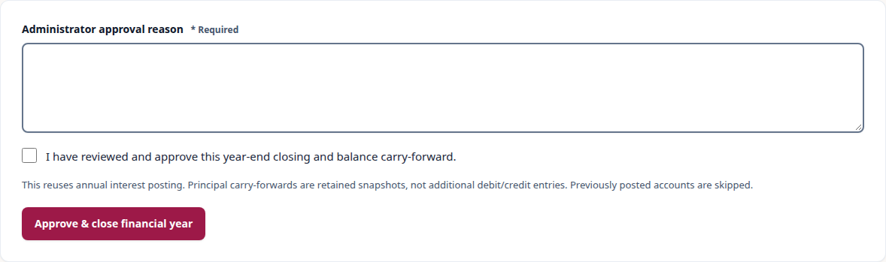

This posts outstanding account-year interest through the existing posting services and saves an immutable administrator-approved batch. Previously posted accounts are retained and skipped for new interest posting. The batch records all reviewed accounts, the administrator, timestamp, reason, totals and equal closing/next-opening amounts.

The batch operation does not wait for the configurable approval levels and is not held by pending individual requests. It is an alternative administrator authorization route. A pending individual request may later fail validation if its account was already posted through another path; review its current state rather than assuming its queue still controls the account.

Open **Approved closing history → View balances** to obtain the retained per-account approval evidence. In the training example, three accounts are reconciled and only one is newly posted because two were already posted earlier.

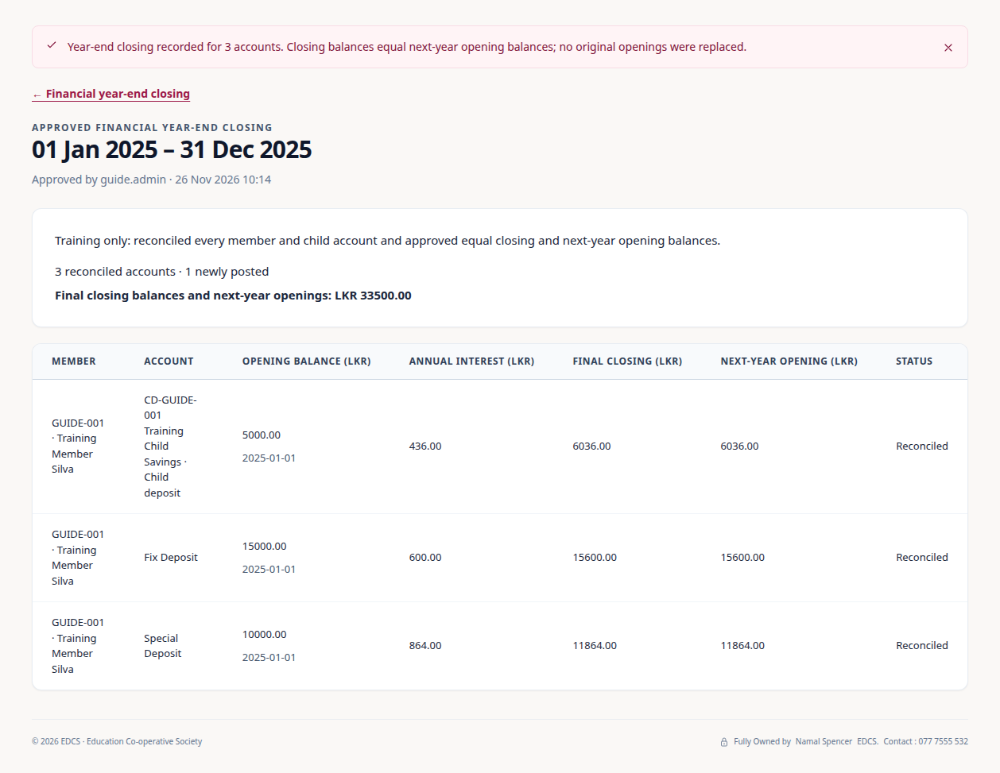

The current screen has no separate per-account approval PDF/export button. This guide documents the screens and evidence that already exist. The batch's View balances page and each account's posted year-end details are the current records to consult or print through the browser.

## 7. Check each account's closing and next-year opening

Use these reconciliation rules for each member Payment Type and each child deposit account:

1. **Balance before annual interest = year opening + credits during the year − debits during the year.** Earlier amounts are brought forward; accounts imported or opened during the year retain their actual effective opening date.
2. **Final closing = balance before annual interest + annual interest.**
3. **Next-year opening = final closing.** Principal is carried as a balance, not inserted as a second credit.

The screenshot example was calculated by the current services for 1 January–31 December 2025:

| Account                    | Year opening (LKR) | Annual interest (LKR) | Final closing / next opening (LKR) |
| -------------------------- | ------------------ | --------------------- | ---------------------------------- |
| Special Deposit            | 10,000.00          | 864.00                | 11,864.00                          |
| Fix Deposit                | 15,000.00          | 600.00                | 15,600.00                          |
| Child account CD-GUIDE-001 | 5,000.00           | 436.00                | 6,036.00                           |
| All three accounts         | 30,000.00          | 1,900.00              | 33,500.00                          |

Special Deposit received LKR 1,200 and had LKR 200 debited: 10,000 + 1,200 − 200 + 864 = 11,864. The child account received LKR 600: 5,000 + 600 + 436 = 6,036. Fix Deposit had no principal movements: 15,000 + 600 = 15,600. Each final amount is also the opening on 1 January 2026.

The annual interest figures are sums of the completed quarterly calculations, not simply the final balance multiplied by the annual rate. The configured member pension-quarter and child rate-transition exclusions still apply.

Keep these references with a real closing review: member number; Payment Type or child deposit reference; financial-year start/end; effective opening and source statement; annual interest and calculation review; individual approval reference when used; final posting reference; batch View balances record when used; and the relevant audit trail.

## 8. Current-year and scheduled-posting rules

### 8.1 Current financial-year dates

The reviewed configuration starts the financial year in **January**. On **26 November 2026**, financial year 2026 is still open. It runs from **1 January 2026 to 31 December 2026**; year-end posting/closing is available only after it ends, from **1 January 2027**. Current-year values are previews through today.

The guide uses the completed **2025** year so the current application can demonstrate its actual approval and closing buttons without advancing the clock or changing live records. If the configured financial-year start month is changed, use the dates the application displays rather than assuming a calendar year.

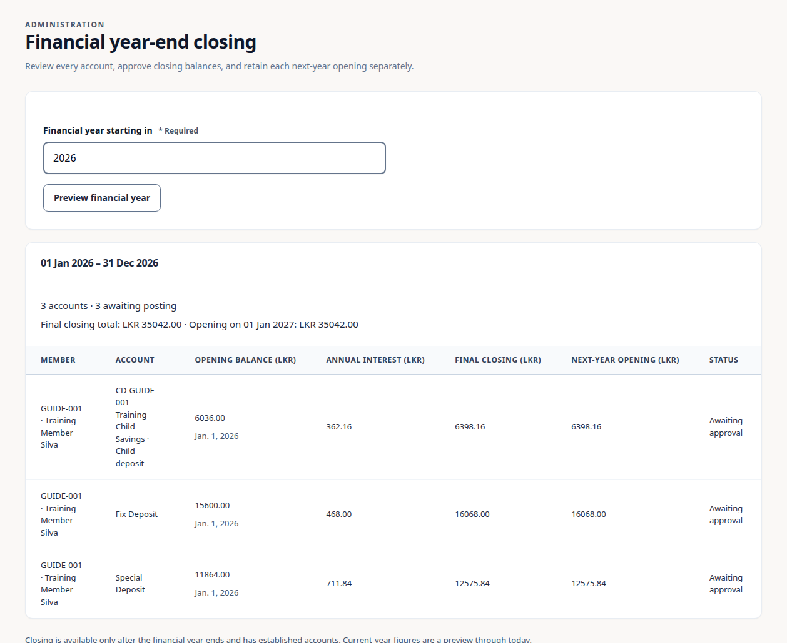

### 8.2 Scheduled interest posting is outside the approval queue

The host's current schedule was checked on 26 November 2026. The application's marked cron entry is installed and invokes **process_deposit_interest --post-ended**. The provided installer schedules it at minute 15 of each hour; actual execution is subject to the host scheduler and its configured time zone.

The command calls the member and child interest-posting services directly for eligible ended years. It does not submit Approval requests or wait for Quarterly Interest levels. It also does not create an administrator-approved FinancialYearClosing batch by itself. An account may therefore already be posted while the batch history has no corresponding administrator review.

Before relying on a policy that requires named reviewers to approve every account before posting, the owner must decide how this scheduled posting and the administrator bypass should work. Configuration of approval levels alone cannot enforce that policy in the current system. This documentation task did not disable or modify the schedule.

## 9. Troubleshooting and operating checklist

| Problem or message                                             | What to check                                                                                                                                                                                       |
| -------------------------------------------------------------- | --------------------------------------------------------------------------------------------------------------------------------------------------------------------------------------------------- |
| No year-end posting / closing button                           | Confirm the financial year has ended. A batch also needs established accounts. A posted individual account has no second posting action.                                                            |
| No saved account to review                                     | Use Quarterly Interest → Show quarterly interest, then Calculate & save with Add permission. Saving alone does not credit the account.                                                              |
| Posting skips the approval queue                               | Check whether the user is a system administrator, whether a matching active Quarterly Interest / Edit or All modules / Edit hierarchy exists, and whether the scheduler already posted the account. |
| Configured reviewer cannot find the request                    | Verify active status, designation and current ledger access. The verified ordinary-reviewer restriction in section 5 is not solved by checking more module permissions alone.                       |
| Child interest is using the wrong hierarchy                    | Select Quarterly Interest / Edit. Child Deposits is for child-account record edits, not the annual interest posting request.                                                                        |
| Hierarchy cannot be saved                                      | Enter the configuration reason, unique level orders and designated active users. Edit or deactivate an existing active policy for the same module/action.                                           |
| Request shows Failed to apply                                  | Recheck the requester's current access, reviewed account/rate/calculation and whether another path posted it. Review the result and audit trail before submitting a new request.                    |
| Carry-forward cannot skip a year                               | Close missing intervening account-years in order; reconcile the previous final closing against the next year's opening.                                                                             |
| Accounts or calculations changed after review                  | Refresh the relevant review and check its current figures before approving. The system rejects stale calculation hashes.                                                                            |
| Batch says Awaiting approval but no Approvals reference exists | The batch label means unposted. Submit an individual posting request if using that workflow, or use direct administrator batch approval if that is the authorized path.                             |
| Original opening amount appears unchanged after closing        | This is expected. The system preserves the imported/manual opening and carries balances through the existing journal and year snapshots. Do not add the final principal as another credit.          |

Before an actual close, verify the year and configuration, source statements and openings, member and child account coverage, interest rates/exclusions, access and intended approval path. Review pending requests and the automatic processor's role. After approval, confirm the posted account-year, equal final closing / next opening, batch history when used, and audit evidence.

## 10. Verification and screen references

The captures exercised the current user-permission screen, hierarchy creation/edit/list, member and child posting review, request submission, administrator level approval, administrator override, batch approval/history, and current-year preview. The synthetic ordinary designated reviewer's access was checked separately and found insufficient under current single-ledger ownership. The normal application database was not used for training records.

| Screen / operation             | Current module or route                                                 |
| ------------------------------ | ----------------------------------------------------------------------- |
| Configure hierarchy and levels | Administration → Approval hierarchies; /approval-hierarchies/           |
| Member and child calculations  | Quarterly Interest; /deposit-interest/                                  |
| Member posting review          | /deposit-interest/[account-year ID]/post/                               |
| Child posting review           | /deposit-interest/children/[account-year ID]/post/                      |
| Review a queued request        | Approvals; /approvals/[request ID]/                                     |
| Whole financial-year batch     | Administration → Year-end closing; /year-end-closing/                   |
| Retained batch evidence        | Approved closing history → View balances; /year-end-closing/[batch ID]/ |
| Business audit evidence        | Administration → Audit Logs                                             |

The source files used to verify this guide are members/approval_forms.py, approval_scope.py, approval_services.py, approval_views.py, interest_views.py, permissions.py, year_end_views.py, year_end_services.py, year_end_models.py and management/commands/process_deposit_interest.py, with the corresponding current templates. Machine-readable capture checks and screenshot source references are included in year_end_approval_assets/capture-evidence.json.

The guide explains the current implementation; it does not add a new approval module, change permissions or promise mandatory multi-person approval where the current access and scheduled-posting paths do not enforce it.

## 11. Per-account approval worksheet

Copy this worksheet for each member Payment Type or child deposit account you are documenting. Fill the editable Word version using the actual system records. This is a filing aid, not a new application screen or an approval action. A completed worksheet does not change the account or substitute for a recorded system decision.

| Record field | Enter the verified details |
| --- | --- |
| Member number and name | \_\_\_\_\_\_\_\_\_\_\_\_\_\_\_\_\_\_\_\_\_\_\_\_\_\_\_\_\_\_\_\_\_\_\_\_\_\_\_\_\_\_\_\_\_\_ |
| Account group | Member Payment Type / Child deposit account |
| Payment Type or child deposit type | \_\_\_\_\_\_\_\_\_\_\_\_\_\_\_\_\_\_\_\_\_\_\_\_\_\_\_\_\_\_\_\_\_\_\_\_\_\_\_\_\_\_\_\_\_\_ |
| Child name and deposit reference, if applicable | \_\_\_\_\_\_\_\_\_\_\_\_\_\_\_\_\_\_\_\_\_\_\_\_\_\_\_\_\_\_\_\_\_\_\_\_\_\_\_\_\_\_\_\_\_\_ |
| Financial-year start and end | \_\_\_\_\_\_\_\_\_\_\_\_\_\_\_\_\_\_\_\_\_\_\_\_\_\_\_\_\_\_\_\_\_\_\_\_\_\_\_\_\_\_\_\_\_\_ |
| Effective opening date and opening amount | \_\_\_\_\_\_\_\_\_\_\_\_\_\_\_\_\_\_\_\_\_\_\_\_\_\_\_\_\_\_\_\_\_\_\_\_\_\_\_\_\_\_\_\_\_\_ |
| Credits before annual interest | LKR \_\_\_\_\_\_\_\_\_\_\_\_\_\_\_\_\_\_\_\_\_\_\_\_\_\_\_\_\_\_\_\_\_\_\_\_\_\_\_\_\_ |
| Debits during the year | LKR \_\_\_\_\_\_\_\_\_\_\_\_\_\_\_\_\_\_\_\_\_\_\_\_\_\_\_\_\_\_\_\_\_\_\_\_\_\_\_\_\_ |
| Balance before annual interest | Opening + credits − debits = LKR \_\_\_\_\_\_\_\_\_\_\_\_\_\_\_\_ |
| Approved annual interest | LKR \_\_\_\_\_\_\_\_\_\_\_\_\_\_\_\_\_\_\_\_\_\_\_\_\_\_\_\_\_\_\_\_\_\_\_\_\_\_\_\_\_ |
| Final closing / next-year opening | Closing LKR \_\_\_\_\_\_\_\_\_\_ ; next opening LKR \_\_\_\_\_\_\_\_\_\_ |
| Next financial-year opening date | \_\_\_\_\_\_\_\_\_\_\_\_\_\_\_\_\_\_\_\_\_\_\_\_\_\_\_\_\_\_\_\_\_\_\_\_\_\_\_\_\_\_\_\_\_\_ |
| Approval path used | Individual Quarterly Interest request / Administrator batch |
| Individual approval reference and final status | \_\_\_\_\_\_\_\_\_\_\_\_\_\_\_\_\_\_\_\_\_\_\_\_\_\_\_\_\_\_\_\_\_\_\_\_\_\_\_\_\_\_\_\_\_\_ |
| Level 1 reviewer, decision and date/time | \_\_\_\_\_\_\_\_\_\_\_\_\_\_\_\_\_\_\_\_\_\_\_\_\_\_\_\_\_\_\_\_\_\_\_\_\_\_\_\_\_\_\_\_\_\_ |
| Level 2 reviewer, decision and date/time | \_\_\_\_\_\_\_\_\_\_\_\_\_\_\_\_\_\_\_\_\_\_\_\_\_\_\_\_\_\_\_\_\_\_\_\_\_\_\_\_\_\_\_\_\_\_ |
| Additional levels, where configured | \_\_\_\_\_\_\_\_\_\_\_\_\_\_\_\_\_\_\_\_\_\_\_\_\_\_\_\_\_\_\_\_\_\_\_\_\_\_\_\_\_\_\_\_\_\_ |
| Administrator decision or override and reason | \_\_\_\_\_\_\_\_\_\_\_\_\_\_\_\_\_\_\_\_\_\_\_\_\_\_\_\_\_\_\_\_\_\_\_\_\_\_\_\_\_\_\_\_\_\_ |
| Batch View balances reference, administrator and date/time | \_\_\_\_\_\_\_\_\_\_\_\_\_\_\_\_\_\_\_\_\_\_\_\_\_\_\_\_\_\_\_\_\_\_\_\_\_\_\_\_\_\_\_\_\_\_ |
| Posted account-year / ledger transaction reference | \_\_\_\_\_\_\_\_\_\_\_\_\_\_\_\_\_\_\_\_\_\_\_\_\_\_\_\_\_\_\_\_\_\_\_\_\_\_\_\_\_\_\_\_\_\_ |
| Source statement and audit references | \_\_\_\_\_\_\_\_\_\_\_\_\_\_\_\_\_\_\_\_\_\_\_\_\_\_\_\_\_\_\_\_\_\_\_\_\_\_\_\_\_\_\_\_\_\_ |
| Prepared by and date | \_\_\_\_\_\_\_\_\_\_\_\_\_\_\_\_\_\_\_\_\_\_\_\_\_\_\_\_\_\_\_\_\_\_\_\_\_\_\_\_\_\_\_\_\_\_ |

Record who actually made each decision. Do not enter a designated reviewer's name as the approver when the audit shows an administrator override. For a zero-interest account, record zero interest and the retained account-year/batch reference rather than inventing a credit transaction.
