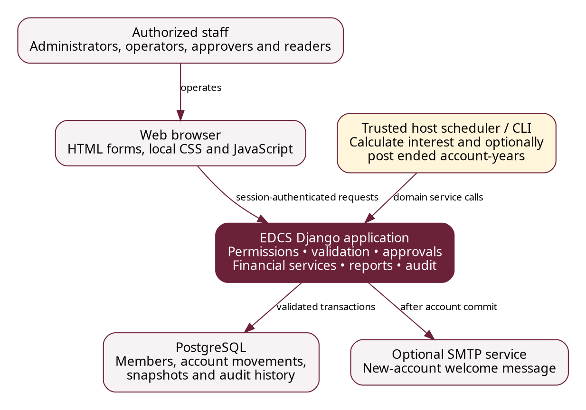
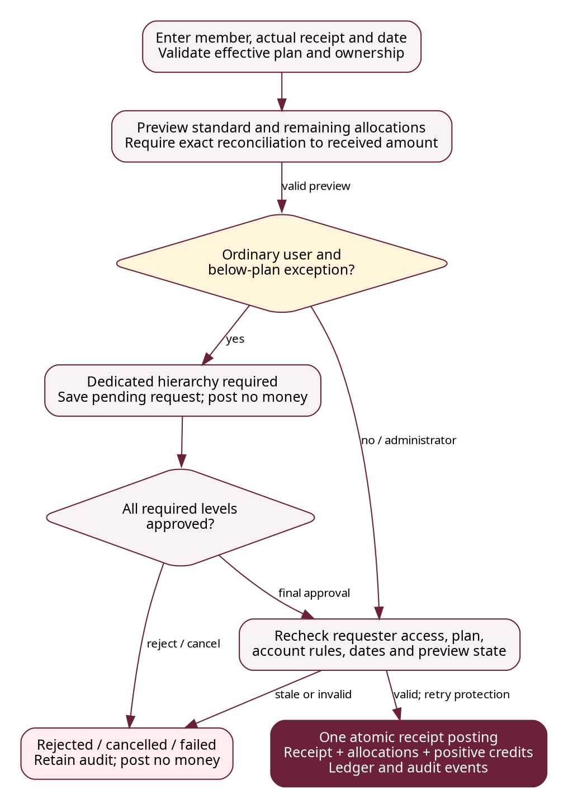

# EDCS Software Requirements Specification

EDCS Member Management System

Detailed business and function level specification

Document identifier: EDCS-SRS-002  
Version: 1.0  
Prepared: 22 November 2026  
Status: Draft for business review  
Baseline: Current workspace source, including migrations through 0032

This specification defines the member administration and financial record functions of the EDCS application. It describes what each function accepts, validates, changes and returns, including access boundaries, approvals, financial calculations, permanent history and failure handling. It supports business review, implementation maintenance and acceptance testing.

### Contents

1. Document control and conventions
2. Product scope and system context
3. Actors and authorization model
4. Shared business and accounting rules
5. Authentication and administration functions
6. Master data functions
7. Member management functions
8. Payment plans and opening balances
9. Member debit and credit functions
10. Contribution receipt and allocation functions
11. Children and child deposit functions
12. Fix Deposit loans and withdrawals
13. Quarterly interest functions
14. Permanent ledgers and member transfers
15. Approval workflow functions
16. Audit and reporting functions
17. Financial year closing and scheduled processing
18. Interfaces and nonfunctional requirements
19. Acceptance and requirements traceability
20. Assumptions and decisions requiring confirmation
21. Data dictionary
22. Application route inventory
23. Implementation function index

## 1. Document control and conventions

### 1.1 Purpose and audience

The intended readers are EDCS business owners, branch and zonal officers, ledger maintenance officers, administrators, software developers and quality assurance staff. The application is a staff-operated membership and financial records system. Member and child information are business records; they are not automatically login accounts.

The functional baseline is the supplied Django workspace as it exists on the preparation date, including local modifications. The specification does not substitute an older Git revision for these files. Existing local changes are outside the documentation change scope.

### 1.2 Requirement interpretation

Requirements identified as FR describe behavior implemented or explicitly enforced in the reviewed application. The word **shall** expresses that baseline as a requirement for future maintenance. Every function specification identifies its inputs or trigger, processing and validation rules, result or failure behavior, and a testable acceptance condition. Shared rules apply even where a function does not repeat them.

Requirements identified as NFR describe current technical controls unless marked **proposed acceptance target**. Proposed targets require stakeholder agreement and measurement; they are not claims of demonstrated capacity, availability or certification. Items identified as DEC are business or operational decisions requiring confirmation.

Priority is **Must** for all FR requirements and current-control NFR requirements. Proposed targets remain unapproved. An acceptance example defines observable expected behavior; it does not assert that the example was executed when preparing this document.

### 1.3 Evidence and change control

The primary evidence is the models, forms, permissions, services, views, URL configuration, browser scripts, management commands and existing tests. README explanations supplement the code. Where older descriptions conflict with current forms or services, the current code governs this baseline. For example, computer number, title and date of birth are required on current member forms despite older optional-field descriptions.

Business rule changes shall identify affected requirement IDs, validation rules, migrations, permission effects, posted-history protections and regression scenarios before approval. The business owner approves policy; the technical owner approves implementation; finance representatives approve accounting and interest examples. No approvals have been assumed for this draft.

### 1.4 Terms

| Term             | Meaning                                                                                                                                              |
| ---------------- | ---------------------------------------------------------------------------------------------------------------------------------------------------- |
| Branch           | Current visible label for a District record. Existing model names and `/districts/` URLs remain.                                                     |
| Zonal office     | An OfficeLocation belonging to a branch.                                                                                                             |
| Department       | The School model, representing the member's department or school.                                                                                    |
| Lager            | A ledger master under a zonal office, grouping members and identifying the assigned maintenance user. The existing application spelling is retained. |
| EPF              | Employee identifier stored in a unique ledger officer profile.                                                                                       |
| Payment type     | A configurable member account or contribution category.                                                                                              |
| Payment plan     | A member's monthly agreement; it creates no money movement by itself.                                                                                |
| Receipt          | Evidence of an actual received contribution and its posted category allocations.                                                                     |
| Opening balance  | An imported/manual baseline effective on a particular date.                                                                                          |
| Ledger page      | A permanent member location and responsibility record, linked to preceding and receiving pages on transfer.                                          |
| Credit and debit | In member deposit statements, a credit increases the balance and a debit reduces it. These are account movements, not a complete general ledger.     |
| Fix Deposit      | The application label for deposits supporting secured loans and controlled withdrawals.                                                              |
| Financial year   | Twelve months beginning on the configured first month; January is the default.                                                                       |
| Posted interest  | An immutable annual interest calculation with its one-time account credit, if positive.                                                              |
| Fingerprint      | A digest used to detect a changed record or reviewed calculation.                                                                                    |
| Operation key    | A unique value used by supported posting workflows to prevent retry duplicates.                                                                      |

## 2. Product scope and system context

### 2.1 Business objectives

EDCS shall maintain member identity and organizational placement; define monthly contribution agreements; record actual receipts and account movements; administer child deposits and deposit-secured loans; calculate quarterly deposit interest; preserve account continuity across transfers and financial years; and provide permission-controlled reports and permanent audit evidence.

### 2.2 Included modules

The baseline includes authentication and sessions; users, groups and permissions; branches, offices, subdivisions, departments, Lagers and genders; member registration and retirement; payment types, templates and plans; opening balances; member debit and credit journals; contribution allocation; children and separate deposit accounts; Fix Deposit policies, accounts, loans and withdrawal reviews; quarterly and annual interest; permanent ledgers and transfers; configurable approvals; member and central audit logs; reporting, CSV export and printing; whole-system year-end closing; and command-line scheduling support.

### 2.3 External boundary

Staff use an HTML interface in a browser. The Django server enforces authentication, scope, validation, approvals and financial services. PostgreSQL stores identity, account and audit records. Static Tailwind CSS and JavaScript provide the interface and browser interactions. SMTP optionally delivers new-account welcome messages. A host scheduler can invoke interest processing independently of the web server.

The current system does not implement external payroll deductions, online banking transfers, payment gateways, a member self-service portal, a complete double-entry general ledger, an external identity provider, document scanning, SMS delivery or a general public integration API. Contribution entry records money already received. Loan issuance records lending and security without automatically debiting deposit principal. SMTP is not a payment interface.

### 2.4 Operating constraints

The configured database is PostgreSQL. The empty SQLite file in the project root is not the configured application database. Python and Django compatibility shall follow the installed dependency baseline; the requirements file pins Django 6.1.3. The application uses Asia/Colombo local business dates and timezone-aware timestamps. Node tooling builds CSS and runs browser-logic tests; it is not a separate business application server.

## 3. Actors and authorization model

### 3.1 Actors

| Actor                      | Responsibility and access basis                                                                                                                                                                    |
| -------------------------- | -------------------------------------------------------------------------------------------------------------------------------------------------------------------------------------------------- |
| System administrator       | Active superuser; controls users, shared configuration, approval hierarchies and whole-system closing; has all locations and module actions subject to permanent-history and financial safeguards. |
| Registration operator      | Ordinary user granted selected member actions, with branch, office, EPF and Lager assignments.                                                                                                     |
| Financial operator         | Ordinary user granted selected account, contribution, deposit or loan actions within their ownership scope.                                                                                        |
| Ledger maintenance officer | Active system user with a valid EPF, assigned through a Lager; responsibility history on individual ledger pages is recorded separately.                                                           |
| Approver                   | Active designated user at a snapshotted approval level; ordinary users also need visibility to the request and cannot approve their own submissions.                                               |
| Report or audit reader     | User granted relevant View actions; financial and security audit access remain separately controlled.                                                                                              |
| Member and child           | Subjects of records, not independently authorized system actors.                                                                                                                                   |
| Scheduled processor        | Trusted operating-system task invoking account-year calculation and optional posting.                                                                                                              |

Roles are configurable Django groups. The actor names above describe responsibilities, not mandatory pre-created group names.

### 3.2 Effective access

For an ordinary user, a permitted member operation requires an authenticated active user, the relevant module/action grant, an assigned branch, an assigned zonal office inside that branch, and the member's current Lager assigned to that user with a valid EPF. Failure of any required condition shall deny access. Effective action grants are the union of direct permissions and every assigned group. Removing a direct grant does not revoke an equivalent group grant.

Staff status alone does not grant business administration. Historical individual ledger responsibility does not confer ownership of another user's current Lager. Shared lookup information for a transfer destination does not confer access to the destination's members.

Scope shall apply to lists, counts, detail URLs, form choices, embedded data, lookup endpoints, reports, exports, posting services and approval replay. Assignment changes shall affect existing sessions on subsequent requests. Superusers bypass ordinary ownership and business approval queues, while validation, posted-year locks and permanent history protections remain effective.

### 3.3 Action matrix

| Module family                                               | Supported actions       | Additional restriction                                                                 |
| ----------------------------------------------------------- | ----------------------- | -------------------------------------------------------------------------------------- |
| Members, Children                                           | View, Add, Edit, Delete | Used records are protected; retirement uses Members Edit.                              |
| Branches and location masters, Genders                      | View, Add, Edit, Delete | Branch creation is administrator-only; hierarchy and ownership rules apply.            |
| Payment Types, Child Deposit Types, Fix Deposit Rules       | View, Add, Edit, Delete | Shared rule changes are administrator-controlled.                                      |
| Payment Plan, Templates, Opening Balances                   | View, Add, Edit, Delete | Independent grants; financial history and fixed rows can block changes.                |
| Debit / Credit                                              | View, Add, Edit         | No Delete permission; opposite-entry correction uses Add.                              |
| Child Deposits                                              | View, Add, Edit, Delete | Delete applies to an unused account, never to dated entries.                           |
| Fix Deposit Loans and Withdrawals                           | View, Add, Edit, Delete | Servicing uses Add or Edit as specified in chapter 12; used accounts remain protected. |
| Quarterly Interest                                          | View, Add, Edit, Delete | Add saves calculations; Edit posts; Delete removes only an unposted draft.             |
| Member Ledgers                                              | View, Add, Edit         | Edit is a recorded officer handover; permanent pages cannot be deleted.                |
| Member Transfers                                            | View, Add               | No edit or delete of completed transfer history.                                       |
| Audit Logs                                                  | View only               | Underlying module visibility still applies; security logs have a separate grant.       |
| Users, Roles, Approval hierarchies, System year-end closing | Administrator functions | Active superuser required.                                                             |

## 4. Shared business and accounting rules

### 4.1 Identity and hierarchy

BR-01. Branch, office, subdivision, department and Lager relationships shall be consistent. Departments belong to a branch and office, optionally a subdivision. Lagers belong to an office; their branch is derived. Members require a department and Lager in the selected office. Existing legacy nulls shall not imply permission to create incomplete new records.

BR-02. Member, computer and NIC identifiers shall be unique. Applicable identifier normalization shall trim input and use the required case. A NIC shall match twelve digits or nine digits followed by V or X. Phone input shall accept permitted formatting with 7–15 digits. Birth and admission dates shall not be future dates. Monthly salary is optional, nonnegative reference data.

BR-03. Inactive master records shall remain visible on retained historical assignments when needed for editing or reporting, while new assignments shall use active eligible records. Used master records shall not be deleted or moved to conflicting parents.

### 4.2 Amounts and balance basis

BR-04. Monetary entry amounts shall use decimal LKR with at most two fractional digits. Ordinary amount fields use twelve total digits, permitting up to 9,999,999,999.99; calculated aggregates use wider fields. Nonfinite, negative or excessive amounts shall be rejected where inappropriate. A dated debit/credit entry shall have one strictly positive side and a zero opposite side.

BR-05. For a member/payment-type account, a saved opening amount effective by the statement end shall establish the baseline. Transactions before that opening date shall be excluded from that account's post-import balance. If no opening is effective, the calculation shall use transaction history without inventing an opening. On the opening date, dated movements shall be included.

BR-06. A statement period shall carry earlier eligible movements into brought-forward balance. Final balance shall equal brought-forward plus period credits minus period debits. Changing the report start date shall not discard prior money. No general nonnegative-balance rule is enforced for ordinary deposit journals; negative balances can appear, and earn no deposit interest under BR-09.

BR-07. Monthly plan amounts, transfer snapshots, receipt descriptions, pending approvals, loan principal issues and withdrawal requests shall not be counted as deposits. Receipt allocation credits, released withdrawal debits and annual interest journal entries affect deposit balances exactly once. Child account balances shall remain separate from parent payment-type accounts.

### 4.3 Historical integrity

BR-08. Member and child dated debit/credit entries shall not be deleted through supported application or model deletion paths. Linked opposite entries shall preserve the original. Receipt-linked entries, posted-interest journals, closed ledger history and Fix Deposit servicing records have additional edit protections. Privileged direct database writes are outside the supported business workflow.

BR-09. Quarterly deposit interest shall use the minimum of three completed month-end closing balances, floored at zero, multiplied by the annual percentage divided by 400. Each quarter shall round half-up to cents. Incomplete quarters shall remain pending. Interest shall accrue without quarterly capitalization and be credited once after the financial year ends.

BR-10. Four consecutive three-month periods shall follow the saved financial-year start. In the January configuration these are calendar quarters. The member pension-date period and child age-threshold-birthday period shall be excluded in full. Non-January years use their configured quarter boundaries. Standard and custom frequency metadata on Payment Types shall not replace this quarterly calculation rule.

BR-11. Annual final closing shall equal pre-interest closing plus annual interest and equal the next financial year's opening. Original manual openings shall not be replaced with carried principal. The prior year's journal credit already participates in subsequent balances; the carry snapshot shall not create a duplicate principal posting.

BR-12. Mutating supported financial workflows shall use transaction boundaries and current ownership checks. A failed compound posting shall not leave some categories, an incomplete transfer or partial closing batch committed. Idempotency applies to the operations explicitly providing operation keys or unique account-year/review identities; arbitrary new manual entries do not acquire duplicate detection merely by sharing values.

### 4.4 Lifecycle and state transitions

| Record                  | Allowed business transition                                                                              | Effect and terminal protection                                                                                                           |
| ----------------------- | -------------------------------------------------------------------------------------------------------- | ---------------------------------------------------------------------------------------------------------------------------------------- |
| Member                  | Active, Inactive or Retired through validated editing; Process retirement sets Retired and pension date. | Expected retirement never automatically changes status; financial history remains.                                                       |
| Contribution draft      | Entered → Previewed → Posted, or Previewed → Pending approval.                                           | A draft/preview is not a receipt or ledger credit; changed values require another preview.                                               |
| Approval request        | Pending → next pending level → Approved; Pending → Rejected, Cancelled or Failed.                        | Approved means the business operation applied; Failed retains evidence without partial application. Completed requests are not reopened. |
| Account interest year   | Unsaved preview → saved unposted draft → Posted.                                                         | Drafts may be refreshed/deleted with grants; posted year and linked journal are fixed.                                                   |
| Member ledger page      | Active → Transferred when a receiving active page is created.                                            | The source becomes frozen; original/receiving chain is retained.                                                                         |
| Fix Deposit loan        | Issued and unsettled → servicing entries → explicitly Settled.                                           | Zero balances alone do not perform formal settlement; no new servicing on a settled loan.                                                |
| Withdrawal              | Pending → Released or Rejected.                                                                          | Released creates one debit and restarts cycle; rejected creates no debit; a reviewed request cannot be reviewed twice.                   |
| Financial closing batch | Reviewed preview → administrator-approved immutable batch.                                               | Stale/invalid previews cannot close; an identical review returns its prior batch.                                                        |

The receipt and approval flow is shown below. Administrator direct posting still performs all applicable validation and accounting checks.

## 5. Authentication and administration functions

### FR-AUTH-01 Sign in and select landing page

**Actor and input:** An unauthenticated staff user supplies username and password at `/login/`. **Behavior:** The system shall authenticate an active account with Django's configured authentication controls. A valid active superuser shall land at the control center; another valid user shall land at the dashboard or permission-aware workspace. Already-authenticated users shall be redirected from sign-in. **Result and failures:** Invalid credentials shall not start an authenticated session. The application shall record supported authentication audit events without retaining submitted passwords. **Acceptance:** An active administrator reaches `/admin/`; an ordinary active user reaches their workspace; an inactive account cannot sign in.

### FR-AUTH-02 Maintain and expire sessions

**Trigger and input:** Authenticated requests and browser activity. **Behavior:** The system shall use a configurable inactivity timeout, default 900 seconds, and browser-close session cookies. Pointer, keyboard, touch and scroll activity shall coordinate across open tabs and refresh a live session through the protected activity endpoint. Server expiry shall remain effective when JavaScript is unavailable. **Result and failures:** Expired sessions shall return to authentication; the activity endpoint shall return 204 for a live authenticated session and 401 otherwise and shall accept POST only. **Acceptance:** Continued form interaction keeps a live session active; an idle user loses access after the configured interval.

### FR-AUTH-03 Sign out and prevent cached access

**Actor and input:** A signed-in user submits logout. **Behavior:** Logout shall terminate the session through Django's POST logout flow and redirect to login. Authenticated responses shall receive private non-cacheable headers. Session cookies shall be HttpOnly and SameSite Lax, with Secure enabled outside debug mode. **Result and failures:** A previous protected URL shall require authentication after logout. Closing one browser tab shall not be treated as logout for all tabs. **Acceptance:** Reopening a protected URL after logout cannot retrieve current authenticated content through the server.

### FR-ADM-01 View control center and user directory

**Actor and input:** Active superuser; optional user search and filters. **Behavior:** The system shall show administrative summaries, supported activity information and paginated users. Ordinary users, including staff without superuser status, shall be denied control-center and advanced-admin access. **Result and failures:** User identity, active state, roles and authorized assignment editing shall be available to administrators. **Acceptance:** An ordinary staff user cannot bypass the workspace by opening `/admin/` or `/admin/django/` directly.

### FR-ADM-02 Create a user and send welcome email

**Actor and input:** Administrator provides unique username, optional personal/contact details, matching validated password, active state, roles, direct permissions, branches, zonal offices and optional unique EPF. **Behavior:** The system shall validate passwords and office/branch consistency, save the account and relationships, and create an ordinary workspace user without adding superuser privileges. If email is supplied, it shall attempt a welcome email after save containing username and sign-in link. **Result and failures:** Email failure shall warn while retaining the account; no email shall be attempted for a blank address; passwords shall be supplied separately. **Acceptance:** A new user receives exactly their effective grants and no implicit member access from creation alone.

### FR-ADM-03 Edit users and change access

**Actor and input:** Administrator edits identity, password, active state, roles, permissions, EPF, branches or offices. **Behavior:** A blank password shall preserve the current one. Direct permission changes shall preserve advanced permissions outside the workspace catalog. Offices outside selected branches shall be rejected. Required active-ledger and Lager responsibilities shall be handed over before incompatible deactivation, EPF removal or access removal. **Result and failures:** Valid changes shall affect subsequent requests in existing sessions and be audited; editing shall not send a second creation email. **Acceptance:** Revoking ownership denies the next member request even when the user remains signed in.

### FR-ADM-04 Manage roles and effective permissions

**Actor and input:** Administrator supplies a role name and supported module/action grants. **Behavior:** The system shall create or edit Django groups and preserve out-of-catalog advanced grants when updating supported workspace permissions. User effective permissions shall combine groups and direct grants. Role deletion shall require confirmation and POST and remove that group's grants without deleting its users. **Result and failures:** The interface shall distinguish direct grants from effective access. **Acceptance:** A group-granted action remains effective after its equivalent direct grant is removed, until the group grant is also revoked.

### FR-ADM-05 Delete or deactivate accounts safely

**Actor and input:** Administrator selects an account and confirms a permitted action. **Behavior:** The control center shall prevent deleting superusers, deleting the current user and deactivating superusers. Permanent ledger/financial references shall protect referenced users. An assigned officer shall be replaced before required responsibilities are removed. **Result and failures:** Protected deletion shall preserve the account and display the blocking reason; deactivation is available when domain rules permit. **Acceptance:** Attempting to delete an officer retained in ledger history does not remove the user or their audit identity.

### FR-ADM-06 Bootstrap an initial administrator

**Actor and input:** Trusted operator invokes `bootstrap_admin`. **Behavior:** The command shall create an initial administrator only when the expected account does not already exist, generate an initial password and write credentials to an owner-readable ignored local file. **Result and failures:** Existing credentials shall not be reset by rerunning the command. **Acceptance:** A second invocation preserves the existing account password. Credential files and environment secrets shall not be copied into operational reports or this SRS.

## 6. Master data functions

### FR-MST-01 Maintain branches and province labels

**Actor and input:** Authorized master operator supplies branch name, unique code, full province, optional short name and active state; new branches require an administrator. **Behavior:** The system shall list/search branches and show related office, department and permitted member counts. Province full and short names shall remain separate values. **Result and failures:** Used branches shall be protected from deletion. Editing shall follow the configured existing-record approval policy where applicable. **Acceptance:** Updating a province short name does not replace the full province, change branch IDs or break existing District URLs.

### FR-MST-02 Maintain zonal offices

**Actor and input:** Authorized operator supplies branch, office name, unique code, optional address/phone and active state. **Behavior:** The system shall validate the selected branch and scope all list and form choices. An office with linked hierarchy or member records shall not be moved to a conflicting branch. **Result and failures:** Protected offices shall remain available historically and cannot be deleted while referenced. **Acceptance:** A forged office-to-foreign-branch assignment is rejected even when the submitted office ID is valid.

### FR-MST-03 Maintain subdivisions

**Actor and input:** Authorized operator supplies office, subdivision name, unique code and active state. **Behavior:** The system shall enforce that the office is accessible and that saved child/member relationships remain consistent when an existing subdivision changes. **Result and failures:** Used subdivisions shall be protected from deletion or conflicting parent changes. **Acceptance:** A department in one office cannot reference a subdivision in another office.

### FR-MST-04 Maintain departments

**Actor and input:** Authorized operator supplies branch, office, optional subdivision, department name, unique code, optional address and active state. **Behavior:** The system shall validate all parent relationships and support name/code search and branch filtering. Department labels shall identify name and relevant province, branch, office and subdivision. **Result and failures:** Used departments shall retain their valid parent relationships and be protected from deletion. **Acceptance:** Choosing a department during registration fills its saved organizational relationships and offers only a valid Lager for that office.

### FR-MST-05 Maintain Lagers and their assigned officers

**Actor and input:** Authorized operator supplies office, Lager name, globally unique code, active state and active maintenance user with EPF. **Behavior:** Names shall be unique within an office while the same name may exist in different offices. The server shall derive branch and officer EPF rather than trust altered browser fields. New or edited Lager records shall require a valid active officer/EPF. Existing populated Lagers shall not change office or be deleted. **Result and failures:** Changing the Lager's assigned user shall change current member access without rewriting individual ledger responsibility snapshots. **Acceptance:** An operator losing the Lager assignment loses current member visibility; prior ledger history remains unchanged.

### FR-MST-06 Maintain genders

**Actor and input:** Authorized operator supplies display name, unique stable code, sort order and active state. **Behavior:** The system shall normalize codes to lowercase, prevent changing a used saved code through supported editing, and show active choices on new registrations. Existing inactive gender selections shall remain readable and retain their meaning. **Result and failures:** A referenced gender cannot be deleted; deactivate it instead. **Acceptance:** Renaming the display name updates member labels without changing the stable stored member gender code.

### FR-MST-07 Maintain payment types and reference interest periods

**Actor and input:** Administrator supplies unique payment-type name, annual rate from 0 to 100 inclusive, display order, active state and frequency metadata. **Behavior:** Daily, monthly, quarterly, yearly and custom metadata shall be supported. A repeating custom period shall require a whole interval from 1 to 32767 and a day/month/year unit; a fixed custom period shall require ordered start/end dates. Switching to a standard frequency shall clear unused custom settings. **Result and failures:** Used types cannot be deleted; inactive history remains. The quarterly calculation service shall continue to follow BR-09. **Acceptance:** Adding an active type makes it available to plan and opening forms without a code change.

### FR-MST-08 Maintain child deposit types

**Actor and input:** Administrator supplies unique type name, threshold age from 1 to 150, below/from-threshold annual rates from 0 to 100, sort order and active state. **Behavior:** The type shall calculate its reference rate from the child's completed age on the chosen date. The seeded Child Savings policy uses 18, 8% and 5%; administrators may change these. **Result and failures:** Inactive types cannot open new accounts; used types remain protected. **Acceptance:** Different types can use different age thresholds without changing code or altering previously posted annual snapshots.

### FR-MST-09 Serve location and template lookups

**Actor and input:** Signed-in authorized form user submits branch/office identifiers or a template request. **Behavior:** Lookup endpoints shall return only the metadata required by the relevant permitted workflow. Member registration may use location choices without master-management permission. Explicit receiving-location metadata shall remain bounded by branch and office assignments. **Result and failures:** Unauthorized lookups shall not expose member or financial records. **Acceptance:** Changing a branch narrows office, department and Lager selections and a forged foreign identifier cannot bypass server validation.

## 7. Member management functions

### FR-MEM-01 List, search and filter members

**Actor and input:** Members View user provides optional search, branch, office, Lager, department, status, gender, admission range and sort. **Behavior:** The directory shall search full/short name, member number, computer number, NIC and mobile phone within current scope. It shall support name, oldest registration and admission ordering, with newest-created as the default. Standard pagination shall use ten records per page and retain filters. **Result and failures:** Totals, choices and rows shall use the same authorized population. **Acceptance:** A user with broad View permission but no assigned Lager/EPF sees no member records.

### FR-MEM-02 Register a member and original ledger

**Actor and input:** Members Add user supplies required identifiers, title, full name, birth date, department/Lager, contact details, admission date, gender and status; salary, pension date and subdivision are optional. **Behavior:** The form shall require computer number, title, birth date, office/private addresses and mobile phone. It shall enforce identifier uniqueness, formats, dates and location consistency. Saved master officer/EPF shall govern the original ledger. **Result and failures:** Successful registration shall save the member with generated identity fields, original ledger and audit/ledger events through the supported workflow. An unconfigured legacy Lager shall block new registration. **Acceptance:** Altering a submitted officer value cannot replace the officer saved on the selected Lager master.

### FR-MEM-03 Generate short name and expected retirement

**Trigger and input:** Member full name, title or birth date is saved. **Behavior:** All name components except the final component shall become initials, prefixed by the title; a single name shall remain complete. Expected retirement shall use the stored default age 60 and birth date. A leap-day birth shall use February's last valid day when the retirement year is not leap. **Result and failures:** Generated fields shall be read-only in forms and recalculated on ordinary model save; neither shall change actual retirement status. **Acceptance:** Mr. Krishantha Namal Spencer produces Mr. K. N. Spencer, while a future birth date is rejected.

### FR-MEM-04 Edit member details

**Actor and input:** Members Edit user changes an accessible record. **Behavior:** The system shall validate current required fields, preserve eligible existing inactive choices, regenerate derived identity fields and apply configured edit approval before saving. Organizational changes requiring ledger continuity shall use the transfer service and its safeguards. Posted interest shall prevent pension/identity changes that would rewrite eligibility. **Result and failures:** The before/after audit and supported ledger update event shall identify the actor. A queued edit shall not immediately change the member. **Acceptance:** Editing a legacy member with missing currently required identity values requires completing those fields.

### FR-MEM-05 View and print member profile

**Actor and input:** Members View user opens an accessible member. **Behavior:** The profile shall show identity, contacts, location, status, expected/recorded retirement and permission-appropriate links. Opening balances, payment agreements, financial records, children and financial summaries shall require their corresponding View permissions. Posted contribution receipts shall contribute to received totals; pending approvals shall not. **Result and failures:** A printable member profile shall be available through the interface. **Acceptance:** A registration-only viewer cannot infer protected child deposit balances or opening balances from profile sections.

### FR-MEM-06 Export member directory

**Actor and input:** Members View user requests CSV using directory filters. **Behavior:** Export shall include all matching authorized records across pagination with identity, location and supported member fields, including generated name and retirement values. Spreadsheet formula prefixes shall be escaped. **Result and failures:** The export shall not broaden visibility compared with the directory. **Acceptance:** A filtered two-page directory exports both pages' matching members and no foreign-Lager rows.

### FR-MEM-07 Process retirement

**Actor and input:** Members Edit user supplies an actual retirement date. **Behavior:** The date shall be today or earlier and strictly after known birth date. After any required edit approval, a locked save shall set pension date and status Retired while preserving accounts, plans and history. Posted-interest pension protections shall continue to apply. **Result and failures:** Calculated expected retirement shall remain planning information and shall not trigger this action automatically. **Acceptance:** A permitted early retirement is recorded without deleting deposits or loans; an invalid future retirement through this action is rejected.

### FR-MEM-08 Delete or deactivate a member

**Actor and input:** Members Delete user requests confirmation and submits POST. **Behavior:** The system shall attempt deletion only where no protected relationships prevent it. Permanent ledgers, financial records, children, plans and openings shall retain their defined protection. Status changes provide an alternative where permitted. **Result and failures:** Successful deletion shall retain its audit identity; protected deletion shall leave all records intact and explain the relationship. **Acceptance:** A member with permanent ledger history cannot be deleted by an administrator or ordinary user through supported deletion paths.

### FR-MEM-09 Display dashboard and restricted workspace

**Actor and input:** Signed-in user opens `/`. **Behavior:** A user with Members View shall receive authorized member totals, recent member information, six-month admission counts and supported branch summaries. A user without that grant shall receive the permission-aware workspace without member statistics. **Result and failures:** Dashboard aggregation shall not include another officer's current members. **Acceptance:** Granting a financial action without Members View exposes the relevant navigation while withholding member dashboard statistics.

## 8. Payment plans and opening balances

### FR-PLN-01 Create a reusable payment plan template

**Actor and input:** Templates Add user supplies unique template name, description, active state and amounts for existing payment types, optionally marking positive amounts fixed. **Behavior:** The system shall validate nonnegative two-decimal amounts, omit blank/zero contributions from the usable template and store independent template rows. Templates shall be shared configuration without member data. **Result and failures:** Template permission shall not grant permission to assign a member plan. **Acceptance:** A template can be used by authorized operators in different branches without granting cross-branch member access.

### FR-PLN-02 Edit, deactivate or delete a template

**Actor and input:** Appropriate template action user selects an existing template. **Behavior:** Variable amounts and permitted metadata shall be editable subject to edit approval; already-fixed amounts shall not change, become zero, be removed or be unlocked. Deletion shall require confirmation and preserve assigned member plans, copied amounts and source template name. Inactive templates shall not be newly applied. **Result and failures:** Changing a shared template shall not update existing agreements. **Acceptance:** Editing a variable template amount leaves every previously assigned member amount unchanged.

### FR-PLN-03 Create or replace draft member plan amounts

**Actor and input:** Payment Plan Add user selects an accessible member, agreement date, optional active template and category amounts. **Behavior:** Each member shall have one current plan. Template selection shall copy current eligible amounts and fixed flags into the draft. Applying a different template shall preserve already-fixed member amounts. Blank/zero amounts shall not create positive obligations. **Result and failures:** A plan shall store source template identity/name where applicable and its own independent rows. No deposit transaction shall result. **Acceptance:** Saving a LKR 1,500 monthly plan leaves all actual account balances unchanged.

### FR-PLN-04 Edit, view and delete member plans

**Actor and input:** User with the relevant independent plan action opens an accessible member plan. **Behavior:** Editing shall retain historical inactive types, introduce newly active types and enforce fixed member amounts on the server and advanced admin. Applicable edits shall queue for approval. View shall show agreement, category amounts and total; opening details shall require Opening Balances View. Deletion shall remove plan rows only if receipt/history protections permit. **Result and failures:** A posted-receipt reference shall retain the plan. **Acceptance:** A forged reduction to a fixed amount fails without modifying other plan rows.

### FR-PLN-05 Continue registration to payment setup

**Actor and input:** Registration operator also holds Payment Plan Add. **Behavior:** Registration shall offer Register and set payment plan and carry the newly saved member into plan setup. Add-only plan operators shall be able to choose authorized member number/name without obtaining full member-directory View. **Result and failures:** Member registration permission alone shall not grant plan management. **Acceptance:** A user with Members Add and Payment Plan Add can complete both stages within their assigned Lager while being denied unrelated plan edits.

### FR-OPN-01 Create manual opening balances

**Actor and input:** Opening Balances Add user selects an accessible member, balance-as-of date and per-payment-type nonnegative amounts. **Behavior:** The system shall maintain one opening header per member and unique category rows, treating blank entered amounts as zero. Active payment types shall be available on a new record. The form shall show a total and validate applicable account, date, closed-period and Fix Deposit constraints. **Result and failures:** The saved record shall establish account baselines, independently of monthly plan obligations. **Acceptance:** An opening of 10,000 and subsequent credit of 2,000 produces 12,000 under BR-05.

### FR-OPN-02 View and edit opening balances

**Actor and input:** Opening Balances View or Edit user selects a member or saved record. **Behavior:** The summary shall distinguish missing header, unsaved new-type amount and saved zero. Existing inactive types shall remain available. Selecting a member with an existing opening shall route to the saved record according to the user's permissions. Edits shall follow approval rules and protections against rewriting frozen or closed financial history. **Result and failures:** Annual carry snapshots shall be displayed separately from original manual openings. **Acceptance:** A new payment type displays Not entered until saved, rather than claiming an imported value already exists.

### FR-OPN-03 Delete an unprotected opening record

**Actor and input:** Opening Balances Delete user confirms a record. **Behavior:** The system shall permit deletion only where posted interest, historical ledger freezes and Fix Deposit servicing allow it. Protected category rows shall not be removed indirectly by deleting the header. **Result and failures:** An allowed delete shall remove amounts while preserving member/plan records and record the supported ledger/audit event. **Acceptance:** An opening protected by an already-posted account year remains unchanged after a deletion attempt.

## 9. Member debit and credit functions

### FR-TXN-01 Create a dated account movement

**Actor and input:** Debit / Credit Add user selects member, active payment type, transaction date, one positive debit or credit, optional reference and description. **Behavior:** The server shall validate two-decimal amounts, dates, current ownership, ledger date boundaries, account history and specialized posting controls. Existing-member selection shall use authorized identities. Below-plan ordinary credits shall use FR-CON-06. Fix Deposit debits shall use its controlled withdrawal service. **Result and failures:** A successful normal posting shall retain creator and record ledger/audit events. **Acceptance:** Supplying both positive debit and credit fails without inserting an entry.

### FR-TXN-02 Preview saved balances

**Actor and input:** User with Debit / Credit View, Add or Edit supplies an authorized member and date, optionally the entry being edited. **Behavior:** The read-only balance lookup shall show saved balances by category effective at that date, incorporating applicable openings and excluding the saved entry under edit. It shall exclude unsaved draft amounts. Remaining contribution credits shall be shown as amounts already in balances. **Result and failures:** The response shall not be cached or grant access to Opening Balances management. **Acceptance:** Editing a saved 200 credit shows the member balance before that 200, rather than counting the draft twice.

### FR-TXN-03 View an account statement

**Actor and input:** Debit / Credit View user selects member/type and either a single date or inclusive range. **Behavior:** The system shall reject mixed date modes, reversed ranges and a future range start without a suitable end. An omitted end shall default to today. The statement shall show brought-forward, date-ordered entries, running balances, period totals and final balance using opening rules. Same-date entries shall have stable primary-key ordering. **Result and failures:** Pagination shall not reset running balances. **Acceptance:** A no-movement day still displays the correct as-of final balance.

### FR-TXN-04 Edit an eligible journal entry

**Actor and input:** Debit / Credit Edit user submits corrected date, amounts, reference or description. **Behavior:** Member, payment type and original creator shall remain fixed. Historical inactive payment types shall remain available for the existing entry. Edit permission shall be checked at the HTTP boundary and request-context model save. Posted-interest, receipt, historical-ledger, correction-link and Fix Deposit protections shall precede save. Applicable edits shall enter approval. **Result and failures:** An allowed update shall retain before/after values and ledger events. **Acceptance:** Moving an existing entry to another member via forged input is rejected or ignored through fixed fields and server validation.

### FR-TXN-05 Correct an entry with an opposite posting

**Actor and input:** Debit / Credit Add user chooses an original accessible entry and supplies a correction date and reason. **Behavior:** The correction shall use the same member/type and exact opposite amounts. Its date shall not precede the original and shall satisfy current ledger/closed-period rules. Each entry shall have at most one direct correction. Dates, amounts, accounts and correction links on linked entries shall remain fixed; notes/reference edits remain subject to other protections. **Result and failures:** The original remains; correcting the correction can create a further chain. A corrective credit shall not be treated as new salary contribution. **Acceptance:** Correcting a 500 credit inserts a linked 500 debit and preserves the first record.

### FR-TXN-06 Reject deletion and unsupported bulk mutation

**Trigger:** Workspace deletion route, instance/queryset delete, cascading deletion, or bulk mutation of member/child dated journals. **Behavior:** Supported entry deletion shall be blocked, including administrator requests. Posting querysets shall reject bulk update/create operations that bypass individual validation and history. **Result and failures:** The interface shall direct users to opposite-entry correction rather than erase the journal. **Acceptance:** Calling a retained deletion URL or model delete does not remove the journal or its ledger event.

### FR-TXN-07 Report balances across accounts

**Actor and input:** Debit / Credit View user chooses optional member/type and date filters. **Behavior:** Blank member/type shall include all accessible established accounts with openings or transactions, including retained inactive types. Totals shall cover all matching records, not just the current page. Statement links shall retain filters. **Result and failures:** An unused type shall not invent a funded account. **Acceptance:** Adding all per-account final balances across multiple pages reconciles to the displayed filtered total.

## 10. Contribution receipt and allocation functions

### FR-CON-01 Preview a received contribution

**Actor and input:** Debit / Credit Add user supplies member, received date, positive actual received amount, optional category, reference and description. **Behavior:** A payment plan effective on or before receipt shall exist and have applicable positive category amounts. The current ledger shall exist. The date shall not be future or before the current receiving ledger. Inactive positive categories shall block allocation for the applicable scope. **Result and failures:** Preview shall read rules and draft allocations without posting money. **Acceptance:** A missing or later-effective plan prevents saving a receipt and explains the required setup.

### FR-CON-02 Allocate a receipt to standard plan categories

**Actor and input:** User reviews and, where allowed, enters allocation amounts. **Behavior:** When receipt equals the applicable plan total, allocations shall exactly equal configured amounts. For a higher/lower receipt, the user shall explicitly enter actual amounts for exactly the applicable categories; no proportional ratio shall be invented. Zero standard allocations are allowed and retained. A category-only receipt shall use one configured positive category. **Result and failures:** Changing draft values after preview shall require a fresh valid preview. **Acceptance:** The 1,500 example plan allocates 200 Fix Deposit, 500 Special Deposit, 400 Pension, 100 Funeral and 300 Scholarship when 1,500 is received.

### FR-CON-03 Allocate remaining receipt balance to additional accounts

**Actor and input:** User supplies ordered active payment-type/positive-amount rows using Add Another Account or Remove. **Behavior:** At most 100 remaining rows shall be accepted. The same type may appear multiple times or alongside its standard allocation; each row shall retain its own position and credit. Running available balance shall update after each row. Missing types, nonpositive/nonfinite amounts, extra decimal places and over-allocation shall be rejected. **Result and failures:** Standard plus remaining allocations shall exactly equal actual receipt before posting. **Acceptance:** A remaining 1,300 can be split into 600, 200 and 500, ending with zero unallocated balance and three retained allocation rows.

### FR-CON-04 Detect below-plan exceptions

**Trigger and input:** Validated allocations and applicable configured category amounts. **Behavior:** A standard plan allocation below its configured amount shall make the ordinary user's receipt an exception, even when the total receipt exceeds the overall plan. Adding a separate remaining-account row to the same category shall not clear an already-flagged standard shortfall in the current implementation. Remaining-row eligibility checks also use the total allocated to the corresponding category. Evaluation shall be per payment, not cumulative monthly receipt total. Fixed-plan configuration does not prohibit actual below/above-plan allocation. **Result and failures:** The entire receipt shall wait; no category may post early. **Acceptance:** A 3,500 receipt containing a below-plan standard category requires exception approval despite its high total.

### FR-CON-05 Post a normal receipt atomically and once

**Actor and input:** Authorized user saves a validated nonexception preview and operation key. **Behavior:** The service shall lock relevant records, recheck requester access, plan/category/date/ledger rules and preview fingerprint, then save one receipt, its plan snapshot, allocations and a credit for each positive allocation. Zero allocations shall retain a row without a zero-value journal. Reusing the supported operation identity shall not duplicate a completed receipt. **Result and failures:** All credits, receipt and events shall commit together or roll back. **Acceptance:** Retrying the same valid operation yields the existing receipt and unchanged aggregate balances.

### FR-CON-06 Submit and apply below-plan payments

**Actor and input:** Ordinary user submits an exception or a below-plan new single-category credit. **Behavior:** An active dedicated Payment exceptions hierarchy with designated levels shall be required. A global edit hierarchy shall not substitute. No receipt credits shall post while pending. Final approval shall revalidate the original requester's current access, current plan, category eligibility and ledger, and use the original requester as posting actor. **Result and failures:** Missing hierarchy shall block submission; changed plan/ledger shall require a fresh preview/request. Administrators shall post directly without this queue. **Acceptance:** Rejection, cancellation or application failure leaves every category balance unchanged.

### FR-CON-07 View receipts and preserve their allocations

**Actor and input:** Debit / Credit View user opens receipt list or detail. **Behavior:** The system shall show actual posted amount, member, date, reference, complete standard/remaining allocation breakdown, saved plan snapshot, approval link where present and resulting statement links. Receipt allocations and receipt-linked journal entries shall not be independently edited or deleted. **Result and failures:** Later agreement changes shall not revalue earlier receipts; referenced plans remain retained. **Acceptance:** A plan changed from 1,500 to 2,000 leaves a prior 1,500 receipt and its original allocation evidence intact.

## 11. Children and child deposit functions

### FR-CHD-01 Register and maintain a child

**Actor and input:** Children Add/Edit user supplies parent member, child name, birth date and active state. **Behavior:** The parent shall be accessible and fixed on an existing child. Birth date shall be valid and not future. Existing posted child interest shall protect the parent linkage and birth identity where eligibility would be rewritten. **Result and failures:** A member may have multiple children; child-only View shall not reveal deposit balances. **Acceptance:** Adding a child does not open an account or change any parent balance.

### FR-CHD-02 List, view and delete children

**Actor and input:** User has the corresponding Children action and current parent-member scope. **Behavior:** The child directory and detail shall use the parent's access boundary, support available filters and show account links only with deposit permission. Used children shall be protected from deletion. **Result and failures:** Inactivation shall preserve history and prevent incompatible new account/activity creation. **Acceptance:** A child with a retained deposit account cannot be deleted, including through a direct URL.

### FR-CHD-03 Open and maintain a separate child deposit

**Actor and input:** Child Deposits Add user supplies child, active type, opening date, nonnegative opening amount and active state. **Behavior:** Multiple accounts of the same type shall be allowed. Each shall receive a unique generated reference. The form shall preview the child's completed-age rate. Opening details and identity shall become restricted by recorded activity and posted-year protections. **Result and failures:** The new account shall hold its own opening and entries, not a parent payment-type balance. **Acceptance:** Opening two Child Savings accounts for one child yields distinct references and independent balances.

### FR-CHD-04 Record and edit dated child deposit movements

**Actor and input:** Child Deposits Add/Edit user supplies account, transaction date, one positive debit/credit, reference and note. **Behavior:** Entries shall not predate account opening, use inactive records for new business, cross current ledger boundaries or rewrite closed years. Account identity shall remain fixed for edits. The configured rate at entry shall be saved. Editing amount/note shall preserve it; changing an eligible unposted transaction date shall refresh it from current rules. **Result and failures:** Normal entry creation shall not calculate or capitalize interest. **Acceptance:** A later type-rate change changes new entry rates while retaining an existing same-date entry's saved rate.

### FR-CHD-05 View account list and statement

**Actor and input:** Child Deposits View user supplies as-of date and optional parent, child/type/account filters. **Behavior:** The list shall show each independent balance and applicable reference rate, with filtered totals across all pages. Statements shall support a single date or inclusive range, carry earlier amounts, and show debits, credits, running totals, annual posted interest and brought-forward information. **Result and failures:** Balance equals opening plus saved credits minus debits through the chosen end. **Acceptance:** Filtering one child's account does not merge another account with the same deposit type.

### FR-CHD-06 Correct child entries and protect accounts

**Actor and input:** Child Deposits Add user selects a correction target and supplies date/reason; Delete user may request removal of an unused account. **Behavior:** Exact opposite corrections shall follow FR-TXN-05 with deposit identity in place of member/type. Dated entry deletion shall always be rejected. Account deletion shall be available only when no transaction/interest history protects it. **Result and failures:** Account inactivation preserves prior statements. **Acceptance:** A correction of a 300 child debit creates a 300 credit in that child's same account and no parent credit.

### FR-CHD-07 Read child balance and date-specific rate

**Actor and input:** Permitted child deposit form user supplies account reference/date to the balance endpoint. **Behavior:** The system shall authorize the parent member and relevant deposit action, calculate saved balance and completed-age rate for that date, and exclude the saved edited movement where applicable. **Result and failures:** Response shall contain form-support data within scope, not broaden deposit statement permission. **Acceptance:** A foreign-Lager account identifier yields no account balance data.

## 12. Fix Deposit loans and withdrawals

### FR-FIX-01 Configure secured-deposit policy

**Actor and input:** Administrator supplies unique policy name, one linked payment type, maturity months, withdrawal percentage, loan security percentage, loan issue interval, optional annual loan rate and active state. **Behavior:** Maturity shall be 36–1200 months; maximum withdrawal shall be positive and no more than 75%; security shall be positive and no more than 90%; issue interval shall be 12–1200 months; a configured loan rate shall be positive and no more than 100%. **Result and failures:** Borrowing shall be blocked until the rate is configured. Used policies shall retain protective relationships. **Acceptance:** Saving a 100% withdrawal or 95% security policy fails validation.

### FR-FIX-02 Register and maintain a Fix Deposit account

**Actor and input:** Fix Deposit Add/Edit user selects member, policy, actual withdrawal-cycle start, active state and notes. **Behavior:** The account shall use the member's corresponding payment-type journal as its deposit balance. The cycle start may precede a later imported manual opening and shall not be inferred incorrectly from that import. Eligible metadata edits shall follow approvals and servicing-history protection. **Result and failures:** Creating this wrapper shall not create a second deposit principal. **Acceptance:** A member's 10,000 Fix Deposit journal balance remains 10,000 after account registration.

### FR-FIX-03 Calculate account status and eligibility

**Actor and input:** Authorized viewer or service requests an account and as-of date. **Behavior:** The system shall calculate deposit balance, principal/assessed-interest due, unsettled-loan count, last released-cycle start, maturity and next loan date. Security capacity shall be floor-to-cents of nonnegative balance times policy percentage, less outstanding principal, floored at zero. Withdrawal limit shall be floor-to-cents of nonnegative balance times withdrawal percentage. **Result and failures:** Status shall explain ineligibility, including inactive rules, dates, missing rate, maturity, unsettled loans or no capacity. **Acceptance:** Balance 100,000, 90% security and 20,000 principal outstanding gives 70,000 additional loan capacity.

### FR-FIX-04 Issue a secured loan

**Actor and input:** Fix Deposit Add user supplies issue date, positive principal and notes. **Behavior:** The service shall lock account/member/policy, require active eligibility and configured rate, enforce issue spacing and capacity, and reject dates before cycle/latest servicing or after today. It shall snapshot annual rate, deposit balance and maximum additional loan at issue and generate a unique reference. **Result and failures:** Loan principal shall remain a separate receivable; the deposit journal shall not be debited by issuance. **Acceptance:** Issuing a permitted 50,000 loan against 100,000 security records principal due 50,000 while deposit remains 100,000.

### FR-FIX-05 Record interest assessments and repayments

**Actor and input:** Fix Deposit Edit user selects unsettled loan and provides entry kind/date, principal/interest amounts, reference, notes and supported operation key. **Behavior:** Interest assessments shall record bank-assessed interest, not compute an amortization schedule. Repayments shall not exceed outstanding principal or assessed interest. Entry-kind amount rules shall be validated and dates shall not precede issue/latest servicing or exceed today. Reuse of a matching operation key shall return the existing entry; conflicting reuse shall fail. **Result and failures:** Principal and interest ledgers remain separate from deposit balance. **Acceptance:** A 1,000 assessed charge and 400 interest repayment leave 600 interest due.

### FR-FIX-06 Mark a fully paid loan settled

**Actor and input:** Fix Deposit Edit user supplies settlement date and explicit interest-through-date confirmation. **Behavior:** After any configured existing-record approval, all principal and assessed interest shall be zero and the user shall confirm all required interest has been assessed/paid. Already-settled loans and invalid dates shall be rejected. **Result and failures:** Settlement records date and actor without inserting an artificial repayment. A zero balance alone shall not count as formally settled for withdrawal eligibility. **Acceptance:** Withdrawal remains blocked until a fully paid but unmarked loan is explicitly settled.

### FR-FIX-07 Request a matured withdrawal

**Actor and input:** Fix Deposit Add user supplies request date, positive amount and notes. **Behavior:** The service shall require matured active account, all loans fully paid and formally settled, positive permitted balance, amount within the current withdrawal limit, and no existing pending withdrawal. **Result and failures:** A pending request shall not debit the member account or reset the withdrawal cycle. **Acceptance:** A 75% policy permits up to 75,000 against 100,000 only when maturity and settlement conditions hold.

### FR-FIX-08 Review, release or reject withdrawal

**Actor and input:** Fix Deposit Edit user chooses pending withdrawal, review date, release/reject and notes. **Behavior:** Review shall follow applicable edit approval. Date shall be between request and today. Release shall recheck current balance, maturity, loans and policy; it shall create exactly one linked payment-type debit and snapshot before/after balance and limit. Rejection shall change status without posting. **Result and failures:** Release restarts the maturity cycle; reviewed requests cannot be processed again. **Acceptance:** Releasing 75,000 against 100,000 yields 25,000 and a new cycle beginning on release date.

### FR-FIX-09 Protect servicing evidence and delete only unused accounts

**Trigger:** Generic journal/opening edit or Fix Deposit deletion. **Behavior:** Released withdrawal entries shall be managed by their service. Deposit amounts/dates and openings shall become protected after loan/withdrawal activity; eligible note/reference changes may remain. Generic Fix Deposit debit creation shall be blocked. Opposite correction shall not bypass servicing constraints. Accounts with protected loans/withdrawals cannot be deleted. **Result and failures:** Monthly top-up credits can continue within current ledger and closed-year rules. **Acceptance:** A user cannot reduce collateral retrospectively by rewriting the opening after issuing a loan.

## 13. Quarterly interest functions

### FR-INT-01 Preview member and child account interest

**Actor and input:** Quarterly Interest View user selects financial-year start year, account group and optional member/payment type/child/deposit filters. **Behavior:** The system shall derive saved year boundaries from the configured first month and calculate through the earlier of today or year end. Member/payment-type and individual child accounts shall remain distinct. Existing posted years shall return their immutable saved results. Preview shall not save drafts or close periods. **Result and failures:** The report shall show account identity, quarterly status, rates, month ends, annual total and eligible posting status. **Acceptance:** Merely opening a historical interest report creates no journal entries.

### FR-INT-02 Calculate member quarterly interest

**Input:** Eligible account opening and dated movements, annual type rate, financial year and pension date. **Behavior:** Each completed three-month period shall use its three month-end closing amounts. The minimum, floored at zero, multiplied by annual rate/400 shall be rounded half-up to cents. A month before account establishment shall contribute zero. The entire period containing pension date shall earn zero. Incomplete periods shall not contribute. **Result and failures:** Quarter records shall preserve month ends, balances, completion, minimum, interest and exclusion reason. **Acceptance:** At 8%, month ends 2,000, 3,000 and 1,500 earn 30.00; a second eligible minimum 1,300 earns 26.00, totaling 56.00.

### FR-INT-03 Calculate child rate transition and exclusion

**Input:** Child birth date, deposit-type threshold/rates, account opening/movements and year boundaries. **Behavior:** The whole three-month period containing the threshold birthday shall be excluded, including a birthday on its first/last day. Earlier complete periods use the below-threshold rate and later periods the from-threshold rate; no birthday proration shall occur. A leap-day child reaches the threshold on 1 March in a non-leap year. Parent pension date shall not exclude child interest. **Result and failures:** Saved rules shall identify birth date, threshold, both rates and transition method. **Acceptance:** An age-threshold birthday on 15 May excludes April–June for a January financial year and preserves other eligible periods.

### FR-INT-04 Save or refresh a calculation draft

**Actor and input:** Quarterly Interest Add user selects eligible account-years and requests Calculate and save. **Behavior:** The service shall save unique account-year records with dates, rate/rules, quarter snapshots, calculated-through date, pre-interest closing, annual interest, next opening and opening/movement reconciliation fields. Open-year drafts shall use current rates; ended-year drafts shall retain their last saved historical rate policy. **Result and failures:** Posted years shall not be revalued. Previously unsaved historical years require the intended bank rate to be set before calculation. **Acceptance:** Changing next year's rate does not recalculate an ended year's already-saved annual rate.

### FR-INT-05 Review and post annual interest

**Actor and input:** Quarterly Interest Edit user reviews a saved year and submits the reviewed fingerprint after year end. **Behavior:** The service shall lock the account, recheck calculation/rules and permissions, require an ended year, prevent duplicate or overlapping posted periods, and enforce earlier-year sequencing. A positive annual total shall produce one journal credit dated the saved year end; zero interest shall close without a zero journal. Applicable edit hierarchy approval shall occur before application. **Result and failures:** Stale review shall require a new review; transaction failure shall roll back posting. **Acceptance:** Repeated supported posting of one account-year cannot add annual interest twice.

### FR-INT-06 Carry annual closing into the next year

**Trigger:** Successful annual posting. **Behavior:** Final closing shall equal pre-interest balance plus annual interest. The next-year opening snapshot shall equal that final closing, and subsequent calculation shall derive balances from original opening plus journals without inserting carried principal again. Member interest credits the member/payment-type journal; child interest credits the specific child account. Late postings after a transfer shall use the current ledger page with their financial year-end date. **Result and failures:** Original opening records and frozen source-page balances remain intact. **Acceptance:** Closing principal 10,000 plus interest 800 yields next opening 10,800, not 20,800.

### FR-INT-07 Protect posted years and remove only drafts

**Actor and input:** Quarterly Interest Delete user requests deletion; other functions attempt related changes. **Behavior:** Only unposted drafts may be removed. Posted calculations and their journals shall be immutable. Transactions/openings effective on or before a closed account period shall not be rewritten or backfilled incompatibly. Member pension and child identity/opening edits shall not alter posted eligibility or historical amounts. **Result and failures:** Valid next-period deposits and withdrawals remain available. **Acceptance:** An attempted historical amount change fails while a new-year deposit succeeds.

## 14. Permanent ledgers and member transfers

### FR-LED-01 Create or initialize original ledger

**Actor and input:** Registration workflow or authorized Member Ledgers Add operator identifies a member and known responsible officer. **Behavior:** The system shall maintain an original permanent reference, location/registration snapshot, opening balance snapshot and officer assignment evidence. New workspace registration shall use the Lager master assignment. Imported members with unknown officer shall remain explicitly marked assignment required; identities shall not be guessed. **Result and failures:** Existing member/account IDs and financial values shall be retained. **Acceptance:** Initializing a legacy ledger does not create duplicate transactions or replace imported openings.

### FR-LED-02 Assign or change individual ledger officer

**Actor and input:** Member Ledgers Edit user supplies active page, eligible active user/EPF and reason; original initialization follows its supported action. **Behavior:** A normal receiving-office handover shall validate officer office/branch assignments, lock the active page and record prior/new names and EPFs, actor and time. Initial legacy responsibility has its supported validation path. Historical closed pages shall not be reassigned. **Result and failures:** Profile corrections shall not rewrite earlier identity snapshots. Individual responsibility changes shall not grant current access to a foreign Lager. **Acceptance:** After a handover, both officer identities remain in permanent assignment history.

### FR-LED-03 Browse permanent pages, chains and event snapshots

**Actor and input:** Member Ledgers View user selects a visible page, optional predecessor inclusion and supported event filters. **Behavior:** The page shall show permanent reference, Ledger Code, current assigned system user's EPF separately from recorded officer EPF, location/status, chain, frozen carried/closing amounts and saved events. Financial sections shall require their respective module View grants. **Result and failures:** Source owners retain permitted historical pages; current receiving owners may follow preceding pages for continuity. Source-only users shall not see later receiving activity. **Acceptance:** Exporting an authorized source page does not include destination-only transactions.

### FR-TRF-01 Validate transfer destination and effective date

**Actor and input:** Member Transfers Add user supplies member, expected current-ledger ID, receiving branch/office/department/Lager/subdivision, officer, date and reason. **Behavior:** The operator shall have current source ownership plus both required branch/office scopes. The destination shall be active and internally consistent, and the receiving officer eligible. The current ledger shall match the member and be assigned. Date shall not exceed today, precede page opening/latest activity, or be on/before a preceding transfer for a receiving page. **Result and failures:** Unchanged destination, stale ledger, missing reason or conflicting activity shall block transfer. **Acceptance:** A second form opened before another successful transfer cannot transfer the now-stale source page.

### FR-TRF-02 Complete an atomic member transfer

**Trigger:** Valid transfer passes any configured transfer approval. **Behavior:** The service shall lock the member and relevant pages/masters, capture balances at the effective date, close the source page with frozen location/closing snapshots, update member placement, create linked receiving page/opening snapshot, record receiving responsibility and insert immutable transfer history. IDs, registration numbers, children, plans, deposits, loans and cycles shall remain. **Result and failures:** Carry amounts shall be snapshots rather than duplicate account movements. Any failure shall roll back the complete operation. **Acceptance:** All account balances immediately before and after transfer reconcile without a second principal credit.

### FR-TRF-03 Preserve same-day activity and current ownership

**Trigger:** Transfer and subsequent postings. **Behavior:** Already-recorded same-day entries shall stay on their original page. New entries shall use the current page and retained timestamps/references. Normal postings shall not be backdated before the receiving page opens; late annual interest follows its special financial-date rule. Current ordinary screens shall follow current Lager ownership, while historical pages follow their retained authorization logic. **Result and failures:** The transfer shall not expose the receiver's current records to a source-only user. **Acceptance:** Two same-date transactions recorded on opposite sides of transfer display their respective permanent page references.

### FR-TRF-04 Retain transfer and ledger history

**Actor and input:** User opens transfer list/detail, CSV export or a retained edit/delete URL. **Behavior:** Lists shall show only visible historical/current records. Completed transfers, linked pages and permanent history shall not support arbitrary edit/delete. Financial writes shall append saved-value events with effective date, recorded time and available actor identity. **Result and failures:** Protected member/user deletion shall retain chains and events. **Acceptance:** A completed transfer cannot be undone by deleting its history row through the application.

## 15. Approval workflow functions

### FR-APR-01 Configure an approval hierarchy

**Actor and input:** Administrator supplies name, applicable module, allowed action, active state, version, reason and one to twenty ordered levels with designated active users and rejection flag. **Behavior:** Levels shall have unique positions, each from 1 to 100, and at least one designated approver. Member Transfers and Payment exceptions shall use their special Add scope; ordinary module/global policies shall be Edit only. The system shall reject unsupported action combinations and stale configuration versions. **Result and failures:** Creation/change shall increment/preserve version semantics and record before/after configuration audit. **Acceptance:** A global edit policy cannot silently become approval for all normal create/delete operations.

### FR-APR-02 Select policy and submit a validated request

**Actor and input:** Ordinary user submits a supported transfer, exception, edit or processing action. **Behavior:** Forms shall validate before queuing. A module-specific active edit policy shall take precedence over a global edit policy. The request shall retain requester name/EPF, target identity/fingerprint, submitted values, summary, operation route, hierarchy version and designated-level snapshots. Supported duplicate pending submissions shall be deduplicated. **Result and failures:** Business data shall remain unchanged pending final approval. **Acceptance:** A queued member name edit leaves the saved member name unchanged until successfully applied.

### FR-APR-03 View permitted requests

**Actor and input:** Signed-in requester or designated approver filters requests. **Behavior:** Ordinary users shall see only their own/assigned requests that also meet ledger ownership and current visibility restrictions. Designation alone shall not reveal another user's Lager. Pending member-linked requests shall require current member access. Administrators shall resolve cross-ledger requests. **Result and failures:** Snapshotted assignments survive hierarchy edits; an inactive user loses decision rights immediately. **Acceptance:** Naming a foreign-Lager officer as approver does not give that officer access to the submission.

### FR-APR-04 Approve an ordered level

**Actor and input:** Current-level designated active approver chooses Approve. **Behavior:** Any one eligible designated user shall complete the current level. An ordinary user shall not self-approve. A locked decision shall advance one level or, at the final level, invoke application once. Ordinary approve reasons are optional unless another rule requires them. **Result and failures:** An out-of-sequence or duplicate decision shall not apply business data. **Acceptance:** A level-two approver cannot advance a request still awaiting level one.

### FR-APR-05 Reject, cancel or administratively override

**Actor and input:** Eligible current-level rejector, requester cancellation or active superuser supplies decision and required reason. **Behavior:** Ordinary rejection requires the level's rejection flag. Requester may cancel while pending. Administrators may decide any level and approve all remaining levels, including their own submission, with a reason. Every rejection, cancellation and administrator decision shall record a reason, identity, level, time and override status. **Result and failures:** Rejected/cancelled requests shall leave business data unchanged. **Acceptance:** Administrator override without a reason fails before changing request status.

### FR-APR-06 Apply final approval with current requester authority

**Trigger:** Final approval or administrator approval of all remaining levels. **Behavior:** Application shall run the supported validated workspace operation in a database transaction using the original requester's current active account and permissions. The target and related rules shall be rechecked for stale state; copied template defaults shall remain the submitted values. The service shall prevent concurrent double application. **Result and failures:** Success shall mark Approved and retain result URL; failed validation/access/state shall mark Failed with permanent failure evidence and no partial business change. **Acceptance:** Revoking the requester's relevant access before final approval prevents the formerly authorized change from applying.

### FR-APR-07 Keep the correct approval boundary

**Trigger:** Supported create/delete, administrator operation, or advanced administration. **Behavior:** Administrators shall perform business operations directly without entering ordinary hierarchy queues, including below-plan payments, while retaining domain protections. Normal create/delete actions shall remain immediate except defined transfer/payment exception flows. Retirement, settlement, withdrawal review and annual posting are existing-record processing actions covered by matching edit policies. Password/user/role administration shall stay under administrative security controls. **Result and failures:** Privileged bulk/database writes shall not be represented as approval-aware interfaces. **Acceptance:** A new qualifying child deposit can save normally under a global edits hierarchy, while an existing-account edit queues for approval.

## 16. Audit and reporting functions

### FR-AUD-01 Record central audit events

**Trigger:** Supported model saves/deletions, access-assignment changes, group/permission relationship changes and authentication events. **Behavior:** Central AuditLog shall preserve module/action, source identity, record label, before/after data, changed fields, recorded time and actor identity/EPF, plus relevant member/location/request context. Sensitive password, token, secret and credential values shall be excluded by the audit sanitization rules. **Result and failures:** Supported transactional business changes and their audit records shall commit together. System/background writes without an available actor shall be identified accordingly, without inventing an employee. **Acceptance:** Changing a user's office assignments creates access-change evidence without recording their password.

### FR-AUD-02 Search and inspect immutable central logs

**Actor and input:** Audit Logs View user supplies module, action, date range, record/reference or actor search. **Behavior:** Business logs shall require the corresponding module View and authorized record/location visibility. User/role security logs shall additionally require `view_securityauditlog`; approval logs shall follow visible request access. Administrators shall see the full audit population. **Result and failures:** Log detail shall show saved before/after fields. Create/edit/delete routes and ordinary model/queryset mutations shall be blocked. **Acceptance:** Audit Logs View alone does not reveal another module's financial data.

### FR-AUD-03 View member change history

**Actor and input:** Authorized Members viewer opens member audit or profile history. **Behavior:** Events shall preserve member identity independently of a subsequently deleted source, actor, time and before/after changes for additions, edits and successful deletions. Ordinary viewers shall follow the allowed member access boundary; administrators shall inspect retained deleted-member history. Supported queryset updates shall retain member audit, while member bulk creation shall be rejected. **Result and failures:** Earlier unrecorded history shall not be reconstructed with guessed actors. **Acceptance:** A successful permitted member deletion leaves a readable retained deletion event.

### FR-RPT-01 View and export Lager activity

**Actor and input:** Lagers View user selects accessible Lager, optional member, activity type and date range, or requests CSV. **Behavior:** The report shall gather saved current members' openings, plans, account movements, Fix Deposit servicing, withdrawals, children and saved interest records only for modules the user can View. It shall include inactive members and their children. Date filtering shall apply to records; closing summaries shall use the report end and loan balances remain separate. **Result and failures:** CSV shall include all matching authorized records, not only a page. **Acceptance:** A plan or interest snapshot appears as activity but does not add a second amount to account balance.

### FR-RPT-02 Distinguish activity, audit and historical ledger reporting

**Trigger:** Reporting a moved or edited member. **Behavior:** Lager activity shall follow the member's current Lager and saved source rows; moving a member carries their activity into the new current-Lager report. It shall not claim to represent deleted rows or all previous values. Permanent ledger pages provide location-retained history; central/member audit provides change history. Activity-type selection shall filter the event table while summaries retain all permitted module data for selected members. **Result and failures:** These three report purposes shall remain distinct. **Acceptance:** A current-Lager report and frozen source-page report can differ in membership while each preserves its defined balance basis.

## 17. Financial year closing and scheduled processing

### FR-YEC-01 Review whole-system year-end closing

**Actor and input:** Active administrator supplies a valid configured financial-year start year. **Behavior:** The service shall gather established member/payment-type and child accounts, including eligible inactive records, and show original effective opening, year movement, annual interest, final closing and next opening. It shall validate account-year equations and contiguous prior posted periods. Historical posted records lacking explicit opening metadata shall be derived read-only from retained sources. **Result and failures:** Preview shall not post interest or close a year. **Acceptance:** An inconsistent carry or skipped prior close is reported rather than silently repaired through manual openings.

### FR-YEC-02 Approve and execute a closing batch

**Actor and input:** Active superuser submits review fingerprint, mandatory reason and explicit review confirmation for an ended year. **Behavior:** The service shall lock the shared account-writing records, recalculate/revalidate the preview, reject changed review state, save/post only outstanding account-years and create an immutable FinancialYearClosing with account snapshots, totals, counts, approver and reason. No global period lock shall be inferred beyond the account-year protections. **Result and failures:** Failure shall roll back the entire batch's new calculations, journals and audit writes. **Acceptance:** For every account, opening plus credits minus debits equals pre-interest closing, and final closing equals next opening.

### FR-YEC-03 Retain and repeat closing reviews safely

**Actor and input:** Administrator replays a review identity or opens prior batch detail. **Behavior:** Identical supported review approval shall return the existing batch; account-year uniqueness shall prevent duplicate interest. A later legitimate historical account import may be covered in a fresh review, skipping already-posted account-years while retaining older batch snapshots. **Result and failures:** Closing records shall not be edited/deleted or used to overwrite original openings. **Acceptance:** Closing an additional imported account does not alter the previously retained account snapshots or add earlier interest again.

### FR-SCH-01 Process account years automatically

**Actor and input:** Trusted operator invokes `process_deposit_interest`, optionally `--post-ended` and `--from-year`. **Behavior:** The command shall calculate both member and child account-years oldest first. Default initial start shall be the current financial year when no saved start exists, otherwise the earliest saved calculation year; explicit `--from-year` permits historical processing. It shall post ended years only when requested and retain existing historical-rate rules. **Result and failures:** Supported per-account validation failures shall be reported while unaffected accounts continue; a failure summary shall return a nonzero command status. **Acceptance:** Repeated ended-year processing cannot create duplicate annual credits.

### FR-SCH-02 Install or display an interest schedule

**Actor and input:** Trusted operator invokes `install_interest_schedule`, optionally `--install`. **Behavior:** Without install, the command shall display the proposed schedule. On supported Linux hosts, install shall preserve other jobs, run at minute 15 each hour, use `flock` against overlapping processor executions and append to the configured local scheduler log. **Result and failures:** Web-server uptime shall not be required for the command, but host, cron, environment and database availability shall be. Moving deployment path requires schedule update. **Acceptance:** Display mode does not alter crontab; install mode retains unrelated existing jobs.

## 18. Interfaces and nonfunctional requirements

### 18.1 User interface and browser behavior

NFR-UI-01. The system shall provide responsive server-rendered HTML with EDCS branding, maroon/gold styling, local static assets, readable labels, required/optional indicators and field/nonfield errors. Navigation and action buttons shall reflect current supported permissions, while server-side checks remain authoritative.

NFR-UI-02. Standard action controls shall use the established 44px button height and 14px labels; single-line form controls shall use the established 52px height, with multiline inputs starting at 120px. Forms shall preserve submitted values and explain validation errors. Keyboard interaction and visible focus shall be available for searchable department selections.

NFR-UI-03. Generated fields shall be visibly read-only; automatic province fields shall have explicit labels. Selecting organizational masters shall not fabricate office address/phone on member registration. Users shall enter member contact data manually.

NFR-UI-04. Ordinary paginated screens shall use the shared ten-record page size. Filter state shall persist in pagination and appropriate report links. Export totals and monetary summaries shall cover the complete filtered result set rather than the page.

NFR-UI-05. Proposed acceptance target: core registration, statement, allocation and approval workflows should be validated with keyboard-only use and against WCAG 2.2 AA criteria agreed by the owner. No formal accessibility conformance is claimed by this baseline.

### 18.2 Application and data interfaces

NFR-IF-01. HTML forms shall be the primary operational interface. Protected `/api/` endpoints shall support location options, saved member balances and child/Fix Deposit status. These are session-authenticated application lookups, not a general token-authenticated public API contract. Exact routes and handlers are catalogued in chapter 22.

NFR-IF-02. Mutating forms shall use POST and CSRF protection; a GET preview/list shall not perform its associated business mutation. Export endpoints shall use the same scope as their reports. Retained forbidden action URLs shall remain denied rather than treated as supported operations.

NFR-IF-03. PostgreSQL foreign keys, uniqueness rules, check constraints and supported transaction/row locks shall preserve integrity. The field dictionary shall distinguish database nullability from stricter workflow/form requirements. Live financial integrations shall use validated individual saves and domain services; raw SQL or unauthorized bulk writes are outside the application contract.

NFR-IF-04. SMTP configuration shall come from environment settings for host, port, credentials, timeout, sender and TLS/SSL. Welcome-message failure shall not undo a valid user creation. The console email backend may be used locally. No password shall be included in the welcome template.

### 18.3 Security and privacy

NFR-SEC-01. Authentication and module permissions shall be enforced on every protected operation. Current record ownership shall be checked on server-side form processing and supported posting services. A role shall not expand branch, office or Lager ownership.

NFR-SEC-02. Password handling shall use Django password hashing and the configured similarity, minimum-length, common-password and numeric-password validators. Workspace password changes shall not store or expose plaintext values. Existing framework change-password administration is available only under its required admin boundary.

NFR-SEC-03. The application shall apply CSRF middleware, HttpOnly session cookies, SameSite Lax, frame denial, content-type sniffing protection and secure session/CSRF cookies outside debug mode. Authenticated pages shall be non-cacheable and expired sessions shall be rejected on the server.

NFR-SEC-04. Deployment shall use a real secret key, restrictive allowed hosts, debug disabled and HTTPS. Secrets and credentials shall remain outside committed/report content. Production web/static serving and environment security are deployment responsibilities; the repository's development defaults are not a completed secure deployment.

NFR-SEC-05. Audit sanitization shall exclude supported secret fields and event visibility shall follow authorization. Member identities, addresses, NIC, phones, birth dates and financial data are sensitive operational data and shall be made available only to the authorized application roles/scope defined here.

NFR-SEC-06. CSV member export shall protect formula-prefixed values. Exported files are copies outside the application's continuing access controls and require organizational handling rules. Account lockout/rate limiting, multifactor authentication and database encryption are not demonstrated baseline capabilities and require a separate decision if needed.

### 18.4 Reliability and financial integrity

NFR-REL-01. Receipt credits, transfers, supported approval application, annual postings and whole-system closing shall be atomic at their specified boundaries. Concurrency control shall prevent the supported duplicate decision/posting/carry scenarios.

NFR-REL-02. Financial calculations shall use decimal arithmetic and their explicit rounding rule: quarterly interest half-up, loan/withdrawal percentage limits down to cents. Binary floating-point browser previews shall not replace server monetary validation.

NFR-REL-03. Historical records shall retain original references and snapshots. An application error shall not be handled by deleting evidence or silently replacing manual balances. An operator shall receive a recoverable validation outcome or recorded approval failure where defined.

NFR-REL-04. Proposed acceptance target: daily encrypted PostgreSQL backups, an initial recovery point objective of 24 hours and recovery time objective of 4 hours should be agreed and demonstrated by restoration rehearsal. The repository does not establish a completed backup operation or guarantee those targets.

NFR-REL-05. Proposed acceptance target: availability and incident response objectives shall be selected after deployment architecture and support hours are agreed. No numerical availability SLA is supplied by the application baseline.

### 18.5 Performance, maintainability and deployment

NFR-PERF-01. Reporting shall preserve correctness across pagination and aggregate all matching records. Implemented bulk aggregation and selected related loading shall be retained when optimizing balances and interest. Correct scope and accounting shall not be weakened for faster reports.

NFR-PERF-02. Proposed acceptance target: at an agreed initial load of 50 concurrent staff users and 100,000 members, 95% of ordinary nonexport page requests should complete within 2 seconds and year-end batch time should be measured separately. Hardware, transaction volume, account counts, network latency and data distribution must be specified before acceptance. This is an unmeasured planning target.

NFR-MNT-01. Schema changes shall use Django migrations and preserve identifiers/history according to the migration's design. The current migration sequence includes multiple office assignments, required current member details, remaining-account receipt allocations, posting corrections, central audit and explicit year-opening/closing metadata.

NFR-MNT-02. Business rules shall remain concentrated in shared models/services and permission helpers so workspace and administration cannot drift on fixed-amount or history safeguards. Browser interaction may improve previews but shall not become the only validator.

NFR-MNT-03. Relevant existing regression suites shall be run when changing business behavior. Python, template and JavaScript formatting shall follow the repository tool configuration. A documentation-only change does not establish that application regression suites were executed.

NFR-OPS-01. Production shall use the configured PostgreSQL, an appropriate WSGI/ASGI server, compiled local static assets and a static-serving configuration. Deployment checks, migrations, static collection and host-scheduler installation shall be performed with the intended deployment configuration.

NFR-OPS-02. Business dates shall use Asia/Colombo. `FINANCIAL_YEAR_START_MONTH` shall be an integer from 1 to 12. `SESSION_IDLE_TIMEOUT` shall be positive. Configuration shall be settled before a financial year starts; saved years retain their actual boundaries and posted overlap shall not be permitted.

## 19. Acceptance and requirements traceability

### 19.1 Entry and exit criteria

Acceptance data shall use fictional identities in an isolated test database. Initial setup shall include two branches, multiple offices, two officers with distinct EPFs and owned Lagers, an administrator, a registration user, a finance user, a report user and eligible approval designations. At least one user shall have intentionally missing ownership assignments. Financial data shall include imported openings, dated credits/debits, child accounts, a Fix Deposit policy, transfer history and both open/ended account-years.

Exit criteria are successful verification of the Must requirements applicable to the release, reconciled financial examples, no unresolved permission bypass or duplicate posting, demonstrated failure rollback for compound workflows, and stakeholder approval of outstanding policy decisions. Existing automated tests are supporting evidence; their presence alone is not proof of current execution or business acceptance.

### 19.2 Acceptance scenarios

| Scenario                                       | Requirements            | Expected observable outcome                                                                          |
| ---------------------------------------------- | ----------------------- | ---------------------------------------------------------------------------------------------------- |
| AT-01 Valid/invalid/inactive login             | FR-AUTH-01–03           | Correct landing page; rejected invalid/inactive login; session terminates on logout.                 |
| AT-02 Idle and active tabs                     | FR-AUTH-02              | Interaction refreshes a live session; idle expiry works with and without browser JavaScript.         |
| AT-03 Action grant and ownership intersection  | Chapter 3, NFR-SEC-01   | A module grant without branch/office/Lager/EPF does not reveal members.                              |
| AT-04 User/role assignment and revocation      | FR-ADM-02–05            | Group/direct union is correct; changes affect an existing session's next request.                    |
| AT-05 Welcome mail failure                     | FR-ADM-02               | Saved account remains; warning shown; no password is mailed.                                         |
| AT-06 Master hierarchy mismatch                | FR-MST-01–05            | Cross-office subdivision/department/Lager mismatch rejected server-side.                             |
| AT-07 New member identity                      | FR-MEM-02–03            | Required fields enforced; identifiers unique; short name and expected retirement correct.            |
| AT-08 Legacy and inactive selections           | FR-MEM-04, BR-03        | Existing allowed inactive value retained; missing current required fields completed.                 |
| AT-09 Export scope                             | FR-MEM-06               | All filtered pages exported, foreign rows excluded and formula prefixes escaped.                     |
| AT-10 Retirement and pension lock              | FR-MEM-07, FR-INT-07    | Valid early retirement retains history; changed posted eligibility blocked.                          |
| AT-11 Template copy and fixed amounts          | FR-PLN-01–04            | Independent plan rows; locked amounts reject altered submissions.                                    |
| AT-12 Original opening date                    | FR-OPN-01–03, BR-05     | Pre-opening movements excluded after effective opening; no duplicate imported history.               |
| AT-13 Statement and running totals             | FR-TXN-02–03            | Opening 10,000 plus 2,000 credit yields 12,000; page changes preserve balance.                       |
| AT-14 Invalid journal sides                    | FR-TXN-01               | Two positive sides, no positive side and excessive decimals fail.                                    |
| AT-15 Opposite correction                      | FR-TXN-05–06            | Exact opposite linked entry; one direct correction; original cannot be deleted.                      |
| AT-16 Exact-plan receipt                       | FR-CON-01–02, 05        | Exact configured amounts post once and reconcile to actual receipt.                                  |
| AT-17 Manual and remaining allocations         | FR-CON-02–03            | Explicit allocations plus ordered remaining rows equal receipt exactly.                              |
| AT-18 Duplicate remaining category             | FR-CON-03               | Separate retained rows/credits; correct aggregate category and running remainder.                    |
| AT-19 Underpayment pending/rejection           | FR-CON-04, 06           | Whole receipt waits; no early credits; rejection posts zero money.                                   |
| AT-20 Changed receipt plan/ledger              | FR-CON-05–07            | Stale preview or final approval fails atomically and needs resubmission.                             |
| AT-21 Separate child accounts                  | FR-CHD-01–05            | Multiple accounts of one type remain separate from each other and parent deposits.                   |
| AT-22 Child entry rate history                 | FR-CHD-04, FR-INT-03    | Amount/note edit keeps saved rate; permitted date change refreshes; transition period excluded.      |
| AT-23 Loan capacity and interval               | FR-FIX-01–04            | Additional security capacity, date spacing and rate requirement enforced.                            |
| AT-24 Loan payment and formal settlement       | FR-FIX-05–06            | Repayment cannot exceed due; withdrawal blocked until formal confirmed settlement.                   |
| AT-25 Withdrawal request versus release        | FR-FIX-07–09            | Pending request has no debit; release rechecks limit and posts once/reset cycle.                     |
| AT-26 Quarter minimum and rounding             | FR-INT-01–04            | 8% on minimum 1,500 gives 30.00; incomplete/negative/excluded periods earn zero.                     |
| AT-27 Threshold leap-day boundary              | FR-INT-03               | 1 March is threshold in non-leap year; whole containing period excluded.                             |
| AT-28 Annual close and double submission       | FR-INT-05–07            | Positive interest credits once; zero interest closes without zero journal.                           |
| AT-29 Transfer continuity                      | FR-TRF-01–04            | Source frozen, receiver linked, original IDs retained, no duplicate principal.                       |
| AT-30 Historical source access                 | FR-LED-03, FR-TRF-03    | Source-only user sees permitted source history and no later destination entries.                     |
| AT-31 Officer changes                          | FR-LED-01–02, FR-ADM-03 | Handover retained; incompatible user deactivation/access removal blocked.                            |
| AT-32 Sequential approval and self-approval    | FR-APR-01–05            | Current eligible level only; ordinary self-approval blocked; reason required for override.           |
| AT-33 Cross-ledger designation                 | FR-APR-03               | Designation alone does not expose another officer's request.                                         |
| AT-34 Approval stale target/access failure     | FR-APR-06               | Failed status and audit retained; business data untouched.                                           |
| AT-35 Audit immutability and secrets           | FR-AUD-01–03            | Correct before/after values; no secret values; unsupported audit writes rejected.                    |
| AT-36 Lager activity reconciliation            | FR-RPT-01–02            | Current membership applied; each viewed module authorized; nonmovements not double counted.          |
| AT-37 Whole-system closing                     | FR-YEC-01–03            | Every account reconciles, immutable batch retained, no original openings replaced.                   |
| AT-38 Changed closing review and batch failure | FR-YEC-02               | Fingerprint change rejected; induced posting failure rolls back complete new batch.                  |
| AT-39 Non-January and contiguous years         | BR-10–11, FR-YEC-01     | Actual boundaries retained; skipped carries rejected; no calendar-date hardcoding.                   |
| AT-40 Scheduler retries and account failures   | FR-SCH-01–02            | Oldest-first processing, no duplicate credits, failures reported, unrelated valid accounts continue. |

### 19.3 Implementation and existing test traceability

| Requirement family                    | Main implementation                                                                                                                                                 | Existing relevant test modules                                                                                |
| ------------------------------------- | ------------------------------------------------------------------------------------------------------------------------------------------------------------------- | ------------------------------------------------------------------------------------------------------------- |
| AUTH, security headers, error pages   | `config/views.py`, `config/middleware.py`, `static/js/session.js`                                                                                                   | `config/tests.py`, `config/test_error_pages.py`, `tests/session.test.cjs`                                     |
| ADM, authorization and location scope | `members/access_forms.py`, `members/access_views.py`, `members/permissions.py`                                                                                      | `test_permissions`, `test_district_access`, `test_zonal_access`, `test_ledger_access`, `test_notifications`   |
| MST and MEM                           | `members/forms.py`, `members/views.py`, `members/models.py`, `members/retirement_views.py`                                                                          | `tests`, `test_member_records`, `test_member_identity`, `test_lager_migration`, `test_ledger_master_officers` |
| PLN and OPN                           | `members/payment_forms.py`, `members/payment_views.py`, `members/payment_template_views.py`, `members/opening_balance_forms.py`, `members/opening_balance_views.py` | `test_payment_plans`, `test_payment_templates`, `test_fixed_payment_amounts`, `test_opening_balances`         |
| TXN and corrections                   | `members/transaction_forms.py`, `members/transaction_views.py`, `members/transaction_balances.py`, `members/posting_policies.py`                                    | `test_transactions`, `test_audit_postings`                                                                    |
| CON                                   | `members/contribution_forms.py`, `members/contribution_services.py`, `members/contribution_views.py`                                                                | `test_contributions`, `test_remaining_allocations`, `tests/contribution-balances.test.cjs`                    |
| CHD                                   | `members/child_forms.py`, `members/child_views.py`, `members/child_services.py`                                                                                     | `test_child_deposits`, `test_child_interest`                                                                  |
| FIX                                   | `members/fix_deposit_forms.py`, `members/fix_deposit_services.py`, `members/fix_deposit_views.py`                                                                   | `test_fix_deposits`                                                                                           |
| INT                                   | `members/deposit_interest.py`, `members/child_interest.py`, `members/interest_views.py`                                                                             | `test_deposit_interest`, `test_child_interest`, `test_interest_periods`                                       |
| LED and TRF                           | `members/transfer_models.py`, `members/transfer_services.py`, `members/transfer_views.py`, `members/ledger_tracking.py`                                             | `test_member_transfers`, `test_transfer_migration`, `test_ledger_access`                                      |
| APR                                   | `members/approval_forms.py`, `members/approval_services.py`, `members/approval_views.py`                                                                            | `test_approvals`                                                                                              |
| AUD and RPT                           | `members/audit_tracking.py`, `members/audit_views.py`, `members/member_audit.py`, `members/lager_activity.py`, `members/lager_views.py`                             | `test_audit_postings`, `test_member_records`, `test_lager_activity`                                           |
| YEC and SCH                           | `members/year_end_services.py`, `members/year_end_views.py`, `members/management/commands/`                                                                         | `test_year_end`, `test_deposit_interest`, `test_child_interest`                                               |

Unqualified Python test names in this table are modules under `members/`. The traceability table identifies relevant existing suites rather than certifying that each requirement has complete automated coverage. Actual execution results belong in a release validation report.

## 20. Assumptions and decisions requiring confirmation

### 20.1 Baseline assumptions

The business operates in LKR and uses Asia/Colombo dates. User identity and EPF are maintained by administrators. External payroll receipt accuracy and assessed loan interest are provided by staff; the application does not fetch them. Initial imported balances and historical rates are supplied by the business. Original actor/transfer history that was never recorded cannot be reconstructed. Persisted legacy optional/null values may exist despite current mandatory form rules.

### 20.2 Decision register

| Decision                                     | Required agreement                                                                                                               | Baseline consequence                                                                                                                                          |
| -------------------------------------------- | -------------------------------------------------------------------------------------------------------------------------------- | ------------------------------------------------------------------------------------------------------------------------------------------------------------- |
| DEC-01 Financial-year start                  | Confirm first month before operational use and any changeover plan.                                                              | Default January; saved periods retain actual dates; no posted overlap.                                                                                        |
| DEC-02 Historical rate entry                 | Identify who authorizes rates for never-saved ended years.                                                                       | Current configured rate is used for an initial historical calculation; saved ended-year policy is retained.                                                   |
| DEC-03 Administrative approval bypass        | Confirm administrator direct-operation policy and required organizational review.                                                | Active superusers bypass business queues but retain validation/history locks.                                                                                 |
| DEC-04 Cross-ledger approvers                | Confirm ownership-constrained ordinary approvals and administrator resolution.                                                   | Designation does not extend current Lager visibility.                                                                                                         |
| DEC-05 Loan interest assessment              | Define bank calculation method, evidence and assessment schedule outside existing manual assessment entry.                       | No automated daily accrual/amortization is claimed.                                                                                                           |
| DEC-06 Retention and privacy                 | Define lawful retention, export handling, archive procedures and responsible owner.                                              | Application history is permanent through supported interfaces; no retention duration is invented.                                                             |
| DEC-07 Operational targets                   | Approve workload, response time, uptime, backup and restoration targets.                                                         | Chapter 18 proposed targets remain unmeasured.                                                                                                                |
| DEC-08 Authentication hardening              | Determine requirements for MFA, throttling, SSO or password policy beyond configured validators.                                 | These are not established baseline features.                                                                                                                  |
| DEC-09 Recovery from business mistakes       | Define authorized servicing path for locked Fix Deposit or posted-period mistakes.                                               | Generic delete/edit/correction cannot bypass protected servicing history.                                                                                     |
| DEC-10 Reporting and accounting scope        | Confirm any need for trial balance, reconciliation to external banks/payroll or statutory reports.                               | Current member-account records do not constitute a complete general ledger.                                                                                   |
| DEC-11 Deployment and support                | Name production host/database owner, schedule operator, backup owner and support hours.                                          | Local configuration alone does not establish production operations.                                                                                           |
| DEC-12 Final business approval               | Confirm this draft against representative real workflows with finance and operations.                                            | Source-verified baseline is not a signed business acceptance.                                                                                                 |
| DEC-13 Repeated-category shortfall treatment | Confirm whether a remaining-account amount should offset a short standard allocation to the same category for approval purposes. | Current preview retains the standard row's below-plan exception even when another row targets that category.                                                  |
| DEC-14 Scheduled posting governance          | Confirm who authorizes unattended year-end posting and review of historical rates.                                               | The trusted command posts through account-year services without replaying browser hierarchy approvals or creating a whole-system administrator closing batch. |

### 20.3 Material limitations

Application immutability and audit safeguards do not claim protection against a fully privileged database administrator. No load test, penetration test, accessibility certification or production recovery rehearsal is represented as completed here. The SRS does not include private environment values, administrator credentials or live member records. Existing assessment/training artifacts provide operational context but do not override current code behavior.

## 21. Data dictionary

This dictionary lists every explicitly declared application model field in the six domain model files. All concrete models also have Django's implicit BigAutoField primary key unless otherwise declared. Framework User, Group, Permission and session tables are described separately below. Null/blank refer to storage and default model validation; the function requirements and forms can be stricter, particularly for legacy member fields. Timestamp fields populated on save and generated references are not ordinary user inputs.

A ForeignKey is many-to-one; OneToOneField adds uniqueness; ManyToManyField uses a relationship table. PROTECT prevents deletion of referenced records, SET_NULL preserves a record while removing its nullable reference, and CASCADE removes dependent rows unless stronger domain protections reject the operation. Custom model/service guards continue to apply beyond declared field options.

### 21.1 District

Branch and province master; holds authorized-user branch assignments.

Source: `members/models.py:31`. Default table naming: `members_district`.

| Field                 | Storage type    | Storage and input options                   | Limits and relationships        |
| --------------------- | --------------- | ------------------------------------------- | ------------------------------- |
| `authorized_users`    | ManyToManyField | multiple relationships; model blank allowed | target settings.AUTH_USER_MODEL |
| `name`                | CharField       | not null                                    | max length 100; unique          |
| `code`                | CharField       | not null                                    | max length 12; unique           |
| `province`            | CharField       | not null                                    | max length 100                  |
| `province_short_name` | CharField       | not null; model blank allowed               | max length 20                   |
| `is_active`           | BooleanField    | not null; default True                      | Domain/form validation applies  |
| `created_at`          | DateTimeField   | not null; creation time                     | Domain/form validation applies  |

**ordering:** `['name']`.

### 21.2 OfficeLocation

Zonal office belonging to a branch.

Source: `members/models.py:65`. Default table naming: `members_officelocation`.

| Field        | Storage type  | Storage and input options     | Limits and relationships                    |
| ------------ | ------------- | ----------------------------- | ------------------------------------------- |
| `district`   | ForeignKey    | not null                      | target District; on delete PROTECT          |
| `name`       | CharField     | not null                      | max length 150                              |
| `code`       | CharField     | not null                      | max length 20; unique                       |
| `address`    | TextField     | not null; model blank allowed | Domain/form validation applies              |
| `phone`      | CharField     | not null; model blank allowed | max length 22; validators [phone_validator] |
| `is_active`  | BooleanField  | not null; default True        | Domain/form validation applies              |
| `created_at` | DateTimeField | not null; creation time       | Domain/form validation applies              |

**ordering:** `['district__name', 'name']`.

**Declared database constraints:**

- `UniqueConstraint(fields=['district', 'name'], name='unique_office_in_district')`

### 21.3 Subdivision

Optional organizational subdivision of a zonal office.

Source: `members/models.py:119`. Default table naming: `members_subdivision`.

| Field          | Storage type | Storage and input options | Limits and relationships                 |
| -------------- | ------------ | ------------------------- | ---------------------------------------- |
| `zonal_office` | ForeignKey   | not null                  | target OfficeLocation; on delete PROTECT |
| `name`         | CharField    | not null                  | max length 150                           |
| `code`         | CharField    | not null                  | max length 20; unique                    |
| `is_active`    | BooleanField | not null; default True    | Domain/form validation applies           |

**ordering:** `['zonal_office__district__name', 'zonal_office__name', 'name']`.

**Declared database constraints:**

- `UniqueConstraint(fields=['zonal_office', 'name'], name='unique_subdivision_in_zone')`

### 21.4 School

Department or school under a branch and zonal office.

Source: `members/models.py:159`. Default table naming: `members_school`.

| Field          | Storage type | Storage and input options     | Limits and relationships                 |
| -------------- | ------------ | ----------------------------- | ---------------------------------------- |
| `district`     | ForeignKey   | not null                      | target District; on delete PROTECT       |
| `zonal_office` | ForeignKey   | not null                      | target OfficeLocation; on delete PROTECT |
| `subdivision`  | ForeignKey   | nullable; model blank allowed | target Subdivision; on delete PROTECT    |
| `name`         | CharField    | not null                      | max length 200                           |
| `code`         | CharField    | not null                      | max length 20; unique                    |
| `address`      | TextField    | not null; model blank allowed | Domain/form validation applies           |
| `is_active`    | BooleanField | not null; default True        | Domain/form validation applies           |

**ordering:** `['district__name', 'zonal_office__name', 'name']`.

### 21.5 Lager

Ledger master under an office and current member-ownership assignment.

Source: `members/models.py:230`. Default table naming: `members_lager`.

| Field                 | Storage type | Storage and input options     | Limits and relationships                           |
| --------------------- | ------------ | ----------------------------- | -------------------------------------------------- |
| `maintenance_officer` | ForeignKey   | nullable; model blank allowed | target settings.AUTH_USER_MODEL; on delete PROTECT |
| `zonal_office`        | ForeignKey   | not null                      | target OfficeLocation; on delete PROTECT           |
| `name`                | CharField    | not null                      | max length 150                                     |
| `code`                | CharField    | not null                      | max length 20; unique                              |
| `is_active`           | BooleanField | not null; default True        | Domain/form validation applies                     |

**ordering:** `['zonal_office__district__name', 'zonal_office__name', 'name', 'pk']`.

**Declared database constraints:**

- `UniqueConstraint(fields=['zonal_office', 'name'], name='unique_lager_in_zone')`

### 21.6 Gender

Configurable display name with a stable member gender code.

Source: `members/models.py:300`. Default table naming: `members_gender`.

| Field        | Storage type              | Storage and input options | Limits and relationships       |
| ------------ | ------------------------- | ------------------------- | ------------------------------ |
| `code`       | SlugField                 | not null                  | max length 15; unique          |
| `name`       | CharField                 | not null                  | max length 100; unique         |
| `sort_order` | PositiveSmallIntegerField | not null; default 0       | Domain/form validation applies |
| `is_active`  | BooleanField              | not null; default True    | Domain/form validation applies |

**ordering:** `['sort_order', 'name', 'pk']`.

### 21.7 MemberAuditEvent

Immutable member before/after change evidence retaining source identity.

Source: `members/models.py:328`. Default table naming: `members_memberauditevent`.

| Field         | Storage type            | Storage and input options     | Limits and relationships                           |
| ------------- | ----------------------- | ----------------------------- | -------------------------------------------------- |
| `member_pk`   | PositiveBigIntegerField | not null                      | indexed                                            |
| `member_no`   | CharField               | not null                      | max length 30                                      |
| `member_name` | CharField               | not null                      | max length 200                                     |
| `district`    | ForeignKey              | not null                      | target District; on delete PROTECT                 |
| `lager`       | ForeignKey              | nullable; model blank allowed | target Lager; on delete PROTECT                    |
| `action`      | CharField               | not null                      | max length 10; choices Action.choices              |
| `actor`       | ForeignKey              | nullable; model blank allowed | target settings.AUTH_USER_MODEL; on delete PROTECT |
| `actor_name`  | CharField               | not null; model blank allowed | max length 300                                     |
| `actor_epf`   | CharField               | not null; model blank allowed | max length 30                                      |
| `occurred_at` | DateTimeField           | not null; creation time       | Domain/form validation applies                     |
| `before`      | JSONField               | not null; default dict        | Domain/form validation applies                     |
| `after`       | JSONField               | not null; default dict        | Domain/form validation applies                     |
| `changes`     | JSONField               | not null; default list        | Domain/form validation applies                     |

**Action choices:** `('created', 'Added')`; `('updated', 'Edited')`; `('deleted', 'Deleted')`.

**ordering:** `['-occurred_at', '-pk']`.

**default_permissions:** `('view',)`.

### 21.8 Member

Registered member identity, organizational placement and retirement details.

Source: `members/models.py:367`. Default table naming: `members_member`.

| Field                      | Storage type              | Storage and input options                   | Limits and relationships                                                  |
| -------------------------- | ------------------------- | ------------------------------------------- | ------------------------------------------------------------------------- |
| `district`                 | ForeignKey                | not null                                    | target District; on delete PROTECT                                        |
| `lager`                    | ForeignKey                | nullable                                    | target Lager; on delete PROTECT                                           |
| `office_location`          | ForeignKey                | not null                                    | target OfficeLocation; on delete PROTECT                                  |
| `subdivision`              | ForeignKey                | nullable; model blank allowed               | target Subdivision; on delete PROTECT                                     |
| `school`                   | ForeignKey                | nullable                                    | target School; on delete PROTECT                                          |
| `member_no`                | CharField                 | not null                                    | max length 30; unique                                                     |
| `computer_no`              | CharField                 | nullable                                    | max length 30; unique                                                     |
| `title`                    | CharField                 | not null                                    | max length 5; choices Title.choices                                       |
| `full_name`                | CharField                 | not null                                    | max length 200                                                            |
| `short_name`               | CharField                 | not null; model blank allowed; not editable | max length 600                                                            |
| `date_of_birth`            | DateField                 | nullable                                    | Domain/form validation applies                                            |
| `retirement_age`           | PositiveSmallIntegerField | not null; default 60; not editable          | Domain/form validation applies                                            |
| `expected_retirement_date` | DateField                 | nullable; model blank allowed; not editable | Domain/form validation applies                                            |
| `salary`                   | DecimalField              | nullable; model blank allowed               | total digits 12; decimals 2; validators [MinValueValidator(Decimal('0'))] |
| `office_address`           | TextField                 | not null                                    | Domain/form validation applies                                            |
| `private_address`          | TextField                 | not null                                    | Domain/form validation applies                                            |
| `phone_office`             | CharField                 | not null; model blank allowed               | max length 22; validators [phone_validator]                               |
| `phone_mobile`             | CharField                 | not null                                    | max length 22; validators [phone_validator]                               |
| `phone_home`               | CharField                 | not null; model blank allowed               | max length 22; validators [phone_validator]                               |
| `admit_date`               | DateField                 | not null; default timezone.localdate        | Domain/form validation applies                                            |
| `gender`                   | CharField                 | not null                                    | max length 15                                                             |
| `nic_no`                   | CharField                 | not null                                    | max length 12; validators [nic_validator]; unique                         |
| `status`                   | CharField                 | not null; default Status.ACTIVE             | max length 10; choices Status.choices                                     |
| `pension_date`             | DateField                 | nullable; model blank allowed               | Domain/form validation applies                                            |
| `created_at`               | DateTimeField             | not null; creation time                     | Domain/form validation applies                                            |
| `updated_at`               | DateTimeField             | not null; save time                         | Domain/form validation applies                                            |

**Title choices:** `('Mr.', 'Mr.')`; `('Miss', 'Miss')`; `('Mrs.', 'Mrs.')`; `('Ms.', 'Ms.')`; `('Rev.', 'Rev.')`.

**Gender choices:** `('male', 'Male')`; `('female', 'Female')`; `('other', 'Other')`; `('unspecified', 'Prefer not to say')`.

**Status choices:** `('active', 'Active')`; `('inactive', 'Inactive')`; `('retired', 'Retired')`.

**ordering:** `['-created_at']`.

**Declared database constraints:**

- `CheckConstraint(condition=Q(salary__gte=0), name='member_salary_nonnegative')`

### 21.9 PaymentType

Shared member account/contribution category and reference rate settings.

Source: `members/models.py:669`. Default table naming: `members_paymenttype`.

| Field                     | Storage type              | Storage and input options                     | Limits and relationships                                                                                    |
| ------------------------- | ------------------------- | --------------------------------------------- | ----------------------------------------------------------------------------------------------------------- |
| `name`                    | CharField                 | not null                                      | max length 120; unique                                                                                      |
| `interest_rate`           | DecimalField              | not null; default Decimal('0.00')             | total digits 5; decimals 2; validators [MinValueValidator(Decimal('0')), MaxValueValidator(Decimal('100'))] |
| `interest_frequency`      | CharField                 | not null; default InterestFrequency.QUARTERLY | max length 12; choices InterestFrequency.choices                                                            |
| `interest_period_type`    | CharField                 | not null; model blank allowed; default ''     | max length 12; choices InterestPeriodType.choices                                                           |
| `interest_interval_count` | PositiveSmallIntegerField | nullable; model blank allowed                 | validators [MinValueValidator(1)]                                                                           |
| `interest_interval_unit`  | CharField                 | not null; model blank allowed; default ''     | max length 6; choices InterestIntervalUnit.choices                                                          |
| `interest_start_date`     | DateField                 | nullable; model blank allowed                 | Domain/form validation applies                                                                              |
| `interest_end_date`       | DateField                 | nullable; model blank allowed                 | Domain/form validation applies                                                                              |
| `sort_order`              | PositiveIntegerField      | not null; default 0                           | Domain/form validation applies                                                                              |
| `is_active`               | BooleanField              | not null; default True                        | Domain/form validation applies                                                                              |

**InterestFrequency choices:** `('daily', 'Daily (every day)')`; `('monthly', 'Monthly (every month)')`; `('quarterly', 'Quarterly (every 3 months)')`; `('yearly', 'Yearly (every year)')`; `('custom', 'Custom period')`.

**InterestPeriodType choices:** `('repeating', 'Repeating interval')`; `('date_range', 'Specific start and end dates')`.

**InterestIntervalUnit choices:** `('days', 'Days')`; `('months', 'Months')`; `('years', 'Years')`.

**ordering:** `['sort_order', 'name', 'pk']`.

**Declared database constraints:**

- `CheckConstraint(condition=Q(interest_rate__gte=0, interest_rate__lte=100), name='payment_type_interest_rate_range')`

- `CheckConstraint(condition=Q(interest_frequency__in=['daily', 'monthly', 'quarterly', 'yearly', 'custom']), name='payment_type_interest_frequency_valid')`

- `CheckConstraint(condition=Q(interest_frequency__in=['daily', 'monthly', 'quarterly', 'yearly'], interest_period_type='', interest_interval_count__isnull=True, interest_interval_unit='', interest_start_date__isnull=True, interest_end_date__isnull=True) | Q(interest_frequency='custom', interest_period_type='repeating', interest_interval_count__isnull=False, interest_interval_count__gte=1, interest_interval_unit__in=['days', 'months', 'years'], interest_start_date__isnull=True, interest_end_date__isnull=True) | Q(interest_frequency='custom', interest_period_type='date_range', interest_interval_count__isnull=True, interest_interval_unit='', interest_start_date__isnull=False, interest_end_date__isnull=False, interest_end_date__gte=F('interest_start_date')), name='payment_type_interest_period_valid')`

### 21.10 PaymentTransaction

Member/payment-type dated journal, including opposite correction links.

Source: `members/models.py:859`. Default table naming: `members_paymenttransaction`.

| Field              | Storage type  | Storage and input options                   | Limits and relationships                                                  |
| ------------------ | ------------- | ------------------------------------------- | ------------------------------------------------------------------------- |
| `reverses`         | OneToOneField | nullable; model blank allowed               | target 'self'; on delete PROTECT; unique                                  |
| `member`           | ForeignKey    | not null                                    | target Member; on delete PROTECT                                          |
| `payment_type`     | ForeignKey    | not null                                    | target PaymentType; on delete PROTECT                                     |
| `transaction_date` | DateField     | not null; default timezone.localdate        | Domain/form validation applies                                            |
| `debit`            | DecimalField  | not null; default Decimal('0.00')           | total digits 12; decimals 2; validators [MinValueValidator(Decimal('0'))] |
| `credit`           | DecimalField  | not null; default Decimal('0.00')           | total digits 12; decimals 2; validators [MinValueValidator(Decimal('0'))] |
| `reference`        | CharField     | not null; model blank allowed               | max length 100                                                            |
| `description`      | TextField     | not null; model blank allowed               | Domain/form validation applies                                            |
| `created_by`       | ForeignKey    | nullable; model blank allowed; not editable | target settings.AUTH_USER_MODEL; on delete SET_NULL                       |
| `created_at`       | DateTimeField | not null; creation time                     | Domain/form validation applies                                            |
| `updated_at`       | DateTimeField | not null; save time                         | Domain/form validation applies                                            |

**default_permissions:** `('view', 'add', 'change')`.

**ordering:** `['transaction_date', 'pk']`.

**Declared database constraints:**

- `CheckConstraint(condition=Q(debit__gt=0, credit=0) | Q(credit__gt=0, debit=0), name='payment_transaction_one_side_positive')`

### 21.11 PaymentPlanTemplate

Shared reusable monthly agreement template.

Source: `members/models.py:980`. Default table naming: `members_paymentplantemplate`.

| Field         | Storage type  | Storage and input options     | Limits and relationships       |
| ------------- | ------------- | ----------------------------- | ------------------------------ |
| `name`        | CharField     | not null                      | max length 150; unique         |
| `description` | TextField     | not null; model blank allowed | Domain/form validation applies |
| `is_active`   | BooleanField  | not null; default True        | Domain/form validation applies |
| `created_at`  | DateTimeField | not null; creation time       | Domain/form validation applies |
| `updated_at`  | DateTimeField | not null; save time           | Domain/form validation applies |

**ordering:** `['name', 'pk']`.

### 21.12 PaymentPlanTemplateAmount

Per-template category amount and fixed configuration flag.

Source: `members/models.py:1036`. Default table naming: `members_paymentplantemplateamount`.

| Field          | Storage type | Storage and input options | Limits and relationships                                                  |
| -------------- | ------------ | ------------------------- | ------------------------------------------------------------------------- |
| `template`     | ForeignKey   | not null                  | target PaymentPlanTemplate; on delete CASCADE                             |
| `payment_type` | ForeignKey   | not null                  | target PaymentType; on delete PROTECT                                     |
| `amount`       | DecimalField | not null                  | total digits 12; decimals 2; validators [MinValueValidator(Decimal('0'))] |
| `is_fixed`     | BooleanField | not null; default False   | Domain/form validation applies                                            |

**ordering:** `['payment_type__sort_order', 'payment_type__name', 'pk']`.

**default_permissions:** `()`.

**Declared database constraints:**

- `UniqueConstraint(fields=['template', 'payment_type'], name='unique_template_payment_type')`

- `CheckConstraint(condition=Q(amount__gte=0), name='template_amount_nonnegative')`

- `CheckConstraint(condition=Q(is_fixed=False) | Q(amount__gt=0), name='template_fixed_amount_positive')`

### 21.13 PaymentPlan

One current monthly agreement for a member.

Source: `members/models.py:1075`. Default table naming: `members_paymentplan`.

| Field                  | Storage type  | Storage and input options                   | Limits and relationships                       |
| ---------------------- | ------------- | ------------------------------------------- | ---------------------------------------------- |
| `member`               | OneToOneField | not null                                    | target Member; on delete PROTECT; unique       |
| `agreement_date`       | DateField     | not null; default timezone.localdate        | Domain/form validation applies                 |
| `source_template`      | ForeignKey    | nullable; model blank allowed               | target PaymentPlanTemplate; on delete SET_NULL |
| `source_template_name` | CharField     | not null; model blank allowed; not editable | max length 150                                 |
| `created_at`           | DateTimeField | not null; creation time                     | Domain/form validation applies                 |
| `updated_at`           | DateTimeField | not null; save time                         | Domain/form validation applies                 |

**ordering:** `['member__member_no']`.

### 21.14 PaymentPlanAmount

Independent per-member-plan category amount and inherited lock.

Source: `members/models.py:1106`. Default table naming: `members_paymentplanamount`.

| Field          | Storage type | Storage and input options         | Limits and relationships                                                  |
| -------------- | ------------ | --------------------------------- | ------------------------------------------------------------------------- |
| `plan`         | ForeignKey   | not null                          | target PaymentPlan; on delete CASCADE                                     |
| `payment_type` | ForeignKey   | not null                          | target PaymentType; on delete PROTECT                                     |
| `amount`       | DecimalField | not null; default Decimal('0.00') | total digits 12; decimals 2; validators [MinValueValidator(Decimal('0'))] |
| `is_fixed`     | BooleanField | not null; default False           | Domain/form validation applies                                            |

**ordering:** `['payment_type__sort_order', 'payment_type__name', 'pk']`.

**Declared database constraints:**

- `UniqueConstraint(fields=['plan', 'payment_type'], name='unique_payment_plan_type')`

- `CheckConstraint(condition=Q(amount__gte=0), name='payment_plan_amount_nonnegative')`

- `CheckConstraint(condition=Q(is_fixed=False) | Q(amount__gt=0), name='plan_fixed_amount_positive')`

### 21.15 OpeningBalance

One original/manual opening header per member.

Source: `members/models.py:1147`. Default table naming: `members_openingbalance`.

| Field          | Storage type  | Storage and input options            | Limits and relationships                 |
| -------------- | ------------- | ------------------------------------ | ---------------------------------------- |
| `member`       | OneToOneField | not null                             | target Member; on delete PROTECT; unique |
| `balance_date` | DateField     | not null; default timezone.localdate | Domain/form validation applies           |
| `created_at`   | DateTimeField | not null; creation time              | Domain/form validation applies           |
| `updated_at`   | DateTimeField | not null; save time                  | Domain/form validation applies           |

**ordering:** `['member__member_no']`.

### 21.16 OpeningBalanceAmount

Effective original opening amount for a member account category.

Source: `members/models.py:1222`. Default table naming: `members_openingbalanceamount`.

| Field             | Storage type | Storage and input options         | Limits and relationships                                                  |
| ----------------- | ------------ | --------------------------------- | ------------------------------------------------------------------------- |
| `opening_balance` | ForeignKey   | not null                          | target OpeningBalance; on delete CASCADE                                  |
| `payment_type`    | ForeignKey   | not null                          | target PaymentType; on delete PROTECT                                     |
| `amount`          | DecimalField | not null; default Decimal('0.00') | total digits 12; decimals 2; validators [MinValueValidator(Decimal('0'))] |

**ordering:** `['payment_type__sort_order', 'payment_type__name', 'pk']`.

**Declared database constraints:**

- `UniqueConstraint(fields=['opening_balance', 'payment_type'], name='unique_opening_balance_type')`

- `CheckConstraint(condition=Q(amount__gte=0), name='opening_balance_amount_nonnegative')`

### 21.17 DepositInterestYear

Member account-year calculation, reconciliation snapshot and annual posting.

Source: `members/models.py:1288`. Default table naming: `members_depositinterestyear`.

| Field                  | Storage type  | Storage and input options         | Limits and relationships                                                                                    |
| ---------------------- | ------------- | --------------------------------- | ----------------------------------------------------------------------------------------------------------- |
| `year_opening_balance` | DecimalField  | nullable; model blank allowed     | total digits 24; decimals 2                                                                                 |
| `opening_effective_on` | DateField     | nullable; model blank allowed     | Domain/form validation applies                                                                              |
| `period_debit`         | DecimalField  | nullable; model blank allowed     | total digits 24; decimals 2                                                                                 |
| `period_credit`        | DecimalField  | nullable; model blank allowed     | total digits 24; decimals 2                                                                                 |
| `member`               | ForeignKey    | not null                          | target Member; on delete PROTECT                                                                            |
| `payment_type`         | ForeignKey    | not null                          | target PaymentType; on delete PROTECT                                                                       |
| `year_start`           | DateField     | not null                          | Domain/form validation applies                                                                              |
| `year_end`             | DateField     | not null                          | Domain/form validation applies                                                                              |
| `annual_rate`          | DecimalField  | not null                          | total digits 5; decimals 2; validators [MinValueValidator(Decimal('0')), MaxValueValidator(Decimal('100'))] |
| `quarters`             | JSONField     | not null; default list            | Domain/form validation applies                                                                              |
| `calculated_through`   | DateField     | not null                          | Domain/form validation applies                                                                              |
| `annual_interest`      | DecimalField  | not null; default Decimal('0.00') | total digits 24; decimals 2                                                                                 |
| `closing_balance`      | DecimalField  | not null; default Decimal('0.00') | total digits 24; decimals 2                                                                                 |
| `next_opening_balance` | DecimalField  | not null; default Decimal('0.00') | total digits 24; decimals 2                                                                                 |
| `ledger_transaction`   | OneToOneField | nullable; model blank allowed     | target PaymentTransaction; on delete PROTECT; unique                                                        |
| `posted_at`            | DateTimeField | nullable; model blank allowed     | Domain/form validation applies                                                                              |
| `posted_by`            | ForeignKey    | nullable; model blank allowed     | target settings.AUTH_USER_MODEL; on delete SET_NULL                                                         |
| `updated_at`           | DateTimeField | not null; save time               | Domain/form validation applies                                                                              |

**ordering:** `['-year_start', 'member__member_no', 'payment_type__name']`.

**Declared database constraints:**

- `UniqueConstraint(fields=['member', 'payment_type', 'year_start'], name='unique_member_type_interest_year')`

- `CheckConstraint(condition=Q(year_end__gte=F('year_start')), name='interest_year_valid_dates')`

- `CheckConstraint(condition=Q(annual_rate__gte=0, annual_rate__lte=100, annual_interest__gte=0), name='deposit_interest_valid_rate_amount')`

### 21.18 Child

Child identity under an existing member.

Source: `members/models.py:1387`. Default table naming: `members_child`.

| Field           | Storage type  | Storage and input options | Limits and relationships         |
| --------------- | ------------- | ------------------------- | -------------------------------- |
| `member`        | ForeignKey    | not null                  | target Member; on delete PROTECT |
| `name`          | CharField     | not null                  | max length 200                   |
| `date_of_birth` | DateField     | not null                  | Domain/form validation applies   |
| `is_active`     | BooleanField  | not null; default True    | Domain/form validation applies   |
| `created_at`    | DateTimeField | not null; creation time   | Domain/form validation applies   |
| `updated_at`    | DateTimeField | not null; save time       | Domain/form validation applies   |

**ordering:** `['member__member_no', 'name', 'pk']`.

### 21.19 ChildDepositType

Shared child deposit type and age-dependent annual rate rules.

Source: `members/models.py:1462`. Default table naming: `members_childdeposittype`.

| Field                  | Storage type              | Storage and input options         | Limits and relationships                                                                                    |
| ---------------------- | ------------------------- | --------------------------------- | ----------------------------------------------------------------------------------------------------------- |
| `name`                 | CharField                 | not null                          | max length 120; unique                                                                                      |
| `age_threshold`        | PositiveSmallIntegerField | not null; default 18              | validators [MinValueValidator(1), MaxValueValidator(150)]                                                   |
| `rate_below_threshold` | DecimalField              | not null; default Decimal('8.00') | total digits 5; decimals 2; validators [MinValueValidator(Decimal('0')), MaxValueValidator(Decimal('100'))] |
| `rate_from_threshold`  | DecimalField              | not null; default Decimal('5.00') | total digits 5; decimals 2; validators [MinValueValidator(Decimal('0')), MaxValueValidator(Decimal('100'))] |
| `sort_order`           | PositiveIntegerField      | not null; default 0               | Domain/form validation applies                                                                              |
| `is_active`            | BooleanField              | not null; default True            | Domain/form validation applies                                                                              |

**ordering:** `['sort_order', 'name', 'pk']`.

**Declared database constraints:**

- `CheckConstraint(condition=Q(age_threshold__gte=1, age_threshold__lte=150), name='child_type_valid_age')`

- `CheckConstraint(condition=Q(rate_below_threshold__gte=0, rate_below_threshold__lte=100, rate_from_threshold__gte=0, rate_from_threshold__lte=100), name='child_type_valid_rates')`

### 21.20 ChildDeposit

Independent referenced child account with its own original opening.

Source: `members/models.py:1519`. Default table naming: `members_childdeposit`.

| Field            | Storage type  | Storage and input options                               | Limits and relationships                                                  |
| ---------------- | ------------- | ------------------------------------------------------- | ------------------------------------------------------------------------- |
| `child`          | ForeignKey    | not null                                                | target Child; on delete PROTECT                                           |
| `deposit_type`   | ForeignKey    | not null                                                | target ChildDepositType; on delete PROTECT                                |
| `account_no`     | CharField     | not null; default child_deposit_reference; not editable | max length 20; unique                                                     |
| `opened_on`      | DateField     | not null; default timezone.localdate                    | Domain/form validation applies                                            |
| `opening_amount` | DecimalField  | not null; default Decimal('0.00')                       | total digits 12; decimals 2; validators [MinValueValidator(Decimal('0'))] |
| `is_active`      | BooleanField  | not null; default True                                  | Domain/form validation applies                                            |
| `created_at`     | DateTimeField | not null; creation time                                 | Domain/form validation applies                                            |
| `updated_at`     | DateTimeField | not null; save time                                     | Domain/form validation applies                                            |

**ordering:** `['child__member__member_no', 'child__name', 'account_no']`.

**Declared database constraints:**

- `CheckConstraint(condition=Q(opening_amount__gte=0), name='child_deposit_opening_nonnegative')`

### 21.21 ChildDepositTransaction

Child account dated movement with saved reference rate and correction link.

Source: `members/models.py:1617`. Default table naming: `members_childdeposittransaction`.

| Field              | Storage type  | Storage and input options                       | Limits and relationships                                                  |
| ------------------ | ------------- | ----------------------------------------------- | ------------------------------------------------------------------------- |
| `reverses`         | OneToOneField | nullable; model blank allowed                   | target 'self'; on delete PROTECT; unique                                  |
| `deposit`          | ForeignKey    | not null                                        | target ChildDeposit; on delete PROTECT                                    |
| `transaction_date` | DateField     | not null; default timezone.localdate            | Domain/form validation applies                                            |
| `debit`            | DecimalField  | not null; default Decimal('0.00')               | total digits 12; decimals 2; validators [MinValueValidator(Decimal('0'))] |
| `credit`           | DecimalField  | not null; default Decimal('0.00')               | total digits 12; decimals 2; validators [MinValueValidator(Decimal('0'))] |
| `interest_rate`    | DecimalField  | not null; default Decimal('0.00'); not editable | total digits 5; decimals 2                                                |
| `reference`        | CharField     | not null; model blank allowed                   | max length 100                                                            |
| `description`      | TextField     | not null; model blank allowed                   | Domain/form validation applies                                            |
| `created_by`       | ForeignKey    | nullable; model blank allowed; not editable     | target settings.AUTH_USER_MODEL; on delete SET_NULL                       |
| `created_at`       | DateTimeField | not null; creation time                         | Domain/form validation applies                                            |
| `updated_at`       | DateTimeField | not null; save time                             | Domain/form validation applies                                            |

**ordering:** `['transaction_date', 'pk']`.

**default_permissions:** `()`.

**Declared database constraints:**

- `CheckConstraint(condition=Q(debit__gt=0, credit=0) | Q(credit__gt=0, debit=0), name='child_entry_one_positive_side')`

- `CheckConstraint(condition=Q(interest_rate__gte=0, interest_rate__lte=100), name='child_entry_valid_rate')`

### 21.22 ChildDepositInterestYear

Child account-year calculation, saved rate rules and annual posting.

Source: `members/models.py:1765`. Default table naming: `members_childdepositinterestyear`.

| Field                  | Storage type  | Storage and input options         | Limits and relationships                                                                                    |
| ---------------------- | ------------- | --------------------------------- | ----------------------------------------------------------------------------------------------------------- |
| `year_opening_balance` | DecimalField  | nullable; model blank allowed     | total digits 24; decimals 2                                                                                 |
| `opening_effective_on` | DateField     | nullable; model blank allowed     | Domain/form validation applies                                                                              |
| `period_debit`         | DecimalField  | nullable; model blank allowed     | total digits 24; decimals 2                                                                                 |
| `period_credit`        | DecimalField  | nullable; model blank allowed     | total digits 24; decimals 2                                                                                 |
| `deposit`              | ForeignKey    | not null                          | target ChildDeposit; on delete PROTECT                                                                      |
| `year_start`           | DateField     | not null                          | Domain/form validation applies                                                                              |
| `year_end`             | DateField     | not null                          | Domain/form validation applies                                                                              |
| `annual_rate`          | DecimalField  | not null                          | total digits 5; decimals 2; validators [MinValueValidator(Decimal('0')), MaxValueValidator(Decimal('100'))] |
| `rate_rules`           | JSONField     | not null; default dict            | Domain/form validation applies                                                                              |
| `quarters`             | JSONField     | not null; default list            | Domain/form validation applies                                                                              |
| `calculated_through`   | DateField     | not null                          | Domain/form validation applies                                                                              |
| `annual_interest`      | DecimalField  | not null; default Decimal('0.00') | total digits 24; decimals 2                                                                                 |
| `closing_balance`      | DecimalField  | not null; default Decimal('0.00') | total digits 24; decimals 2                                                                                 |
| `next_opening_balance` | DecimalField  | not null; default Decimal('0.00') | total digits 24; decimals 2                                                                                 |
| `ledger_transaction`   | OneToOneField | nullable; model blank allowed     | target ChildDepositTransaction; on delete PROTECT; unique                                                   |
| `posted_at`            | DateTimeField | nullable; model blank allowed     | Domain/form validation applies                                                                              |
| `posted_by`            | ForeignKey    | nullable; model blank allowed     | target settings.AUTH_USER_MODEL; on delete SET_NULL                                                         |
| `updated_at`           | DateTimeField | not null; save time               | Domain/form validation applies                                                                              |

**default_permissions:** `()`.

**ordering:** `['-year_start', 'deposit__child__member__member_no', 'deposit__account_no']`.

**Declared database constraints:**

- `UniqueConstraint(fields=['deposit', 'year_start'], name='unique_child_deposit_interest_year')`

- `CheckConstraint(condition=Q(year_end__gte=F('year_start')), name='child_interest_valid_dates')`

- `CheckConstraint(condition=Q(annual_rate__gte=0, annual_rate__lte=100, annual_interest__gte=0), name='child_interest_valid_rate_amount')`

### 21.23 FixDepositPolicy

Secured-deposit maturity, loan-security and withdrawal rules.

Source: `members/models.py:1883`. Default table naming: `members_fixdepositpolicy`.

| Field                  | Storage type              | Storage and input options          | Limits and relationships                                                                                       |
| ---------------------- | ------------------------- | ---------------------------------- | -------------------------------------------------------------------------------------------------------------- |
| `name`                 | CharField                 | not null                           | max length 120; unique                                                                                         |
| `payment_type`         | OneToOneField             | not null                           | target PaymentType; on delete PROTECT; unique                                                                  |
| `maturity_months`      | PositiveSmallIntegerField | not null; default 36               | validators [MinValueValidator(36), MaxValueValidator(1200)]                                                    |
| `withdrawal_percent`   | DecimalField              | not null; default Decimal('75.00') | total digits 5; decimals 2; validators [MinValueValidator(Decimal('0.01')), MaxValueValidator(Decimal('75'))]  |
| `loan_percent`         | DecimalField              | not null; default Decimal('90.00') | total digits 5; decimals 2; validators [MinValueValidator(Decimal('0.01')), MaxValueValidator(Decimal('90'))]  |
| `loan_interval_months` | PositiveSmallIntegerField | not null; default 12               | validators [MinValueValidator(12), MaxValueValidator(1200)]                                                    |
| `loan_interest_rate`   | DecimalField              | nullable; model blank allowed      | total digits 5; decimals 2; validators [MinValueValidator(Decimal('0.01')), MaxValueValidator(Decimal('100'))] |
| `is_active`            | BooleanField              | not null; default True             | Domain/form validation applies                                                                                 |

**ordering:** `['name', 'pk']`.

**Declared database constraints:**

- `CheckConstraint(condition=Q(maturity_months__gte=36, maturity_months__lte=1200, loan_interval_months__gte=12, loan_interval_months__lte=1200), name='fix_policy_valid_periods')`

- `CheckConstraint(condition=Q(withdrawal_percent__gt=0, withdrawal_percent__lte=75, loan_percent__gt=0, loan_percent__lte=90), name='fix_policy_valid_limits')`

- `CheckConstraint(condition=Q(loan_interest_rate__isnull=True) | Q(loan_interest_rate__gt=0, loan_interest_rate__lte=100), name='fix_policy_valid_interest')`

### 21.24 FixDepositAccount

Member/policy servicing account linked to the existing member deposit journal.

Source: `members/models.py:1999`. Default table naming: `members_fixdepositaccount`.

| Field              | Storage type  | Storage and input options     | Limits and relationships                   |
| ------------------ | ------------- | ----------------------------- | ------------------------------------------ |
| `member`           | ForeignKey    | not null                      | target Member; on delete PROTECT           |
| `policy`           | ForeignKey    | not null                      | target FixDepositPolicy; on delete PROTECT |
| `cycle_started_on` | DateField     | not null                      | Domain/form validation applies             |
| `is_active`        | BooleanField  | not null; default True        | Domain/form validation applies             |
| `notes`            | TextField     | not null; model blank allowed | Domain/form validation applies             |
| `created_at`       | DateTimeField | not null; creation time       | Domain/form validation applies             |
| `updated_at`       | DateTimeField | not null; save time           | Domain/form validation applies             |

**ordering:** `['member__member_no', 'pk']`.

**Declared database constraints:**

- `UniqueConstraint(fields=['member', 'policy'], name='unique_member_fix_policy')`

### 21.25 FixDepositLoan

Issued loan principal and security/rate evidence retained at issue.

Source: `members/models.py:2072`. Default table naming: `members_fixdepositloan`.

| Field                      | Storage type  | Storage and input options                          | Limits and relationships                                                     |
| -------------------------- | ------------- | -------------------------------------------------- | ---------------------------------------------------------------------------- |
| `account`                  | ForeignKey    | not null                                           | target FixDepositAccount; on delete PROTECT                                  |
| `reference`                | CharField     | not null; default fix_loan_reference; not editable | max length 20; unique                                                        |
| `issued_on`                | DateField     | not null                                           | Domain/form validation applies                                               |
| `principal`                | DecimalField  | not null                                           | total digits 12; decimals 2; validators [MinValueValidator(Decimal('0.01'))] |
| `interest_rate`            | DecimalField  | not null                                           | total digits 5; decimals 2                                                   |
| `deposit_balance_at_issue` | DecimalField  | not null                                           | total digits 14; decimals 2                                                  |
| `maximum_loan_at_issue`    | DecimalField  | not null                                           | total digits 14; decimals 2                                                  |
| `settled_on`               | DateField     | nullable; model blank allowed                      | Domain/form validation applies                                               |
| `settled_by`               | ForeignKey    | nullable; model blank allowed                      | target settings.AUTH_USER_MODEL; on delete SET_NULL                          |
| `created_by`               | ForeignKey    | nullable; model blank allowed                      | target settings.AUTH_USER_MODEL; on delete SET_NULL                          |
| `notes`                    | TextField     | not null; model blank allowed                      | Domain/form validation applies                                               |
| `created_at`               | DateTimeField | not null; creation time                            | Domain/form validation applies                                               |

**ordering:** `['-issued_on', '-pk']`.

**default_permissions:** `()`.

**Declared database constraints:**

- `CheckConstraint(condition=Q(principal__gt=0, principal__lte=F('maximum_loan_at_issue'), interest_rate__gt=0, interest_rate__lte=100), name='fix_loan_valid_amount_rate')`

- `CheckConstraint(condition=Q(settled_on__isnull=True) | Q(settled_on__gte=F('issued_on')), name='fix_loan_valid_settlement_date')`

### 21.26 FixLoanEntry

Assessed loan interest or principal/interest repayment with operation identity.

Source: `members/models.py:2130`. Default table naming: `members_fixloanentry`.

| Field              | Storage type  | Storage and input options             | Limits and relationships                                                  |
| ------------------ | ------------- | ------------------------------------- | ------------------------------------------------------------------------- |
| `loan`             | ForeignKey    | not null                              | target FixDepositLoan; on delete PROTECT                                  |
| `operation_key`    | UUIDField     | not null; default uuid4; not editable | unique                                                                    |
| `kind`             | CharField     | not null                              | max length 12; choices Kind.choices                                       |
| `entry_date`       | DateField     | not null; default timezone.localdate  | Domain/form validation applies                                            |
| `principal_amount` | DecimalField  | not null; default Decimal('0.00')     | total digits 12; decimals 2; validators [MinValueValidator(Decimal('0'))] |
| `interest_amount`  | DecimalField  | not null; default Decimal('0.00')     | total digits 12; decimals 2; validators [MinValueValidator(Decimal('0'))] |
| `reference`        | CharField     | not null; model blank allowed         | max length 100                                                            |
| `notes`            | TextField     | not null; model blank allowed         | Domain/form validation applies                                            |
| `recorded_by`      | ForeignKey    | nullable; model blank allowed         | target settings.AUTH_USER_MODEL; on delete SET_NULL                       |
| `created_at`       | DateTimeField | not null; creation time               | Domain/form validation applies                                            |

**Kind choices:** `('repayment', 'Principal / interest repayment')`; `('interest', 'Interest charge assessed by bank')`.

**ordering:** `['entry_date', 'pk']`.

**default_permissions:** `()`.

**Declared database constraints:**

- `CheckConstraint(condition=Q(kind='interest', principal_amount=0, interest_amount__gt=0) | Q(kind='repayment', principal_amount__gte=0, interest_amount__gte=0) & (Q(principal_amount__gt=0) | Q(interest_amount__gt=0)), name='fix_loan_entry_valid_amounts')`

### 21.27 FixDepositWithdrawal

Pending, released or rejected controlled withdrawal and release evidence.

Source: `members/models.py:2193`. Default table naming: `members_fixdepositwithdrawal`.

| Field                | Storage type  | Storage and input options            | Limits and relationships                                                     |
| -------------------- | ------------- | ------------------------------------ | ---------------------------------------------------------------------------- |
| `account`            | ForeignKey    | not null                             | target FixDepositAccount; on delete PROTECT                                  |
| `requested_on`       | DateField     | not null; default timezone.localdate | Domain/form validation applies                                               |
| `amount`             | DecimalField  | not null                             | total digits 12; decimals 2; validators [MinValueValidator(Decimal('0.01'))] |
| `status`             | CharField     | not null; default Status.PENDING     | max length 10; choices Status.choices                                        |
| `released_on`        | DateField     | nullable; model blank allowed        | Domain/form validation applies                                               |
| `balance_before`     | DecimalField  | nullable; model blank allowed        | total digits 14; decimals 2                                                  |
| `balance_after`      | DecimalField  | nullable; model blank allowed        | total digits 14; decimals 2                                                  |
| `maximum_at_release` | DecimalField  | nullable; model blank allowed        | total digits 14; decimals 2                                                  |
| `ledger_transaction` | OneToOneField | nullable; model blank allowed        | target PaymentTransaction; on delete PROTECT; unique                         |
| `requested_by`       | ForeignKey    | nullable; model blank allowed        | target settings.AUTH_USER_MODEL; on delete SET_NULL                          |
| `reviewed_by`        | ForeignKey    | nullable; model blank allowed        | target settings.AUTH_USER_MODEL; on delete SET_NULL                          |
| `reviewed_at`        | DateTimeField | nullable; model blank allowed        | Domain/form validation applies                                               |
| `notes`              | TextField     | not null; model blank allowed        | Domain/form validation applies                                               |
| `created_at`         | DateTimeField | not null; creation time              | Domain/form validation applies                                               |

**Status choices:** `('pending', 'Pending release')`; `('released', 'Released')`; `('rejected', 'Rejected')`.

**ordering:** `['-requested_on', '-pk']`.

**default_permissions:** `()`.

**Declared database constraints:**

- `UniqueConstraint(fields=['account'], condition=Q(status='pending'), name='one_pending_fix_withdrawal')`

- `CheckConstraint(condition=Q(amount__gt=0), name='fix_withdrawal_positive')`

- `CheckConstraint(condition=Q(status='released', released_on__isnull=False, ledger_transaction__isnull=False, balance_before__isnull=False, balance_after__isnull=False, maximum_at_release__isnull=False, amount__lte=F('maximum_at_release'), balance_after__gte=0) | Q(status__in=['pending', 'rejected'], released_on__isnull=True, ledger_transaction__isnull=True), name='fix_withdrawal_valid_release')`

### 21.28 PaymentReceipt

Immutable actual contribution receipt, plan snapshot and posting identity.

Source: `members/contribution_models.py:12`. Default table naming: `members_paymentreceipt`.

| Field              | Storage type  | Storage and input options             | Limits and relationships                                    |
| ------------------ | ------------- | ------------------------------------- | ----------------------------------------------------------- |
| `operation_key`    | UUIDField     | not null; default uuid4; not editable | unique                                                      |
| `member`           | ForeignKey    | not null                              | target 'members.Member'; on delete PROTECT                  |
| `plan`             | ForeignKey    | not null                              | target 'members.PaymentPlan'; on delete PROTECT             |
| `received_on`      | DateField     | not null                              | Domain/form validation applies                              |
| `amount`           | DecimalField  | not null                              | total digits 12; decimals 2                                 |
| `reference`        | CharField     | not null; model blank allowed         | max length 100                                              |
| `description`      | TextField     | not null; model blank allowed         | Domain/form validation applies                              |
| `plan_snapshot`    | JSONField     | not null                              | Domain/form validation applies                              |
| `created_by`       | ForeignKey    | not null                              | target settings.AUTH_USER_MODEL; on delete PROTECT          |
| `posted_at`        | DateTimeField | not null; creation time               | Domain/form validation applies                              |
| `approval_request` | OneToOneField | nullable; model blank allowed         | target 'members.ApprovalRequest'; on delete PROTECT; unique |

**default_permissions:** `()`.

**ordering:** `['-posted_at', '-pk']`.

**Declared database constraints:**

- `CheckConstraint(condition=Q(amount__gt=0), name='receipt_amount_positive')`

### 21.29 PaymentReceiptAllocation

Ordered standard or remaining receipt allocation linked to a resulting credit when positive.

Source: `members/contribution_models.py:51`. Default table naming: `members_paymentreceiptallocation`.

| Field               | Storage type              | Storage and input options       | Limits and relationships                                       |
| ------------------- | ------------------------- | ------------------------------- | -------------------------------------------------------------- |
| `kind`              | CharField                 | not null; default Kind.STANDARD | max length 10; choices Kind.choices                            |
| `position`          | PositiveSmallIntegerField | not null; default 0             | Domain/form validation applies                                 |
| `receipt`           | ForeignKey                | not null                        | target PaymentReceipt; on delete PROTECT                       |
| `payment_type`      | ForeignKey                | not null                        | target 'members.PaymentType'; on delete PROTECT                |
| `configured_amount` | DecimalField              | not null                        | total digits 12; decimals 2                                    |
| `amount`            | DecimalField              | not null                        | total digits 12; decimals 2                                    |
| `transaction`       | OneToOneField             | nullable; model blank allowed   | target 'members.PaymentTransaction'; on delete PROTECT; unique |

**Kind choices:** `('standard', 'Standard contribution')`; `('remaining', 'Remaining balance')`.

**default_permissions:** `()`.

**ordering:** `['pk']`.

**Declared database constraints:**

- `UniqueConstraint(fields=['receipt', 'payment_type'], condition=Q(kind='standard'), name='receipt_standard_type_unique')`

- `UniqueConstraint(fields=['receipt', 'position'], condition=Q(kind='remaining'), name='receipt_remaining_position_unique')`

- `CheckConstraint(condition=Q(configured_amount__gte=0, amount__gte=0), name='receipt_allocation_valid_amounts')`

- `CheckConstraint(condition=Q(amount=0, transaction__isnull=True) | Q(amount__gt=0, transaction__isnull=False), name='receipt_allocation_transaction_required')`

- `CheckConstraint(condition=Q(kind='standard', position=0) | Q(kind='remaining', position__gt=0), name='receipt_allocation_kind_position')`

### 21.30 LedgerOfficerProfile

Employee EPF and multiple assigned offices for an existing system user.

Source: `members/transfer_models.py:20`. Default table naming: `members_ledgerofficerprofile`.

| Field           | Storage type    | Storage and input options                   | Limits and relationships                                   |
| --------------- | --------------- | ------------------------------------------- | ---------------------------------------------------------- |
| `user`          | OneToOneField   | not null                                    | target settings.AUTH_USER_MODEL; on delete CASCADE; unique |
| `epf_number`    | CharField       | nullable; model blank allowed               | max length 30; unique                                      |
| `zonal_offices` | ManyToManyField | multiple relationships; model blank allowed | target 'members.OfficeLocation'                            |

**default_permissions:** `()`.

### 21.31 MemberLedger

Permanent original/receiving page with identity, location and balance snapshots.

Source: `members/transfer_models.py:116`. Default table naming: `members_memberledger`.

| Field                       | Storage type  | Storage and input options                        | Limits and relationships                            |
| --------------------------- | ------------- | ------------------------------------------------ | --------------------------------------------------- |
| `member`                    | ForeignKey    | not null                                         | target 'members.Member'; on delete PROTECT          |
| `reference`                 | CharField     | not null; default ledger_reference; not editable | max length 20; unique                               |
| `district`                  | ForeignKey    | not null                                         | target 'members.District'; on delete PROTECT        |
| `zonal_office`              | ForeignKey    | not null                                         | target 'members.OfficeLocation'; on delete PROTECT  |
| `lager`                     | ForeignKey    | nullable; model blank allowed                    | target 'members.Lager'; on delete PROTECT           |
| `school`                    | ForeignKey    | nullable; model blank allowed                    | target 'members.School'; on delete PROTECT          |
| `subdivision`               | ForeignKey    | nullable; model blank allowed                    | target 'members.Subdivision'; on delete PROTECT     |
| `previous_ledger`           | OneToOneField | nullable; model blank allowed                    | target 'self'; on delete PROTECT; unique            |
| `opened_on`                 | DateField     | not null; default timezone.localdate             | Domain/form validation applies                      |
| `closed_on`                 | DateField     | nullable; model blank allowed                    | Domain/form validation applies                      |
| `status`                    | CharField     | not null; default Status.ACTIVE                  | max length 15; choices Status.choices               |
| `maintenance_officer`       | ForeignKey    | nullable; model blank allowed                    | target settings.AUTH_USER_MODEL; on delete PROTECT  |
| `officer_name`              | CharField     | not null; model blank allowed                    | max length 350                                      |
| `officer_epf`               | CharField     | not null; model blank allowed                    | max length 30                                       |
| `legacy_assignment_pending` | BooleanField  | not null; default False                          | Domain/form validation applies                      |
| `registration_snapshot`     | JSONField     | not null; default dict                           | Domain/form validation applies                      |
| `location_snapshot`         | JSONField     | not null; default dict                           | Domain/form validation applies                      |
| `opening_balances`          | JSONField     | not null; default dict                           | Domain/form validation applies                      |
| `closing_balances`          | JSONField     | not null; default dict                           | Domain/form validation applies                      |
| `created_by`                | ForeignKey    | nullable; model blank allowed                    | target settings.AUTH_USER_MODEL; on delete SET_NULL |
| `created_at`                | DateTimeField | not null; creation time                          | Domain/form validation applies                      |

**Status choices:** `('active', 'Active')`; `('transferred', 'Transferred / historical')`.

**ordering:** `['member__member_no', 'opened_on', 'pk']`.

**Declared database constraints:**

- `UniqueConstraint(fields=['member'], condition=Q(status='active'), name='one_active_member_ledger')`

- `CheckConstraint(condition=Q(closed_on__isnull=True, status='active') | Q(closed_on__isnull=False, status='transferred', closed_on__gte=F('opened_on')), name='ledger_valid_closing_state')`

### 21.32 MemberTransfer

Immutable source-to-receiving-page transfer evidence.

Source: `members/transfer_models.py:237`. Default table naming: `members_membertransfer`.

| Field               | Storage type  | Storage and input options                          | Limits and relationships                            |
| ------------------- | ------------- | -------------------------------------------------- | --------------------------------------------------- |
| `member`            | ForeignKey    | not null                                           | target 'members.Member'; on delete PROTECT          |
| `reference`         | CharField     | not null; default transfer_reference; not editable | max length 20; unique                               |
| `from_ledger`       | OneToOneField | not null                                           | target MemberLedger; on delete PROTECT; unique      |
| `to_ledger`         | OneToOneField | not null                                           | target MemberLedger; on delete PROTECT; unique      |
| `effective_date`    | DateField     | not null                                           | Domain/form validation applies                      |
| `reason`            | TextField     | not null                                           | Domain/form validation applies                      |
| `performed_by`      | ForeignKey    | nullable                                           | target settings.AUTH_USER_MODEL; on delete SET_NULL |
| `performed_by_name` | CharField     | not null                                           | max length 350                                      |
| `performed_by_epf`  | CharField     | not null; model blank allowed                      | max length 30                                       |
| `created_at`        | DateTimeField | not null; creation time                            | Domain/form validation applies                      |

**ordering:** `['-effective_date', '-pk']`.

### 21.33 LedgerOfficerAssignment

Permanent responsibility handover with prior/new employee snapshots.

Source: `members/transfer_models.py:292`. Default table naming: `members_ledgerofficerassignment`.

| Field              | Storage type  | Storage and input options     | Limits and relationships                            |
| ------------------ | ------------- | ----------------------------- | --------------------------------------------------- |
| `ledger`           | ForeignKey    | not null                      | target MemberLedger; on delete PROTECT              |
| `previous_officer` | ForeignKey    | nullable; model blank allowed | target settings.AUTH_USER_MODEL; on delete PROTECT  |
| `officer`          | ForeignKey    | not null                      | target settings.AUTH_USER_MODEL; on delete PROTECT  |
| `previous_name`    | CharField     | not null; model blank allowed | max length 350                                      |
| `previous_epf`     | CharField     | not null; model blank allowed | max length 30                                       |
| `officer_name`     | CharField     | not null                      | max length 350                                      |
| `officer_epf`      | CharField     | not null                      | max length 30                                       |
| `reason`           | TextField     | not null                      | Domain/form validation applies                      |
| `changed_by`       | ForeignKey    | nullable                      | target settings.AUTH_USER_MODEL; on delete SET_NULL |
| `changed_by_name`  | CharField     | not null; model blank allowed | max length 350                                      |
| `changed_at`       | DateTimeField | not null; creation time       | Domain/form validation applies                      |

**default_permissions:** `()`.

**ordering:** `['changed_at', 'pk']`.

### 21.34 LedgerRecord

Stable link from a business source record to its original permanent page.

Source: `members/transfer_models.py:327`. Default table naming: `members_ledgerrecord`.

| Field             | Storage type            | Storage and input options | Limits and relationships                   |
| ----------------- | ----------------------- | ------------------------- | ------------------------------------------ |
| `member`          | ForeignKey              | not null                  | target 'members.Member'; on delete PROTECT |
| `original_ledger` | ForeignKey              | not null                  | target MemberLedger; on delete PROTECT     |
| `source_model`    | CharField               | not null                  | max length 80                              |
| `source_id`       | PositiveBigIntegerField | not null                  | Domain/form validation applies             |

**default_permissions:** `()`.

**Declared database constraints:**

- `UniqueConstraint(fields=['source_model', 'source_id'], name='unique_ledger_source_record')`

### 21.35 LedgerEvent

Saved source values at a creation, update or permitted deletion.

Source: `members/transfer_models.py:348`. Default table naming: `members_ledgerevent`.

| Field          | Storage type  | Storage and input options     | Limits and relationships                                                                        |
| -------------- | ------------- | ----------------------------- | ----------------------------------------------------------------------------------------------- |
| `record`       | ForeignKey    | not null                      | target LedgerRecord; on delete PROTECT                                                          |
| `ledger`       | ForeignKey    | not null                      | target MemberLedger; on delete PROTECT                                                          |
| `action`       | CharField     | not null                      | max length 10; choices [('created', 'Created'), ('updated', 'Updated'), ('deleted', 'Deleted')] |
| `effective_on` | DateField     | not null                      | Domain/form validation applies                                                                  |
| `snapshot`     | JSONField     | not null                      | Domain/form validation applies                                                                  |
| `actor`        | ForeignKey    | nullable                      | target settings.AUTH_USER_MODEL; on delete SET_NULL                                             |
| `actor_name`   | CharField     | not null; model blank allowed | max length 350                                                                                  |
| `actor_epf`    | CharField     | not null; model blank allowed | max length 30                                                                                   |
| `recorded_at`  | DateTimeField | not null; creation time       | Domain/form validation applies                                                                  |

**default_permissions:** `()`.

**ordering:** `['-recorded_at', '-pk']`.

### 21.36 ApprovalHierarchy

Versioned module/action approval policy.

Source: `members/approval_models.py:16`. Default table naming: `members_approvalhierarchy`.

| Field        | Storage type         | Storage and input options         | Limits and relationships                                                                                             |
| ------------ | -------------------- | --------------------------------- | -------------------------------------------------------------------------------------------------------------------- |
| `name`       | CharField            | not null                          | max length 150                                                                                                       |
| `module`     | CharField            | not null                          | max length 60                                                                                                        |
| `action`     | CharField            | not null; default '*'             | max length 10; choices [('*', 'All changes'), ('add', 'Create'), ('change', 'Edit / process'), ('delete', 'Delete')] |
| `is_active`  | BooleanField         | not null; default True            | Domain/form validation applies                                                                                       |
| `version`    | PositiveIntegerField | not null; default 1; not editable | Domain/form validation applies                                                                                       |
| `updated_at` | DateTimeField        | not null; save time               | Domain/form validation applies                                                                                       |

**default_permissions:** `()`.

**ordering:** `['module', 'action', 'name']`.

**Declared database constraints:**

- `UniqueConstraint(fields=['module', 'action'], condition=Q(is_active=True), name='one_active_approval_policy')`

### 21.37 ApprovalLevel

Ordered hierarchy level with designated users and rejection permission.

Source: `members/approval_models.py:48`. Default table naming: `members_approvallevel`.

| Field             | Storage type              | Storage and input options                   | Limits and relationships                    |
| ----------------- | ------------------------- | ------------------------------------------- | ------------------------------------------- |
| `hierarchy`       | ForeignKey                | not null                                    | target ApprovalHierarchy; on delete CASCADE |
| `position`        | PositiveSmallIntegerField | not null                                    | Domain/form validation applies              |
| `name`            | CharField                 | not null                                    | max length 100                              |
| `approvers`       | ManyToManyField           | multiple relationships; model blank allowed | target settings.AUTH_USER_MODEL             |
| `allow_rejection` | BooleanField              | not null; default True                      | Domain/form validation applies              |

**default_permissions:** `()`.

**ordering:** `['position', 'pk']`.

**Declared database constraints:**

- `UniqueConstraint(fields=['hierarchy', 'position'], name='unique_approval_level_position')`

### 21.38 ApprovalRequest

Submitted operation, hierarchy/approver snapshots and application outcome.

Source: `members/approval_models.py:72`. Default table naming: `members_approvalrequest`.

| Field                | Storage type              | Storage and input options                          | Limits and relationships                           |
| -------------------- | ------------------------- | -------------------------------------------------- | -------------------------------------------------- |
| `reference`          | CharField                 | not null; default approval_reference; not editable | max length 20; unique                              |
| `hierarchy`          | ForeignKey                | not null                                           | target ApprovalHierarchy; on delete PROTECT        |
| `hierarchy_name`     | CharField                 | not null                                           | max length 150                                     |
| `hierarchy_version`  | PositiveIntegerField      | not null                                           | Domain/form validation applies                     |
| `module`             | CharField                 | not null                                           | max length 60                                      |
| `action`             | CharField                 | not null                                           | max length 10                                      |
| `description`        | CharField                 | not null                                           | max length 250                                     |
| `requested_by`       | ForeignKey                | not null                                           | target settings.AUTH_USER_MODEL; on delete PROTECT |
| `requester_name`     | CharField                 | not null                                           | max length 350                                     |
| `requester_epf`      | CharField                 | not null; model blank allowed                      | max length 30                                      |
| `steps`              | JSONField                 | not null; default list                             | Domain/form validation applies                     |
| `current_step`       | PositiveSmallIntegerField | not null; default 0                                | Domain/form validation applies                     |
| `status`             | CharField                 | not null; default Status.PENDING                   | max length 10; choices Status.choices              |
| `view_name`          | CharField                 | not null                                           | max length 100                                     |
| `view_kwargs`        | JSONField                 | not null; default dict                             | Domain/form validation applies                     |
| `query`              | JSONField                 | not null; default dict                             | Domain/form validation applies                     |
| `payload`            | JSONField                 | not null; default dict                             | Domain/form validation applies                     |
| `summary`            | JSONField                 | not null; default list                             | Domain/form validation applies                     |
| `target_model`       | CharField                 | not null; model blank allowed                      | max length 100                                     |
| `target_id`          | PositiveBigIntegerField   | nullable; model blank allowed                      | Domain/form validation applies                     |
| `target_fingerprint` | CharField                 | not null; model blank allowed                      | max length 64                                      |
| `deduplication_key`  | CharField                 | not null                                           | max length 64                                      |
| `result_url`         | CharField                 | not null; model blank allowed                      | max length 500                                     |
| `outcome`            | TextField                 | not null; model blank allowed                      | Domain/form validation applies                     |
| `created_at`         | DateTimeField             | not null; creation time                            | Domain/form validation applies                     |
| `completed_at`       | DateTimeField             | nullable; model blank allowed                      | Domain/form validation applies                     |

**Status choices:** `('pending', 'Awaiting approval')`; `('approved', 'Approved and applied')`; `('rejected', 'Rejected')`; `('cancelled', 'Cancelled')`; `('failed', 'Could not apply')`.

**default_permissions:** `()`.

**ordering:** `['-created_at', '-pk']`.

**Declared database constraints:**

- `UniqueConstraint(fields=['deduplication_key'], condition=Q(status='pending'), name='one_pending_identical_request')`

### 21.39 ApprovalAuditEvent

Permanent configuration, decision, override and application evidence.

Source: `members/approval_models.py:139`. Default table naming: `members_approvalauditevent`.

| Field         | Storage type  | Storage and input options     | Limits and relationships                                                                                                                                                                                                                                                                                                                                                                                                             |
| ------------- | ------------- | ----------------------------- | ------------------------------------------------------------------------------------------------------------------------------------------------------------------------------------------------------------------------------------------------------------------------------------------------------------------------------------------------------------------------------------------------------------------------------------ |
| `hierarchy`   | ForeignKey    | not null                      | target ApprovalHierarchy; on delete PROTECT                                                                                                                                                                                                                                                                                                                                                                                          |
| `request`     | ForeignKey    | nullable; model blank allowed | target ApprovalRequest; on delete PROTECT                                                                                                                                                                                                                                                                                                                                                                                            |
| `action`      | CharField     | not null                      | max length 40; choices [('hierarchy_created', 'Hierarchy created'), ('hierarchy_updated', 'Hierarchy updated'), ('submitted', 'Submitted for approval'), ('approve', 'Level approved'), ('reject', 'Request rejected'), ('override_approve', 'Remaining levels approved by administrator'), ('cancel', 'Request cancelled'), ('application_failed', 'Approved change could not be applied'), ('applied', 'Approved change applied')] |
| `level_name`  | CharField     | not null; model blank allowed | max length 100                                                                                                                                                                                                                                                                                                                                                                                                                       |
| `actor`       | ForeignKey    | nullable; model blank allowed | target settings.AUTH_USER_MODEL; on delete SET_NULL                                                                                                                                                                                                                                                                                                                                                                                  |
| `actor_name`  | CharField     | not null                      | max length 350                                                                                                                                                                                                                                                                                                                                                                                                                       |
| `actor_epf`   | CharField     | not null; model blank allowed | max length 30                                                                                                                                                                                                                                                                                                                                                                                                                        |
| `is_override` | BooleanField  | not null; default False       | Domain/form validation applies                                                                                                                                                                                                                                                                                                                                                                                                       |
| `reason`      | TextField     | not null; model blank allowed | Domain/form validation applies                                                                                                                                                                                                                                                                                                                                                                                                       |
| `details`     | JSONField     | not null; default dict        | Domain/form validation applies                                                                                                                                                                                                                                                                                                                                                                                                       |
| `created_at`  | DateTimeField | not null; creation time       | Domain/form validation applies                                                                                                                                                                                                                                                                                                                                                                                                       |

**default_permissions:** `()`.

**ordering:** `['created_at', 'pk']`.

### 21.40 AuditLog

Read-only central business, access and authentication event record.

Source: `members/audit_models.py:20`. Default table naming: `members_auditlog`.

| Field             | Storage type            | Storage and input options      | Limits and relationships       |
| ----------------- | ----------------------- | ------------------------------ | ------------------------------ |
| `module`          | CharField               | not null                       | max length 80; indexed         |
| `module_label`    | CharField               | not null                       | max length 120                 |
| `source_model`    | CharField               | not null                       | max length 100                 |
| `source_id`       | PositiveBigIntegerField | nullable; model blank allowed  | Domain/form validation applies |
| `record_label`    | CharField               | not null                       | max length 600                 |
| `action`          | CharField               | not null                       | max length 40; indexed         |
| `occurred_at`     | DateTimeField           | not null; default timezone.now | indexed                        |
| `actor_id`        | PositiveBigIntegerField | nullable; model blank allowed  | Domain/form validation applies |
| `actor_username`  | CharField               | not null; model blank allowed  | max length 150                 |
| `actor_name`      | CharField               | not null; model blank allowed  | max length 350                 |
| `actor_epf`       | CharField               | not null; model blank allowed  | max length 30                  |
| `member_pk`       | PositiveBigIntegerField | nullable; model blank allowed  | indexed                        |
| `district_pk`     | PositiveBigIntegerField | nullable; model blank allowed  | Domain/form validation applies |
| `lager_pk`        | PositiveBigIntegerField | nullable; model blank allowed  | Domain/form validation applies |
| `zonal_office_pk` | PositiveBigIntegerField | nullable; model blank allowed  | Domain/form validation applies |
| `before`          | JSONField               | not null; default dict         | Domain/form validation applies |
| `after`           | JSONField               | not null; default dict         | Domain/form validation applies |
| `changes`         | JSONField               | not null; default list         | Domain/form validation applies |
| `request_path`    | CharField               | not null; model blank allowed  | max length 500                 |
| `request_method`  | CharField               | not null; model blank allowed  | max length 10                  |
| `origin`          | CharField               | not null; default 'live'       | max length 100                 |
| `origin_id`       | PositiveBigIntegerField | nullable; model blank allowed  | Domain/form validation applies |

**ordering:** `['-occurred_at', '-pk']`.

**default_permissions:** `('view',)`.

**Declared database constraints:**

- `UniqueConstraint(fields=['origin', 'origin_id'], condition=Q(origin_id__isnull=False), name='audit_unique_import_source')`

### 21.41 FinancialYearClosing

Immutable administrator-approved whole-system closing review batch.

Source: `members/year_end_models.py:24`. Default table naming: `members_financialyearclosing`.

| Field                | Storage type         | Storage and input options | Limits and relationships                           |
| -------------------- | -------------------- | ------------------------- | -------------------------------------------------- |
| `year_start`         | DateField            | not null                  | Domain/form validation applies                     |
| `year_end`           | DateField            | not null                  | Domain/form validation applies                     |
| `calculation_hash`   | CharField            | not null                  | max length 64                                      |
| `account_count`      | PositiveIntegerField | not null                  | Domain/form validation applies                     |
| `newly_posted_count` | PositiveIntegerField | not null                  | Domain/form validation applies                     |
| `total_closing`      | DecimalField         | not null                  | total digits 28; decimals 2                        |
| `total_interest`     | DecimalField         | not null                  | total digits 28; decimals 2                        |
| `accounts`           | JSONField            | not null; default list    | Domain/form validation applies                     |
| `approved_by`        | ForeignKey           | not null                  | target settings.AUTH_USER_MODEL; on delete PROTECT |
| `approved_at`        | DateTimeField        | not null; creation time   | Domain/form validation applies                     |
| `reason`             | TextField            | not null                  | Domain/form validation applies                     |

**ordering:** `['-year_start', '-approved_at', '-pk']`.

**default_permissions:** `()`.

**Declared database constraints:**

- `UniqueConstraint(fields=['year_start', 'calculation_hash'], name='unique_year_closing_review')`

### 21.42 Framework and relationship records

Django User stores unique username, hashed password, first/last name, email, active/staff/superuser flags and login/join timestamps. Group stores reusable role names. Permission links an action codename to a content type. User-group, user-permission and group-permission relationships implement effective action grants. District-authorized-user and officer-profile-office relationships implement location assignments. ApprovalLevel-approver relationships configure designated users; submitted requests retain independent snapshots.

Django session storage holds session key, encoded session data and expiry; authenticated cookies identify sessions rather than store plaintext credentials. Framework administration logging supplies additional control-center activity evidence. These framework tables are governed by Django and are not redeclared as custom domain models here.

**Dictionary coverage:** 41 application models and 395 explicitly declared fields, plus implicit primary keys and generated relationship tables.

**Principal cardinalities:** Branch 1:N Office; Office 1:N Lager/Subdivision/Department; Lager 1:N Member; Member 1:1 current PaymentPlan and original OpeningBalance; each header 1:N category amounts; Member 1:N PaymentTransaction/PaymentReceipt/Child/MemberLedger; Child 1:N ChildDeposit; ChildDeposit 1:N dated transactions and account-years; FixDepositAccount 1:N loans and withdrawals; Loan 1:N servicing entries; MemberLedger 0:1 predecessor and 0:1 successor; Hierarchy 1:N levels/requests/audit events; Receipt 1:N ordered allocations with 0:1 journal each; account identity plus year start uniquely identifies annual calculation records.

## 22. Application route inventory

Routes below are the named application routes in the reviewed URL configuration, including the expanded subdivision, department and Lager master routes. Paths are relative to the site root. A registered route does not imply a supported action: audit mutation, journal deletion and permanent-history edit/delete handlers intentionally reject writes. Function requirements define the action grant, methods and safeguards. Django's generated advanced-admin model URLs are framework routes and are not individually enumerated.

### Authentication and session routes

| Path                 | URL name           | Handler                           | Additional dispatch options |
| -------------------- | ------------------ | --------------------------------- | --------------------------- |
| `/login/`            | `login`            | `WorkspaceLoginView.as_view()`    | See functional requirements |
| `/logout/`           | `logout`           | `auth_views.LogoutView.as_view()` | See functional requirements |
| `/session/activity/` | `session_activity` | `session_activity`                | See functional requirements |

### Custom administration routes

| Path                            | URL name             | Handler                | Additional dispatch options |
| ------------------------------- | -------------------- | ---------------------- | --------------------------- |
| `/admin/`                       | `administration`     | `views.administration` | See functional requirements |
| `/admin/users/`                 | `access_users`       | `views.user_list`      | See functional requirements |
| `/admin/users/new/`             | `access_user_create` | `views.user_form`      | See functional requirements |
| `/admin/users/<int:pk>/`        | `access_user_edit`   | `views.user_form`      | See functional requirements |
| `/admin/users/<int:pk>/delete/` | `access_user_delete` | `views.user_delete`    | See functional requirements |
| `/admin/roles/`                 | `access_roles`       | `views.role_list`      | See functional requirements |
| `/admin/roles/new/`             | `access_role_create` | `views.role_form`      | See functional requirements |
| `/admin/roles/<int:pk>/`        | `access_role_edit`   | `views.role_form`      | See functional requirements |
| `/admin/roles/<int:pk>/delete/` | `access_role_delete` | `views.role_delete`    | See functional requirements |

### Business workspace routes

| Path                                            | URL name                        | Handler                                                | Additional dispatch options |
| ----------------------------------------------- | ------------------------------- | ------------------------------------------------------ | --------------------------- |
| `/year-end-closing/`                            | `financial_year_closing_list`   | `year_end_views.financial_year_closing_list`           | See functional requirements |
| `/year-end-closing/<int:pk>/`                   | `financial_year_closing_detail` | `year_end_views.financial_year_closing_detail`         | See functional requirements |
| `/audit-logs/`                                  | `audit_log_list`                | `audit_views.audit_log_list`                           | See functional requirements |
| `/audit-logs/new/`                              | `audit_log_create`              | `audit_views.audit_log_write_disabled`                 | action intentionally denied |
| `/audit-logs/<int:pk>/`                         | `audit_log_detail`              | `audit_views.audit_log_detail`                         | See functional requirements |
| `/audit-logs/<int:pk>/edit/`                    | `audit_log_edit`                | `audit_views.audit_log_write_disabled`                 | action intentionally denied |
| `/audit-logs/<int:pk>/delete/`                  | `audit_log_delete`              | `audit_views.audit_log_write_disabled`                 | action intentionally denied |
| `/members/audit/`                               | `member_audit`                  | `views.member_audit`                                   | See functional requirements |
| `/genders/`                                     | `gender_list`                   | `views.gender_list`                                    | See functional requirements |
| `/genders/new/`                                 | `gender_create`                 | `views.gender_form`                                    | See functional requirements |
| `/genders/<int:pk>/edit/`                       | `gender_edit`                   | `views.gender_form`                                    | See functional requirements |
| `/genders/<int:pk>/delete/`                     | `gender_delete`                 | `views.gender_delete`                                  | See functional requirements |
| `/contributions/`                               | `contribution_list`             | `contribution_views.contribution_list`                 | See functional requirements |
| `/contributions/new/`                           | `contribution_create`           | `contribution_views.contribution_create`               | See functional requirements |
| `/contributions/<int:pk>/`                      | `contribution_detail`           | `contribution_views.contribution_detail`               | See functional requirements |
| `/approvals/`                                   | `approval_request_list`         | `approval_views.request_list`                          | See functional requirements |
| `/approvals/<int:pk>/`                          | `approval_request_detail`       | `approval_views.request_detail`                        | See functional requirements |
| `/approval-hierarchies/`                        | `approval_hierarchy_list`       | `approval_views.hierarchy_list`                        | See functional requirements |
| `/approval-hierarchies/new/`                    | `approval_hierarchy_create`     | `approval_views.hierarchy_form`                        | See functional requirements |
| `/approval-hierarchies/<int:pk>/edit/`          | `approval_hierarchy_edit`       | `approval_views.hierarchy_form`                        | See functional requirements |
| `/approval-hierarchies/<int:pk>/history/`       | `approval_hierarchy_history`    | `approval_views.hierarchy_history`                     | See functional requirements |
| `/member-transfers/`                            | `member_transfer_list`          | `transfer_views.member_transfer_list`                  | See functional requirements |
| `/member-transfers/new/`                        | `member_transfer_create`        | `transfer_views.member_transfer_create`                | See functional requirements |
| `/member-transfers/<int:pk>/`                   | `member_transfer_detail`        | `transfer_views.member_transfer_detail`                | See functional requirements |
| `/member-transfers/<int:pk>/edit/`              | `member_transfer_edit`          | `transfer_views.permanent_history_action`              | action intentionally denied |
| `/member-transfers/<int:pk>/delete/`            | `member_transfer_delete`        | `transfer_views.permanent_history_action`              | action intentionally denied |
| `/member-ledgers/`                              | `member_ledger_list`            | `transfer_views.member_ledger_list`                    | See functional requirements |
| `/member-ledgers/new/`                          | `member_ledger_create`          | `transfer_views.member_ledger_create`                  | See functional requirements |
| `/member-ledgers/<int:pk>/`                     | `member_ledger_detail`          | `transfer_views.member_ledger_detail`                  | See functional requirements |
| `/member-ledgers/<int:pk>/export/`              | `member_ledger_export`          | `transfer_views.member_ledger_detail`                  | CSV export                  |
| `/member-ledgers/<int:pk>/officer/`             | `member_ledger_edit`            | `transfer_views.member_ledger_officer`                 | See functional requirements |
| `/member-ledgers/<int:pk>/delete/`              | `member_ledger_delete`          | `transfer_views.permanent_history_action`              | action intentionally denied |
| `/payment-plan-templates/`                      | `payment_plan_template_list`    | `payment_template_views.payment_plan_template_list`    | See functional requirements |
| `/payment-plan-templates/new/`                  | `payment_plan_template_create`  | `payment_template_views.payment_plan_template_form`    | See functional requirements |
| `/payment-plan-templates/<int:pk>/edit/`        | `payment_plan_template_edit`    | `payment_template_views.payment_plan_template_form`    | See functional requirements |
| `/payment-plan-templates/<int:pk>/delete/`      | `payment_plan_template_delete`  | `payment_template_views.payment_plan_template_delete`  | See functional requirements |
| `/payment-plan-templates/options/`              | `payment_plan_template_options` | `payment_template_views.payment_plan_template_options` | See functional requirements |
| `/members/<int:pk>/retire/`                     | `member_retire`                 | `retirement_views.member_retire`                       | See functional requirements |
| `/lagers/<int:pk>/activity/`                    | `lager_activity`                | `lager_views.lager_activity`                           | See functional requirements |
| `/lagers/<int:pk>/activity/export/`             | `lager_activity_export`         | `lager_views.lager_activity`                           | CSV export                  |
| `/deposit-interest/children/<int:pk>/`          | `child_interest_detail`         | `interest_views.deposit_interest_detail`               | child_account=True          |
| `/deposit-interest/children/<int:pk>/post/`     | `child_interest_edit`           | `interest_views.deposit_interest_edit`                 | child_account=True          |
| `/deposit-interest/children/<int:pk>/delete/`   | `child_interest_delete`         | `interest_views.deposit_interest_delete`               | child_account=True          |
| `/deposit-interest/`                            | `deposit_interest_list`         | `interest_views.deposit_interest_list`                 | See functional requirements |
| `/deposit-interest/calculate/`                  | `deposit_interest_create`       | `interest_views.deposit_interest_create`               | See functional requirements |
| `/deposit-interest/<int:pk>/`                   | `deposit_interest_detail`       | `interest_views.deposit_interest_detail`               | See functional requirements |
| `/deposit-interest/<int:pk>/post/`              | `deposit_interest_edit`         | `interest_views.deposit_interest_edit`                 | See functional requirements |
| `/deposit-interest/<int:pk>/delete/`            | `deposit_interest_delete`       | `interest_views.deposit_interest_delete`               | See functional requirements |
| `/fix-deposits/`                                | `fix_deposit_list`              | `fix_deposit_views.fix_deposit_list`                   | See functional requirements |
| `/fix-deposits/new/`                            | `fix_deposit_create`            | `fix_deposit_views.fix_deposit_form`                   | See functional requirements |
| `/fix-deposits/<int:pk>/`                       | `fix_deposit_detail`            | `fix_deposit_views.fix_deposit_detail`                 | See functional requirements |
| `/fix-deposits/<int:pk>/edit/`                  | `fix_deposit_edit`              | `fix_deposit_views.fix_deposit_form`                   | See functional requirements |
| `/fix-deposits/<int:pk>/delete/`                | `fix_deposit_delete`            | `fix_deposit_views.fix_deposit_delete`                 | See functional requirements |
| `/fix-deposits/<int:pk>/loans/new/`             | `fix_loan_create`               | `fix_deposit_views.fix_loan_create`                    | See functional requirements |
| `/fix-deposit-loans/<int:pk>/`                  | `fix_loan_detail`               | `fix_deposit_views.fix_loan_detail`                    | See functional requirements |
| `/fix-deposit-loans/<int:pk>/entries/new/`      | `fix_loan_entry`                | `fix_deposit_views.fix_loan_entry`                     | See functional requirements |
| `/fix-deposit-loans/<int:pk>/settle/`           | `fix_loan_settle`               | `fix_deposit_views.fix_loan_settle`                    | See functional requirements |
| `/fix-deposits/<int:pk>/withdrawals/new/`       | `fix_withdrawal_create`         | `fix_deposit_views.fix_withdrawal_create`              | See functional requirements |
| `/fix-deposit-withdrawals/<int:pk>/review/`     | `fix_withdrawal_review`         | `fix_deposit_views.fix_withdrawal_review`              | See functional requirements |
| `/fix-deposit-rules/`                           | `fix_deposit_policy_list`       | `fix_deposit_views.fix_deposit_policy_list`            | See functional requirements |
| `/fix-deposit-rules/new/`                       | `fix_deposit_policy_create`     | `fix_deposit_views.fix_deposit_policy_form`            | See functional requirements |
| `/fix-deposit-rules/<int:pk>/edit/`             | `fix_deposit_policy_edit`       | `fix_deposit_views.fix_deposit_policy_form`            | See functional requirements |
| `/fix-deposit-rules/<int:pk>/delete/`           | `fix_deposit_policy_delete`     | `fix_deposit_views.fix_deposit_policy_delete`          | See functional requirements |
| `/api/fix-deposits/<int:pk>/status/`            | `fix_deposit_status`            | `fix_deposit_views.fix_deposit_status`                 | See functional requirements |
| `/children/`                                    | `child_list`                    | `child_views.child_list`                               | See functional requirements |
| `/children/new/`                                | `child_create`                  | `child_views.child_form`                               | See functional requirements |
| `/children/<int:pk>/`                           | `child_detail`                  | `child_views.child_detail`                             | See functional requirements |
| `/children/<int:pk>/edit/`                      | `child_edit`                    | `child_views.child_form`                               | See functional requirements |
| `/children/<int:pk>/delete/`                    | `child_delete`                  | `child_views.child_delete`                             | See functional requirements |
| `/child-deposit-types/`                         | `child_deposit_type_list`       | `child_views.child_deposit_type_list`                  | See functional requirements |
| `/child-deposit-types/new/`                     | `child_deposit_type_create`     | `child_views.child_deposit_type_form`                  | See functional requirements |
| `/child-deposit-types/<int:pk>/edit/`           | `child_deposit_type_edit`       | `child_views.child_deposit_type_form`                  | See functional requirements |
| `/child-deposit-types/<int:pk>/delete/`         | `child_deposit_type_delete`     | `child_views.child_deposit_type_delete`                | See functional requirements |
| `/child-deposits/`                              | `child_deposit_list`            | `child_views.child_deposit_list`                       | See functional requirements |
| `/child-deposits/new/`                          | `child_deposit_create`          | `child_views.child_deposit_form`                       | See functional requirements |
| `/child-deposits/<int:pk>/`                     | `child_deposit_detail`          | `child_views.child_deposit_detail`                     | See functional requirements |
| `/child-deposits/<int:pk>/edit/`                | `child_deposit_edit`            | `child_views.child_deposit_form`                       | See functional requirements |
| `/child-deposits/<int:pk>/delete/`              | `child_deposit_delete`          | `child_views.child_deposit_delete`                     | See functional requirements |
| `/child-deposits/<int:deposit_pk>/entries/new/` | `child_entry_create`            | `child_views.child_entry_form`                         | See functional requirements |
| `/child-deposit-entries/<int:pk>/edit/`         | `child_entry_edit`              | `child_views.child_entry_form`                         | See functional requirements |
| `/child-deposit-entries/<int:pk>/delete/`       | `child_entry_delete`            | `child_views.child_entry_delete`                       | action intentionally denied |
| `/api/child-deposits/<int:pk>/balance/`         | `child_deposit_status`          | `child_views.child_deposit_status`                     | See functional requirements |
| `/debit-credit/balances/`                       | `payment_transaction_report`    | `transaction_views.payment_transaction_report`         | See functional requirements |
| `/api/debit-credit/balances/`                   | `payment_transaction_balances`  | `transaction_views.payment_transaction_balances`       | See functional requirements |
| `/debit-credit/`                                | `payment_transaction_list`      | `transaction_views.payment_transaction_list`           | See functional requirements |
| `/debit-credit/new/`                            | `payment_transaction_create`    | `transaction_views.payment_transaction_form`           | See functional requirements |
| `/debit-credit/<int:pk>/edit/`                  | `payment_transaction_edit`      | `transaction_views.payment_transaction_form`           | See functional requirements |
| `/debit-credit/<int:pk>/delete/`                | `payment_transaction_delete`    | `transaction_views.payment_transaction_delete`         | action intentionally denied |
| `/opening-balances/`                            | `opening_balance_list`          | `opening_balance_views.opening_balance_list`           | See functional requirements |
| `/opening-balances/new/`                        | `opening_balance_create`        | `opening_balance_views.opening_balance_form`           | See functional requirements |
| `/opening-balances/<int:pk>/`                   | `opening_balance_detail`        | `opening_balance_views.opening_balance_detail`         | See functional requirements |
| `/opening-balances/<int:pk>/edit/`              | `opening_balance_edit`          | `opening_balance_views.opening_balance_form`           | See functional requirements |
| `/opening-balances/<int:pk>/delete/`            | `opening_balance_delete`        | `opening_balance_views.opening_balance_delete`         | See functional requirements |
| `/payment-plans/`                               | `payment_plan_list`             | `payment_views.payment_plan_list`                      | See functional requirements |
| `/payment-plans/new/`                           | `payment_plan_create`           | `payment_views.payment_plan_form`                      | See functional requirements |
| `/payment-plans/<int:pk>/`                      | `payment_plan_detail`           | `payment_views.payment_plan_detail`                    | See functional requirements |
| `/payment-plans/<int:pk>/edit/`                 | `payment_plan_edit`             | `payment_views.payment_plan_form`                      | See functional requirements |
| `/payment-plans/<int:pk>/delete/`               | `payment_plan_delete`           | `payment_views.payment_plan_delete`                    | See functional requirements |
| `/payment-types/`                               | `payment_type_list`             | `payment_views.payment_type_list`                      | See functional requirements |
| `/payment-types/new/`                           | `payment_type_create`           | `payment_views.payment_type_form`                      | See functional requirements |
| `/payment-types/<int:pk>/edit/`                 | `payment_type_edit`             | `payment_views.payment_type_form`                      | See functional requirements |
| `/payment-types/<int:pk>/delete/`               | `payment_type_delete`           | `payment_views.payment_type_delete`                    | See functional requirements |
| `/`                                             | `dashboard`                     | `views.dashboard`                                      | See functional requirements |
| `/members/`                                     | `member_list`                   | `views.member_list`                                    | See functional requirements |
| `/members/new/`                                 | `member_create`                 | `views.member_form`                                    | See functional requirements |
| `/members/export/`                              | `member_export`                 | `views.member_export`                                  | CSV export                  |
| `/members/<int:pk>/`                            | `member_detail`                 | `views.member_detail`                                  | See functional requirements |
| `/members/<int:pk>/edit/`                       | `member_edit`                   | `views.member_form`                                    | See functional requirements |
| `/members/<int:pk>/delete/`                     | `member_delete`                 | `views.member_delete`                                  | See functional requirements |
| `/districts/`                                   | `district_list`                 | `views.district_list`                                  | See functional requirements |
| `/districts/new/`                               | `district_create`               | `views.district_form`                                  | See functional requirements |
| `/districts/<int:pk>/edit/`                     | `district_edit`                 | `views.district_form`                                  | See functional requirements |
| `/districts/<int:pk>/delete/`                   | `district_delete`               | `views.district_delete`                                | See functional requirements |
| `/offices/`                                     | `office_list`                   | `views.office_list`                                    | See functional requirements |
| `/offices/new/`                                 | `office_create`                 | `views.office_form`                                    | See functional requirements |
| `/offices/<int:pk>/edit/`                       | `office_edit`                   | `views.office_form`                                    | See functional requirements |
| `/offices/<int:pk>/delete/`                     | `office_delete`                 | `views.office_delete`                                  | See functional requirements |
| `/api/offices/`                                 | `office_options`                | `views.office_options`                                 | See functional requirements |
| `/api/locations/`                               | `location_options`              | `views.location_options`                               | See functional requirements |
| `/subdivisions/`                                | `subdivision_list`              | `views.extra_master_list`                              | kind=subdivisions           |
| `/subdivisions/new/`                            | `subdivision_create`            | `views.extra_master_form`                              | kind=subdivisions           |
| `/subdivisions/<int:pk>/edit/`                  | `subdivision_edit`              | `views.extra_master_form`                              | kind=subdivisions           |
| `/subdivisions/<int:pk>/delete/`                | `subdivision_delete`            | `views.extra_master_delete`                            | kind=subdivisions           |
| `/schools/`                                     | `school_list`                   | `views.extra_master_list`                              | kind=schools                |
| `/schools/new/`                                 | `school_create`                 | `views.extra_master_form`                              | kind=schools                |
| `/schools/<int:pk>/edit/`                       | `school_edit`                   | `views.extra_master_form`                              | kind=schools                |
| `/schools/<int:pk>/delete/`                     | `school_delete`                 | `views.extra_master_delete`                            | kind=schools                |
| `/lagers/`                                      | `lager_list`                    | `views.extra_master_list`                              | kind=lagers                 |
| `/lagers/new/`                                  | `lager_create`                  | `views.extra_master_form`                              | kind=lagers                 |
| `/lagers/<int:pk>/edit/`                        | `lager_edit`                    | `views.extra_master_form`                              | kind=lagers                 |
| `/lagers/<int:pk>/delete/`                      | `lager_delete`                  | `views.extra_master_delete`                            | kind=lagers                 |

**Named route coverage:** 143 application routes. Advanced administration is mounted at `/admin/django/`; custom administration at `/admin/`.

## 23. Implementation function index

This source index connects the business functions to their concrete implementation entry points. It includes top-level functions and class methods in production Python files, excluding migrations, tests, standard admin registration declarations and empty modules. Private helpers are included where they implement shared safeguards. A signature documents an implementation reference, not a public external API or an authorization grant. Business validation and expected outcomes are specified in chapters 3–18.

### members/access_forms.py

| Function and signature                                       | Source line and requirement family |
| ------------------------------------------------------------ | ---------------------------------- |
| `workspace_permissions()`                                    | Line 10. FR-ADM; chapter 3         |
| `AccessFormMixin.prepare_access_fields(self, relation_name)` | Line 23. FR-ADM; chapter 3         |
| `AccessFormMixin.save_permissions(self, relation)`           | Line 38. FR-ADM; chapter 3         |
| `AccessFormMixin.permission_rows(self)`                      | Line 43. FR-ADM; chapter 3         |
| `WorkspaceUserForm.__init__(self, *args, actor, **kwargs)`   | Line 137. FR-ADM; chapter 3        |
| `WorkspaceUserForm.clean(self)`                              | Line 164. FR-ADM; chapter 3        |
| `WorkspaceUserForm._post_clean(self)`                        | Line 234. FR-ADM; chapter 3        |
| `WorkspaceUserForm.zonal_office_groups(self)`                | Line 243. FR-ADM; chapter 3        |
| `WorkspaceUserForm.save(self)`                               | Line 256. FR-ADM; chapter 3        |
| `WorkspaceRoleForm.__init__(self, *args, **kwargs)`          | Line 285. FR-ADM; chapter 3        |
| `WorkspaceRoleForm.save(self)`                               | Line 290. FR-ADM; chapter 3        |

### members/access_views.py

| Function and signature                 | Source line and requirement family |
| -------------------------------------- | ---------------------------------- |
| `superuser_required(view)`             | Line 20. FR-ADM; chapter 3         |
| `audit(request, obj, action, message)` | Line 31. FR-ADM; chapter 3         |
| `administration(request)`              | Line 42. FR-ADM; chapter 3         |
| `user_list(request)`                   | Line 67. FR-ADM; chapter 3         |
| `user_form(request, pk=None)`          | Line 100. FR-ADM; chapter 3        |
| `user_delete(request, pk)`             | Line 143. FR-ADM; chapter 3        |
| `role_list(request)`                   | Line 174. FR-ADM; chapter 3        |
| `role_form(request, pk=None)`          | Line 196. FR-ADM; chapter 3        |
| `role_delete(request, pk)`             | Line 228. FR-ADM; chapter 3        |

### members/admin_site.py

| Function and signature                                       | Source line and requirement family |
| ------------------------------------------------------------ | ---------------------------------- |
| `WorkspaceAdminSite.has_permission(self, request)`           | Line 7. FR-ADM; NFR-SEC            |
| `WorkspaceAdminSite.admin_view(self, view, cacheable=False)` | Line 10. FR-ADM; NFR-SEC           |

### members/approval_forms.py

| Function and signature                            | Source line and requirement family |
| ------------------------------------------------- | ---------------------------------- |
| `HierarchyForm.__init__(self, *args, **kwargs)`   | Line 20. FR-APR                    |
| `HierarchyForm.clean(self)`                       | Line 50. FR-APR                    |
| `ApproverChoices.label_from_instance(self, user)` | Line 66. FR-APR                    |
| `LevelForm.__init__(self, *args, **kwargs)`       | Line 80. FR-APR                    |
| `LevelFormSet.clean(self)`                        | Line 96. FR-APR                    |

### members/approval_models.py

| Function and signature                        | Source line and requirement family |
| --------------------------------------------- | ---------------------------------- |
| `approval_reference()`                        | Line 12. FR-APR                    |
| `ApprovalHierarchy.__str__(self)`             | Line 44. FR-APR                    |
| `ApprovalLevel.__str__(self)`                 | Line 68. FR-APR                    |
| `ApprovalRequest.__str__(self)`               | Line 128. FR-APR                   |
| `ApprovalRequest.save(self, *args, **kwargs)` | Line 131. FR-APR                   |

### members/approval_scope.py

| Function and signature                                  | Source line and requirement family |
| ------------------------------------------------------- | ---------------------------------- |
| `requires_approval_scope(module, action, view_name='')` | Line 7. FR-APR                     |

### members/approval_services.py

| Function and signature                                                                                                                 | Source line and requirement family                                                              |
| -------------------------------------------------------------------------------------------------------------------------------------- | ----------------------------------------------------------------------------------------------- |
| `encode(value)`                                                                                                                        | Line 26. FR-APR                                                                                 |
| `digest(value)`                                                                                                                        | Line 30. FR-APR                                                                                 |
| `save_request(record, **kwargs)`                                                                                                       | Line 36. FR-APR                                                                                 |
| `audit(actor, hierarchy, action, *, record=None, reason='', override=False, level='', details=None)`                                   | Line 44. FR-APR                                                                                 |
| `hierarchy_snapshot(hierarchy)`                                                                                                        | Line 70. FR-APR                                                                                 |
| `target_fingerprint(target)`                                                                                                           | Line 96. FR-APR                                                                                 |
| `_summary(form, target)`                                                                                                               | Line 120. FR-APR                                                                                |
| `_parameters(data)`                                                                                                                    | Line 151. FR-APR                                                                                |
| `approval_scope_identity(target, form=None)`                                                                                           | Line 159. FR-APR                                                                                |
| `form_checkpoint(request, form, *, model=None, action=None, target=None, description=None, extra_summary=None)`                        | Line 194. FR-APR                                                                                |
| `checkpoint(request, model, action, description, *, target=None, form=None, extra_summary=None, approval_module=None, required=False)` | Line 220. FR-APR. Return a queue redirect, or None to continue the already validated operation. |
| `visible_requests(user)`                                                                                                               | Line 376. FR-APR                                                                                |
| `decision_rights(user, record)`                                                                                                        | Line 428. FR-APR                                                                                |
| `_querydict(values)`                                                                                                                   | Line 452. FR-APR                                                                                |
| `_apply(record)`                                                                                                                       | Line 459. FR-APR                                                                                |
| `decide(actor, request_pk, decision, reason='')`                                                                                       | Line 529. FR-APR                                                                                |

### members/approval_views.py

| Function and signature             | Source line and requirement family |
| ---------------------------------- | ---------------------------------- |
| `hierarchy_list(request)`          | Line 24. FR-APR                    |
| `hierarchy_form(request, pk=None)` | Line 53. FR-APR                    |
| `request_list(request)`            | Line 137. FR-APR                   |
| `request_detail(request, pk)`      | Line 165. FR-APR                   |
| `hierarchy_history(request, pk)`   | Line 225. FR-APR                   |

### members/apps.py

| Function and signature      | Source line and requirement family     |
| --------------------------- | -------------------------------------- |
| `MembersConfig.ready(self)` | Line 8. Shared controls; chapters 3–18 |

### members/audit_models.py

| Function and signature                                | Source line and requirement family |
| ----------------------------------------------------- | ---------------------------------- |
| `AuditLogQuerySet.update(self, **kwargs)`             | Line 10. FR-AUD                    |
| `AuditLogQuerySet.bulk_update(self, *args, **kwargs)` | Line 13. FR-AUD                    |
| `AuditLogQuerySet.delete(self)`                       | Line 16. FR-AUD                    |
| `AuditLog.name(self)`                                 | Line 61. FR-AUD                    |
| `AuditLog.action_label(self)`                         | Line 65. FR-AUD                    |
| `AuditLog.__str__(self)`                              | Line 76. FR-AUD                    |
| `AuditLog.save(self, *args, **kwargs)`                | Line 79. FR-AUD                    |
| `AuditLog.delete(self, *args, **kwargs)`              | Line 84. FR-AUD                    |

### members/audit_tracking.py

| Function and signature                                                                         | Source line and requirement family |
| ---------------------------------------------------------------------------------------------- | ---------------------------------- |
| `module_for(model)`                                                                            | Line 50. FR-AUD                    |
| `safe_value(value)`                                                                            | Line 57. FR-AUD                    |
| `snapshot(obj)`                                                                                | Line 72. FR-AUD                    |
| `scope_for(obj)`                                                                               | Line 82. FR-AUD                    |
| `write_event(obj, action, before, after, *, using=None, changes=None, actor=None, scope=None)` | Line 123. FR-AUD                   |
| `before_save(sender, instance, using, raw=False, **kwargs)`                                    | Line 177. FR-AUD                   |
| `after_save(sender, instance, created, using, raw=False, **kwargs)`                            | Line 196. FR-AUD                   |
| `before_delete(sender, instance, using, **kwargs)`                                             | Line 213. FR-AUD                   |
| `before_m2m(sender, instance, action, reverse, model, pk_set, using, **kwargs)`                | Line 217. FR-AUD                   |
| `authentication_event(sender, request, user=None, credentials=None, **kwargs)`                 | Line 255. FR-AUD                   |
| `connect_audit_signals()`                                                                      | Line 270. FR-AUD                   |
| `AuditTransactionMiddleware.__init__(self, get_response)`                                      | Line 325. FR-AUD                   |
| `AuditTransactionMiddleware.__call__(self, request)`                                           | Line 328. FR-AUD                   |

### members/audit_views.py

| Function and signature                                  | Source line and requirement family |
| ------------------------------------------------------- | ---------------------------------- |
| `visible_logs(user)`                                    | Line 19. FR-AUD                    |
| `AuditFilterForm.__init__(self, *args, rows, **kwargs)` | Line 97. FR-AUD                    |
| `AuditFilterForm.clean(self)`                           | Line 117. FR-AUD                   |
| `audit_log_list(request)`                               | Line 129. FR-AUD                   |
| `audit_log_detail(request, pk)`                         | Line 169. FR-AUD                   |
| `audit_log_write_disabled(request, pk=None)`            | Line 180. FR-AUD                   |

### members/child_forms.py

| Function and signature                                         | Source line and requirement family |
| -------------------------------------------------------------- | ---------------------------------- |
| `searchable(field, label)`                                     | Line 19. FR-CHD                    |
| `ChildForm.__init__(self, *args, **kwargs)`                    | Line 31. FR-CHD                    |
| `ChildDepositTypeForm.__init__(self, *args, **kwargs)`         | Line 59. FR-CHD                    |
| `ChildDepositTypeForm.clean_name(self)`                        | Line 63. FR-CHD                    |
| `ChildDepositForm.__init__(self, *args, **kwargs)`             | Line 87. FR-CHD                    |
| `ChildEntryForm.__init__(self, *args, deposit, **kwargs)`      | Line 140. FR-CHD                   |
| `ChildEntryForm.clean_debit(self)`                             | Line 171. FR-CHD                   |
| `ChildEntryForm.clean_credit(self)`                            | Line 174. FR-CHD                   |
| `ChildDepositFilterForm.__init__(self, *args, user, **kwargs)` | Line 196. FR-CHD                   |
| `ChildDepositFilterForm.clean_as_of(self)`                     | Line 213. FR-CHD                   |
| `ChildDepositFilterForm.clean(self)`                           | Line 216. FR-CHD                   |
| `ChildStatementFilterForm.__init__(self, *args, **kwargs)`     | Line 228. FR-CHD                   |

### members/child_interest.py

| Function and signature                                                               | Source line and requirement family                                                        |
| ------------------------------------------------------------------------------------ | ----------------------------------------------------------------------------------------- |
| `child_rate_rules(deposit)`                                                          | Line 31. FR-INT                                                                           |
| `threshold_birthday(rules)`                                                          | Line 41. FR-INT                                                                           |
| `quarter_rate(rules, start, end)`                                                    | Line 51. FR-INT                                                                           |
| `child_interest_report(deposits, start, *, as_of=None)`                              | Line 62. FR-INT. Read-only report. The caller must scope deposits to authorized branches. |
| `child_calculation_fingerprint(record)`                                              | Line 232. FR-INT                                                                          |
| `save_child_interest_year(deposit, start, *, today=None)`                            | Line 246. FR-INT                                                                          |
| `post_child_interest_year(pk, *, actor=None, today=None, expected_fingerprint=None)` | Line 277. FR-INT                                                                          |
| `guard_child_identity(child)`                                                        | Line 345. FR-INT                                                                          |
| `guard_child_deposit(deposit)`                                                       | Line 364. FR-INT                                                                          |
| `guard_child_transaction(entry, *, deleting=False)`                                  | Line 382. FR-INT                                                                          |

### members/child_services.py

| Function and signature                                   | Source line and requirement family |
| -------------------------------------------------------- | ---------------------------------- |
| `deposits_with_balances(user, as_of)`                    | Line 11. FR-CHD                    |
| `display_balance(deposit, as_of)`                        | Line 37. FR-CHD                    |
| `deposit_balance(deposit, as_of, *, exclude_entry=None)` | Line 44. FR-CHD                    |
| `child_statement(deposit, start, end)`                   | Line 60. FR-CHD                    |

### members/child_views.py

| Function and signature                                | Source line and requirement family |
| ----------------------------------------------------- | ---------------------------------- |
| `scoped_deposit(user, pk)`                            | Line 40. FR-CHD                    |
| `initial_relation(request, model, key, pk)`           | Line 49. FR-CHD                    |
| `after_form(request, model, obj, prefix)`             | Line 58. FR-CHD                    |
| `child_list(request)`                                 | Line 67. FR-CHD                    |
| `child_form(request, pk=None)`                        | Line 98. FR-CHD                    |
| `child_detail(request, pk)`                           | Line 133. FR-CHD                   |
| `child_delete(request, pk)`                           | Line 160. FR-CHD                   |
| `child_deposit_type_list(request)`                    | Line 171. FR-CHD                   |
| `child_deposit_type_form(request, pk=None)`           | Line 189. FR-CHD                   |
| `child_deposit_type_delete(request, pk)`              | Line 202. FR-CHD                   |
| `child_deposit_list(request)`                         | Line 213. FR-CHD                   |
| `child_deposit_form(request, pk=None)`                | Line 251. FR-CHD                   |
| `child_deposit_detail(request, pk)`                   | Line 296. FR-CHD                   |
| `child_deposit_delete(request, pk)`                   | Line 334. FR-CHD                   |
| `child_entry_form(request, deposit_pk=None, pk=None)` | Line 345. FR-CHD                   |
| `child_entry_delete(request, pk)`                     | Line 433. FR-CHD                   |
| `child_deposit_status(request, pk)`                   | Line 447. FR-CHD                   |

### members/context_processors.py

| Function and signature      | Source line and requirement family     |
| --------------------------- | -------------------------------------- |
| `workspace_access(request)` | Line 4. Shared controls; chapters 3–18 |

### members/contribution_forms.py

| Function and signature                                   | Source line and requirement family |
| -------------------------------------------------------- | ---------------------------------- |
| `ContributionForm.__init__(self, *args, user, **kwargs)` | Line 86. FR-CON                    |
| `ContributionForm.plan_total(self)`                      | Line 192. FR-CON                   |
| `ContributionForm.allocation_rows(self)`                 | Line 196. FR-CON                   |
| `ContributionForm.clean(self)`                           | Line 211. FR-CON                   |

### members/contribution_models.py

| Function and signature                                 | Source line and requirement family |
| ------------------------------------------------------ | ---------------------------------- |
| `PaymentReceipt.receipt_number(self)`                  | Line 39. FR-CON                    |
| `PaymentReceipt.__str__(self)`                         | Line 42. FR-CON                    |
| `PaymentReceipt.save(self, *args, **kwargs)`           | Line 45. FR-CON                    |
| `PaymentReceiptAllocation.save(self, *args, **kwargs)` | Line 102. FR-CON                   |

### members/contribution_services.py

| Function and signature                                                                                                                          | Source line and requirement family                                                   |
| ----------------------------------------------------------------------------------------------------------------------------------------------- | ------------------------------------------------------------------------------------ |
| `received_money(value)`                                                                                                                         | Line 28. FR-CON                                                                      |
| `allocation_input(values)`                                                                                                                      | Line 44. FR-CON. Read only the category amounts submitted by the contribution form.  |
| `allocation_money(value)`                                                                                                                       | Line 53. FR-CON                                                                      |
| `normalize_remaining_allocations(allocations)`                                                                                                  | Line 69. FR-CON                                                                      |
| `allocation_preview(member, received_on, amount, payment_type=None, allocations=None, remaining_payment_type=None, remaining_allocations=None)` | Line 94. FR-CON. Use entered amounts exactly; plan amounts are the initial defaults. |
| `allocation_summary(preview)`                                                                                                                   | Line 299. FR-CON                                                                     |
| `exception_authorized(actor=None)`                                                                                                              | Line 314. FR-CON                                                                     |
| `below_plan_amount(entry)`                                                                                                                      | Line 323. FR-CON                                                                     |
| `guard_receipt_transaction(entry, *, deleting=False)`                                                                                           | Line 353. FR-CON                                                                     |
| `existing_receipt(actor, values)`                                                                                                               | Line 386. FR-CON                                                                     |
| `post_receipt(actor, values, expected_fingerprint)`                                                                                             | Line 434. FR-CON                                                                     |

### members/contribution_views.py

| Function and signature                  | Source line and requirement family |
| --------------------------------------- | ---------------------------------- |
| `contribution_list(request)`            | Line 24. FR-CON                    |
| `receipt_destination(request, receipt)` | Line 58. FR-CON                    |
| `contribution_create(request)`          | Line 65. FR-CON                    |
| `contribution_detail(request, pk)`      | Line 160. FR-CON                   |

### members/deposit_interest.py

| Function and signature                                                         | Source line and requirement family                                                           |
| ------------------------------------------------------------------------------ | -------------------------------------------------------------------------------------------- |
| `add_months(day, months)`                                                      | Line 29. FR-INT                                                                              |
| `financial_year_start(year)`                                                   | Line 34. FR-INT                                                                              |
| `current_financial_year(today=None)`                                           | Line 38. FR-INT                                                                              |
| `interest_report(members, start, *, payment_type=None, as_of=None)`            | Line 43. FR-INT. Read-only bulk calculation. Callers supply a branch-scoped member queryset. |
| `save_interest_year(member, payment_type, start, *, today=None)`               | Line 201. FR-INT                                                                             |
| `calculation_fingerprint(record)`                                              | Line 234. FR-INT                                                                             |
| `post_interest_year(pk, *, actor=None, today=None, expected_fingerprint=None)` | Line 257. FR-INT                                                                             |
| `_closed_years(member_id, payment_type_id=None)`                               | Line 327. FR-INT                                                                             |
| `guard_interest_transaction(entry, *, deleting=False)`                         | Line 336. FR-INT                                                                             |
| `guard_interest_opening(balance)`                                              | Line 378. FR-INT                                                                             |
| `guard_interest_opening_amount(amount, *, deleting=False)`                     | Line 397. FR-INT                                                                             |
| `protect_interest_opening_delete(balance)`                                     | Line 423. FR-INT                                                                             |
| `guard_member_pension(member)`                                                 | Line 430. FR-INT. Pension dates may not rewrite an already posted year's eligibility.        |

### members/fix_deposit_forms.py

| Function and signature                                | Source line and requirement family |
| ----------------------------------------------------- | ---------------------------------- |
| `FixPolicyForm.__init__(self, *args, **kwargs)`       | Line 37. FR-FIX                    |
| `FixAccountForm.__init__(self, *args, **kwargs)`      | Line 64. FR-FIX                    |
| `FixFilterForm.__init__(self, *args, user, **kwargs)` | Line 92. FR-FIX                    |
| `FixFilterForm.clean_as_of(self)`                     | Line 101. FR-FIX                   |
| `ActionForm.__init__(self, *args, **kwargs)`          | Line 113. FR-FIX                   |
| `ActionForm.clean_day(self)`                          | Line 123. FR-FIX                   |
| `LoanEntryForm.clean_principal(self)`                 | Line 163. FR-FIX                   |
| `LoanEntryForm.clean_interest(self)`                  | Line 166. FR-FIX                   |
| `LoanEntryForm.clean(self)`                           | Line 169. FR-FIX                   |

### members/fix_deposit_services.py

| Function and signature                                                                                                    | Source line and requirement family |
| ------------------------------------------------------------------------------------------------------------------------- | ---------------------------------- |
| `add_months(day, months)`                                                                                                 | Line 29. FR-FIX                    |
| `money(value, *, allow_zero=False)`                                                                                       | Line 35. FR-FIX                    |
| `loan_balances(loan, as_of)`                                                                                              | Line 53. FR-FIX                    |
| `account_status(account, as_of)`                                                                                          | Line 72. FR-FIX                    |
| `_locked_account(actor, pk, action)`                                                                                      | Line 171. FR-FIX                   |
| `_action_date(account, day)`                                                                                              | Line 192. FR-FIX                   |
| `issue_loan(actor, account_pk, day, principal, notes='')`                                                                 | Line 213. FR-FIX                   |
| `record_loan_entry(actor, loan_pk, day, kind, principal=ZERO, interest=ZERO, reference='', notes='', operation_key=None)` | Line 240. FR-FIX                   |
| `settle_loan(actor, loan_pk, day, interest_confirmed)`                                                                    | Line 301. FR-FIX                   |
| `request_withdrawal(actor, account_pk, day, amount, notes='')`                                                            | Line 324. FR-FIX                   |
| `review_withdrawal(actor, withdrawal_pk, day, release, notes='')`                                                         | Line 350. FR-FIX                   |
| `locked_payment_types(member_id)`                                                                                         | Line 398. FR-FIX                   |
| `guard_transaction(entry, *, deleting=False)`                                                                             | Line 406. FR-FIX                   |
| `guard_opening_amount(amount, *, deleting=False)`                                                                         | Line 470. FR-FIX                   |
| `protect_opening_delete(balance)`                                                                                         | Line 482. FR-FIX                   |

### members/fix_deposit_views.py

| Function and signature                                                                                | Source line and requirement family |
| ----------------------------------------------------------------------------------------------------- | ---------------------------------- |
| `account_for(user, pk)`                                                                               | Line 41. FR-FIX                    |
| `fix_deposit_list(request)`                                                                           | Line 51. FR-FIX                    |
| `fix_deposit_form(request, pk=None)`                                                                  | Line 82. FR-FIX                    |
| `fix_deposit_detail(request, pk)`                                                                     | Line 138. FR-FIX                   |
| `fix_deposit_delete(request, pk)`                                                                     | Line 156. FR-FIX                   |
| `fix_deposit_policy_list(request)`                                                                    | Line 164. FR-FIX                   |
| `fix_deposit_policy_form(request, pk=None)`                                                           | Line 180. FR-FIX                   |
| `fix_deposit_policy_delete(request, pk)`                                                              | Line 193. FR-FIX                   |
| `fix_loan_detail(request, pk)`                                                                        | Line 204. FR-FIX                   |
| `perform_action(request, account, form_class, title, action, *, loan=None, withdrawal=None, kind='')` | Line 231. FR-FIX                   |
| `fix_loan_create(request, pk)`                                                                        | Line 305. FR-FIX                   |
| `fix_loan_entry(request, pk)`                                                                         | Line 321. FR-FIX                   |
| `fix_loan_settle(request, pk)`                                                                        | Line 346. FR-FIX                   |
| `fix_withdrawal_create(request, pk)`                                                                  | Line 363. FR-FIX                   |
| `fix_withdrawal_review(request, pk)`                                                                  | Line 379. FR-FIX                   |
| `fix_deposit_status(request, pk)`                                                                     | Line 403. FR-FIX                   |

### members/forms.py

| Function and signature                                       | Source line and requirement family       |
| ------------------------------------------------------------ | ---------------------------------------- |
| `selected_id(form, name)`                                    | Line 12. Shared controls; chapters 3–18  |
| `active_choices(model, current_id=None)`                     | Line 21. Shared controls; chapters 3–18  |
| `school_choices(current_id=None, *, user=None)`              | Line 25. Shared controls; chapters 3–18  |
| `location_fields(form, office_field)`                        | Line 38. Shared controls; chapters 3–18  |
| `StyledModelForm.__init__(self, *args, user=None, **kwargs)` | Line 83. Shared controls; chapters 3–18  |
| `StyledModelForm.scope_fields(self)`                         | Line 103. Shared controls; chapters 3–18 |
| `GenderForm.__init__(self, *args, **kwargs)`                 | Line 115. Shared controls; chapters 3–18 |
| `MemberForm.__init__(self, *args, **kwargs)`                 | Line 177. Shared controls; chapters 3–18 |
| `MemberForm.clean_member_no(self)`                           | Line 313. Shared controls; chapters 3–18 |
| `MemberForm.clean_computer_no(self)`                         | Line 316. Shared controls; chapters 3–18 |
| `MemberForm.clean_nic_no(self)`                              | Line 319. Shared controls; chapters 3–18 |
| `MemberForm.clean(self)`                                     | Line 322. Shared controls; chapters 3–18 |
| `MemberForm.save(self, commit=True)`                         | Line 339. Shared controls; chapters 3–18 |
| `DistrictForm.clean_code(self)`                              | Line 355. Shared controls; chapters 3–18 |
| `DistrictForm.clean_province_short_name(self)`               | Line 358. Shared controls; chapters 3–18 |
| `OfficeLocationForm.clean_code(self)`                        | Line 367. Shared controls; chapters 3–18 |
| `OfficeLocationForm.__init__(self, *args, **kwargs)`         | Line 370. Shared controls; chapters 3–18 |
| `SubdivisionForm.__init__(self, *args, **kwargs)`            | Line 385. Shared controls; chapters 3–18 |
| `SubdivisionForm.clean_code(self)`                           | Line 408. Shared controls; chapters 3–18 |
| `LagerForm.__init__(self, *args, **kwargs)`                  | Line 430. Shared controls; chapters 3–18 |
| `LagerForm.clean_code(self)`                                 | Line 463. Shared controls; chapters 3–18 |
| `SchoolForm.__init__(self, *args, **kwargs)`                 | Line 489. Shared controls; chapters 3–18 |
| `SchoolForm.clean_code(self)`                                | Line 494. Shared controls; chapters 3–18 |

### members/interest_forms.py

| Function and signature                                   | Source line and requirement family |
| -------------------------------------------------------- | ---------------------------------- |
| `InterestYearForm.__init__(self, *args, user, **kwargs)` | Line 46. FR-INT                    |
| `InterestYearForm.clean_account_group(self)`             | Line 69. FR-INT                    |
| `InterestYearForm.clean(self)`                           | Line 72. FR-INT                    |

### members/interest_views.py

| Function and signature                                      | Source line and requirement family |
| ----------------------------------------------------------- | ---------------------------------- |
| `_report(request, action)`                                  | Line 42. FR-INT                    |
| `deposit_interest_list(request)`                            | Line 169. FR-INT                   |
| `deposit_interest_create(request)`                          | Line 174. FR-INT                   |
| `_record(request, pk, action, child_account=False)`         | Line 178. FR-INT                   |
| `deposit_interest_detail(request, pk, child_account=False)` | Line 200. FR-INT                   |
| `deposit_interest_edit(request, pk, child_account=False)`   | Line 219. FR-INT                   |
| `deposit_interest_delete(request, pk, child_account=False)` | Line 297. FR-INT                   |

### members/lager_activity.py

| Function and signature                                  | Source line and requirement family                                                                      |
| ------------------------------------------------------- | ------------------------------------------------------------------------------------------------------- |
| `activity_groups(user)`                                 | Line 40. FR-MST; FR-RPT                                                                                 |
| `activity_query(members, groups, start=None, end=None)` | Line 48. FR-MST; FR-RPT. UNION ALL permits database pagination without loading every entry in Python.   |
| `decorate_event(row)`                                   | Line 370. FR-MST; FR-RPT                                                                                |
| `lager_summaries(user, members, start, end)`            | Line 405. FR-MST; FR-RPT. Use existing account balance rules, keeping deposit and loan totals separate. |

### members/lager_views.py

| Function and signature                                                     | Source line and requirement family |
| -------------------------------------------------------------------------- | ---------------------------------- |
| `LagerActivityFilterForm.__init__(self, *args, members, groups, **kwargs)` | Line 37. FR-MST; FR-RPT            |
| `LagerActivityFilterForm.clean(self)`                                      | Line 48. FR-MST; FR-RPT            |
| `CSVBuffer.write(self, value)`                                             | Line 58. FR-MST; FR-RPT            |
| `activity_csv(lager, events)`                                              | Line 62. FR-MST; FR-RPT            |
| `lager_activity(request, pk, export=False)`                                | Line 131. FR-MST; FR-RPT           |

### members/ledger_tracking.py

| Function and signature                                 | Source line and requirement family |
| ------------------------------------------------------ | ---------------------------------- |
| `related_value(obj, path)`                             | Line 99. FR-LED; FR-TRF            |
| `effective_date(obj)`                                  | Line 105. FR-LED; FR-TRF           |
| `officer_identity(user)`                               | Line 126. FR-LED; FR-TRF           |
| `snapshot_record(obj)`                                 | Line 137. FR-LED; FR-TRF           |
| `ledger_context(obj, *, deleting=False, locking=True)` | Line 179. FR-LED; FR-TRF           |
| `record_event(obj, ledger, record, action)`            | Line 254. FR-LED; FR-TRF           |
| `LedgerTrackedModel.clean(self)`                       | Line 289. FR-LED; FR-TRF           |
| `LedgerTrackedModel.save(self, *args, **kwargs)`       | Line 297. FR-LED; FR-TRF           |
| `LedgerTrackedModel.delete(self, *args, **kwargs)`     | Line 306. FR-LED; FR-TRF           |
| `before_tracked_delete(sender, instance, **kwargs)`    | Line 315. FR-LED; FR-TRF           |
| `after_tracked_delete(sender, instance, **kwargs)`     | Line 323. FR-LED; FR-TRF           |
| `protect_history_delete(sender, instance, **kwargs)`   | Line 328. FR-LED; FR-TRF           |
| `attach_ledger_references(objects, model, user)`       | Line 334. FR-LED; FR-TRF           |
| `LedgerActorMiddleware.__init__(self, get_response)`   | Line 383. FR-LED; FR-TRF           |
| `LedgerActorMiddleware.__call__(self, request)`        | Line 386. FR-LED; FR-TRF           |

### members/member_audit.py

| Function and signature                                        | Source line and requirement family |
| ------------------------------------------------------------- | ---------------------------------- |
| `snapshot(member)`                                            | Line 13. FR-AUD-03                 |
| `record_member_change(member, before, action, *, using=None)` | Line 32. FR-AUD-03                 |
| `MemberQuerySet.update(self, **kwargs)`                       | Line 68. FR-AUD-03                 |
| `MemberQuerySet.bulk_create(self, *args, **kwargs)`           | Line 90. FR-AUD-03                 |
| `AuditQuerySet.update(self, **kwargs)`                        | Line 97. FR-AUD-03                 |
| `AuditQuerySet.delete(self)`                                  | Line 100. FR-AUD-03                |
| `AuditQuerySet.bulk_update(self, *args, **kwargs)`            | Line 103. FR-AUD-03                |
| `audit_member_delete(sender, instance, using, **kwargs)`      | Line 107. FR-AUD-03                |
| `protect_gender_delete(sender, instance, **kwargs)`           | Line 111. FR-AUD-03                |

### members/member_identity.py

| Function and signature                | Source line and requirement family |
| ------------------------------------- | ---------------------------------- |
| `short_name(full_name, title='')`     | Line 7. FR-MEM-03                  |
| `retirement_date(birth_date, age=60)` | Line 15. FR-MEM-03                 |

### members/models.py

| Function and signature                                   | Source line and requirement family                                                                                      |
| -------------------------------------------------------- | ----------------------------------------------------------------------------------------------------------------------- |
| `child_deposit_reference()`                              | Line 23. Shared controls; chapters 3–18                                                                                 |
| `fix_loan_reference()`                                   | Line 27. Shared controls; chapters 3–18                                                                                 |
| `District.__str__(self)`                                 | Line 49. Shared controls; chapters 3–18                                                                                 |
| `District.province_display(self)`                        | Line 53. Shared controls; chapters 3–18                                                                                 |
| `District.clean(self)`                                   | Line 60. Shared controls; chapters 3–18                                                                                 |
| `OfficeLocation.__str__(self)`                           | Line 89. Shared controls; chapters 3–18                                                                                 |
| `OfficeLocation.clean(self)`                             | Line 92. Shared controls; chapters 3–18                                                                                 |
| `OfficeLocation.save(self, *args, **kwargs)`             | Line 114. Shared controls; chapters 3–18                                                                                |
| `Subdivision.__str__(self)`                              | Line 135. Shared controls; chapters 3–18                                                                                |
| `Subdivision.clean(self)`                                | Line 138. Shared controls; chapters 3–18                                                                                |
| `School.__str__(self)`                                   | Line 186. Shared controls; chapters 3–18                                                                                |
| `School.clean(self)`                                     | Line 197. Shared controls; chapters 3–18                                                                                |
| `Lager.__str__(self)`                                    | Line 254. Shared controls; chapters 3–18                                                                                |
| `Lager.district(self)`                                   | Line 258. Shared controls; chapters 3–18                                                                                |
| `Lager.district_id(self)`                                | Line 262. Shared controls; chapters 3–18                                                                                |
| `Lager.clean(self)`                                      | Line 265. Shared controls; chapters 3–18                                                                                |
| `Lager.save(self, *args, **kwargs)`                      | Line 287. Shared controls; chapters 3–18                                                                                |
| `Gender.__str__(self)`                                   | Line 309. Shared controls; chapters 3–18                                                                                |
| `Gender.clean(self)`                                     | Line 312. Shared controls; chapters 3–18                                                                                |
| `Gender.save(self, *args, **kwargs)`                     | Line 323. Shared controls; chapters 3–18                                                                                |
| `MemberAuditEvent.save(self, *args, **kwargs)`           | Line 358. Shared controls; chapters 3–18                                                                                |
| `MemberAuditEvent.delete(self, *args, **kwargs)`         | Line 363. Shared controls; chapters 3–18                                                                                |
| `Member.__str__(self)`                                   | Line 477. Shared controls; chapters 3–18                                                                                |
| `Member.get_gender_display(self)`                        | Line 480. Shared controls; chapters 3–18                                                                                |
| `Member.initials(self)`                                  | Line 489. Shared controls; chapters 3–18                                                                                |
| `Member.update_generated_fields(self)`                   | Line 492. Shared controls; chapters 3–18                                                                                |
| `Member.validate_retirement(self)`                       | Line 502. Shared controls; chapters 3–18                                                                                |
| `Member.clean(self)`                                     | Line 514. Shared controls; chapters 3–18                                                                                |
| `Member.save(self, *args, **kwargs)`                     | Line 616. Shared controls; chapters 3–18                                                                                |
| `PaymentType.__str__(self)`                              | Line 798. Shared controls; chapters 3–18                                                                                |
| `PaymentType.interest_period_display(self)`              | Line 802. Shared controls; chapters 3–18                                                                                |
| `PaymentType.clean(self)`                                | Line 822. Shared controls; chapters 3–18                                                                                |
| `PaymentTransaction.__str__(self)`                       | Line 918. Shared controls; chapters 3–18                                                                                |
| `PaymentTransaction.clean(self)`                         | Line 921. Shared controls; chapters 3–18                                                                                |
| `PaymentTransaction.save(self, *args, **kwargs)`         | Line 944. Shared controls; chapters 3–18                                                                                |
| `PaymentTransaction.delete(self, *args, **kwargs)`       | Line 962. Shared controls; chapters 3–18                                                                                |
| `PaymentPlanTemplate.__str__(self)`                      | Line 991. Shared controls; chapters 3–18                                                                                |
| `PaymentPlanTemplate.monthly_total(self)`                | Line 995. Shared controls; chapters 3–18                                                                                |
| `FixedContributionMixin.validate_fixed_amount(self)`     | Line 1004. Shared controls; chapters 3–18                                                                               |
| `FixedContributionMixin.clean(self)`                     | Line 1024. Shared controls; chapters 3–18                                                                               |
| `FixedContributionMixin.save(self, *args, **kwargs)`     | Line 1028. Shared controls; chapters 3–18                                                                               |
| `PaymentPlanTemplateAmount.clean(self)`                  | Line 1069. Shared controls; chapters 3–18                                                                               |
| `PaymentPlan.__str__(self)`                              | Line 1096. Shared controls; chapters 3–18                                                                               |
| `PaymentPlan.monthly_total(self)`                        | Line 1100. Shared controls; chapters 3–18                                                                               |
| `PaymentPlanAmount.__str__(self)`                        | Line 1143. Shared controls; chapters 3–18                                                                               |
| `OpeningBalance.__str__(self)`                           | Line 1158. Shared controls; chapters 3–18                                                                               |
| `OpeningBalance.clean(self)`                             | Line 1161. Shared controls; chapters 3–18                                                                               |
| `OpeningBalance.save(self, *args, **kwargs)`             | Line 1182. Shared controls; chapters 3–18                                                                               |
| `OpeningBalance.delete(self, *args, **kwargs)`           | Line 1189. Shared controls; chapters 3–18                                                                               |
| `OpeningBalance.total(self)`                             | Line 1201. Shared controls; chapters 3–18                                                                               |
| `OpeningBalance.type_balances(self)`                     | Line 1207. Shared controls; chapters 3–18. Include new payment types without presenting missing amounts as saved zeros. |
| `OpeningBalanceAmount.__str__(self)`                     | Line 1250. Shared controls; chapters 3–18                                                                               |
| `OpeningBalanceAmount.clean(self)`                       | Line 1253. Shared controls; chapters 3–18                                                                               |
| `OpeningBalanceAmount.save(self, *args, **kwargs)`       | Line 1263. Shared controls; chapters 3–18                                                                               |
| `OpeningBalanceAmount.delete(self, *args, **kwargs)`     | Line 1271. Shared controls; chapters 3–18                                                                               |
| `DepositInterestYear.__str__(self)`                      | Line 1361. Shared controls; chapters 3–18                                                                               |
| `DepositInterestYear.final_closing_balance(self)`        | Line 1365. Shared controls; chapters 3–18                                                                               |
| `DepositInterestYear.save(self, *args, **kwargs)`        | Line 1368. Shared controls; chapters 3–18                                                                               |
| `DepositInterestYear.delete(self, *args, **kwargs)`      | Line 1381. Shared controls; chapters 3–18                                                                               |
| `Child.__str__(self)`                                    | Line 1401. Shared controls; chapters 3–18                                                                               |
| `Child.age_on(self, as_of)`                              | Line 1404. Shared controls; chapters 3–18                                                                               |
| `Child.age(self)`                                        | Line 1417. Shared controls; chapters 3–18                                                                               |
| `Child.clean(self)`                                      | Line 1420. Shared controls; chapters 3–18                                                                               |
| `Child.save(self, *args, **kwargs)`                      | Line 1452. Shared controls; chapters 3–18                                                                               |
| `ChildDepositType.__str__(self)`                         | Line 1505. Shared controls; chapters 3–18                                                                               |
| `ChildDepositType.rate_for(self, child, as_of)`          | Line 1508. Shared controls; chapters 3–18                                                                               |
| `ChildDeposit.name(self)`                                | Line 1553. Shared controls; chapters 3–18                                                                               |
| `ChildDeposit.__str__(self)`                             | Line 1556. Shared controls; chapters 3–18                                                                               |
| `ChildDeposit.rate_on(self, as_of)`                      | Line 1559. Shared controls; chapters 3–18                                                                               |
| `ChildDeposit.clean(self)`                               | Line 1562. Shared controls; chapters 3–18                                                                               |
| `ChildDeposit.save(self, *args, **kwargs)`               | Line 1605. Shared controls; chapters 3–18                                                                               |
| `ChildDepositTransaction.__str__(self)`                  | Line 1681. Shared controls; chapters 3–18                                                                               |
| `ChildDepositTransaction.clean(self)`                    | Line 1684. Shared controls; chapters 3–18                                                                               |
| `ChildDepositTransaction.save(self, *args, **kwargs)`    | Line 1737. Shared controls; chapters 3–18                                                                               |
| `ChildDepositTransaction.delete(self, *args, **kwargs)`  | Line 1751. Shared controls; chapters 3–18                                                                               |
| `ChildDepositInterestYear.member(self)`                  | Line 1840. Shared controls; chapters 3–18                                                                               |
| `ChildDepositInterestYear.member_id(self)`               | Line 1844. Shared controls; chapters 3–18                                                                               |
| `ChildDepositInterestYear.payment_type(self)`            | Line 1848. Shared controls; chapters 3–18                                                                               |
| `ChildDepositInterestYear.payment_type_id(self)`         | Line 1852. Shared controls; chapters 3–18                                                                               |
| `ChildDepositInterestYear.__str__(self)`                 | Line 1855. Shared controls; chapters 3–18                                                                               |
| `ChildDepositInterestYear.final_closing_balance(self)`   | Line 1859. Shared controls; chapters 3–18                                                                               |
| `ChildDepositInterestYear.save(self, *args, **kwargs)`   | Line 1862. Shared controls; chapters 3–18                                                                               |
| `ChildDepositInterestYear.delete(self, *args, **kwargs)` | Line 1875. Shared controls; chapters 3–18                                                                               |
| `FixDepositPolicy.__str__(self)`                         | Line 1962. Shared controls; chapters 3–18                                                                               |
| `FixDepositPolicy.clean(self)`                           | Line 1965. Shared controls; chapters 3–18                                                                               |
| `FixDepositPolicy.delete(self, *args, **kwargs)`         | Line 1987. Shared controls; chapters 3–18                                                                               |
| `FixDepositAccount.name(self)`                           | Line 2025. Shared controls; chapters 3–18                                                                               |
| `FixDepositAccount.__str__(self)`                        | Line 2028. Shared controls; chapters 3–18                                                                               |
| `FixDepositAccount.clean(self)`                          | Line 2031. Shared controls; chapters 3–18                                                                               |
| `FixDepositAccount.save(self, *args, **kwargs)`          | Line 2059. Shared controls; chapters 3–18                                                                               |
| `FixDepositLoan.__str__(self)`                           | Line 2126. Shared controls; chapters 3–18                                                                               |
| `FixLoanEntry.__str__(self)`                             | Line 2189. Shared controls; chapters 3–18                                                                               |
| `FixDepositWithdrawal.__str__(self)`                     | Line 2281. Shared controls; chapters 3–18                                                                               |

### members/notifications.py

| Function and signature               | Source line and requirement family                                                     |
| ------------------------------------ | -------------------------------------------------------------------------------------- |
| `notify_user_created(request, user)` | Line 13. FR-ADM-02. Send the welcome message only after the new account has committed. |

### members/officers.py

| Function and signature          | Source line and requirement family |
| ------------------------------- | ---------------------------------- |
| `maintenance_officers()`        | Line 7. FR-MST-05; FR-LED          |
| `officer_label(user)`           | Line 17. FR-MST-05; FR-LED         |
| `officer_options()`             | Line 21. FR-MST-05; FR-LED         |
| `validate_master_officer(user)` | Line 33. FR-MST-05; FR-LED         |

### members/opening_balance_forms.py

| Function and signature                                           | Source line and requirement family |
| ---------------------------------------------------------------- | ---------------------------------- |
| `OpeningBalanceMemberForm.__init__(self, *args, user, **kwargs)` | Line 27. FR-OPN                    |
| `OpeningBalanceForm.__init__(self, *args, member, **kwargs)`     | Line 40. FR-OPN                    |
| `OpeningBalanceForm.amount_fields(self)`                         | Line 92. FR-OPN                    |
| `OpeningBalanceForm.clean(self)`                                 | Line 95. FR-OPN                    |
| `OpeningBalanceForm.save(self)`                                  | Line 121. FR-OPN                   |

### members/opening_balance_views.py

| Function and signature                       | Source line and requirement family |
| -------------------------------------------- | ---------------------------------- |
| `member_directory(request, selecting=False)` | Line 17. FR-OPN                    |
| `opening_balance_list(request)`              | Line 73. FR-OPN                    |
| `opening_balance_form(request, pk=None)`     | Line 79. FR-OPN                    |
| `opening_balance_detail(request, pk)`        | Line 163. FR-OPN                   |
| `opening_balance_delete(request, pk)`        | Line 183. FR-OPN                   |

### members/payment_forms.py

| Function and signature                                                                                   | Source line and requirement family |
| -------------------------------------------------------------------------------------------------------- | ---------------------------------- |
| `PaymentTypeForm.__init__(self, *args, **kwargs)`                                                        | Line 44. FR-PLN; FR-MST-07         |
| `PaymentTypeForm.clean(self)`                                                                            | Line 58. FR-PLN; FR-MST-07         |
| `PaymentTypeForm.clean_interest_rate(self)`                                                              | Line 84. FR-PLN; FR-MST-07         |
| `PaymentTypeForm.clean_name(self)`                                                                       | Line 87. FR-PLN; FR-MST-07         |
| `ContributionFields.add_contribution_fields(self, existing, *, locked=None, fixed=None, template=False)` | Line 99. FR-PLN; FR-MST-07         |
| `ContributionFields.clean_contribution_amounts(self, data)`                                              | Line 154. FR-PLN; FR-MST-07        |
| `ContributionFields.amount_fields(self)`                                                                 | Line 171. FR-PLN; FR-MST-07        |
| `ContributionFields.contribution_rows(self)`                                                             | Line 175. FR-PLN; FR-MST-07        |
| `PaymentPlanTemplateForm.__init__(self, *args, **kwargs)`                                                | Line 187. FR-PLN; FR-MST-07        |
| `PaymentPlanTemplateForm.clean_name(self)`                                                               | Line 200. FR-PLN; FR-MST-07        |
| `PaymentPlanTemplateForm.clean(self)`                                                                    | Line 210. FR-PLN; FR-MST-07        |
| `PaymentPlanTemplateForm.save(self)`                                                                     | Line 222. FR-PLN; FR-MST-07        |
| `PaymentPlanForm.__init__(self, *args, member, **kwargs)`                                                | Line 253. FR-PLN; FR-MST-07        |
| `PaymentPlanForm.clean(self)`                                                                            | Line 306. FR-PLN; FR-MST-07        |
| `PaymentPlanForm.save(self)`                                                                             | Line 344. FR-PLN; FR-MST-07        |

### members/payment_template_views.py

| Function and signature                         | Source line and requirement family |
| ---------------------------------------------- | ---------------------------------- |
| `payment_plan_template_list(request)`          | Line 17. FR-PLN; FR-MST-07         |
| `payment_plan_template_form(request, pk=None)` | Line 37. FR-PLN; FR-MST-07         |
| `payment_plan_template_delete(request, pk)`    | Line 77. FR-PLN; FR-MST-07         |
| `payment_plan_template_options(request)`       | Line 113. FR-PLN; FR-MST-07        |

### members/payment_views.py

| Function and signature                       | Source line and requirement family |
| -------------------------------------------- | ---------------------------------- |
| `member_directory(request, selecting=False)` | Line 16. FR-PLN; FR-MST-07         |
| `payment_plan_list(request)`                 | Line 45. FR-PLN; FR-MST-07         |
| `payment_plan_form(request, pk=None)`        | Line 51. FR-PLN; FR-MST-07         |
| `payment_plan_detail(request, pk)`           | Line 136. FR-PLN; FR-MST-07        |
| `payment_plan_delete(request, pk)`           | Line 163. FR-PLN; FR-MST-07        |
| `payment_type_list(request)`                 | Line 210. FR-PLN; FR-MST-07        |
| `payment_type_form(request, pk=None)`        | Line 235. FR-PLN; FR-MST-07        |
| `payment_type_delete(request, pk)`           | Line 248. FR-PLN; FR-MST-07        |

### members/permissions.py

| Function and signature                               | Source line and requirement family                                                                        |
| ---------------------------------------------------- | --------------------------------------------------------------------------------------------------------- |
| `assigned_lagers(user)`                              | Line 161. Chapter 3; NFR-SEC-01                                                                           |
| `accessible_members(user)`                           | Line 174. Chapter 3; NFR-SEC-01                                                                           |
| `require_member_access(user, member, *, lock=False)` | Line 186. Chapter 3; NFR-SEC-01                                                                           |
| `require_lager_access(user, lager_id)`               | Line 198. Chapter 3; NFR-SEC-01                                                                           |
| `guard_member_actor(member, *, locking=False)`       | Line 210. Chapter 3; NFR-SEC-01                                                                           |
| `district_only_queryset(user, queryset)`             | Line 235. Chapter 3; NFR-SEC-01. Location metadata for explicitly authorized receiving-office selections. |
| `accessible_districts(user)`                         | Line 258. Chapter 3; NFR-SEC-01                                                                           |
| `accessible_zonal_offices(user)`                     | Line 266. Chapter 3; NFR-SEC-01                                                                           |
| `scope_queryset(user, queryset)`                     | Line 277. Chapter 3; NFR-SEC-01                                                                           |
| `require_district(user, district_id)`                | Line 316. Chapter 3; NFR-SEC-01                                                                           |
| `require_zonal_office(user, office_id)`              | Line 321. Chapter 3; NFR-SEC-01                                                                           |
| `district_records(user, model)`                      | Line 326. Chapter 3; NFR-SEC-01                                                                           |
| `has_module_permission(user, model, action)`         | Line 330. Chapter 3; NFR-SEC-01                                                                           |
| `permission_name(model, action)`                     | Line 344. Chapter 3; NFR-SEC-01                                                                           |
| `require_permission(user, model, action)`            | Line 348. Chapter 3; NFR-SEC-01                                                                           |
| `require_location_access(user)`                      | Line 353. Chapter 3; NFR-SEC-01                                                                           |
| `module_access(user)`                                | Line 372. Chapter 3; NFR-SEC-01                                                                           |

### members/posting_policies.py

| Function and signature                               | Source line and requirement family   |
| ---------------------------------------------------- | ------------------------------------ |
| `PostingQuerySet.delete(self)`                       | Line 13. FR-TXN-04 to 06; FR-CHD-06  |
| `PostingQuerySet.update(self, **kwargs)`             | Line 16. FR-TXN-04 to 06; FR-CHD-06  |
| `PostingQuerySet.bulk_update(self, *args, **kwargs)` | Line 21. FR-TXN-04 to 06; FR-CHD-06  |
| `PostingQuerySet.bulk_create(self, *args, **kwargs)` | Line 26. FR-TXN-04 to 06; FR-CHD-06  |
| `guard_posting_edit(entry)`                          | Line 32. FR-TXN-04 to 06; FR-CHD-06  |
| `validate_correction(entry)`                         | Line 68. FR-TXN-04 to 06; FR-CHD-06  |
| `prevent_posting_delete(sender, instance, **kwargs)` | Line 105. FR-TXN-04 to 06; FR-CHD-06 |

### members/retirement_views.py

| Function and signature                                   | Source line and requirement family |
| -------------------------------------------------------- | ---------------------------------- |
| `RetirementForm.__init__(self, *args, member, **kwargs)` | Line 19. FR-MEM-07                 |
| `RetirementForm.clean_retirement_date(self)`             | Line 23. FR-MEM-07                 |
| `member_retire(request, pk)`                             | Line 35. FR-MEM-07                 |

### members/transaction_balances.py

| Function and signature                                      | Source line and requirement family                                                             |
| ----------------------------------------------------------- | ---------------------------------------------------------------------------------------------- |
| `account_statement(member, payment_type, start, end)`       | Line 17. FR-TXN. Return a statement starting at the saved opening amount, when effective.      |
| `balance_report(members, start, end, *, payment_type=None)` | Line 72. FR-TXN. Aggregate member/type balances in bulk. Members must already be scoped.       |
| `member_balances(member, as_of, *, exclude_entry=None)`     | Line 180. FR-TXN. Opening amounts start on their balance date; earlier entries are historical. |

### members/transaction_forms.py

| Function and signature                                                                | Source line and requirement family |
| ------------------------------------------------------------------------------------- | ---------------------------------- |
| `PaymentTypeChoiceField.label_from_instance(self, obj)`                               | Line 13. FR-TXN                    |
| `member_choices(user)`                                                                | Line 17. FR-TXN                    |
| `TransactionFilterForm.__init__(self, *args, user, require_selection=True, **kwargs)` | Line 42. FR-TXN                    |
| `TransactionFilterForm.clean(self)`                                                   | Line 57. FR-TXN                    |
| `PaymentTransactionForm.__init__(self, *args, **kwargs)`                              | Line 103. FR-TXN                   |
| `PaymentTransactionForm.clean_debit(self)`                                            | Line 146. FR-TXN                   |
| `PaymentTransactionForm.clean_credit(self)`                                           | Line 149. FR-TXN                   |

### members/transaction_views.py

| Function and signature                       | Source line and requirement family |
| -------------------------------------------- | ---------------------------------- |
| `ledger_url(entry)`                          | Line 26. FR-TXN                    |
| `payment_transaction_balances(request)`      | Line 36. FR-TXN                    |
| `payment_transaction_list(request)`          | Line 65. FR-TXN                    |
| `payment_transaction_report(request)`        | Line 101. FR-TXN                   |
| `payment_transaction_form(request, pk=None)` | Line 154. FR-TXN                   |
| `payment_transaction_delete(request, pk)`    | Line 286. FR-TXN                   |

### members/transfer_forms.py

| Function and signature                                          | Source line and requirement family |
| --------------------------------------------------------------- | ---------------------------------- |
| `OfficerChoice.label_from_instance(self, user)`                 | Line 13. FR-LED; FR-TRF            |
| `TransferForm.__init__(self, *args, user, **kwargs)`            | Line 46. FR-LED; FR-TRF            |
| `TransferForm.clean(self)`                                      | Line 111. FR-LED; FR-TRF           |
| `OfficerAssignmentForm.__init__(self, *args, ledger, **kwargs)` | Line 131. FR-LED; FR-TRF           |
| `RetainedMemberChoice.label_from_instance(self, member)`        | Line 141. FR-LED; FR-TRF           |
| `LedgerFilterForm.__init__(self, *args, user, **kwargs)`        | Line 160. FR-LED; FR-TRF           |
| `LedgerEventFilterForm.__init__(self, *args, **kwargs)`         | Line 193. FR-LED; FR-TRF           |
| `LedgerEventFilterForm.clean(self)`                             | Line 202. FR-LED; FR-TRF           |

### members/transfer_models.py

| Function and signature                                                                          | Source line and requirement family |
| ----------------------------------------------------------------------------------------------- | ---------------------------------- |
| `ledger_reference()`                                                                            | Line 12. FR-LED; FR-TRF            |
| `transfer_reference()`                                                                          | Line 16. FR-LED; FR-TRF            |
| `LedgerOfficerProfile.__str__(self)`                                                            | Line 38. FR-LED; FR-TRF            |
| `LedgerOfficerProfile.clean(self)`                                                              | Line 41. FR-LED; FR-TRF            |
| `LedgerOfficerProfile.save(self, *args, **kwargs)`                                              | Line 51. FR-LED; FR-TRF            |
| `validate_zonal_office_assignments(sender, instance, action, reverse, pk_set, using, **kwargs)` | Line 56. FR-LED; FR-TRF            |
| `PermanentHistory.save(self, *args, **kwargs)`                                                  | Line 107. FR-LED; FR-TRF           |
| `PermanentHistory.delete(self, *args, **kwargs)`                                                | Line 112. FR-LED; FR-TRF           |
| `MemberLedger.name(self)`                                                                       | Line 214. FR-LED; FR-TRF           |
| `MemberLedger.assigned_lager(self)`                                                             | Line 218. FR-LED; FR-TRF           |
| `MemberLedger.__str__(self)`                                                                    | Line 221. FR-LED; FR-TRF           |
| `MemberLedger.save(self, *args, **kwargs)`                                                      | Line 224. FR-LED; FR-TRF           |
| `MemberLedger.delete(self, *args, **kwargs)`                                                    | Line 231. FR-LED; FR-TRF           |
| `MemberTransfer.name(self)`                                                                     | Line 266. FR-LED; FR-TRF           |
| `MemberTransfer.__str__(self)`                                                                  | Line 269. FR-LED; FR-TRF           |
| `MemberTransfer.retained_member_name(self)`                                                     | Line 273. FR-LED; FR-TRF           |
| `MemberTransfer.retained_member_no(self)`                                                       | Line 279. FR-LED; FR-TRF           |
| `MemberTransfer.save(self, *args, **kwargs)`                                                    | Line 284. FR-LED; FR-TRF           |

### members/transfer_services.py

| Function and signature                                                                                                          | Source line and requirement family |
| ------------------------------------------------------------------------------------------------------------------------------- | ---------------------------------- |
| `json_values(value)`                                                                                                            | Line 25. FR-LED; FR-TRF            |
| `member_snapshot(member)`                                                                                                       | Line 29. FR-LED; FR-TRF            |
| `location_snapshot(member)`                                                                                                     | Line 38. FR-LED; FR-TRF            |
| `eligible_officers(office)`                                                                                                     | Line 48. FR-LED; FR-TRF            |
| `validate_officer(officer, office, *, lager=None)`                                                                              | Line 70. FR-LED; FR-TRF            |
| `_save_ledger(ledger, **kwargs)`                                                                                                | Line 93. FR-LED; FR-TRF            |
| `initialize_member_ledger(member, officer=None, actor=None)`                                                                    | Line 103. FR-LED; FR-TRF           |
| `capture_balances(member, as_of)`                                                                                               | Line 153. FR-LED; FR-TRF           |
| `visible_balances(user, snapshot)`                                                                                              | Line 201. FR-LED; FR-TRF           |
| `assign_ledger_officer(actor, ledger_pk, officer, reason, *, initializing=False)`                                               | Line 215. FR-LED; FR-TRF           |
| `guard_member_location(member)`                                                                                                 | Line 267. FR-LED; FR-TRF           |
| `validate_receiving_location(office, lager, school, subdivision)`                                                               | Line 285. FR-LED; FR-TRF           |
| `transfer_member(actor, *, member_pk, expected_ledger_pk, office, lager, school, subdivision, officer, effective_date, reason)` | Line 309. FR-LED; FR-TRF           |

### members/transfer_views.py

| Function and signature                            | Source line and requirement family |
| ------------------------------------------------- | ---------------------------------- |
| `_errors(form, error)`                            | Line 31. FR-LED; FR-TRF            |
| `ledger_chain(user, ledger)`                      | Line 39. FR-LED; FR-TRF            |
| `member_transfer_list(request)`                   | Line 54. FR-LED; FR-TRF            |
| `member_transfer_create(request)`                 | Line 86. FR-LED; FR-TRF            |
| `member_transfer_detail(request, pk)`             | Line 148. FR-LED; FR-TRF           |
| `permanent_history_action(request, pk)`           | Line 169. FR-LED; FR-TRF           |
| `member_ledger_list(request)`                     | Line 176. FR-LED; FR-TRF           |
| `event_query(request, ledger, form)`              | Line 209. FR-LED; FR-TRF           |
| `decorate_event(row)`                             | Line 234. FR-LED; FR-TRF           |
| `member_ledger_detail(request, pk, export=False)` | Line 246. FR-LED; FR-TRF           |
| `member_ledger_officer(request, pk)`              | Line 353. FR-LED; FR-TRF           |
| `member_ledger_create(request)`                   | Line 411. FR-LED; FR-TRF           |

### members/views.py

| Function and signature                                                        | Source line and requirement family       |
| ----------------------------------------------------------------------------- | ---------------------------------------- |
| `location_data(district_id, instance=None, *, user=None, receiving=False)`    | Line 50. Shared controls; chapters 3–18  |
| `officer_options_for_district(district_id, *, offices=None)`                  | Line 132. Shared controls; chapters 3–18 |
| `location_context(form)`                                                      | Line 149. Shared controls; chapters 3–18 |
| `member_school_data(form)`                                                    | Line 171. Shared controls; chapters 3–18 |
| `paginated(request, queryset)`                                                | Line 192. Shared controls; chapters 3–18 |
| `filtered_members(request)`                                                   | Line 201. Shared controls; chapters 3–18 |
| `dashboard(request)`                                                          | Line 245. Shared controls; chapters 3–18 |
| `member_list(request)`                                                        | Line 320. Shared controls; chapters 3–18 |
| `member_form(request, pk=None)`                                               | Line 364. Shared controls; chapters 3–18 |
| `member_detail(request, pk)`                                                  | Line 415. Shared controls; chapters 3–18 |
| `member_export(request)`                                                      | Line 474. Shared controls; chapters 3–18 |
| `delete_record(request, obj, back, section)`                                  | Line 561. Shared controls; chapters 3–18 |
| `member_delete(request, pk)`                                                  | Line 601. Shared controls; chapters 3–18 |
| `district_list(request)`                                                      | Line 612. Shared controls; chapters 3–18 |
| `office_list(request)`                                                        | Line 658. Shared controls; chapters 3–18 |
| `master_form(request, model, form_class, pk, section, singular, destination)` | Line 698. Shared controls; chapters 3–18 |
| `district_form(request, pk=None)`                                             | Line 753. Shared controls; chapters 3–18 |
| `office_form(request, pk=None)`                                               | Line 760. Shared controls; chapters 3–18 |
| `district_delete(request, pk)`                                                | Line 773. Shared controls; chapters 3–18 |
| `office_delete(request, pk)`                                                  | Line 784. Shared controls; chapters 3–18 |
| `office_options(request)`                                                     | Line 795. Shared controls; chapters 3–18 |
| `location_options(request)`                                                   | Line 813. Shared controls; chapters 3–18 |
| `gender_list(request)`                                                        | Line 834. Shared controls; chapters 3–18 |
| `gender_form(request, pk=None)`                                               | Line 848. Shared controls; chapters 3–18 |
| `gender_delete(request, pk)`                                                  | Line 855. Shared controls; chapters 3–18 |
| `member_audit(request)`                                                       | Line 863. Shared controls; chapters 3–18 |
| `extra_master_list(request, kind)`                                            | Line 907. Shared controls; chapters 3–18 |
| `extra_master_form(request, kind, pk=None)`                                   | Line 957. Shared controls; chapters 3–18 |
| `extra_master_delete(request, kind, pk)`                                      | Line 963. Shared controls; chapters 3–18 |

### members/year_end_models.py

| Function and signature                               | Source line and requirement family |
| ---------------------------------------------------- | ---------------------------------- |
| `ClosingQuerySet.update(self, **kwargs)`             | Line 12. FR-YEC                    |
| `ClosingQuerySet.bulk_update(self, *args, **kwargs)` | Line 15. FR-YEC                    |
| `ClosingQuerySet.delete(self)`                       | Line 18. FR-YEC                    |
| `FinancialYearClosing.__str__(self)`                 | Line 48. FR-YEC                    |
| `FinancialYearClosing.save(self, *args, **kwargs)`   | Line 51. FR-YEC                    |

### members/year_end_services.py

| Function and signature                                                            | Source line and requirement family                                                            |
| --------------------------------------------------------------------------------- | --------------------------------------------------------------------------------------------- |
| `validate_account_year(record)`                                                   | Line 18. FR-YEC                                                                               |
| `validate_previous_close(record, others)`                                         | Line 41. FR-YEC                                                                               |
| `historical_opening(record)`                                                      | Line 63. FR-YEC. Read old posted records without changing their snapshots or source balances. |
| `closing_preview(start, *, today=None)`                                           | Line 103. FR-YEC                                                                              |
| `close_financial_year(start, *, actor, expected_fingerprint, reason, today=None)` | Line 199. FR-YEC                                                                              |

### members/year_end_views.py

| Function and signature                                         | Source line and requirement family |
| -------------------------------------------------------------- | ---------------------------------- |
| `YearEndForm.__init__(self, *args, approving=False, **kwargs)` | Line 30. FR-YEC                    |
| `financial_year_closing_list(request)`                         | Line 43. FR-YEC                    |
| `financial_year_closing_detail(request, pk)`                   | Line 91. FR-YEC                    |

### config/context_processors.py

| Function and signature    | Source line and requirement family |
| ------------------------- | ---------------------------------- |
| `session_policy(request)` | Line 8. FR-AUTH; NFR-SEC           |

### config/middleware.py

| Function and signature                                     | Source line and requirement family |
| ---------------------------------------------------------- | ---------------------------------- |
| `WorkspaceNotFoundMiddleware.__init__(self, get_response)` | Line 7. FR-AUTH; NFR-SEC           |
| `WorkspaceNotFoundMiddleware.__call__(self, request)`      | Line 10. FR-AUTH; NFR-SEC          |
| `PrivateSessionMiddleware.__init__(self, get_response)`    | Line 31. FR-AUTH; NFR-SEC          |
| `PrivateSessionMiddleware.__call__(self, request)`         | Line 34. FR-AUTH; NFR-SEC          |

### config/views.py

| Function and signature                              | Source line and requirement family |
| --------------------------------------------------- | ---------------------------------- |
| `page_not_found(request, exception=None)`           | Line 9. FR-AUTH; NFR-SEC           |
| `session_activity(request)`                         | Line 17. FR-AUTH; NFR-SEC          |
| `WorkspaceLoginView.get_default_redirect_url(self)` | Line 26. FR-AUTH; NFR-SEC          |

### members/management/commands/bootstrap_admin.py

| Function and signature                   | Source line and requirement family |
| ---------------------------------------- | ---------------------------------- |
| `Command.handle(self, *args, **options)` | Line 14. FR-ADM-06                 |

### members/management/commands/install_interest_schedule.py

| Function and signature                   | Source line and requirement family |
| ---------------------------------------- | ---------------------------------- |
| `Command.add_arguments(self, parser)`    | Line 11. FR-SCH-02                 |
| `Command.handle(self, *args, **options)` | Line 18. FR-SCH-02                 |

### members/management/commands/process_deposit_interest.py

| Function and signature                   | Source line and requirement family |
| ---------------------------------------- | ---------------------------------- |
| `Command.add_arguments(self, parser)`    | Line 30. FR-SCH-01                 |
| `Command.handle(self, *args, **options)` | Line 42. FR-SCH-01                 |

**Function index coverage:** 554 production Python functions/methods.

Browser responsibilities are implemented in `static/js/app.js` (form interactions and navigation), `static/js/session.js` (activity/session coordination) and `static/js/contribution-balances.js` (allocation/remainder previews). Browser previews do not replace server validation. Dependency pins and build/test commands are defined in `requirements.txt`, `requirements-dev.txt`, `pyproject.toml` and `package.json`.
