# Master Data Adding Guide

EDCS Member Management System

Prepared: 26 November 2026 · Time zone: Asia/Colombo · Current-system guide v1.0

This guide explains how to add every master-data category currently available in the EDCS workspace. It also covers the supporting role, user, EPF and access setup needed before assigning a ledger maintenance officer.

All screenshots show the current application with fictional training values. Add-form examples are filled in the browser without submitting them; successful creation was separately checked through the actual application views in a disposable PostgreSQL database. Live master records, users, permissions, financial accounts and approval policies were not changed. Example rates and financial limits are training values, not instructions to change your institution's approved policy.

### Contents

1. Master-data inventory and creation order
2. Permissions and reusable roles
3. Add a branch and province details
4. Add a zonal office
5. Add the officer user, EPF and location access
6. Add a subdivision
7. Add a department
8. Add a Lager and assign its officer
9. Add a gender option
10. Add a Payment Type and interest reference
11. Add a Child Deposit Type
12. Add a Payment Plan Template
13. Add a Fix Deposit Rule
14. Approvals, corrections and maintenance
15. Readiness checklist, worksheet and screen references

## 1. Master-data inventory and creation order

The current sidebar contains ten categories under **Master data**. This guide covers all ten. Names such as District, School and Lager also appear in internal routes; in the current screens, **District means Branch** and **School means Department**. The document uses the displayed labels.

| Master-data category   | What it provides                                            | Create after                                                       |
| ---------------------- | ----------------------------------------------------------- | ------------------------------------------------------------------ |
| Branches               | Branch identity and province details                        | An existing system administrator is available.                     |
| Zonal offices          | Offices within a branch                                     | Branch.                                                            |
| Subdivisions           | Optional subdivisions within a zonal office                 | Branch and zonal office.                                           |
| Departments            | Member department and its full location                     | Branch, zonal office and optional subdivision.                     |
| Lagers                 | Ledger master, zonal office and current maintenance officer | Branch, zonal office and active officer user with an EPF.          |
| Genders                | Controlled choices used in member registration              | No location dependency.                                            |
| Payment Types          | Member account categories and interest reference settings   | No location dependency.                                            |
| Child Deposit Types    | Child account types, age threshold and two annual rates     | No location dependency.                                            |
| Payment Plan Templates | Reusable monthly contribution amounts                       | Active Payment Types.                                              |
| Fix Deposit Rules      | Fixed-deposit servicing limits and loan rate                | An active Payment Type that is not already linked to another rule. |

Recommended setup order:

1. Use an existing system administrator; create reusable roles if needed.
2. Add the branch and its zonal office.
3. Create the maintenance officer's user account, EPF and branch/zonal-office assignments.
4. Add the optional subdivision, department and Lager. Assign the Lager's officer.
5. Review Genders and add any genuinely missing choices.
6. Review Payment Types and Child Deposit Types; add missing approved types.
7. Add Payment Plan Templates and Fix Deposit Rules using the existing types.
8. Verify access and linked selections before registering members and opening accounts.

You do not need to add every existing value again. Search the lists first. The installation already seeds some branches, Payment Types, Genders and a child savings type; reusing the correct existing entry avoids duplicates.

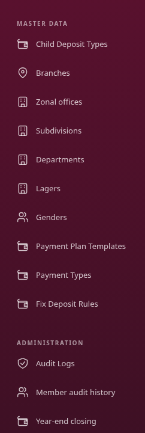

There is no separate Province master screen: province name and short name are stored on each branch. Maintenance officer identity and EPF are maintained through **Administration → Users & access**. Approval hierarchies are supporting administration, covered in section 14. Members, child registrations, deposit accounts, original opening balances and member payment plans are operational records, not additional master-data categories.

## 2. Permissions and reusable roles

Use a system administrator for the full initial setup. Ordinary users need the relevant module's permission and, for location records, the required branch and zonal-office access.

| Master or setup area                        | Who can add it in the current system?                                                                                                                        |
| ------------------------------------------- | ------------------------------------------------------------------------------------------------------------------------------------------------------------ |
| Branches                                    | System administrator only, even if an ordinary user has an Add permission.                                                                                   |
| Payment Types                               | System administrator only. Ordinary users may view when permitted.                                                                                           |
| Child Deposit Types                         | System administrator only. Ordinary users may view when permitted.                                                                                           |
| Fix Deposit Rules                           | System administrator only. Ordinary users may view when permitted.                                                                                           |
| Zonal offices, Subdivisions and Departments | An authorized user with that module's Add permission and appropriate location access; administrators can also add them.                                      |
| Lagers                                      | An authorized user with Add permission and appropriate location access. Subsequent visibility/edit access also follows the current assigned Lager ownership. |
| Genders and Payment Plan Templates          | A user with the corresponding Add permission, or an administrator.                                                                                           |
| Users, roles and approval hierarchies       | System administrator only.                                                                                                                                   |

**View**, **Add**, **Edit** and **Delete** are separate actions. Add alone does not necessarily allow opening a list afterward; a user with Add but no View may see an **Add ...** sidebar link or return to the dashboard after saving. Assign View as well when the person needs to find and verify records in the list.

To create a reusable role:

1. Open **Administration → Roles & permissions**.
2. Choose the create-role action and enter a descriptive role name.
3. Select only the module actions needed by that team.
4. Choose **Save role & permissions**.
5. Assign the role to users in **Users & access**.

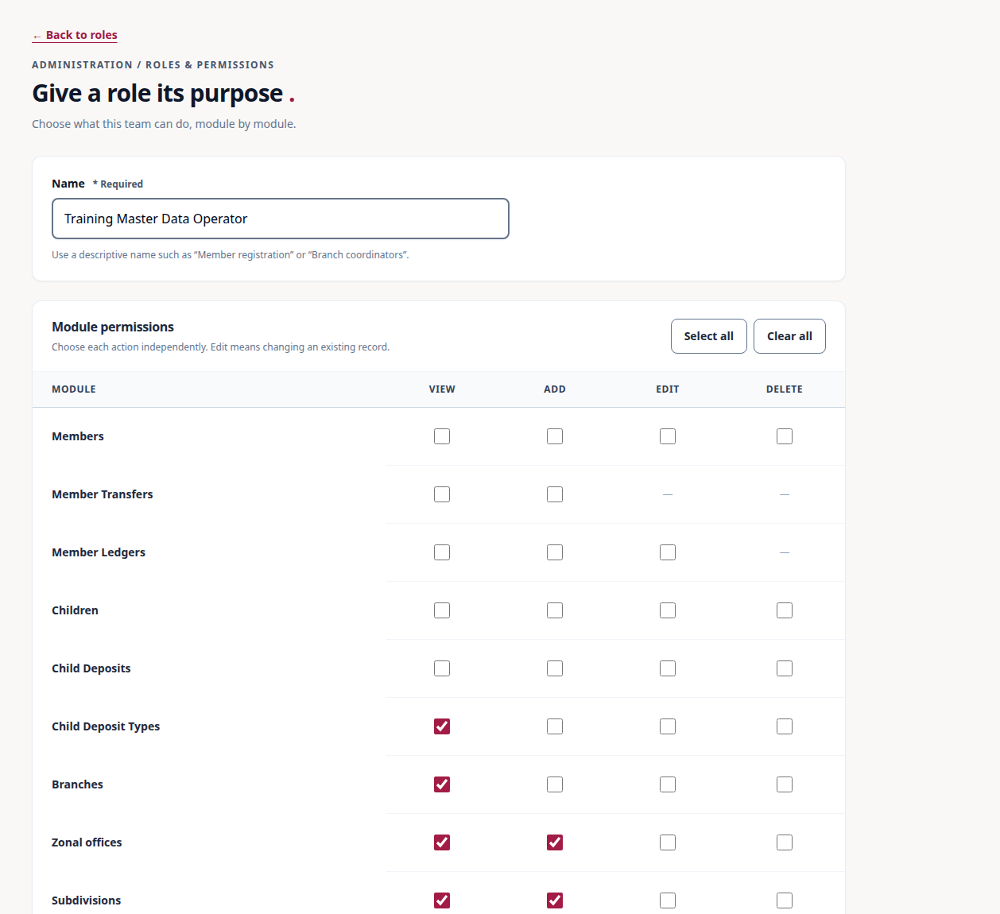

Role permissions add to a user's direct permissions. Clearing a direct permission does not remove the same permission granted through a role. A role called Administrator does not itself create a system-administrator account, and this role screen does not bypass administrator-only master rules.

## 3. Add a branch and province details

**Menu:** Master data → Branches. **Add authority:** system administrator.

1. Search the branch list by name or code to check whether the branch already exists.
2. Choose **Add branch**.
3. Enter the branch name, unique code and province full name.
4. Enter the province short name if used by your organization.
5. Keep **Active branch** selected for current use.
6. Choose **Save branch** and verify the new row in the list.

| Field               | Required?         | Training example / rule                                                           |
| ------------------- | ----------------- | --------------------------------------------------------------------------------- |
| Name                | Yes               | Training Master Branch. The branch name must be unique.                           |
| Code                | Yes               | MD-BR. Use a unique branch code; the form trims it and converts it to uppercase.  |
| Province full name  | Yes               | Western. This is entered on the branch, not chosen from a separate province list. |
| Province short name | No                | WP. The form converts a supplied short name to uppercase.                         |
| Active branch       | Optional checkbox | Select it to make the branch available for current use.                           |

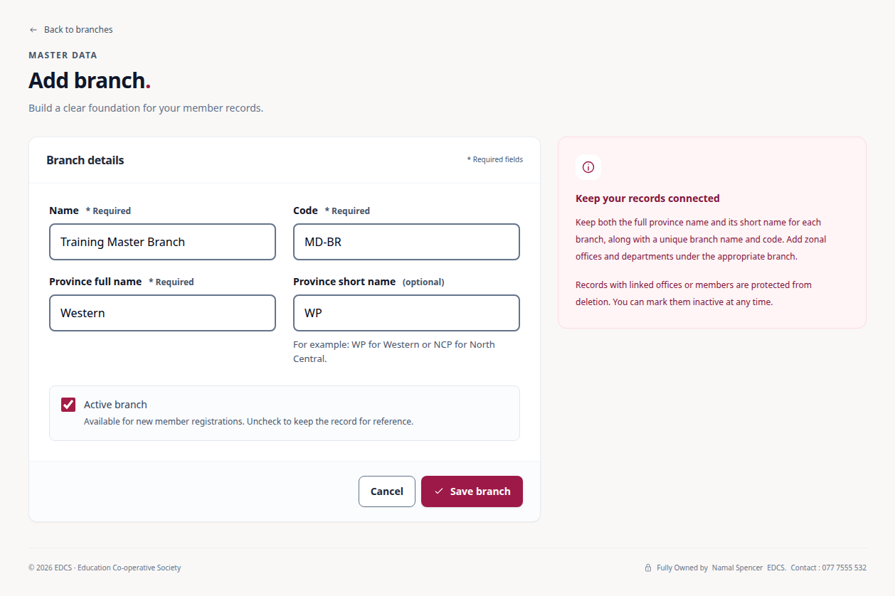

After saving a new branch, an administrator must assign that branch to ordinary users who need it. Adding the branch does not automatically grant every user access. Its zonal offices and departments are added separately.

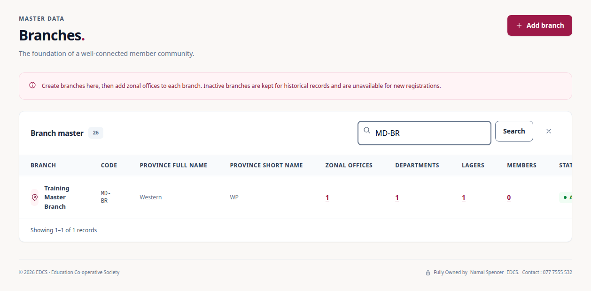

## 4. Add a zonal office

**Menu:** Master data → Zonal offices. **Prerequisite:** an active branch.

1. Choose the add-office action.
2. Select the correct **Branch**.
3. Enter the office name and unique code.
4. Enter the office address and phone where available.
5. Keep the office active and choose **Save zonal office**.
6. Verify its branch and code in the list.

| Field               | Required?         | Training example / rule                                                       |
| ------------------- | ----------------- | ----------------------------------------------------------------------------- |
| Branch              | Yes               | Training Master Branch.                                                       |
| Name                | Yes               | Training Zonal Office. Office names must be distinct within their branch.     |
| Code                | Yes               | MD-Z01. The code must be unique and is converted to uppercase.                |
| Address             | No                | Training office address.                                                      |
| Phone               | No                | A valid phone number; use the office contact, not a member's personal number. |
| Active zonal office | Optional checkbox | Keep selected for normal use.                                                 |

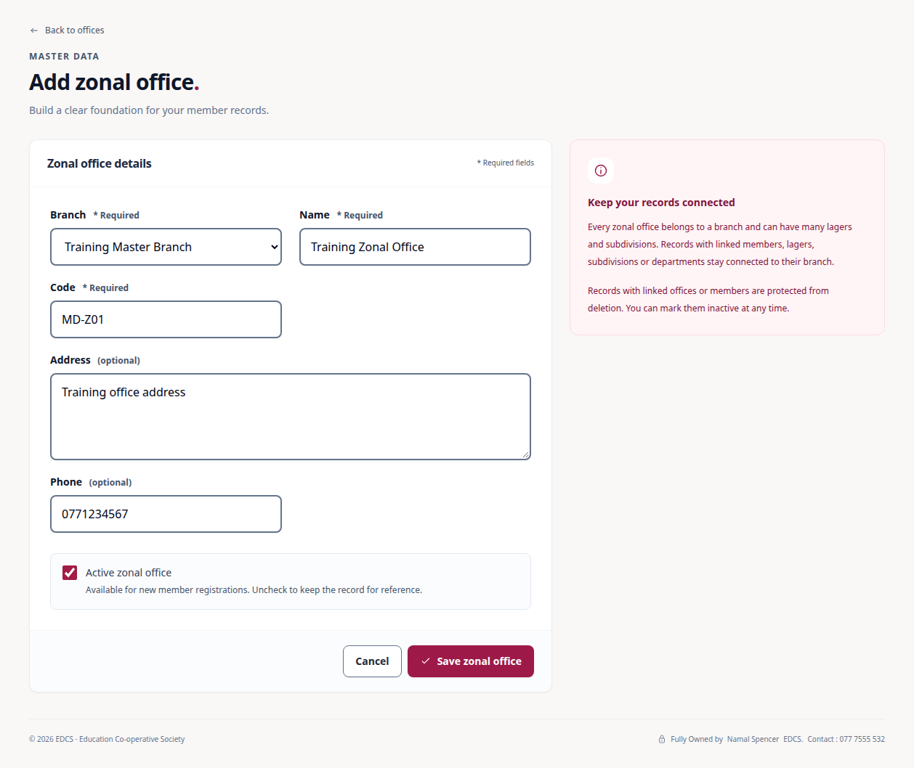

An administrator should add this zonal office to the relevant users' **Assigned zonal offices** before those users work with its dependent records. An office with linked members, subdivisions, departments or Lagers cannot simply be moved to another branch; preserve the existing relationships.

## 5. Add the officer user, EPF and location access

**Menu:** Administration → Users & access. **Authority:** system administrator.

A Lager needs a real, active user as its **Ledger Maintenance Officer**. The officer's EPF belongs to the user's profile; it is not a free-text EPF entered independently on every Lager.

1. Open the new-user form.
2. Enter the username and the person's name.
3. Enter a unique **EPF number** for a user who will maintain a Lager.
4. Enter and confirm a password for a new account. Passwords are not shown in this guide.
5. Assign the appropriate role and any justified direct module permissions.
6. Select the **Assigned branches**, then the **Assigned zonal offices** within those branches.
7. Keep **Active account** selected and save the user.

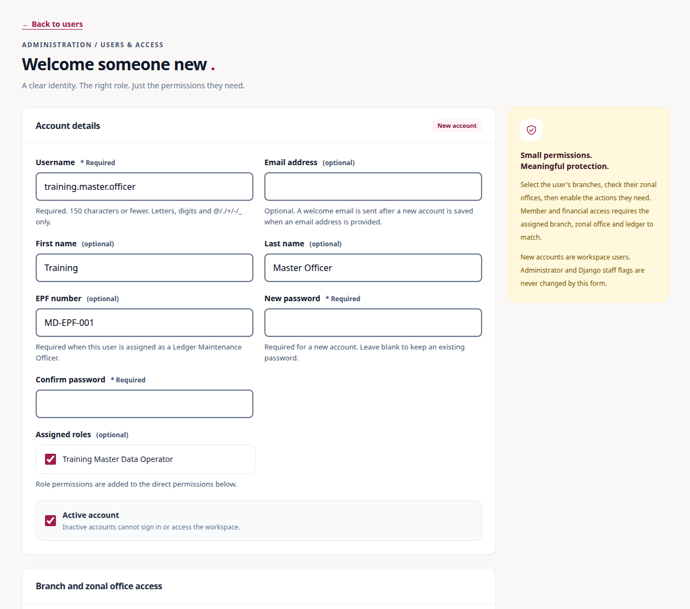

| User setup                        | What to enter or verify                                                                                                                     |
| --------------------------------- | ------------------------------------------------------------------------------------------------------------------------------------------- |
| Username                          | Required and unique. Training example: training.master.officer.                                                                             |
| First / last name                 | Optional fields, but enter meaningful names so officer selections are clear.                                                                |
| Email                             | Optional. Supplying an address can trigger the application's welcome email; use the actual intended recipient when creating a real account. |
| EPF number                        | Required in practice before assigning the user as a Lager maintenance officer; must be unique when supplied. Training example: MD-EPF-001.  |
| Password and confirmation         | Required for a new user. When editing an existing user, leave both blank to keep the current password.                                      |
| Role and direct permissions       | Supply the actions the person needs; these do not grant location ownership by themselves.                                                   |
| Assigned branches / zonal offices | Select the real locations the user may access. Selected zonal offices must belong to the selected branches.                                 |
| Active account                    | An inactive user cannot sign in or act as an eligible current officer.                                                                      |

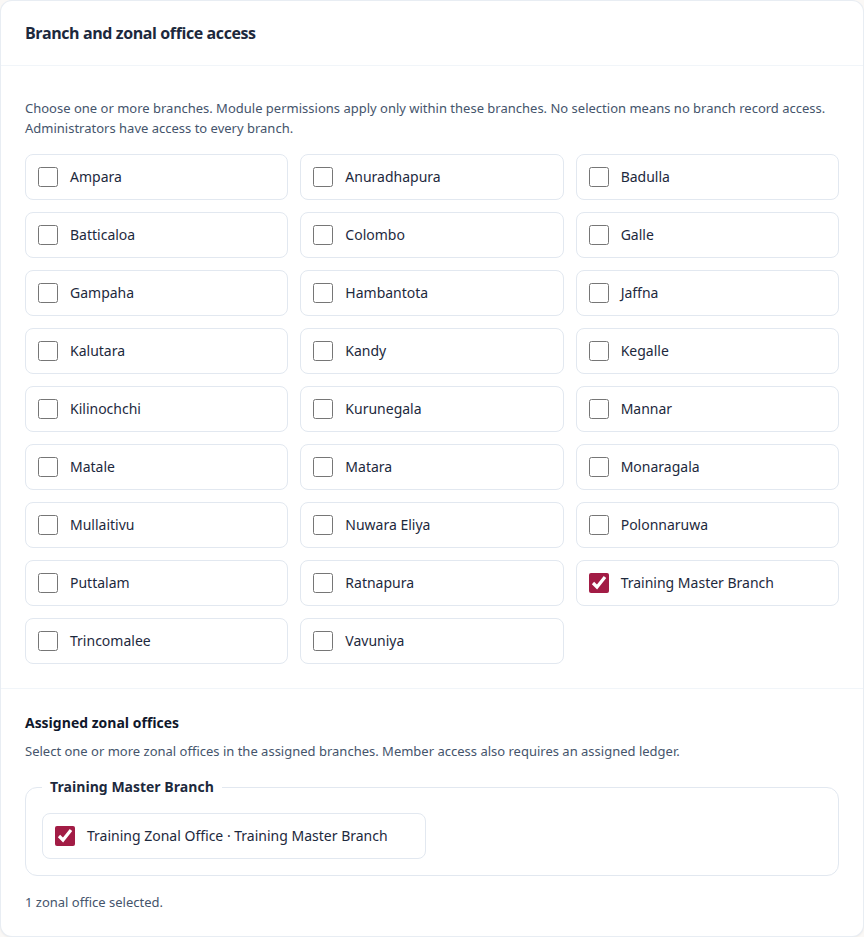

A user needs **module permission + branch access + zonal-office access + the member's current assigned Lager** to work with member-linked records. Creating the user and assigning offices does not automatically make that person the officer of every Lager. Make the Lager assignment in section 8.

Do not remove an officer's EPF, deactivate the user, or remove required office/branch access while active ledgers still depend on that person. Reassign the affected responsibilities through the appropriate existing workflow first.

## 6. Add a subdivision

**Menu:** Master data → Subdivisions. **Prerequisites:** branch and zonal office.

1. Choose the add-subdivision action.
2. Select the branch, then its zonal office.
3. Enter the subdivision name and unique code.
4. Keep it active and choose **Save subdivision**.
5. Verify that it appears under the intended office.

| Field              | Required?         | Training example / rule                                                     |
| ------------------ | ----------------- | --------------------------------------------------------------------------- |
| Branch             | Yes               | Training Master Branch.                                                     |
| Zonal office       | Yes               | Training Zonal Office within that branch.                                   |
| Name               | Yes               | Training Subdivision. The name must be distinct within the selected office. |
| Code               | Yes               | MD-S01. Use a unique code; the form converts it to uppercase.               |
| Active subdivision | Optional checkbox | Select for current use.                                                     |

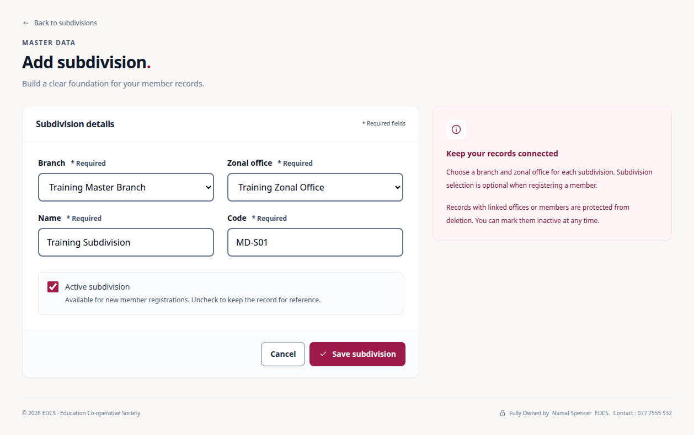

A subdivision is optional when registering a member or adding a department. Do not create a dummy subdivision solely to satisfy an optional field. When a department uses one, select a subdivision in that department's zonal office.

## 7. Add a department

**Menu:** Master data → Departments. **Prerequisites:** branch and zonal office; subdivision if applicable.

1. Choose the add-department action.
2. Select the branch and zonal office.
3. Check the province details filled from the branch.
4. Select the subdivision if the department belongs to one.
5. Enter the department name, unique code and any address.
6. Keep it active and choose **Save department**.

| Field                      | Required?           | Training example / rule                                                                |
| -------------------------- | ------------------- | -------------------------------------------------------------------------------------- |
| Branch                     | Yes                 | Training Master Branch.                                                                |
| Province full / short name | No entry; read-only | Filled from the selected branch. Correct the branch master if these details are wrong. |
| Zonal office               | Yes                 | Training Zonal Office within the branch.                                               |
| Subdivision                | No                  | Training Subdivision, or leave blank when not applicable.                              |
| Name                       | Yes                 | Training Department.                                                                   |
| Code                       | Yes                 | MD-D01. Must be unique; stored in uppercase.                                           |
| Address                    | No                  | The department's address, where available.                                             |
| Active department          | Optional checkbox   | Select for use in new selections.                                                      |

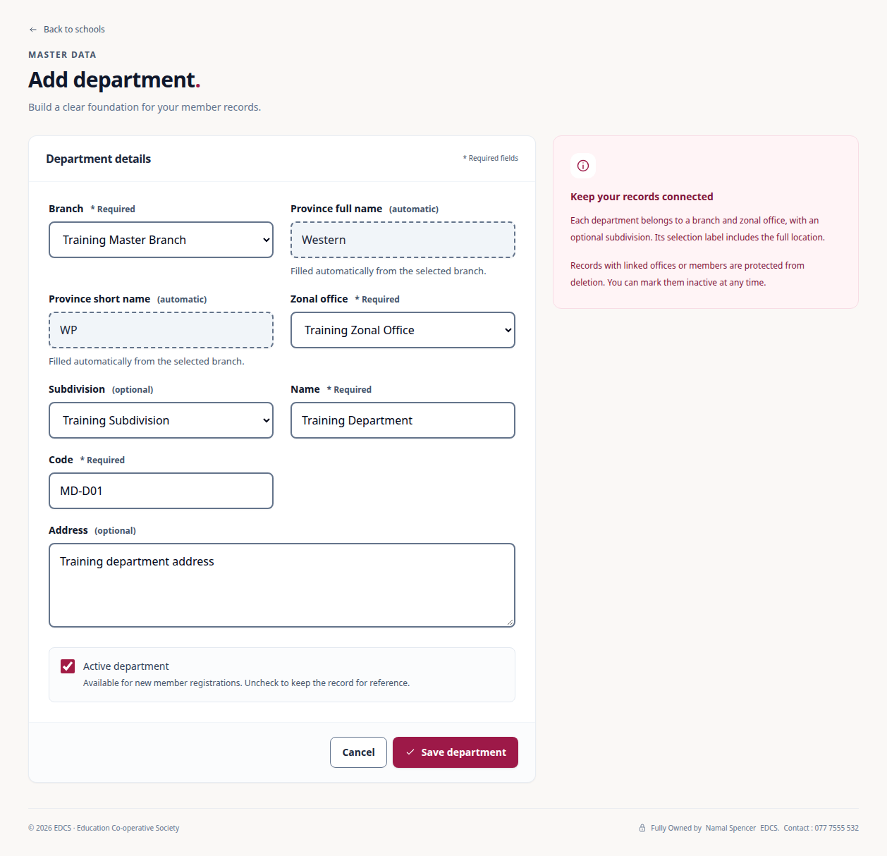

Member registration searches this department list. Selecting a department can fill its branch and zonal-office location. A saved department with linked members cannot be moved freely between locations; review the affected records rather than changing the parent to correct a single member's location.

## 8. Add a Lager and assign its officer

**Menu:** Master data → Lagers. **Prerequisites:** branch, zonal office and an active user with a recorded EPF.

The screen uses **Lager** for the ledger master. It controls the current officer's access to its members and their financial/child records. A member's permanent **Member Ledger** page is a related operational record, not the same thing as adding this master.

1. Choose the add-Lager action.
2. Select the branch and zonal office.
3. Enter a Lager name and unique code.
4. Select the **Ledger Maintenance Officer**.
5. Verify that the read-only **Ledger Maintenance Officer EPF number** matches that user's profile.
6. Keep the Lager active and choose **Save lager**.
7. Verify its office, assigned user and EPF in the list.

| Field                      | Required?           | Training example / rule                                                                                                    |
| -------------------------- | ------------------- | -------------------------------------------------------------------------------------------------------------------------- |
| Branch and zonal office    | Yes                 | Use the intended location.                                                                                                 |
| Name                       | Yes                 | Training Member Ledger. Must be distinct within the zonal office.                                                          |
| Code                       | Yes                 | MD-L01. Must be unique; stored in uppercase.                                                                               |
| Ledger Maintenance Officer | Yes                 | Select an active user with a nonblank recorded EPF. The officer must also have the access needed to work in this location. |
| Officer EPF number         | Required, read-only | Filled from the selected officer. Do not type an unrelated EPF on this form.                                               |
| Active lager               | Optional checkbox   | Select for current member registration.                                                                                    |

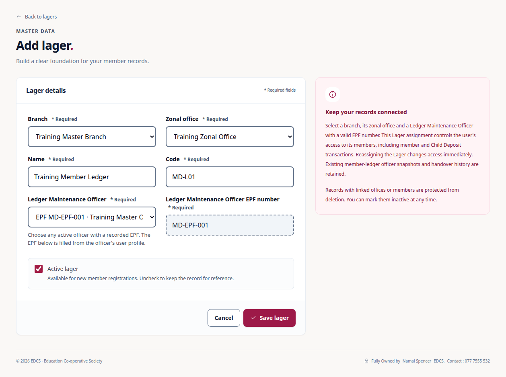

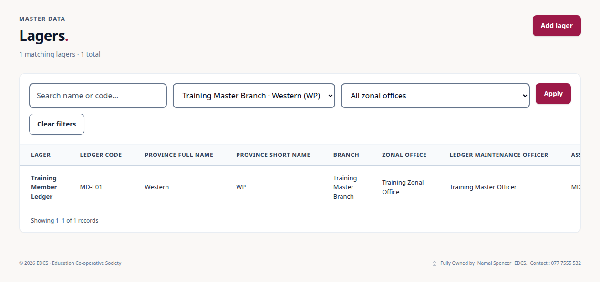

The officer list can show active EPF users beyond the selected office; choosing a name does not automatically add that office or branch to the user. Verify **Users & access** as well as the Lager assignment. An ordinary user's member/financial access follows the currently assigned Lager ownership, not just the EPF or a role.

Changing a Lager's assigned maintenance officer changes current access immediately. Historical member-ledger officer snapshots and handover records remain retained. Do not move a Lager with registered members to a different zonal office as a shortcut for a transfer; use the existing transfer/responsibility workflows where appropriate.

## 9. Add a gender option

**Menu:** Master data → Genders. **Prerequisite:** review existing choices to avoid duplication.

1. Choose the add-gender action.
2. Enter the stable code and display name.
3. Enter **Display order**; lower numbers appear first.
4. Keep it active and save.
5. Verify that it appears in the Genders list and is available in member registration.

| Field         | Required?         | Training example / rule                                                                                        |
| ------------- | ----------------- | -------------------------------------------------------------------------------------------------------------- |
| Code          | Yes               | training. Use a unique slug code: letters, numbers, underscores or hyphens. Codes are normalized to lowercase. |
| Name          | Yes               | Training Gender Option. Use the actual approved display name for a real choice.                                |
| Display order | Yes               | 90 in the training example; zero is allowed.                                                                   |
| Active gender | Optional checkbox | Select to offer it for new member selections.                                                                  |

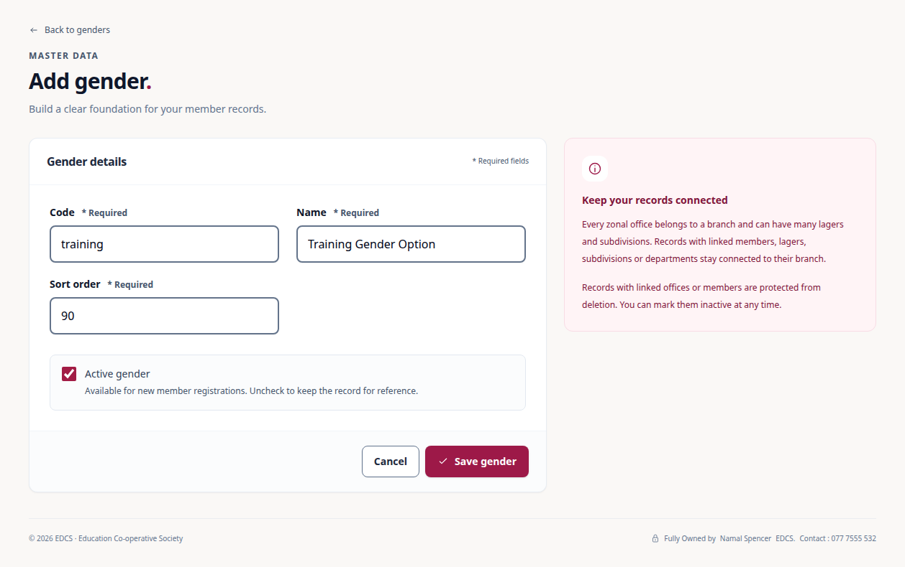

The code cannot be changed after saving; edit the display name when a label needs correction. An inactive choice remains associated with existing members but is not offered for new selections. A gender code already used by members is protected from deletion.

## 10. Add a Payment Type and interest reference

**Menu:** Master data → Payment Types. **Authority:** system administrator.

Payment Types are member account/contribution categories. Adding one does not itself create a member plan, an opening balance, a contribution receipt or a transaction.

1. Check the existing Payment Types before adding a new one.
2. Choose the add-type action and enter a unique name.
3. Enter the approved annual **Interest rate (%)**, or leave blank for zero where that is intended.
4. Choose **Interest calculation frequency**, normally Quarterly for the current quarterly report.
5. If Custom period is selected, complete the relevant custom fields.
6. Set **Display order**, keep the type active, and save.

| Field                          | Required?         | Training example / rule                                                                               |
| ------------------------------ | ----------------- | ----------------------------------------------------------------------------------------------------- |
| Name                           | Yes               | Training Savings. The form rejects another Payment Type with the same name ignoring case.             |
| Interest rate (%)              | No                | 8.00 in this example. Allowed range: 0–100; a blank saves as 0.00.                                    |
| Interest calculation frequency | Yes               | Quarterly (every 3 months). Other choices are Daily, Monthly, Yearly and Custom period.               |
| Custom period type             | Conditional       | Required when a custom period is selected. Choose Repeating interval or Specific start and end dates. |
| Interval count and unit        | Conditional       | For a repeating custom period, enter a positive whole count and choose days, months or years.         |
| Interest start / end dates     | Conditional       | For a date-range custom period, supply both dates; the end cannot precede the start.                  |
| Display order                  | Yes               | 1 in the training example; lower numbers appear first.                                                |
| Active payment type            | Optional checkbox | Select for use in new account/plan selections.                                                        |

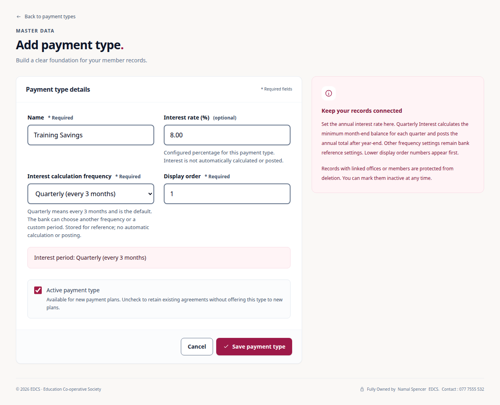

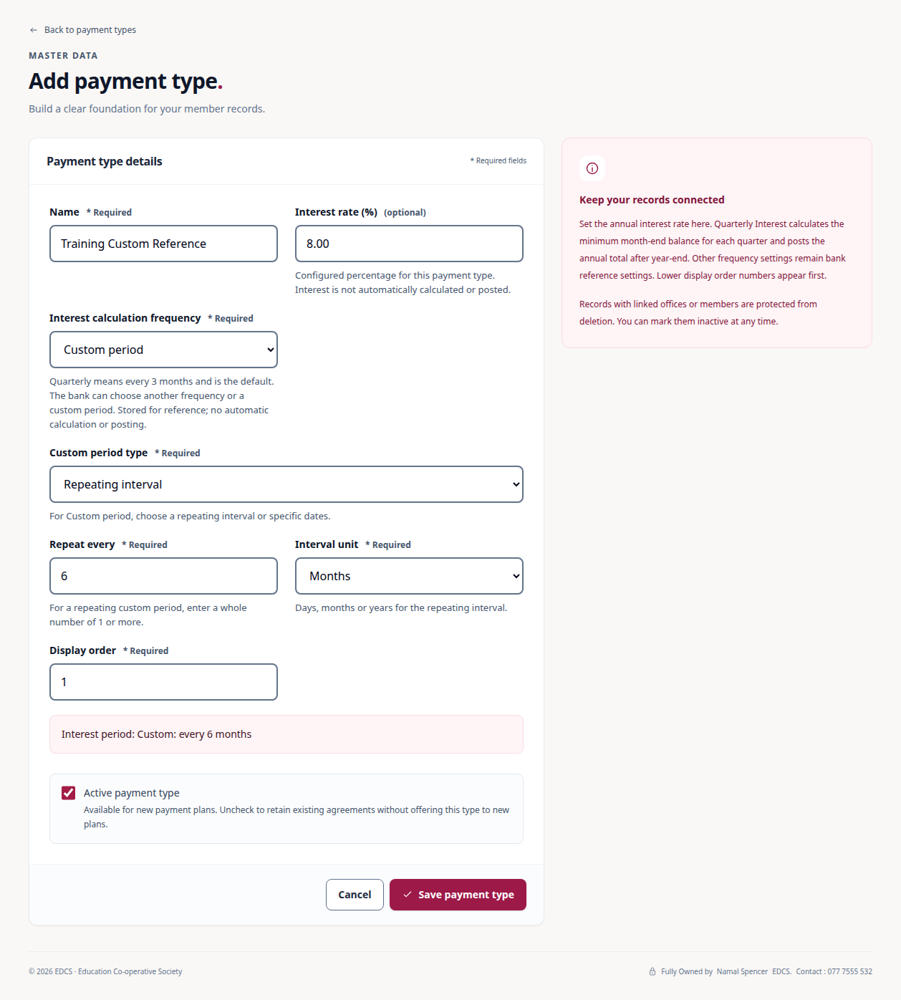

The current **Quarterly Interest** module calculates completed-quarter interest using minimum month-end balances and capitalizes the annual total after year-end. The other frequency/custom-period settings are bank reference settings; selecting Monthly or Custom does not switch that module to a different automatic interest algorithm. Adding or saving a Payment Type does not post interest. See the separate financial year-end approval guide for that operation.

The example also adds **Training Fixed Deposit**, at a 4.00% reference rate, for the Fix Deposit Rule in section 13. Use your institution's approved types and rates in real records. Inactive types remain in historical agreements and transactions; review existing usage before deactivating or attempting deletion.

## 11. Add a Child Deposit Type

**Menu:** Master data → Child Deposit Types. **Authority:** system administrator.

Child Deposit Types are separate from member Payment Types. They define the type of a child's account and its age-dependent annual interest rates.

1. Choose the add-child-deposit-type action.
2. Enter a unique type name.
3. Set **Rate changes at age**.
4. Enter the annual rate below that age and the annual rate from that age.
5. Set the display order, keep the type active, and save.

| Field                     | Required?         | Training example / rule                                                                 |
| ------------------------- | ----------------- | --------------------------------------------------------------------------------------- |
| Name                      | Yes               | Training Child Savings. Names must be unique; case-insensitive duplicates are rejected. |
| Rate changes at age       | Yes               | 18. The system accepts ages from 1 to 150.                                              |
| Rate below this age (%)   | Yes               | 8.00 in the training example; allowed range 0–100.                                      |
| Rate from this age (%)    | Yes               | 5.00 in the training example; allowed range 0–100.                                      |
| Display order             | Yes               | 1, or another nonnegative order value.                                                  |
| Active child deposit type | Optional checkbox | Select for new accounts and entries.                                                    |

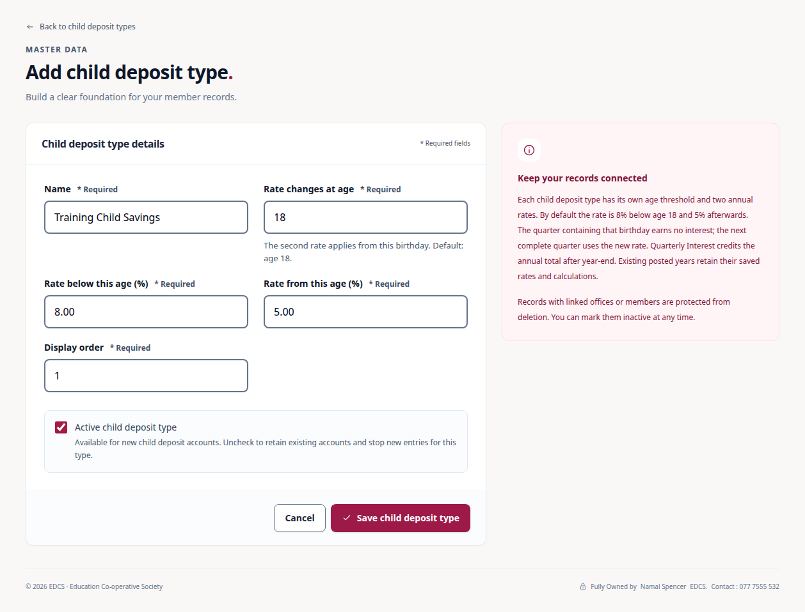

The defaults in the current form are age 18, 8% below the threshold and 5% from the threshold. For the current child quarterly calculation, the quarter containing the threshold birthday is excluded; the next complete quarter uses the new rate. Posted account-years retain their saved rate rules and calculations.

Adding the type does **not** register a child or open a child deposit account. Next register the child under its member and open a **Child Deposits** account using this type. Only then can you select that child's registered account in **Receive contribution → Allocate remaining balance** or **Add debit / credit**. Money credited there belongs to the child's account, separately from the member's own balance.

Deactivating a child deposit type retains existing account history but stops new accounts and normal new entries for that type. Confirm the effect on all linked children before doing so.

## 12. Add a Payment Plan Template

**Menu:** Master data → Payment Plan Templates. **Prerequisite:** active member Payment Types.

1. Choose **Create payment plan template**.
2. Enter a unique template name and optional description.
3. Keep the template active.
4. Enter the agreed monthly LKR amount against each required Payment Type. Blank or zero leaves that type out.
5. Tick **Fixed amount** only where that amount must remain locked after saving and in assigned member plans.
6. Check **Total monthly deposit** and choose **Save template**.

| Field / control              | Required?                    | Rule                                                                                           |
| ---------------------------- | ---------------------------- | ---------------------------------------------------------------------------------------------- |
| Name                         | Yes                          | Training Monthly Plan. Names must be unique ignoring case.                                     |
| Description                  | No                           | Explain the intended agreement or membership category.                                         |
| Is active                    | Optional checkbox            | Select for application to new member plans.                                                    |
| Monthly contribution amounts | At least one positive amount | Amounts must be nonnegative, with at most two decimal places. Zero or blank excludes the type. |
| Fixed amount, per row        | Optional checkbox            | A fixed row needs a positive amount; its saved amount is locked.                               |

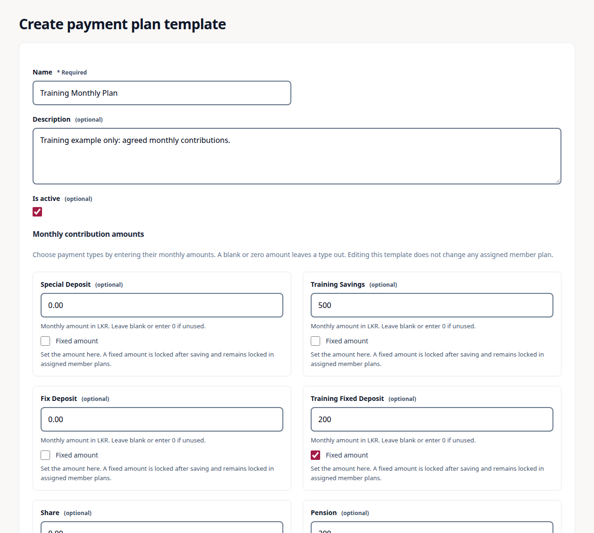

The training template uses Training Savings 500, Training Fixed Deposit 200, Pension 200 and Funeral 100: **LKR 1,000 per month**. Only the Training Fixed Deposit row is marked fixed in this example.

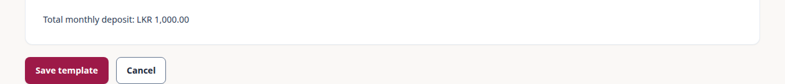

Selecting a template in a member's **Payment Plan** copies the amounts into that member's agreement. Creating or editing the template does not automatically rewrite existing member plans and does not collect money. A received contribution must still be entered through the existing payment workflow.

Fixed amounts cannot simply be changed or unlocked after saving. Decide which rows need locking before saving; do not use Fixed amount merely to highlight a row. Use the appropriate new agreement/template process when a different approved arrangement is required. An assigned member plan keeps its own copied amounts even if the source template is later removed, but making an old template inactive is often clearer than deleting it from reference lists.

## 13. Add a Fix Deposit Rule

**Menu:** Master data → Fix Deposit Rules. **Authority:** system administrator. **Prerequisite:** an active Payment Type for the fixed-deposit account category.

1. Choose the add-rule action.
2. Enter a unique rule name and select its Payment Type.
3. Enter the withdrawal-cycle duration and maximum withdrawal percentage.
4. Enter the loan-security percentage and months between loan issues.
5. Enter the institution's approved annual loan interest rate before the rule is used to issue loans.
6. Keep the rule active and choose **Save fix deposit rule**.

| Field                         | Required?                                   | Current accepted range / training example                                          |
| ----------------------------- | ------------------------------------------- | ---------------------------------------------------------------------------------- |
| Name                          | Yes                                         | Training 36-Month Rule. Must be unique.                                            |
| Payment type                  | Yes                                         | Training Fixed Deposit. A Payment Type can be linked to only one Fix Deposit Rule. |
| Withdrawal cycle (months)     | Yes                                         | 36–1,200 months; training example 36.                                              |
| Maximum withdrawal (%)        | Yes                                         | Greater than 0 and no more than 75; example 75.                                    |
| Maximum loan security (%)     | Yes                                         | Greater than 0 and no more than 90; example 90.                                    |
| Months between loan issues    | Yes                                         | 12–1,200 months; example 12.                                                       |
| Annual loan interest rate (%) | No at master save; needed before loan issue | If supplied, greater than 0 and no more than 100; training example 12.00.          |
| Active Fix Deposit rule       | Optional checkbox                           | Select for new applicable servicing operations.                                    |

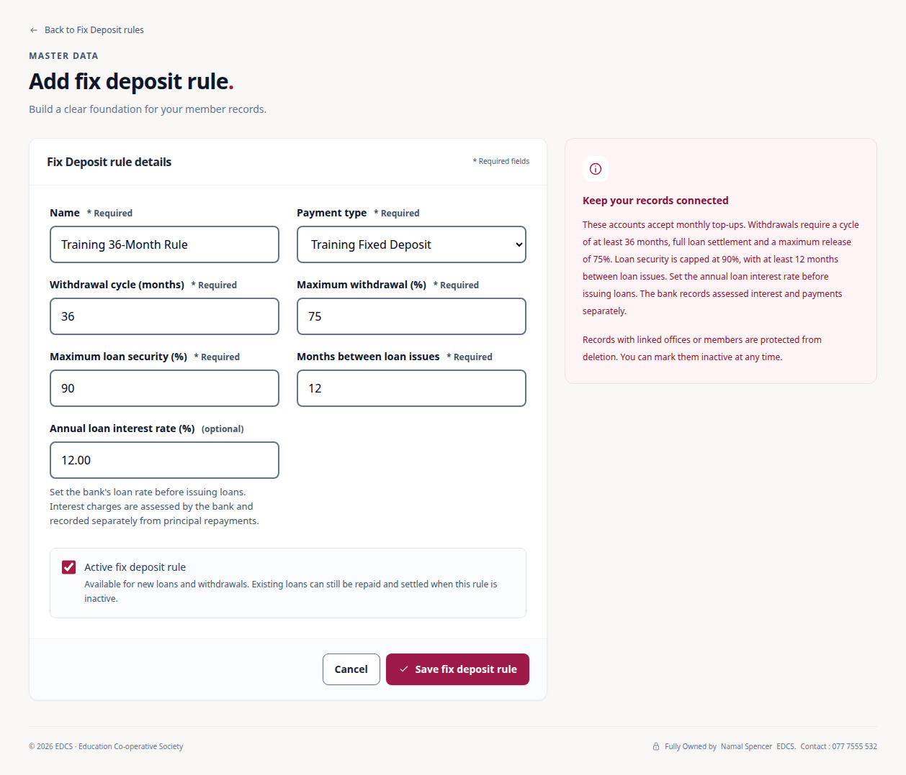

The deposit Payment Type's interest rate and the rule's **annual loan interest rate** serve different purposes. The former is a member deposit reference rate; the latter is the rate associated with secured loan servicing. Do not enter one in place of the other.

Creating this rule does not open a member's fixed-deposit servicing account, issue a loan or release a withdrawal. Add the member's account separately in **Fix Deposit Loans & Withdrawals**, choosing the saved rule. Existing servicing also enforces its maturity, security, settlement and loan-interval rules.

Once balances, accounts or protected activity use the linked Payment Type, the rule's Payment Type selection is locked. An inactive rule retains history; existing loans can still be repaid and settled, while new loans/withdrawals are restricted. Do not expect an inactive rule to erase or settle a loan.

## 14. Approvals, corrections and maintenance

### 14.1 Adding and editing are different actions

Authorized creation of these master records follows the current normal create process. A hierarchy for **Edit existing records** governs matching edits by ordinary users, not the initial add action. System administrators can process directly under the existing administrator policy. The administrator-only master restrictions described in section 2 still apply even when an ordinary user's permission matrix contains Add or Edit.

If master-record edits need review, an administrator can open **Administration → Approval hierarchies**, create or edit a hierarchy, select the specific master module or **All modules — edits only**, select **Edit existing records**, supply a reason, and add ordered designated approvers. A specific module hierarchy takes priority over the All modules fallback.

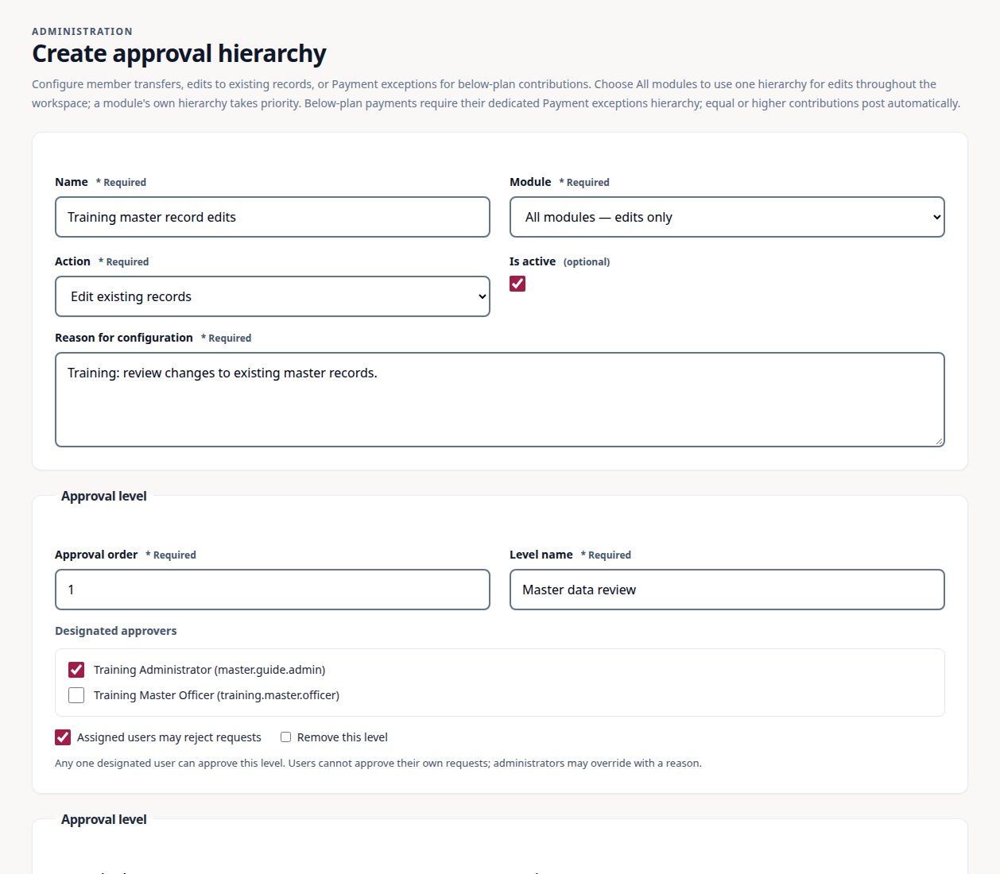

Use the separate **Financial Year-End Closing and Account Approval Guide** for detailed level configuration, decision screens and the verified ledger-access and scheduled-posting limitations. An approval hierarchy does not grant a person access to a ledger and does not turn an ordinary user into a system administrator.

### 14.2 Correct errors on the same record

Search by code or name before adding. If a record already exists and only its display details are wrong, use **Edit** with the required authority rather than create another spelling of the same record. Check downstream relationships before changing a parent location or financial rule. Linked records may lock the parent selection.

If saving shows field errors, read the message, correct the values and save again. The form does not create a valid master merely because the page was displayed.

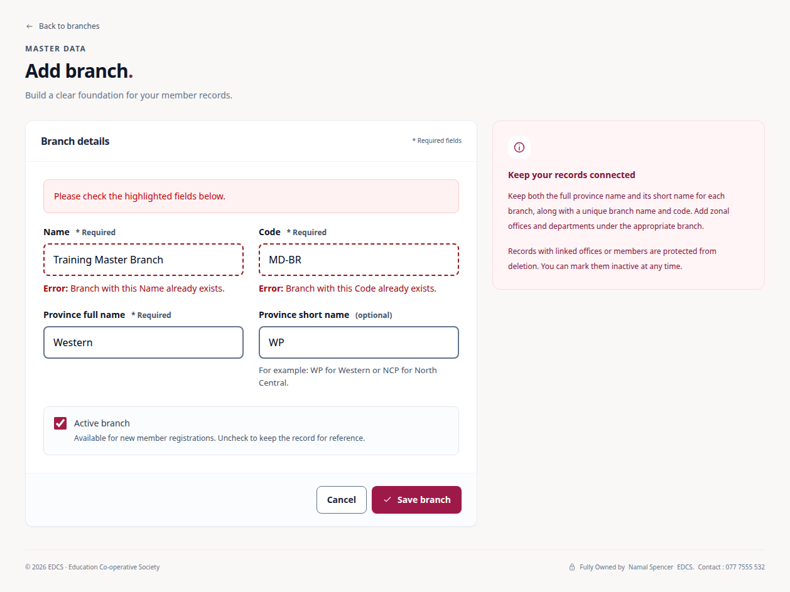

### 14.3 Inactivate and audit carefully

Use **Active** to control availability for new work while retaining historical references. Used location and financial records can be protected from deletion. Protection depends on the record's actual links; templates retain copied member-plan amounts even where deletion of the source is permitted. Do not assume deleting a master reverses its financial transactions.

For changes and additions, administrators can inspect **Administration → Audit Logs**, filter by module, action, date or record reference, and open the event. Audit access is a separate permission for ordinary users; user/role security audit details require their additional security-audit permission.

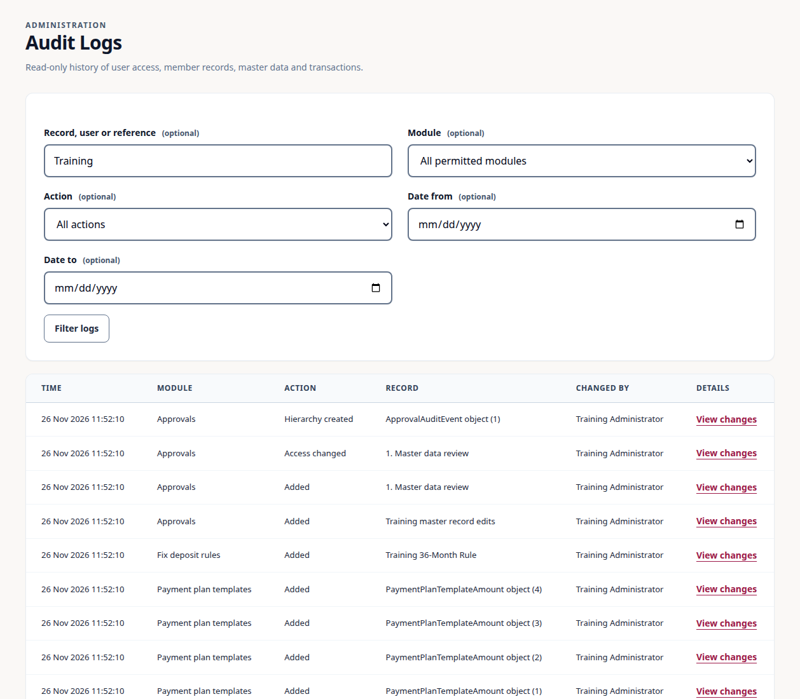

## 15. Readiness checklist, worksheet and screen references

Before using the setup operationally, verify:

1. Each branch, office, subdivision, department and Lager has the intended code, active status and parent location.
2. The officer is active, has a unique recorded EPF and the required branch/zonal-office assignments, and is selected on the correct Lager.
3. An ordinary user can see only the intended location/ledger records with the required module actions.
4. Gender and account-type choices reuse existing correct values rather than duplicate them.
5. Payment Type reference rates, child rate rules and Fix Deposit limits match the institution's approved configuration.
6. Template amounts add up correctly, and Fixed amount is selected only for rows intended to remain locked.
7. New members are registered separately. Assign their payment plan, enter approved opening balances where needed, register children and open their child deposit accounts separately.
8. Check the new setup in the relevant dropdowns and audit records before using it for actual receipts or postings.

| Problem                                               | What to check                                                                                                                    |
| ----------------------------------------------------- | -------------------------------------------------------------------------------------------------------------------------------- |
| Add button or menu is missing                         | Module permission and administrator-only restrictions; Add-only users may have an Add sidebar entry rather than list access.     |
| Branch or office is missing from a dropdown           | Active status, the chosen parent, and the user's branch/zonal-office assignments.                                                |
| Officer is missing                                    | User must be active with a nonblank recorded EPF.                                                                                |
| EPF on the Lager is blank or wrong                    | Select the correct user and check that user's EPF profile. The Lager EPF is read-only.                                           |
| User has an EPF but cannot see members                | Check module actions, branch, zonal office and current Lager ownership together.                                                 |
| Child Deposit Type exists but cannot receive a credit | Register the child and create its actual child deposit account first; the type alone is not an account.                          |
| Template cannot be saved                              | Enter at least one positive monthly amount; a fixed row must have a positive amount; check duplicate name and decimal precision. |
| Fixed amount cannot be changed                        | The saved amount is locked by design. Review the approved agreement/template process.                                            |
| Fix Deposit Rule cannot use a Payment Type            | Check that the type is active, is not already linked to another rule and is not locked by historical balances/activity.          |
| Record cannot be deleted or moved                     | It is linked or protected. Review the dependency or mark inactive where appropriate.                                             |

Use this record for each master addition; fill the editable Word version or copy the table into the team's setup register. It is a documentation aid and does not itself save an application record.

| Setup register field                                      | Enter the details                                            |
| --------------------------------------------------------- | ------------------------------------------------------------ |
| Master-data category                                      | \_\_\_\_\_\_\_\_\_\_\_\_\_\_\_\_\_\_\_\_\_\_\_\_\_\_\_\_\_\_ |
| Record name and unique code, where applicable             | \_\_\_\_\_\_\_\_\_\_\_\_\_\_\_\_\_\_\_\_\_\_\_\_\_\_\_\_\_\_ |
| Parent branch / zonal office / subdivision                | \_\_\_\_\_\_\_\_\_\_\_\_\_\_\_\_\_\_\_\_\_\_\_\_\_\_\_\_\_\_ |
| Officer and EPF, or linked account type, where applicable | \_\_\_\_\_\_\_\_\_\_\_\_\_\_\_\_\_\_\_\_\_\_\_\_\_\_\_\_\_\_ |
| Active status and approved configuration reference        | \_\_\_\_\_\_\_\_\_\_\_\_\_\_\_\_\_\_\_\_\_\_\_\_\_\_\_\_\_\_ |
| Entered by / date / verified by                           | \_\_\_\_\_\_\_\_\_\_\_\_\_\_\_\_\_\_\_\_\_\_\_\_\_\_\_\_\_\_ |
| List-screen confirmation and audit reference              | \_\_\_\_\_\_\_\_\_\_\_\_\_\_\_\_\_\_\_\_\_\_\_\_\_\_\_\_\_\_ |

Current screen references:

| Master / supporting setup            | Current route                                          |
| ------------------------------------ | ------------------------------------------------------ |
| Branches                             | /districts/                                            |
| Zonal offices                        | /offices/                                              |
| Subdivisions                         | /subdivisions/                                         |
| Departments                          | /schools/                                              |
| Lagers                               | /lagers/                                               |
| Genders                              | /genders/                                              |
| Payment Types                        | /payment-types/                                        |
| Child Deposit Types                  | /child-deposit-types/                                  |
| Payment Plan Templates               | /payment-plan-templates/                               |
| Fix Deposit Rules                    | /fix-deposit-rules/                                    |
| Roles / users / approval hierarchies | /admin/roles/ ; /admin/users/ ; /approval-hierarchies/ |

The documentation capture verified all ten master categories, fourteen successful supporting/master creations, the LKR 1,000 template total, duplicate-branch rejection, six ordinary-user add screens and the four administrator-only create restrictions. The screenshots were rendered from the actual current templates with training values. The temporary training database was removed; no master, user or financial records were written to the application's normal database. The field catalog and capture checks are retained in master_data_assets/capture-evidence.json.
