# Member Activation & Deactivation User Manual

EDCS Member Management System

Prepared: 26 November 2026 · Time zone: Asia/Colombo · Current-system manual v1.0

This manual explains initial activation, deactivation and reactivation through **Membership Status**, including administrator setup, approval levels, supporting documents, effective dates and audit history. The current system uses the word **Inactivation** for deactivation. Both terms in this manual refer to changing an Active member to Inactive.

Screenshots show the current application with fictional training members, users, reasons and documents. Completed registration, two-level approvals, inactivation, reactivation, rejection, cancellation and future scheduling were checked through the real application views in a disposable database. Filled configuration forms illustrate choices without changing live settings. Live member records, users, accounts and approval policies were not changed.

### Contents

1. Membership workflow and responsibilities
2. Administrator: grant permissions and configure approval levels
3. Administrator: decide whether requester approval is allowed
4. Register and activate a new member
5. Find and follow membership status requests
6. Submit a deactivation request with a valid reason
7. Review, approve, reject or cancel a request
8. Reactivate an inactive member and retain the same ledger
9. Effective dates, scheduled requests and request statuses
10. Audit history, troubleshooting and completion checklist

## 1. Membership workflow and responsibilities

Open **Membership Status** in the workspace sidebar. An authorized officer can also start from the member profile's **Request activation**, **Request inactivation** or **Request reactivation** action, according to the current membership state.

| Current membership state | Available request            | Result after required approval and application                           |
| ------------------------ | ---------------------------- | ------------------------------------------------------------------------ |
| Awaiting activation      | Initial activation           | Active. Registration automatically creates the first activation request. |
| Active                   | Inactivation / deactivation  | Inactive. A valid reason and detailed description are required.          |
| Inactive                 | Reactivation                 | Active, with a new active membership period on the same ledger page.     |
| Retired                  | Separate retirement workflow | Retired members are not selectable in this status-request form.          |

An ordinary officer can request changes only for members within their current assigned Lagers, branch and zonal-office access. An administrator has broader access. A reviewer designated in the workflow can review the assigned request without becoming the member's Lager owner.

| Responsibility                | What the person does                                                                                                                                        |
| ----------------------------- | ----------------------------------------------------------------------------------------------------------------------------------------------------------- |
| Requesting officer            | Confirms member identity and current status, supplies a valid reason, effective date and applicable supporting documents, then follows the request outcome. |
| Manager / designated reviewer | Reviews member details, evidence and date; records a decision and reason at the assigned level.                                                             |
| System administrator          | Grants permissions, creates and maintains approval levels, and decides whether requester approval is permitted at particular levels.                        |
| Authorized audit user         | Reviews retained requests, status changes, approval decisions and active-period history.                                                                    |

All configured levels must complete for the normal approval route. A system administrator can use the available override action with a recorded reason, subject to the restrictions on approving their own request described in section 3. Missing or incomplete approval configuration blocks submission; it does not activate a member automatically.

This workflow preserves member accounts and their transaction histories. It does not automatically pay out balances, settle loans or change interest policy. Existing membership statuses remain in place until a request is actually applied.

## 2. Administrator: grant permissions and configure approval levels

### Grant access

Use **Administration → Users & access** for individual permissions, or **Roles & permissions** for a reusable role. In the **Membership Status** row:

| Permission | Meaning in this module                                                                                            |
| ---------- | ----------------------------------------------------------------------------------------------------------------- |
| View       | View requests within the permitted member/Lager scope.                                                            |
| Add        | Submit activation, inactivation or reactivation requests for permitted members.                                   |
| Edit       | Review assigned requests and make authorized decisions. This permission does not allow rewriting request history. |
| Delete     | Unavailable for permanent status history.                                                                         |

Ordinary requesting officers normally need View and Add. Reviewers need Edit/review authority and an assignment in the approval workflow. Edit also allows reaching their assigned request list. Members Add permits registration and its automatic activation request; granting membership-status permissions separately provides ongoing status management.

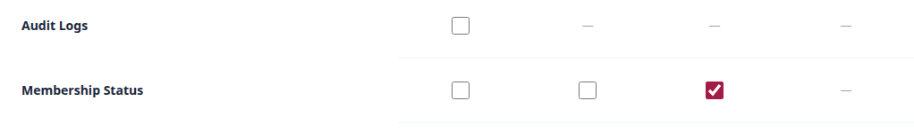

For ordinary officers, also verify the active user account, EPF, branch/zonal-office assignments and assigned Lager master. Permission alone does not assign a Lager. A role with a manager-sounding name does not by itself grant approval authority.

### Create the hierarchy

1. Open **Administration → Approval hierarchies** and choose **Create hierarchy**.
2. Enter a descriptive name, such as Membership Status approvals.
3. Select module **Membership Status**.
4. Select action **Edit existing records**. This is the current action label used for processing membership-status requests.
5. Select Active and enter the configuration reason.
6. Add review levels in the required order, selecting authorized active users at each level.
7. Review the requester-approval setting described in section 3.
8. Choose **Save hierarchy**.

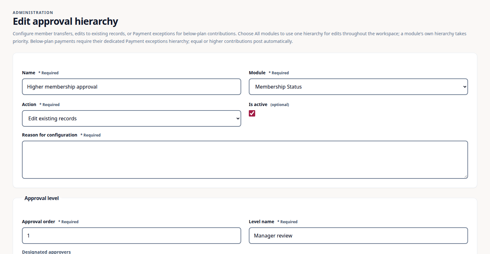

The worked example uses **1. Manager review** followed by **2. Final higher-level review**. At least one designated authorized user must be available at every level. Any one designated user can complete a particular level; the next level then becomes current.

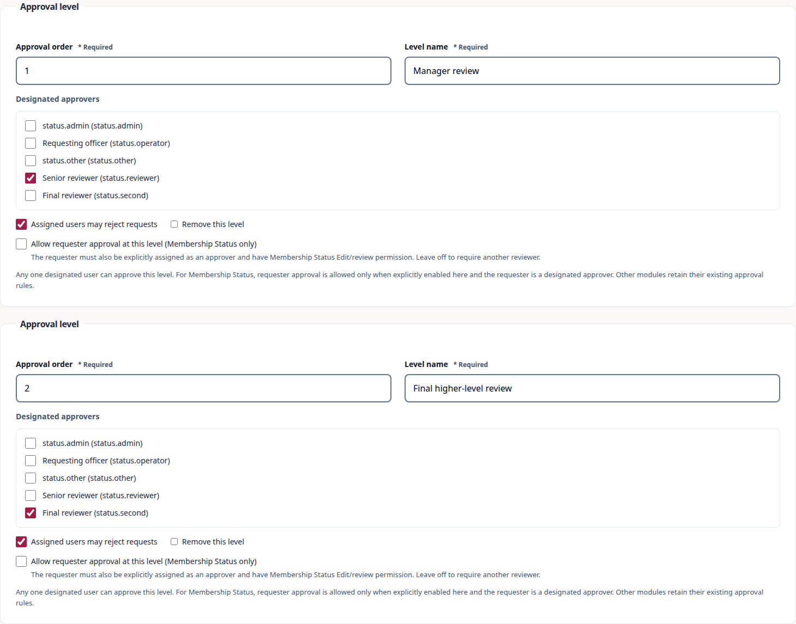

Membership Status requires its own active hierarchy. **All modules — edits only** does not replace it. If the hierarchy is missing, inactive or has an unusable level, registration/status submission is blocked with a configuration message. Some generic approval-screen help describes other modules; these membership-specific requirements still apply.

Changes to a hierarchy are audited. Pending requests retain the levels, designated users and requester-approval rules captured when they were submitted. Review the request's own progress rather than assuming a later policy edit changed an existing request.

## 3. Administrator: decide whether requester approval is allowed

The system administrator chooses the approvers. Managers can be the normal reviewers. When business workflow allows the same user to request and approve a change, configure that permission explicitly for the relevant level.

1. Open the Membership Status hierarchy's **Edit** screen.
2. At the intended level, select **Allow requester approval at this level (Membership Status only)**.
3. Explicitly include the requesting user among that level's designated approvers.
4. Verify that the user has **Membership Status → Edit** review permission.
5. Save the hierarchy with an explanatory configuration reason.

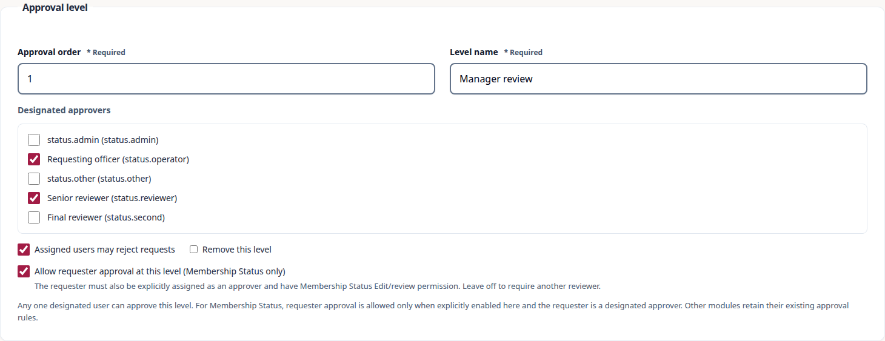

Requester approval is off by default. Selecting the user without enabling the setting does not permit self-approval. Enabling the setting without assigning that user or granting review authority is also insufficient. These rules come from the saved workflow; a requester cannot turn them on in their status-request form.

Completing a self-approved first level does not skip a later manager level. A requester who is also a system administrator cannot override later levels unless every remaining level permits requester approval and explicitly assigns that requester. Another authorized administrator can use their available review/override authority with a recorded reason.

For pending requests, the captured rule remains in force even if the administrator edits the hierarchy later. Check the **Approval progress** text, which identifies whether requester approval is enabled at each level.

## 4. Register and activate a new member

1. Open **Member directory → Register member**.
2. Complete the normal location, Lager, identity and contact information.
3. Confirm the read-only membership status **Awaiting activation**.
4. Choose **Register & request activation** after checking all registration sections.
5. Verify the newly created membership-status request.

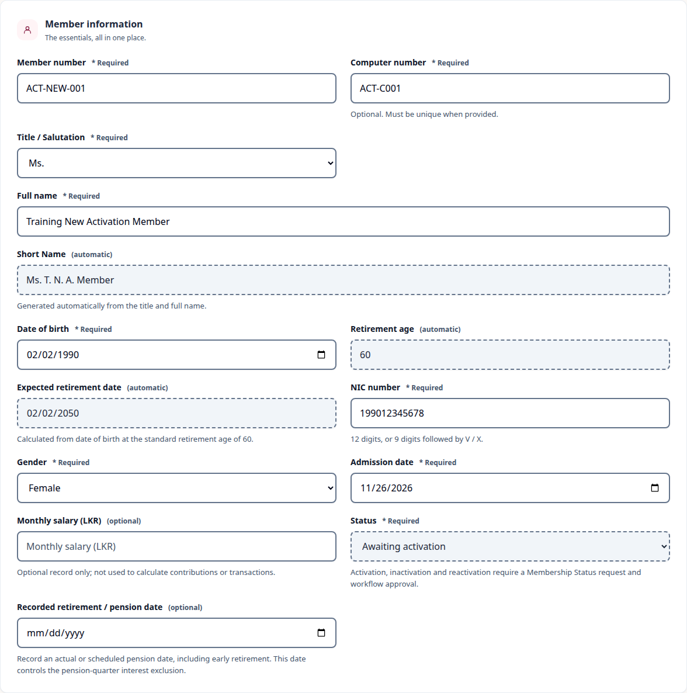

Successful registration creates the member, retains the original ledger page and automatically submits an **Initial activation** request with reason **New member registration**. Requested By and the request timestamp are recorded automatically. The first result is the status-request page, rather than immediate active membership.

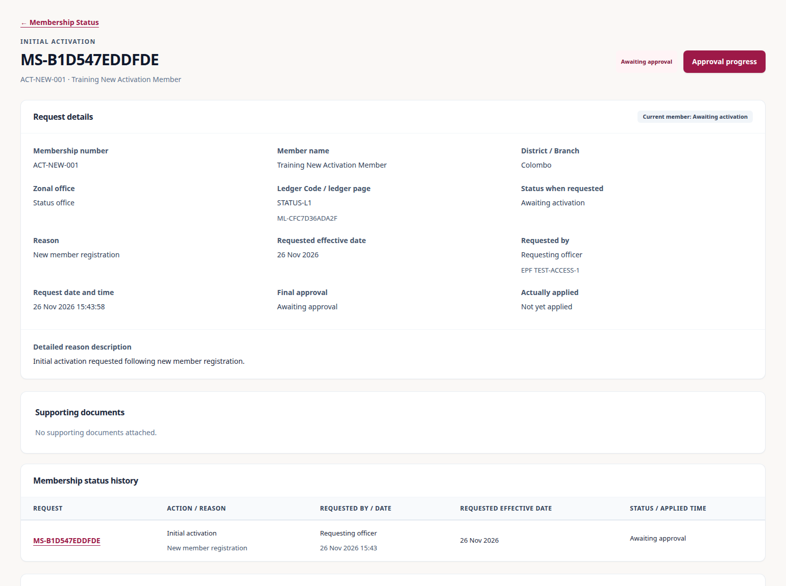

An assigned reviewer opens **Approval requests** or follows the request's **Approval progress** link. The reviewer checks the information and records a decision reason. The next reviewer completes any later levels. In the training example, the member stayed Awaiting activation after the first approval and became Active after final review.

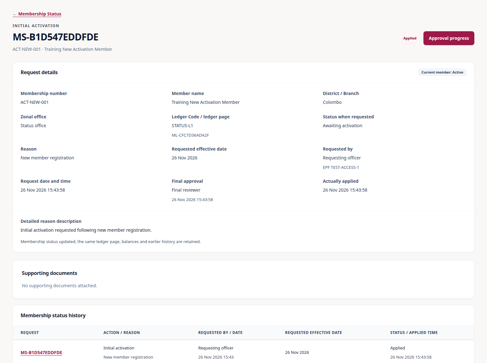

Financial postings are blocked while initial activation is pending. Payment plans can be prepared from the profile where permitted, but registration itself does not post a receipt or deposit. Do not register the same person again because their activation is awaiting review.

If approval configuration is missing or incomplete, registration is not committed and the form reports the issue. Have the administrator complete the hierarchy, then resubmit the registration. Use the separate Member Directory guide for the other registration fields, with this manual's activation steps replacing its earlier immediate-registration behavior.

## 5. Find and follow membership status requests

1. Open **Membership Status**.
2. Search by membership number, member name or request reference.
3. Select a Request status when needed and choose **Filter requests**.
4. Open the **MS-...** request reference.
5. Use **Reset** to clear filters and the page controls for additional results.

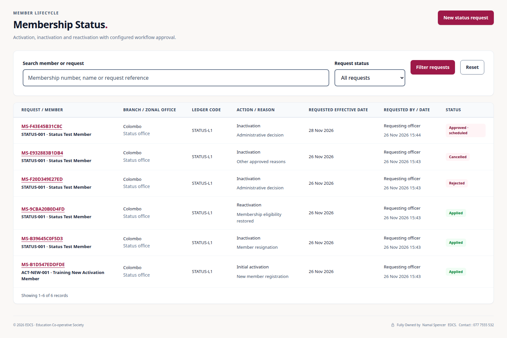

The list shows ten requests per page. Ordinary officers see requests within their authorized member scope. Assigned reviewers can see their designated requests through review authority; they do not receive unrestricted access to all members.

On a request detail page, distinguish **Status when requested** from the member's current status. The captured identity, original status, branch, zonal office, Ledger Code and ledger reference describe the request at submission time. The current member badge can change after approval and application.

Choose **Approval progress** to see review levels and decisions. Reviewers may see **Review approval**. Status details remain available for authorized history enquiries after a request is applied, rejected or cancelled.

## 6. Submit a deactivation request with a valid reason

An inactivation request is available for an existing **Active** member.

1. Open **Membership Status → New status request**, or **Request inactivation** on the profile.
2. Select the member and choose **Review member**.
3. Check membership number, name, District/Branch, zonal office, Ledger Code and the Active status badge.
4. Confirm the requested action **Inactivation**.
5. Select a valid Reason and enter a meaningful Detailed reason description.
6. Choose today or a future Requested effective date.
7. Attach supporting documents where applicable.
8. Choose **Submit for higher-level approval** and read the result.

| Field / information                               | How it is captured                                                                                                 |
| ------------------------------------------------- | ------------------------------------------------------------------------------------------------------------------ |
| Membership number and member name                 | Retrieved from the selected member and retained on the request.                                                    |
| District / Branch, zonal office and Ledger Code   | Retrieved from the current assignment; the ledger page reference is also retained.                                 |
| Current membership status                         | Checked against the requested action and captured at submission.                                                   |
| Reason                                            | Required choice from the approved reason list.                                                                     |
| Detailed reason description                       | Required, 10–3,000 characters after trimming. Explain the actual case rather than repeating a short category name. |
| Requested effective date                          | Required; today or a future date. Backdated requests are rejected.                                                 |
| Supporting documents                              | Optional where applicable; up to five PDF, JPG or PNG files, maximum 5 MB each.                                    |
| Requested By, requester EPF and request date/time | Recorded by the system from the signed-in user and server time.                                                    |

The inactivation reasons are: **Member resignation**, **Death of a member**, **Membership termination**, **Disciplinary action**, **Duplicate membership**, **Membership eligibility issues**, **Administrative decision** and **Other approved reasons**. A category alone does not replace the detailed explanation. Without a valid reason and description, the request cannot be submitted.

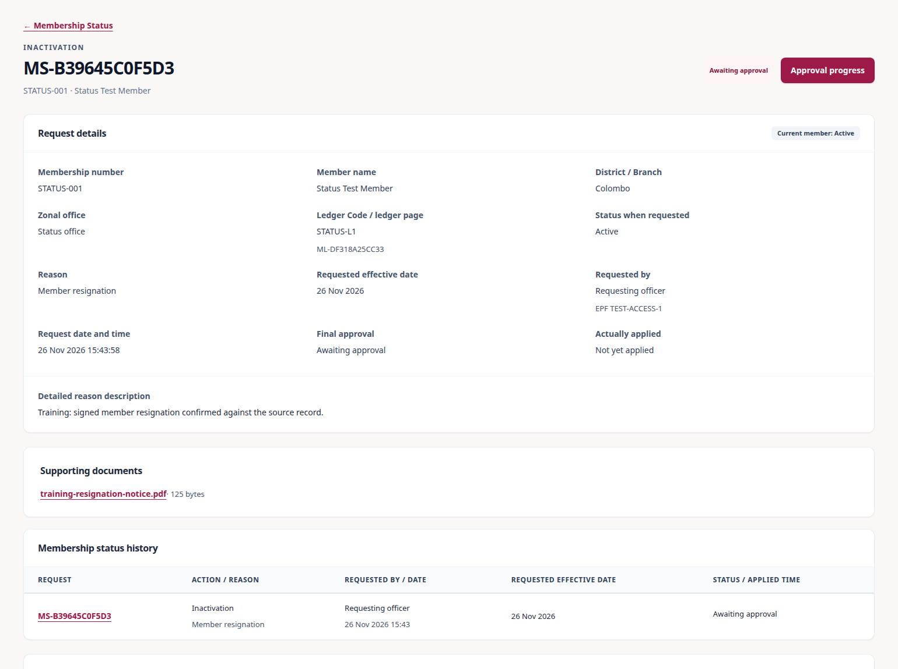

Attach the necessary documents before submitting. Supported files are validated and retained privately. Open a filename from request details or the approval review page to download it with authorized access. An unrelated officer cannot download the document just by knowing its link.

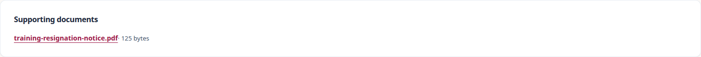

A member can have only one awaiting-approval or approved/scheduled status request at a time. Check the existing request before submitting again. The general **Edit member** form cannot change Active/Inactive status directly, and editing other personal details does not replace this reason-and-approval process.

## 7. Review, approve, reject or cancel a request

### Review and approve

1. Open **Administration → Approval requests**, or follow the request's **Approval progress** link.
2. Find the assigned request and confirm the member and requested action.
3. Open **Member status details & supporting documents** or the document links to inspect evidence.
4. Review the original status, reason, detailed description, effective date and requester.
5. Check the current level and whether requester approval is permitted there.
6. Enter a decision reason and choose **Approve this level** when satisfied.

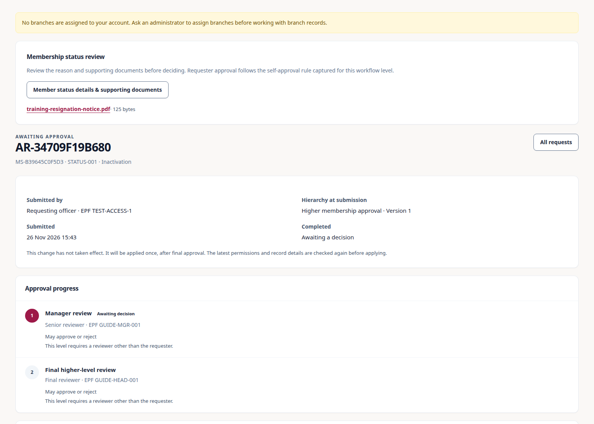

A decision reason is required for Membership Status approvals as well as rejection, cancellation and administrator decisions. The available buttons reflect the user's permissions, assigned level, requester-approval rule and current request state.

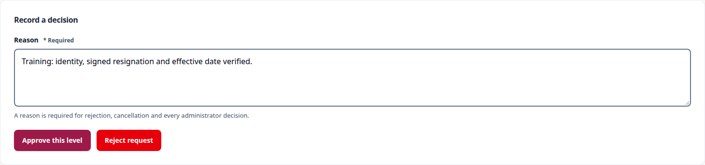

After the first approval in the training example, the member remained Active and the second review level became current. Approval of one level does not itself finish a multi-level workflow.

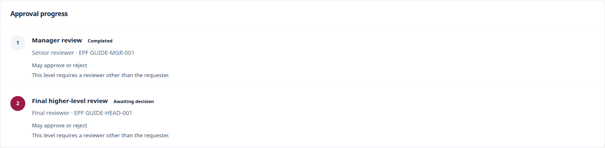

After final approval of a today-dated request, confirm **Applied**, the **Actually applied** timestamp and the member's Inactive status. The **Status when requested** field still shows the original Active status as retained evidence.

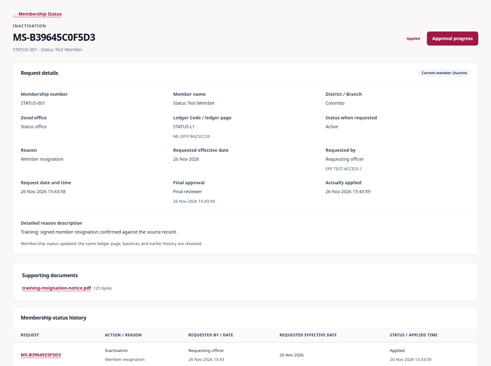

### Reject, cancel and administrator decisions

An authorized reviewer can use **Reject request** where their level permits rejection. Enter the reason and verify the Rejected outcome. The member's status remains unchanged. If rejection is reserved for administrators at that level, the ordinary reviewer's Reject action is unavailable.

The requester or an authorized administrator can use **Cancel request** while it is pending, with a cancellation reason. The cancelled request remains in history and a corrected request can then be submitted. There is no ordinary edit/delete action for rewriting a submitted request.

An authorized administrator may see **Approve all remaining levels**. Record a reason and review the remaining levels before using it. The administrator's authority to override their own request is limited by the captured requester-approval rules explained in section 3. Do not assume a scheduled or completed request can be cancelled using the pending-request action.

## 8. Reactivate an inactive member and retain the same ledger

1. Open the existing Inactive member; keep the same member identity.
2. Choose **Request reactivation**, or select that member in **Membership Status → New status request**.
3. Confirm **Reactivation** and check the member, location and Ledger Code.
4. Select a reactivation reason, provide the detailed explanation and requested date, and attach applicable documents.
5. Submit and complete the configured approval levels.
6. Verify Active membership, the application time and the new active period.

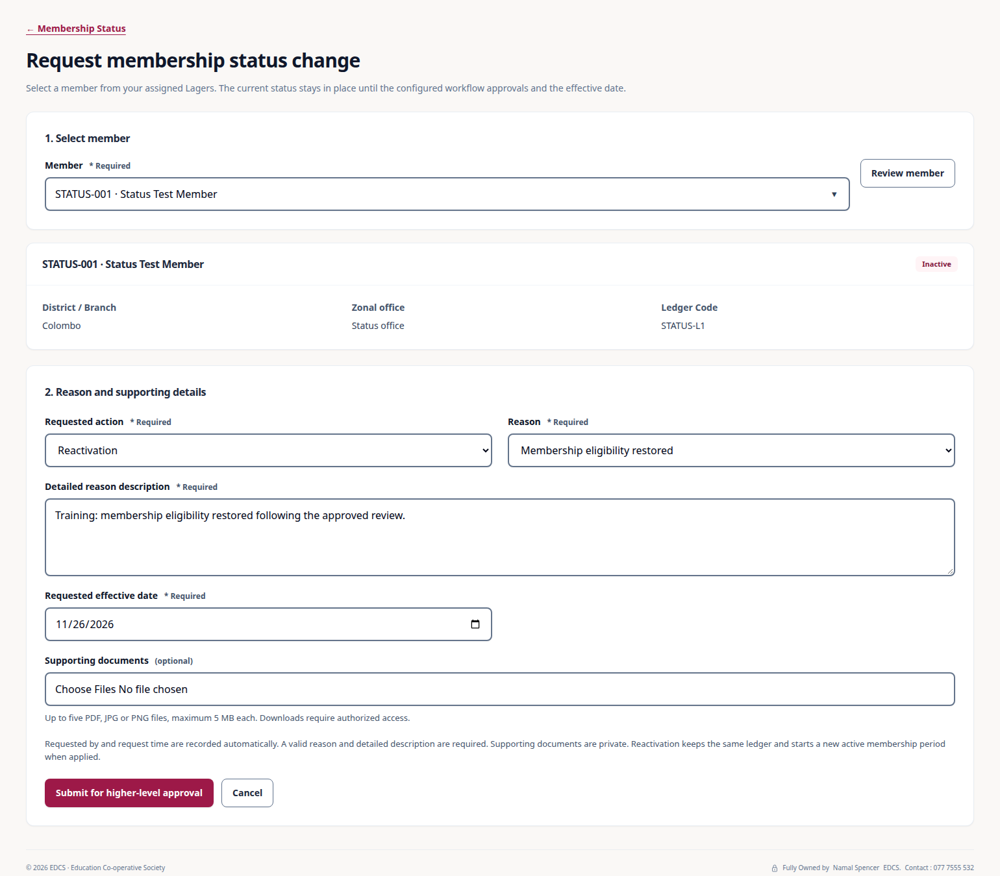

Reactivation reasons are **Membership eligibility restored**, **Disciplinary clearance**, **Approved administrative review** and **Other approved reactivation reason**. The same required description, future-date validation and optional document rules apply. Reactivation needs its own request and approval; a previous activation approval does not authorize a later reactivation.

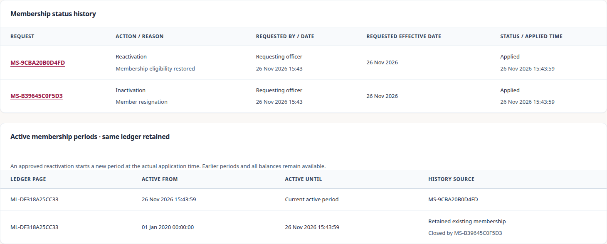

The worked example retained the **same ledger record ID**, the existing **2,500.00** member balance and its original transaction entry. Inactivation closed the earlier active period. Reactivation opened a new period at the actual application time, without creating another member or duplicating a balance.

The ledger page's **Active** label identifies the current ledger page. The member's Active/Inactive membership state is displayed separately. Read the member status badge and membership-history rows when checking whether a status request applied.

## 9. Effective dates, scheduled requests and request statuses

For a requested effective date of today, application happens when final approval completes. If approval arrives later, the actual application time is retained; the system does not backdate the membership status to an earlier requested time.

A future-dated request can complete approval before its requested date. It then remains **Approved · scheduled**, with the member's old status still in place. When it becomes due, application rechecks the requester's permission, current Lager/ledger assignment and membership status.

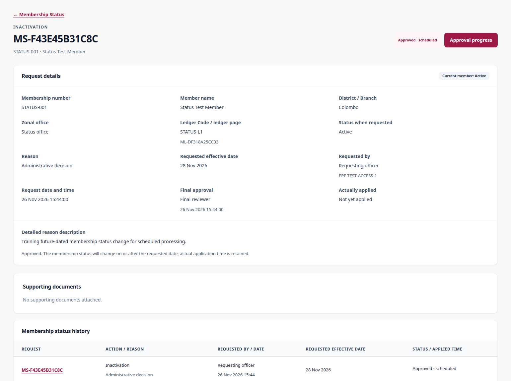

| Request status       | Meaning / next action                                                                                                                                                   |
| -------------------- | ----------------------------------------------------------------------------------------------------------------------------------------------------------------------- |
| Awaiting approval    | Follow Approval progress; complete all required levels. Membership remains unchanged.                                                                                   |
| Approved · scheduled | Approval is complete, but the requested date has not yet been applied. Check the date and later application outcome.                                                    |
| Applied              | The membership change completed. Check the current member status and actual application timestamp.                                                                      |
| Rejected             | A reviewer declined the request. Review the reason; submit a new justified request if appropriate.                                                                      |
| Cancelled            | The pending request was withdrawn. The retained record is not deleted.                                                                                                  |
| Could not apply      | Current data or authorization no longer satisfies the approved request. Have the administrator review the outcome and submit a new authorized request when appropriate. |

Due requests are checked during authenticated workspace requests. For execution during quiet periods, the deployment administrator can schedule **apply_membership_status** at least once a minute using the application's configured environment. This operational command is documented in the supplied Membership Status setup instructions; ordinary users follow the request status and application timestamp.

A later hierarchy edit does not rewrite an already-submitted request's captured levels. If the member moved to a different Lager/ledger, their membership status changed or the requester lost access while waiting, application can fail rather than applying an outdated request. Preserve the failed request and investigate its outcome.

## 10. Audit history, troubleshooting and completion checklist

Use **Membership status history** on the member profile or request detail to inspect earlier requests. **Active membership periods** shows when membership was active, its end time where applicable and the request that opened/closed the period.

Open **Member Ledgers → the member's ledger page** to inspect **Membership activation / inactivation history**. Applied changes retain the old/new status, reason, detailed description, request reference, reviewer and effective time. Previous ledger and financial history remain available according to access.

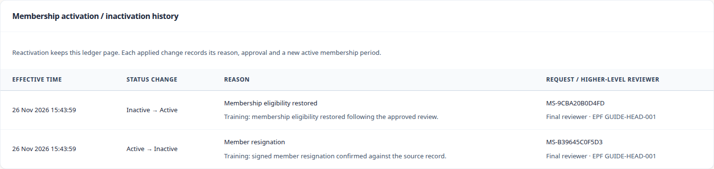

Authorized audit users can open **Audit Logs**, select **Membership status** and filter by date, action or reference. The general member status edit also appears under the Members audit scope. Approval requests retain their own approval audit trail and decision reasons.

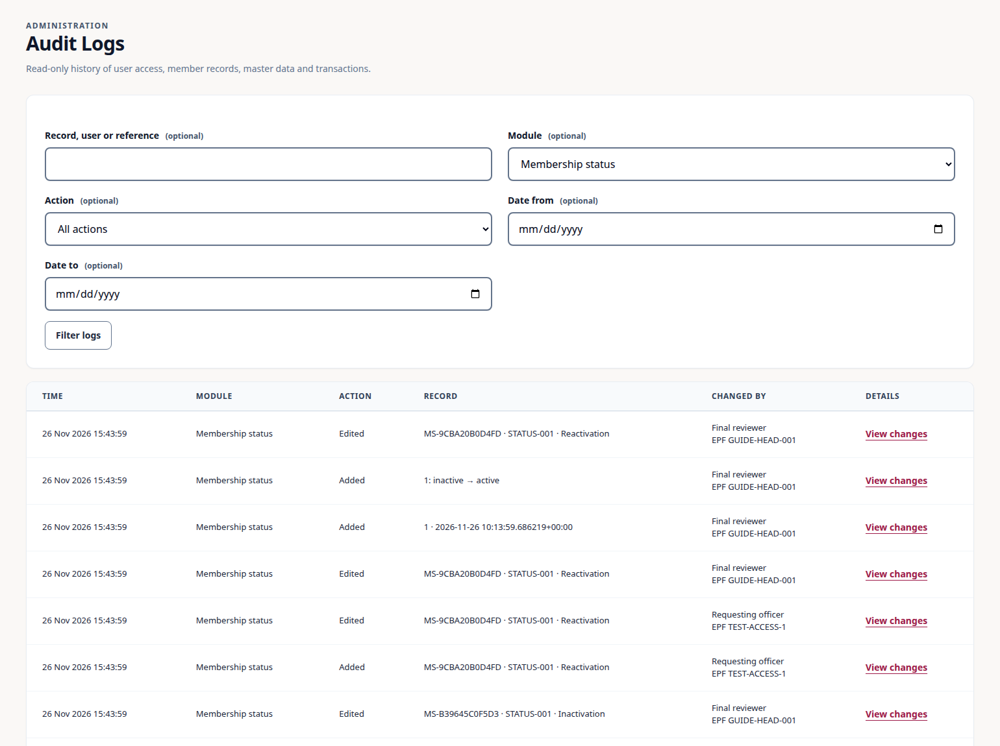

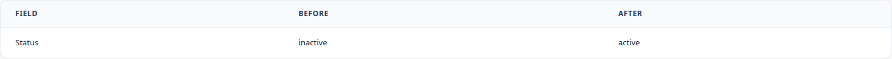

Existing active records can show an imported baseline marked **Retained existing membership**. This preserves the known starting position; it does not invent historical approval reasons from before the module existed. Supporting-file metadata is audited, while private document bytes are not copied into audit JSON.

| Problem or message                                        | What to check                                                                                                                |
| --------------------------------------------------------- | ---------------------------------------------------------------------------------------------------------------------------- |
| Membership Status link or action is missing               | Check Membership Status View/Add/Edit permissions and current member state.                                                  |
| Member is absent from selection                           | Check assigned Lager, branch, zonal office, active user and EPF; Retired members are excluded.                               |
| Registration or submission says configure hierarchy       | The administrator must activate a dedicated Membership Status policy with usable authorized reviewers at every level.        |
| Cannot submit without a reason                            | Select a valid reason and enter 10–3,000 characters of meaningful detail.                                                    |
| Backdated requested date is rejected                      | Use today or a future date. Actual application time is retained separately.                                                  |
| File upload is rejected                                   | Use up to five matching PDF/JPG/PNG files, each containing data and no larger than 5 MB.                                     |
| Another open request exists                               | Review the pending/scheduled request first. Avoid duplicate submissions.                                                     |
| Requester cannot approve                                  | Check the captured level's self-approval setting, explicit user assignment, Edit/review permission and current review level. |
| First approval did not change status                      | Complete the remaining levels; also check whether the approved request is future-dated.                                      |
| Request is approved/scheduled but membership is unchanged | Check its requested date, actual application time and due-processing outcome.                                                |
| Member is Inactive but ledger still says Active           | The current ledger page remains in use; membership status is a separate state.                                               |
| Could not apply                                           | Read the outcome and recheck current ownership, permissions, status and ledger before resubmitting.                          |

Before submitting, confirm the member number/name, assigned Lager, action, reason, detailed explanation, date and documents. Before approving, confirm the evidence, assigned level and requester-approval rule, and record the decision reason. After application, verify the current membership state, actual application time, same ledger identity, retained balance and new/closed active period.

The administrator controls the real approval accounts and order. The fictional Manager and Final reviewer in this manual illustrate a two-level process; they are not instructions to grant authority to a particular real user. Related documents are the **Membership Status setup instructions**, **Member Directory User Guide** and **Member Lagers & Ledgers User Guide**. Screens are current as of 26 November 2026.
