# Member Directory User Guide

EDCS Member Management System

Prepared: 26 November 2026 · Time zone: Asia/Colombo · Current-system guide v1.0

A practical guide to registering, finding, viewing, editing and transferring members, with every current member-profile option explained. It includes member and child deposit enquiries, contributions, ledger continuity, retirement, printing, audit history and protected deletion.

The screenshots show the current application with fictional training records. Registration, approval, transfer, receipt, debit, retirement and protected-delete outcomes were checked through the real application views in a disposable PostgreSQL database. Browser-filled forms illustrate the steps; live member records and approval settings were not changed. Sample amounts and dates are training examples.

### Contents

1. Access, preparation and the member workflow
2. Find members, filter the directory and export CSV
3. Add a member: location and officer
4. Add a member: identity, contact details and registration
5. Read the profile and use its actions
6. Set a payment plan and original opening balances
7. Edit a member, follow approval and inspect changes
8. Check member balances and transaction statements
9. Receive contributions and add debit or credit entries
10. Register children and use child deposit accounts
11. Quarterly interest and Fix Deposit options
12. Transfer a member and follow approval
13. Verify original and receiving ledgers; change officer
14. Process retirement or mark a member inactive
15. Print the profile and understand protected deletion
16. Troubleshooting, completion checklist and related guides

## 1. Access, preparation and the member workflow

Sign in and open **Members** in the sidebar to reach the Member Directory. Use an account authorized for the member's branch, zonal office and assigned Lager. In the current system, a member's Lager and its maintenance officer also determine ordinary-user access. An administrator can see broader records than a normal officer.

Before registration, confirm that the branch, zonal office, department, Lager and its assigned active maintenance officer exist. The officer must have an EPF and the appropriate branch and zonal-office assignments. Add missing master records first using the separate Master Data Adding Guide. Screen labels **Branch** and **Department** correspond to District and School in some internal names.

| Task                                  | Required access / preparation                                                                                                   |
| ------------------------------------- | ------------------------------------------------------------------------------------------------------------------------------- |
| Find, view and export members         | Members View, plus access to those records.                                                                                     |
| Register a member                     | Members Add; valid department, Lager and officer setup.                                                                         |
| Edit or process retirement            | Members Edit, plus access; approval may apply.                                                                                  |
| Transfer                              | Member Transfers Add and access to the current member and receiving location. View permission is separate for transfer history. |
| Inspect ledgers / change officer      | Member Ledgers View / Edit respectively.                                                                                        |
| View financial or child records       | The relevant module's View permission; Members View alone does not grant these.                                                 |
| Post contributions or account entries | The relevant Add permissions and current financial-period rules.                                                                |
| Delete                                | Members Delete; existing ledger and financial references can still protect the record.                                          |
| Configure approvals and users         | System administrator; a role name alone does not make a user an administrator.                                                  |

The normal sequence is: search for an existing member → register once → verify the profile and original ledger → set the payment plan and any legitimate original balances → record actual paid transactions → use Edit for corrections and Transfer for location changes. Each linked financial module retains its own permissions and validation.

## 2. Find members, filter the directory and export CSV

1. Open **Members**.
2. Enter a member number, name, short name, computer number, NIC or mobile number in Search.
3. Narrow the results with Branch, Zonal office, Lager, Status, Gender or admission-date From/To filters.
4. Select the sort order and apply the search/filter action.
5. Open the member's name or view action to see the profile.
6. Clear the filters when returning to the complete authorized list.

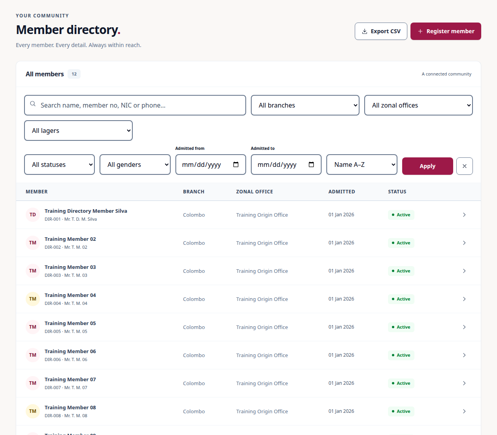

The default order is newest records. Other choices include oldest records, name A–Z and admission date with the newest admission first. Date filters include both selected endpoints. Status choices include Active, Inactive and Retired.

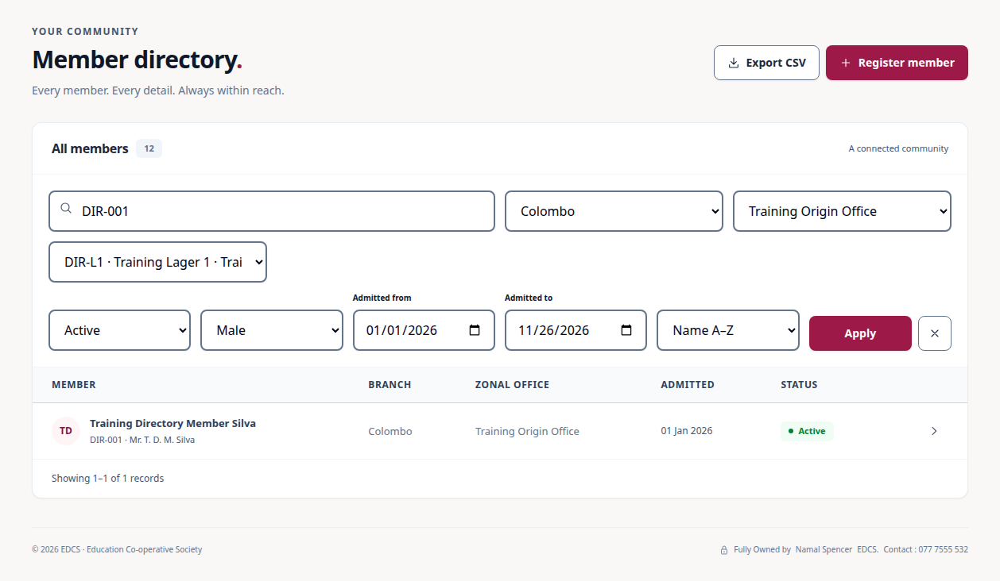

The list shows ten members per page. Use the page controls to reach the remaining results; a page is not the complete directory.

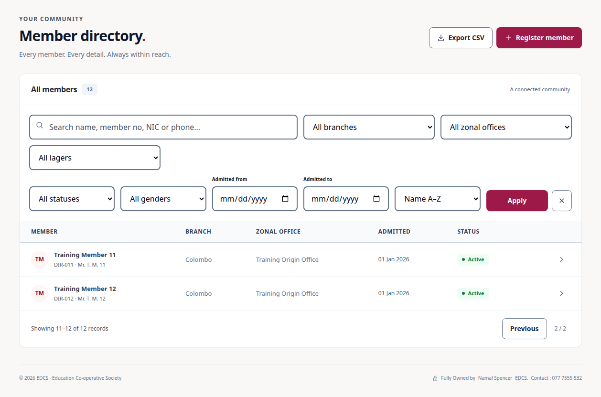

**Export CSV** downloads all authorized matches for the selected filters, across every page. Open it in a spreadsheet. The directory has no bulk-import action.

## 3. Add a member: location and officer

1. In the directory, choose **Register member**.
2. Search for and select the correct **Department**, or select Branch and Zonal office to narrow departments first.
3. Confirm the resulting Branch and Zonal office. Province details come from the selected branch and are read-only here.
4. Select the correct **Lager** in that office.
5. Select the subdivision when applicable; it is optional.
6. Confirm the **Ledger Maintenance Officer** and displayed EPF. The Lager determines its assigned officer; resolve a wrong or missing assignment in the master/user setup before registering.

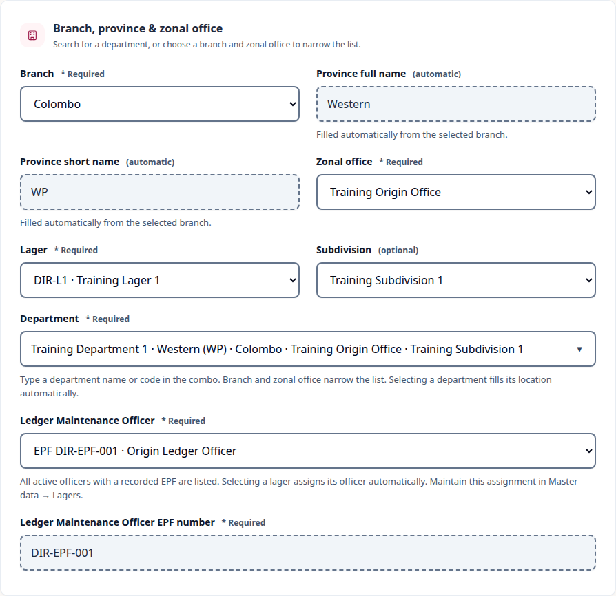

Department and Lager are required. For missing selections, have an administrator check active status, location, EPF and access before creating another master record.

## 4. Add a member: identity, contact details and registration

Complete the **Member information** section using verified source details. Date input format follows the browser locale; these screenshots display month/day/year, while profile dates use named months.

| Field                                | Entry rule                                                                                                                                                   |
| ------------------------------------ | ------------------------------------------------------------------------------------------------------------------------------------------------------------ |
| Member number                        | Required and unique; normalized to uppercase. Maximum 30 characters.                                                                                         |
| Computer number                      | Required by the current form and unique when supplied; maximum 30 characters. Its current helper text says “Optional”, but form validation requires a value. |
| Title and full name                  | Required. Full name allows up to 200 characters.                                                                                                             |
| Short name                           | Generated from title and full name; review the result.                                                                                                       |
| Date of birth                        | Required; cannot be a future date.                                                                                                                           |
| Retirement age / expected retirement | Displayed calculations. Retirement age is 60 and the expected date is derived from birth date.                                                               |
| NIC                                  | Required and unique. Use a valid twelve-digit NIC or nine digits followed by V/X.                                                                            |
| Gender                               | Required; select a configured gender option.                                                                                                                 |
| Admission date                       | Required; cannot be a future date.                                                                                                                           |
| Salary                               | Optional reference amount; it does not automatically calculate the payment-plan contribution.                                                                |
| Status                               | Required. Use Active for a normal current member.                                                                                                            |
| Recorded retirement / pension date   | Enter when applicable; required for Retired status. This is distinct from the expected retirement date.                                                      |

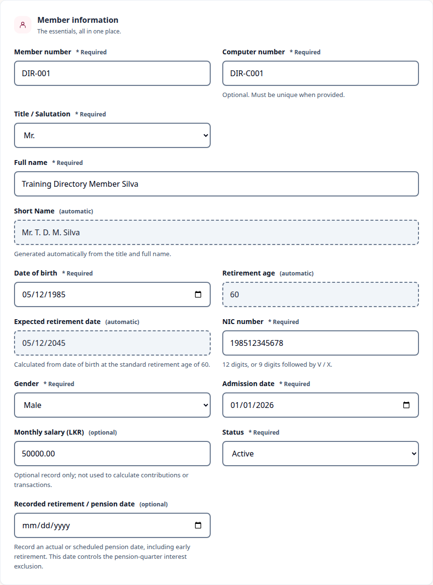

Next complete **Contact & addresses**. Mobile number, office address and private address are required. Office and home telephone numbers are optional. Telephone values must satisfy the form's format validation; enter 7–15 digits for ordinary telephone values rather than free text.

1. Review the location, identity and contact sections.
2. Choose **Register & set payment plan** when that button is available, or **Register member** when payment-plan creation is not permitted.
3. Resolve any highlighted field errors and submit again.
4. Verify the new member number and profile or selected-member payment-plan page.

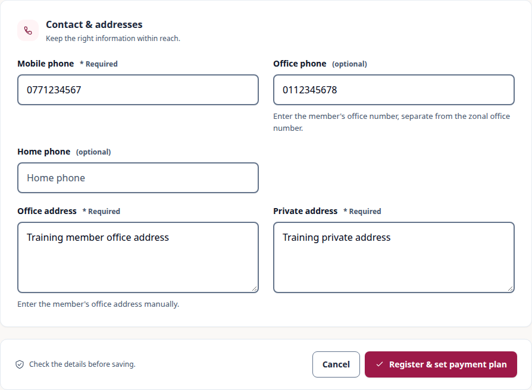

Successful registration creates the member and an original permanent ledger with its assigned officer. The payment-plan button opens the next setup form; it does not itself create a plan, cash receipt or deposit credit. If the next page reports missing payment permissions, verify the profile before attempting registration again.

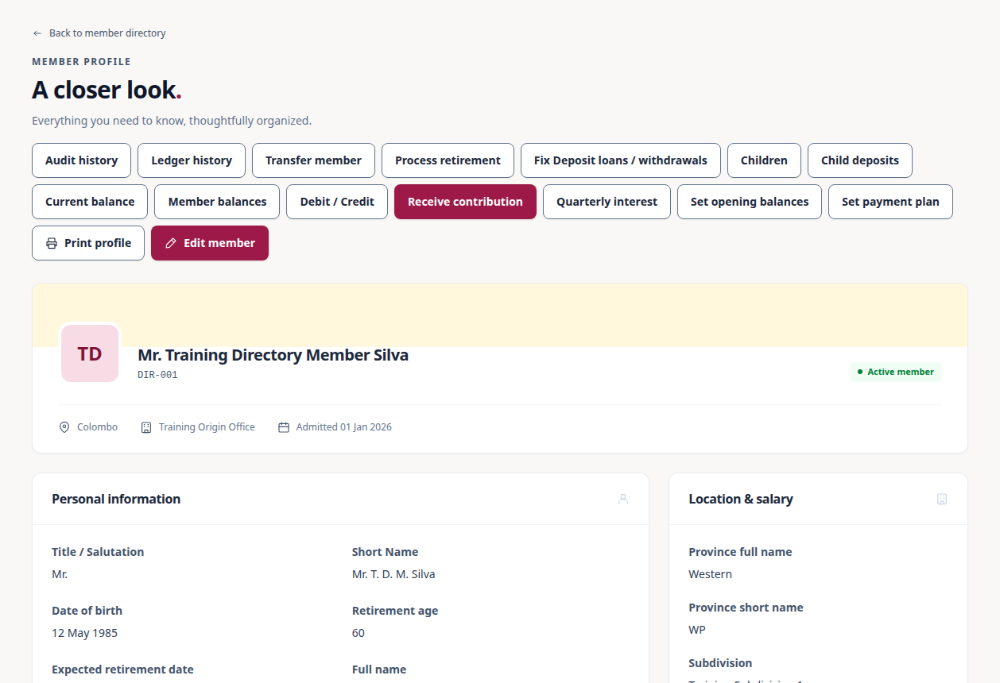

Duplicate member number, computer number or NIC values produce validation errors. Correct the existing record when appropriate instead of registering the same person again.

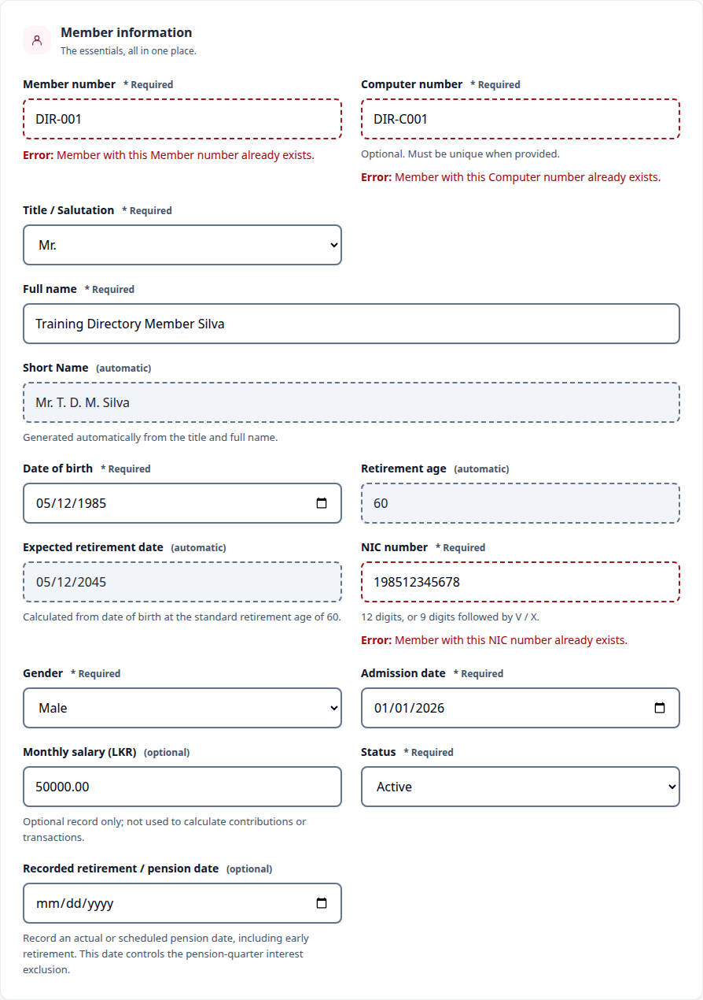

## 5. Read the profile and use its actions

Open a member from the directory. The profile presents identity, contact and location information, salary reference, contribution totals, original opening amounts and recent changes. Confirm the member number and NIC before posting any financial transaction.

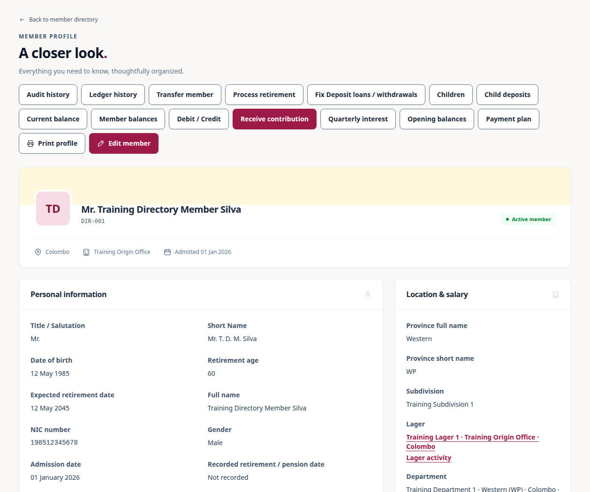

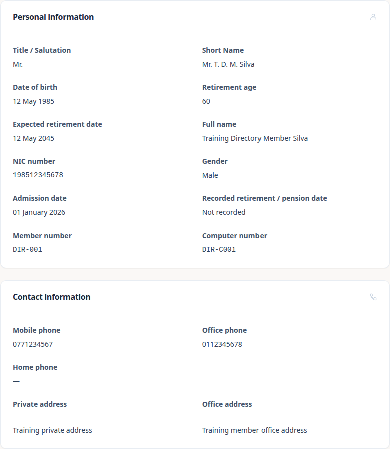

The available actions depend on permissions and whether a linked record already exists. An account with Add but no View may see a creation action in place of an enquiry link. The administrator screenshots expose more options than an ordinary officer may see.

| Profile option                                          | Purpose and guide section                                                     |
| ------------------------------------------------------- | ----------------------------------------------------------------------------- |
| Edit member                                             | Correct permitted personal/contact details; section 7.                        |
| Audit history / Full audit                              | Inspect member changes and wider audit records where permitted; section 7.    |
| Ledger history                                          | Open permanent original and subsequent ledgers; section 13.                   |
| Transfer member                                         | Move the existing member through the transfer workflow; section 12.           |
| Process retirement                                      | Record actual retirement and update status; section 14.                       |
| Payment plan / Set or Edit payment plan                 | Maintain scheduled contribution amounts; section 6.                           |
| Opening balances / Set or Edit opening balances         | Maintain legitimate original brought-forward amounts when allowed; section 6. |
| Current balance                                         | Selected-member monthly enquiry and transaction history; section 8.           |
| Member balances                                         | Balance report by account/payment type; section 8.                            |
| Debit / Credit or Add debit / credit                    | Post or inspect account entries; section 9.                                   |
| Receive contribution                                    | Allocate money actually received; section 9.                                  |
| Children / Add child                                    | Register and manage linked children; section 10.                              |
| Child deposits                                          | Open and inspect each child's actual deposit accounts; section 10.            |
| Quarterly interest                                      | Inspect member and child interest calculations/postings; section 11.          |
| Fix Deposit loans / withdrawals or Register Fix Deposit | Open fixed-deposit servicing options; section 11.                             |
| Print profile                                           | Print or save the printable profile; section 15.                              |
| Lager activity                                          | Inspect authorized activity for the member's current Lager; section 7.        |
| Delete member record                                    | Open confirmation, subject to record protection; section 15.                  |

A contribution total measures receipts and can include allocations into child deposits. It is not the member's current account balance. Use the balance and statement pages for financial enquiries.

## 6. Set a payment plan and original opening balances

### Set the payment plan

1. From registration or the profile, open **Set payment plan**.
2. Confirm the selected member and agreement date.
3. Select a plan template when applicable or enter the permitted amounts for active Payment Types.
4. Check that at least one contribution amount is positive and review the monthly total.
5. Save and return to the profile or plan detail to verify the values.

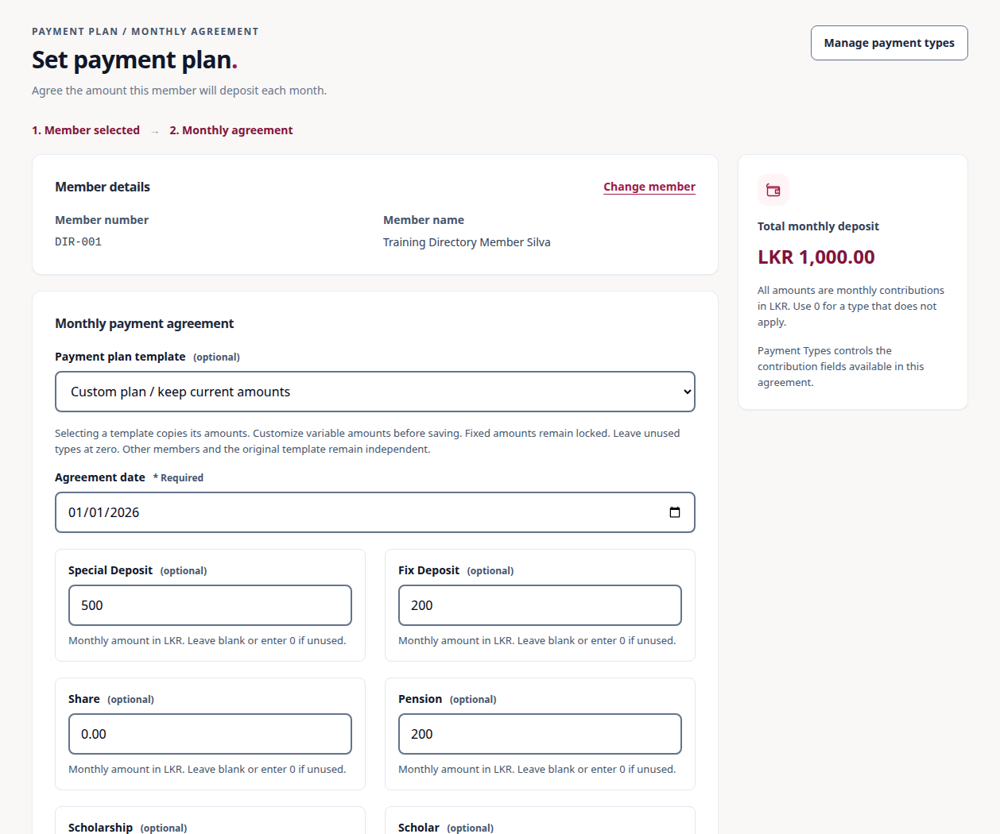

The training plan is Special Deposit 500.00, Fix Deposit 200.00, Pension 200.00 and Funeral 100.00. Fixed template-controlled rows may be locked. Maintain templates through their master screen; do not assume editing a template rewrites every already-created member plan. A plan schedules amounts. Only an actual posted receipt or credit adds money to an account.

### Set original opening balances

1. Open **Opening balances** or **Set opening balances** from the profile.
2. Check the member and original balance date.
3. Enter approved brought-forward amounts separately for each member Payment Type.
4. Save and check the amounts in the balance enquiry.

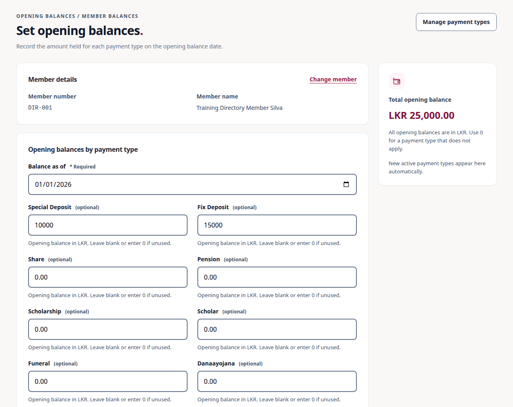

Use original openings for migration or genuine starting balances. Do not repeat them as receipt credits or create them again after a transfer or year-end. Child account openings belong to each Child Deposit account. Later interest or fixed-deposit activity can lock opening-balance changes; investigate a blocked correction through the approved financial workflow.

## 7. Edit a member, follow approval and inspect changes

1. Open the correct profile and choose **Edit member**.
2. Change the permitted details, such as mobile number or private address.
3. Review the complete form and choose its save action.
4. Read the success or pending-approval message before assuming the profile has changed.

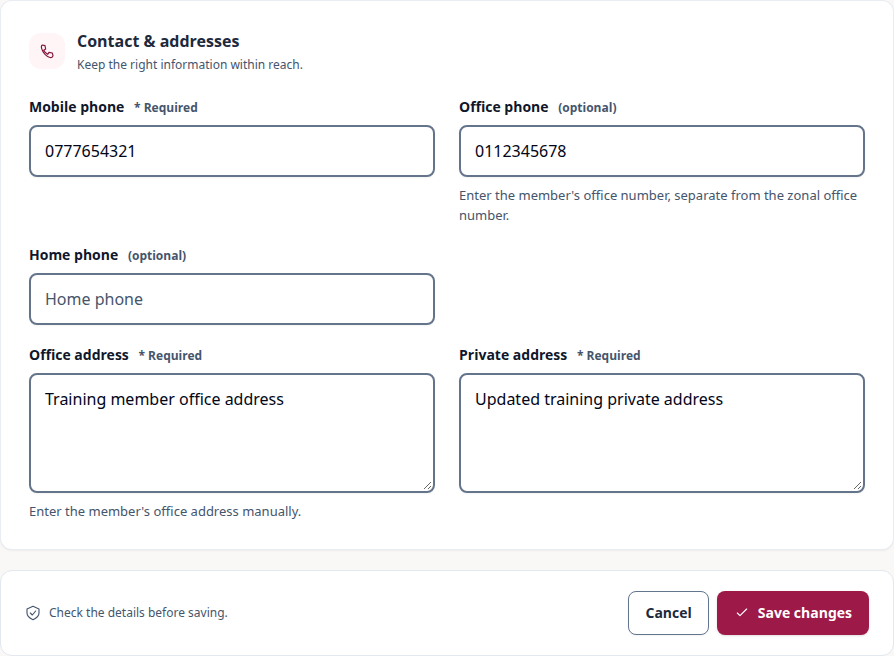

A registered member's Branch, Zonal office and Department cannot be relocated through ordinary Edit. Use **Transfer member** so the original ledger and responsibility history remain connected.

For an ordinary user, a matching Members/Edit approval hierarchy, or a matching applicable All modules hierarchy, can queue the change. The existing profile remains unchanged until final approval. Without an applicable hierarchy the change may save directly. System administrators can apply changes directly and can override approval requests; the screenshot examples explicitly use administrator review.

1. Open **Administration → Approval requests**, or the submitted request link when available.
2. Find the member edit request and review the proposed changes.
3. The assigned authorized reviewer records a decision and reason through the request screen.
4. After final approval, reopen the member profile and verify the changed values.
5. If rejected or no longer applicable, inspect the outcome and correct/resubmit as instructed.

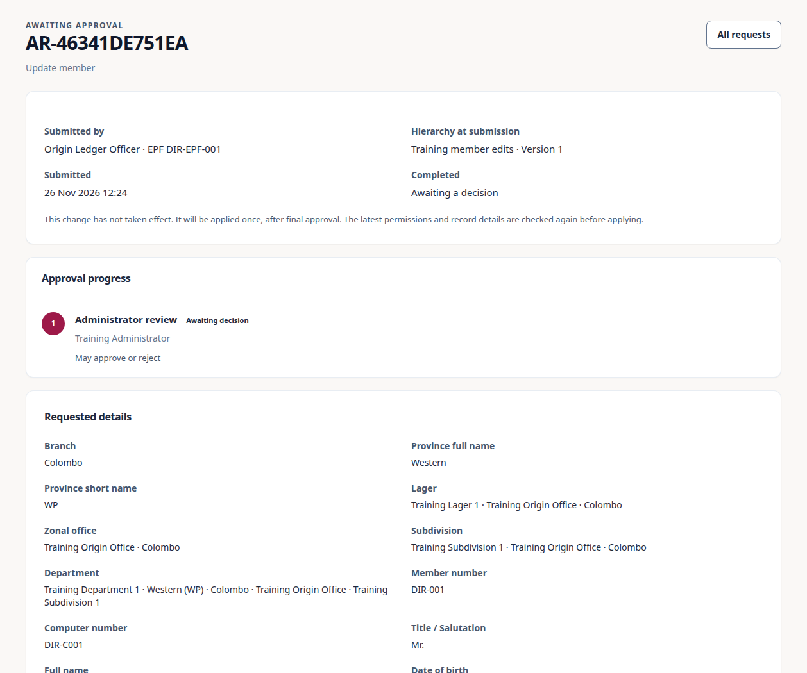

Approval hierarchy configuration belongs in **Administration → Approval hierarchies**, not in Member Directory. The separate Financial Year-End Approval Guide explains creating levels and assigning approvers. Select the correct module and action for member edits or transfers; a year-end hierarchy alone does not govern these actions.

Use **Audit history** or **Recent member changes** to review recorded additions and edits. Entries identify the actor and changed values where available. The full audit screen has its own permissions. Historical activity before audit tracking was introduced may not have an equivalent audit entry.

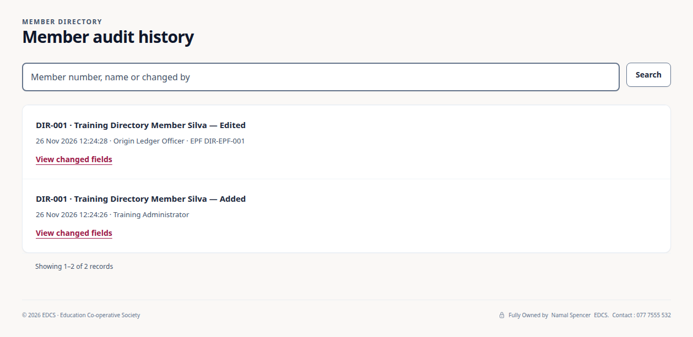

The profile's **Lager activity** link opens the authorized activity enquiry for the current Lager. Use its member/date filters and CSV export when reconciling operational records. This activity view complements the member-change audit.

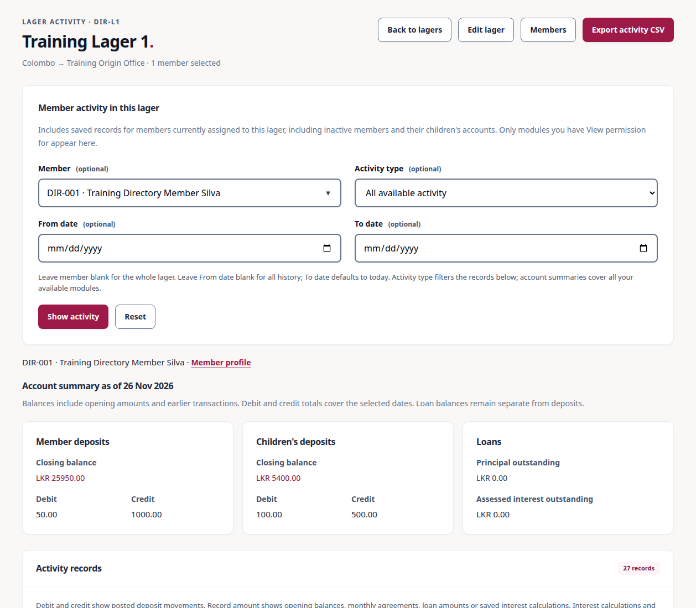

## 8. Check member balances and transaction statements

1. Open **Current balance** from the member profile.
2. Select the required month/date controls and show the result.
3. Review opening/brought-forward amounts, contributions actually paid, other credits, posted interest and debits.
4. Inspect the detail transaction list and open individual account statements when needed.
5. Review child balances separately; do not silently add child money to the member's own accounts.

**Posted member balance = opening / brought-forward balance + paid contributions + other posted credits + posted interest − debits.** Scheduled but unpaid plan amounts are excluded. Interest previews are separate from cash already posted. This is the member account position recorded by the system; it is not an independently reconciled bank statement balance.

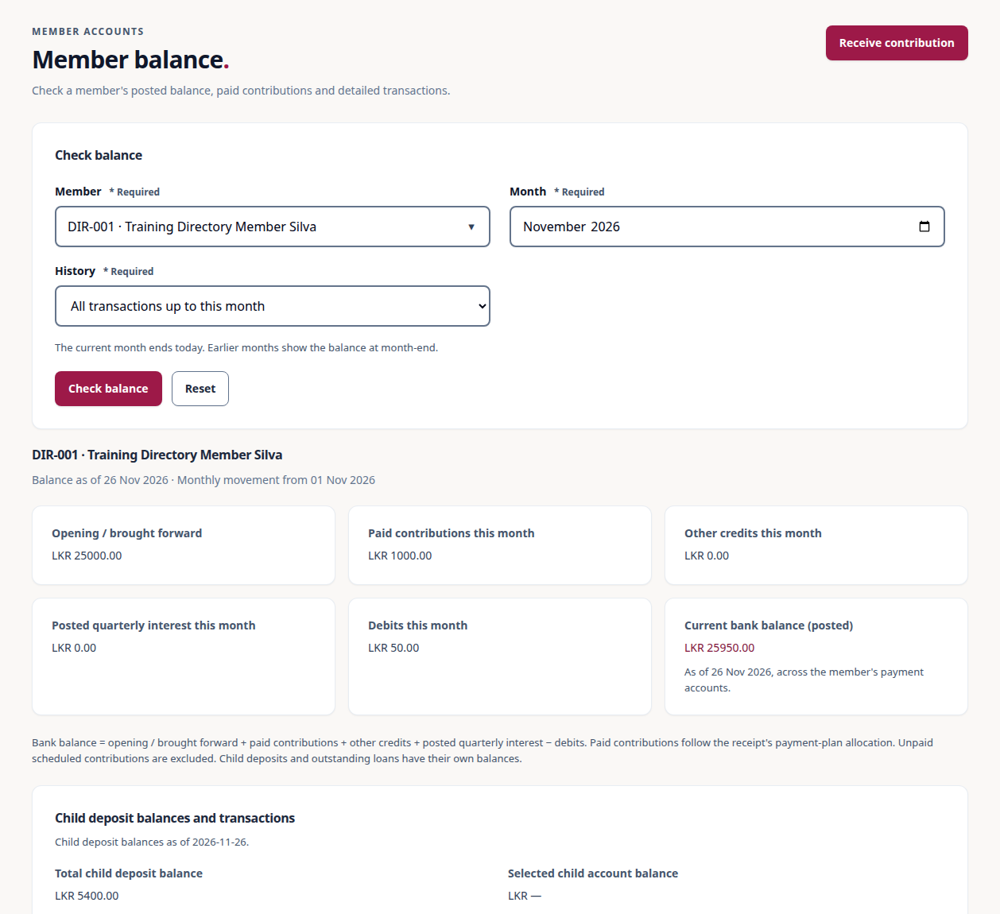

The training member's own balance is **25,950.00**: original openings 25,000.00 + paid member allocations 1,000.00 − debit 50.00. No interest was posted in this example. The child account separately holds **5,400.00**: opening 5,000.00 + paid allocation 500.00 − debit 100.00.

**Member balances** opens the report across Payment Types. Review the selected date range and account rows before reading totals. An individual account statement shows its debit/credit history and running/final balance under the selected filters.

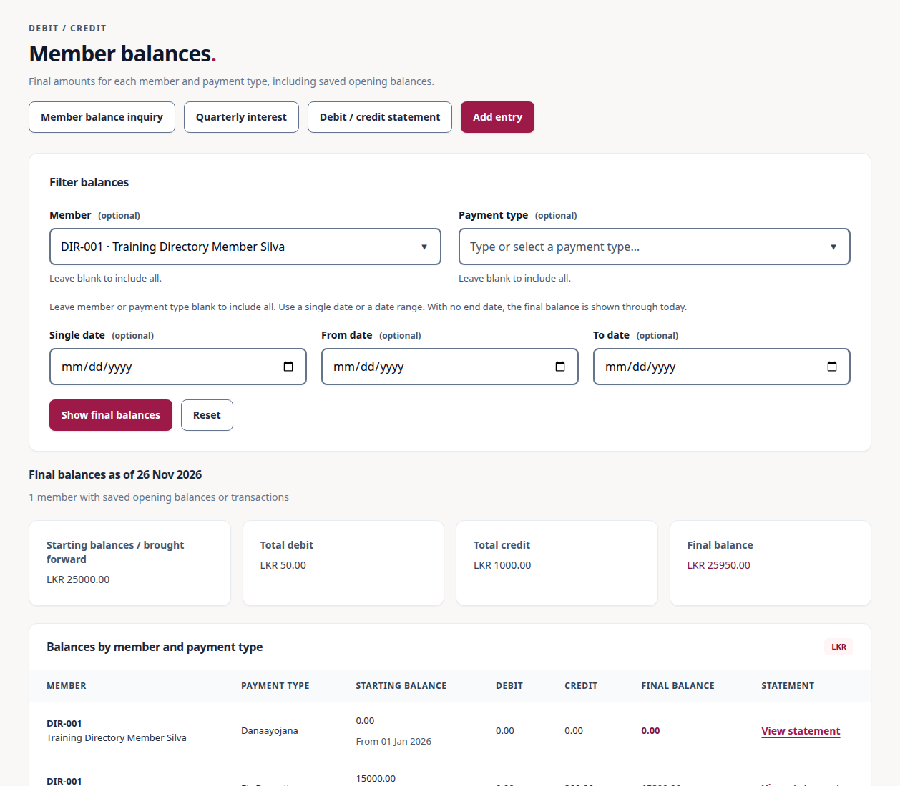

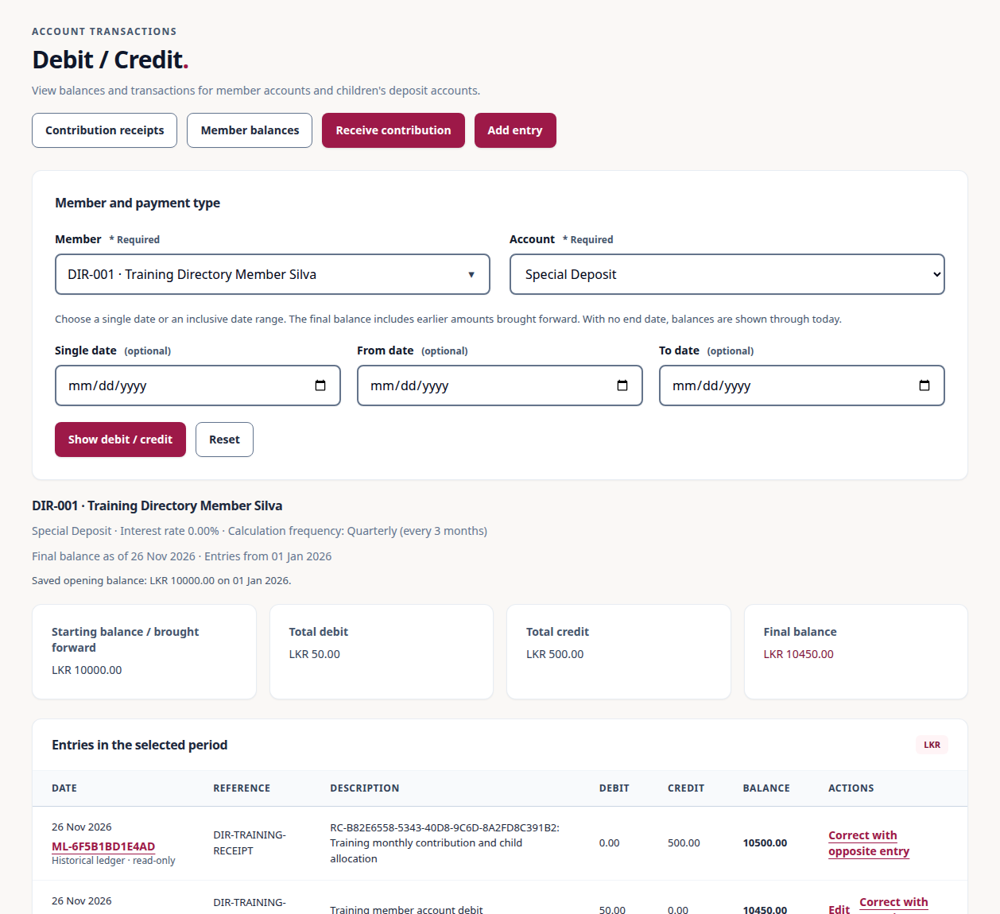

Use all-history or appropriate start-date controls when explaining how a balance accumulated. A monthly transaction list alone omits earlier activity even when the displayed balance includes brought-forward money. If a figure seems wrong, compare original openings, dates, receipt allocations, child ownership, debits and posted interest before entering a correcting journal.

## 9. Receive contributions and add debit or credit entries

### Receive contribution

1. Open **Receive contribution** and confirm the member.
2. Enter the actual receipt date, amount, reference and description.
3. Check the plan-based allocations and adjust only where permitted.
4. Allocate any remaining amount into one or more permitted member accounts or child deposit accounts.
5. For a child type, select the actual child account as well as the type.
6. Preview and review the allocation. The full received amount must be allocated.
7. Post the reviewed receipt and inspect its receipt detail.

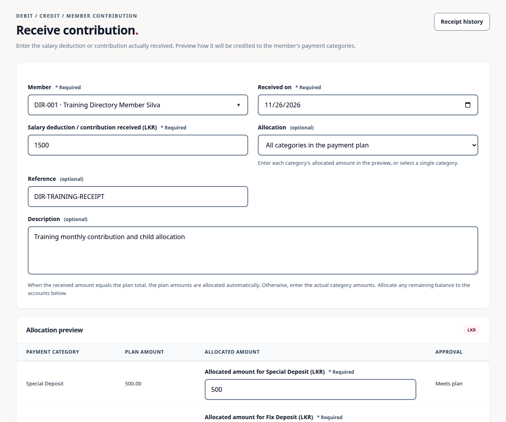

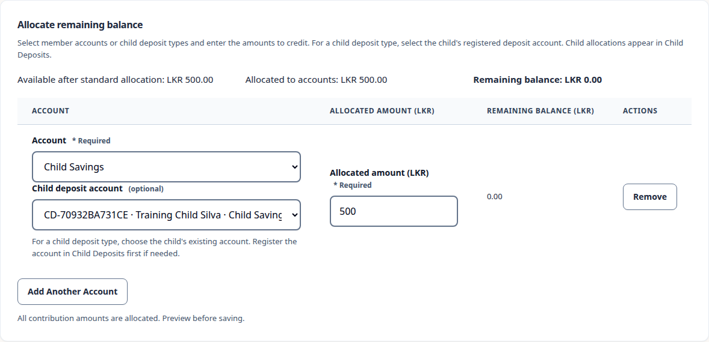

In this example 1,000.00 follows the member plan and 500.00 goes to the child's deposit account. The child's allocation appears in the Child Deposit module and does not inflate the member's own Payment Type balances.

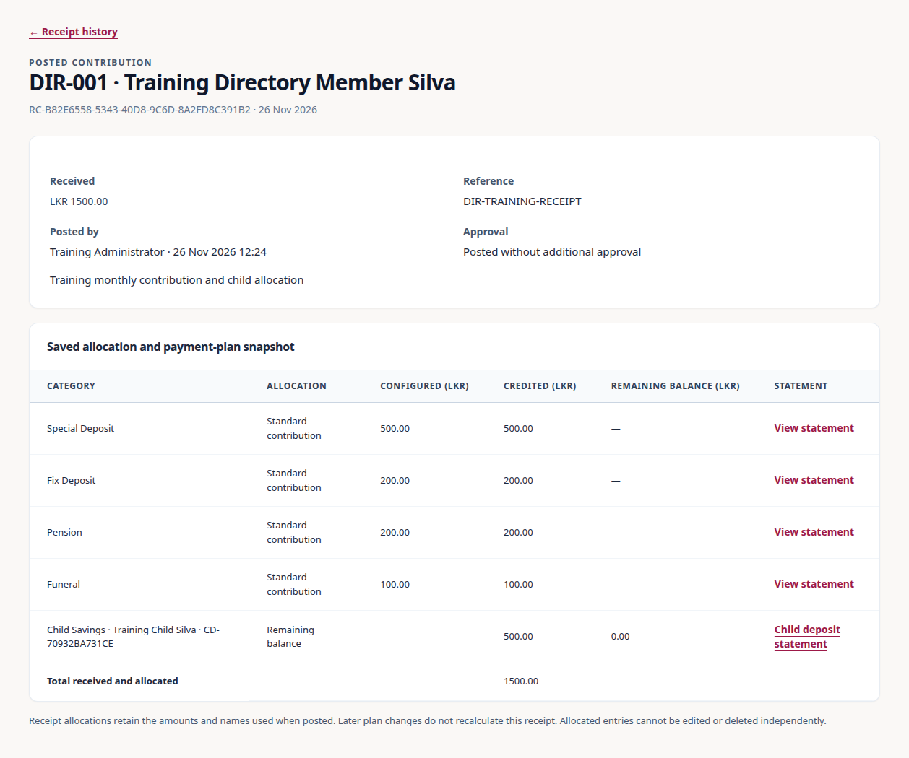

Changing the form after preview requires another review before posting. An ordinary user's below-plan payment may require the separate payment-exception approval workflow. Posted receipts and their linked entries are protected financial records; use the supported correction workflow rather than trying to edit or delete receipt history directly.

### Add debit / credit

1. Open **Debit / Credit** or **Add debit / credit**.
2. Confirm the member and choose the Payment Type.
3. For a child type, choose the actual Child Deposit account and verify the child/account identity.
4. Check the saved balance and recent history.
5. Enter the date, either a credit or debit, and an informative reference/description.
6. Save, then inspect the statement or account detail to confirm the result.

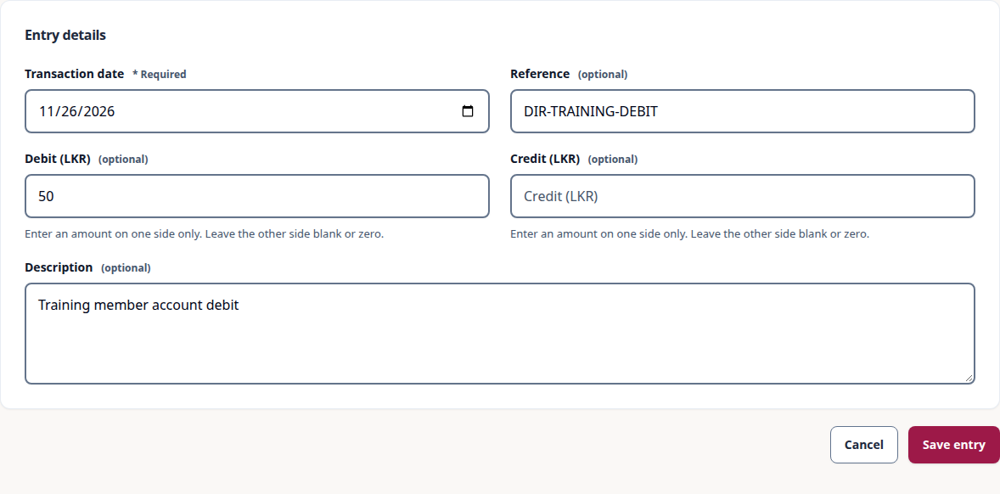

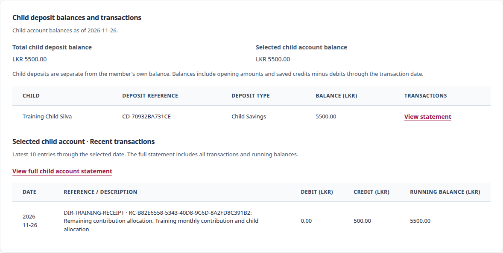

A credit increases the selected account; a debit reduces it. A child entry posts into that child's deposit ledger. Posting child entries requires the relevant child-deposit authority in addition to the entry-form permission. Closed/approved financial periods and other posting rules still apply.

## 10. Register children and use child deposit accounts

1. From the profile, choose **Children** or **Add child**.
2. Confirm the parent member, enter the child's name and date of birth, and set Active as appropriate.
3. Save the child record.
4. Open **Child deposits** and create an actual account for that child using an active Child Deposit Type.
5. Enter the account opening date and legitimate opening amount; save and open its detail page.
6. Receive later contributions or post permitted entries into this exact account.

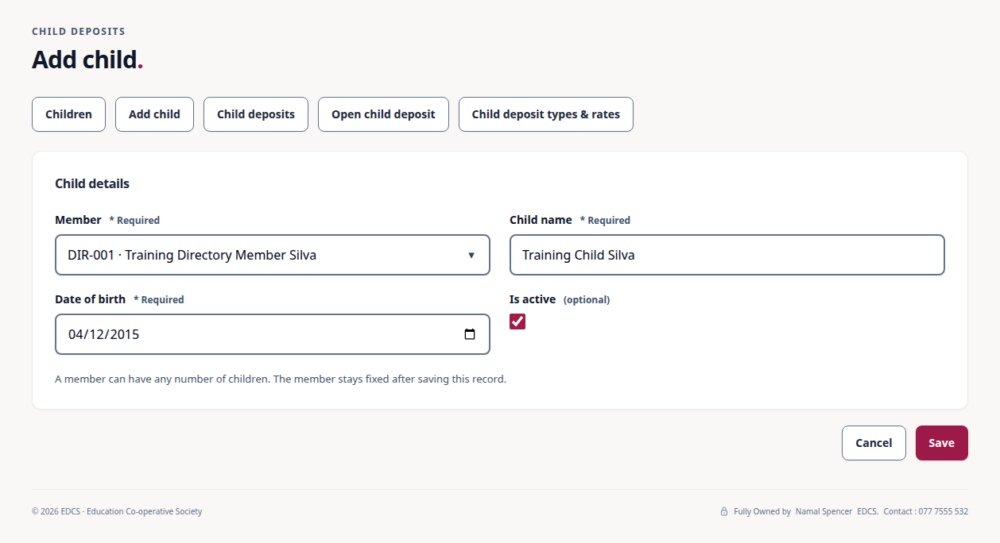

A Child Deposit Type is a master definition. A registered child is a person record. A Child Deposit is the actual financial account. Creating a child or a type alone does not create a funded deposit balance.

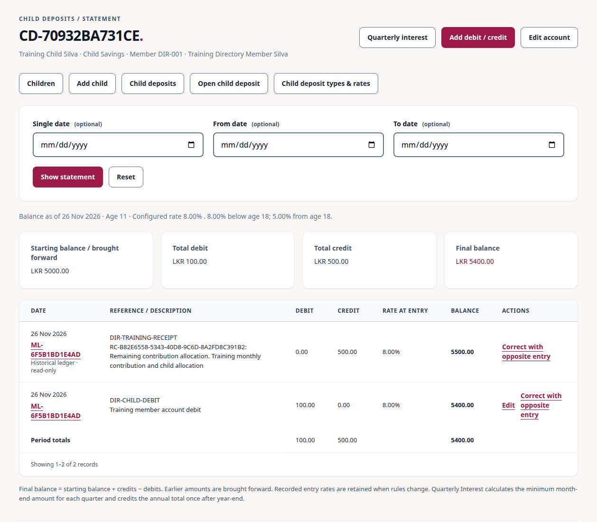

Use the account detail for its balance, transactions and interest information. Multiple children or account types must be checked individually. Figure 24 shows the account before the subsequent 100.00 child debit, so it displays 5,500.00. Figure 26 shows the final 5,400.00. The training account's final 5,400.00 remains separate from the parent's 25,950.00. Transferring the parent preserves the existing child record, account identity and transaction history.

## 11. Quarterly interest and Fix Deposit options

### Quarterly interest

Open **Quarterly interest** from the profile, select the financial year/member and inspect the relevant quarter and account rows. Member Payment Types and Child Deposit Types have separate configured rules.

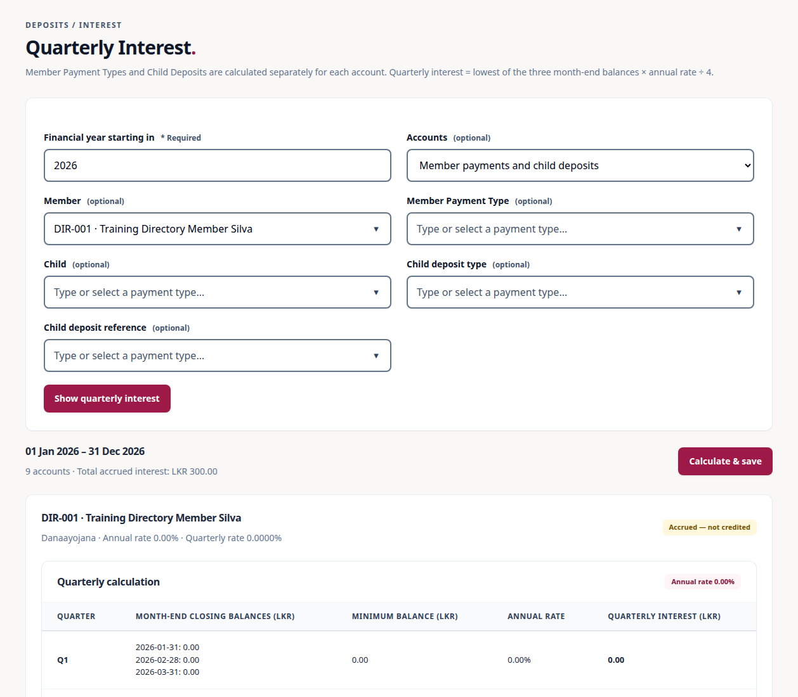

For eligible completed quarters, the calculation uses the lowest of the three month-end balances and the configured annual rate divided by four. Pension/retirement dates and child age thresholds can affect eligibility. A preview is not a posted credit. Annual posting and year-end approval are separate controls; follow the Financial Year-End Approval Guide before authorizing or posting closing interest. Training dates or rates are not institutional policy instructions.

### Fix Deposit loans and withdrawals

Choose **Fix Deposit loans / withdrawals** to open an existing servicing account, or **Register Fix Deposit** if the member needs one and you have Add authority. Select the member, approved rule and cycle start, then save the servicing record.

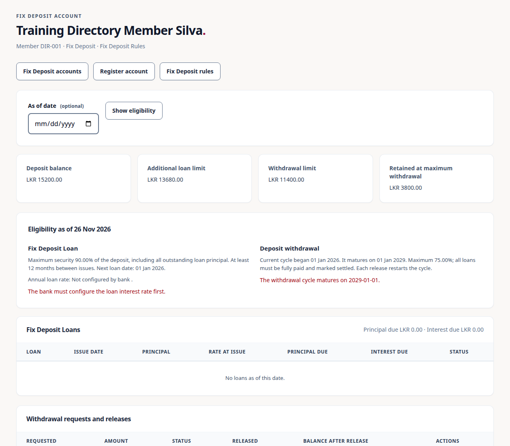

Use the account's specific actions for loans, repayments, guarantors and controlled withdrawals when permitted. Rule limits, qualification and approvals are checked by that module. Registering a servicing record is not a second cash deposit. Do not duplicate the existing member Fix Deposit balance with another opening or manual credit, or replace a controlled withdrawal with an unrelated debit entry.

## 12. Transfer a member and follow approval

Use a transfer when the registered member moves to another branch, zonal office, department or Lager. Keep the same member record; do not create a replacement member or manually copy balances.

1. Open the member's current profile and choose **Transfer member**, or start from the Member Transfers module.
2. Confirm the member and current active ledger shown in section 1 of the form.
3. Select the receiving Branch and Zonal office.
4. Select the receiving Department, optional Subdivision and Lager.
5. Confirm the eligible receiving **Ledger Maintenance Officer** and EPF.
6. Review the receiving location, effective date and reason before proceeding to the completion section.

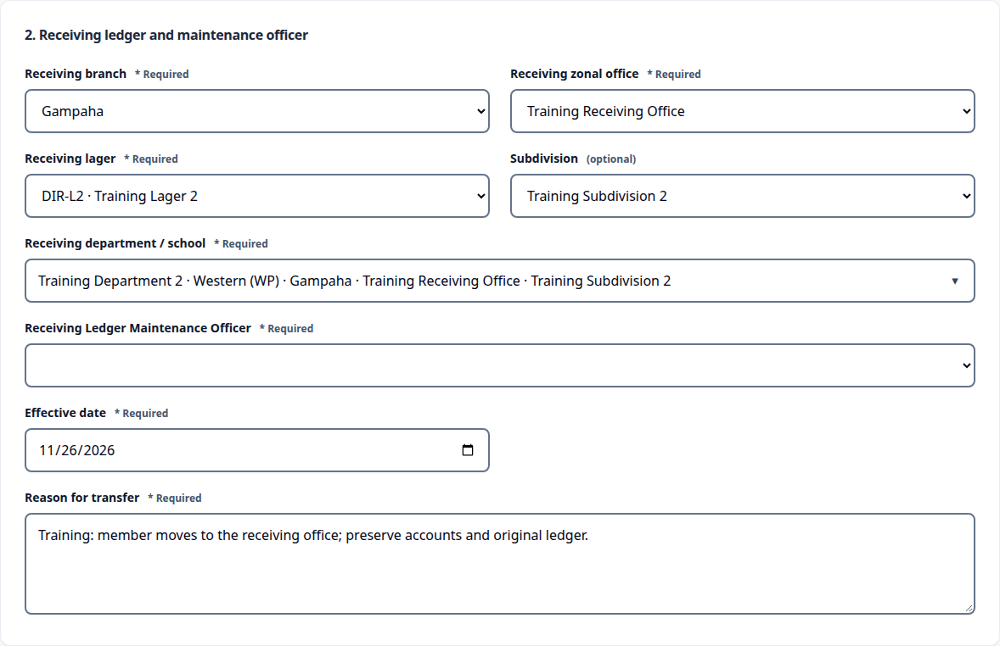

**Current browser limitation observed during this guide:** the receiving-officer dropdown remained empty after selecting the receiving location and Lager. The current transfer template does not supply the officer data expected by the shared browser script. Do not submit an incomplete form or register a duplicate member to work around it. Have the system maintainer correct this selection issue before using the browser to complete a transfer. The approved-transfer and ledger examples below were verified through the actual server views with valid fictional selections in the isolated test database; they demonstrate the supported server workflow, not a successful end-to-end browser submission.

The receiving officer must be active with an EPF and appropriate receiving branch/zonal-office assignments. An ordinary submitter also needs access to the receiving location. An unchanged location/department combination, stale current ledger or inconsistent master selection can be rejected.

7. In the receiving section, enter the effective transfer date and a meaningful reason.
8. Use a date on or before today that is consistent with ledger opening, previous transfers and the latest financial activity.
9. Read the continuity explanation and submit through the form's action.
10. Inspect the resulting request or completed transfer instead of assuming every submission completes immediately.

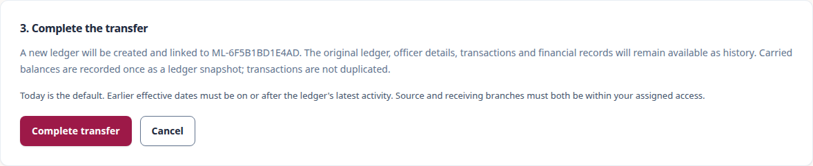

For ordinary users, a matching **Member Transfers / Add** hierarchy can queue the transfer. Configure its levels in **Administration → Approval hierarchies**; the action selector describes the member-transfer/below-plan-payment action for its relevant module. The active ledger remains unchanged while the transfer is pending. Administrator submissions can bypass the hierarchy, and administrator review/override can complete a queued request.

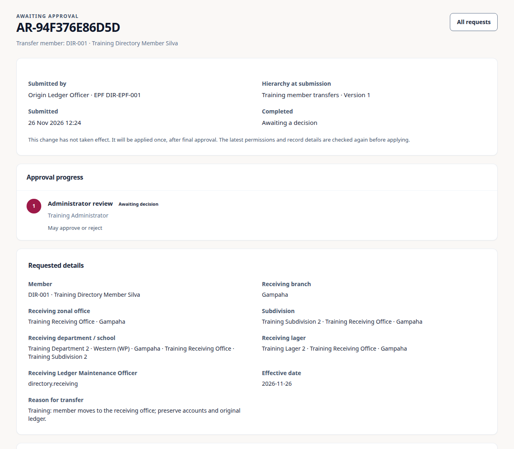

The system uses configured levels and assigned approvers; it does not automatically impose a separate receiving-officer sign-off unless your hierarchy provides it. Reviewers need the relevant record access. If an ordinary assigned reviewer cannot access the request, have an administrator check the approval and access setup.

After approval, open the completed transfer and confirm the source/receiving ledgers, date, officers and carried amounts.

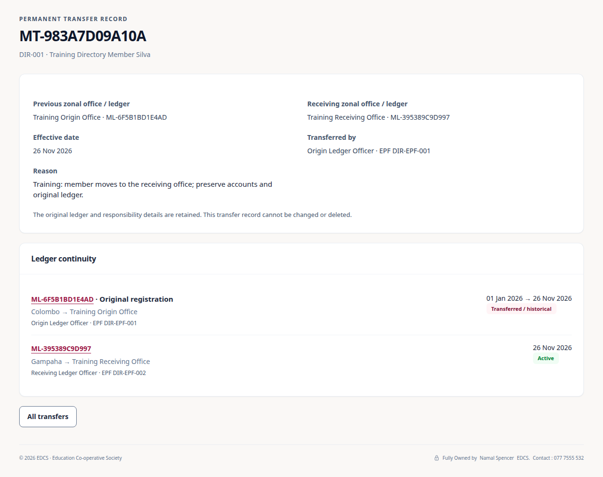

The completed transfer closes the original ledger as **Transferred** and creates a linked active receiving ledger. The original profile/office/officer details and closing balances are retained. The member identity, payment plan, child accounts and existing transactions continue without duplicating money. Completed transfer records are retained history; they are not edited or deleted as ordinary member corrections.

## 13. Verify original and receiving ledgers; change officer

Open **Ledger history** from the profile or **Member Ledgers** in the sidebar. Select the original or receiving ledger by its reference.

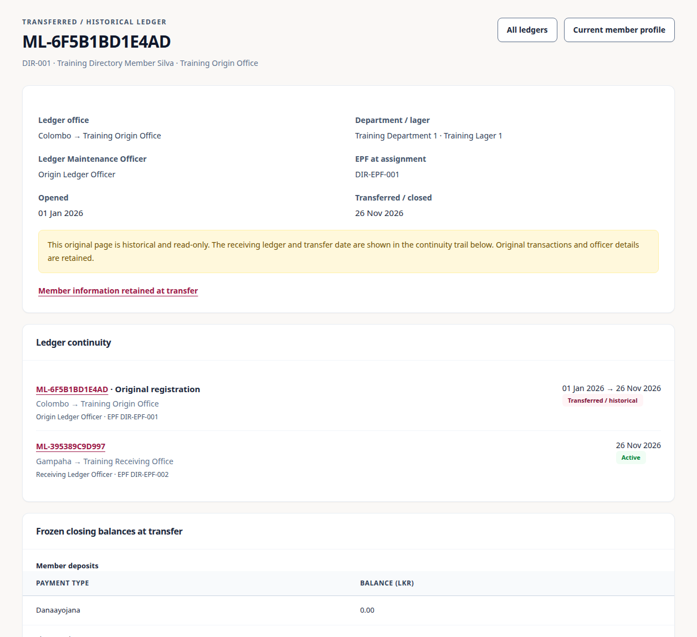

The original page shows the former location/officer, transfer/closing date and frozen closing balances. Expand the retained member information where available. The continuity trail links the subsequent ledger.

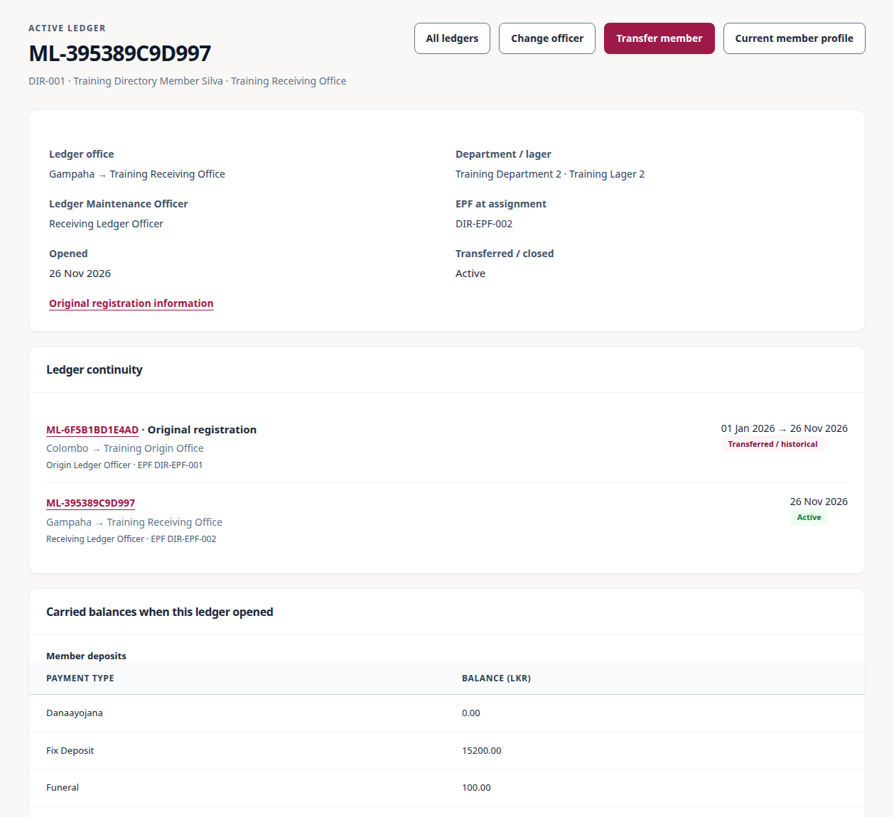

The receiving page separates balances carried at opening from current linked account balances. Use activity dates and **include previous** controls to inspect permitted linked history. Choose **Export ledger CSV** to download the selected ledger enquiry. Account detail visibility still depends on the corresponding financial module permissions.

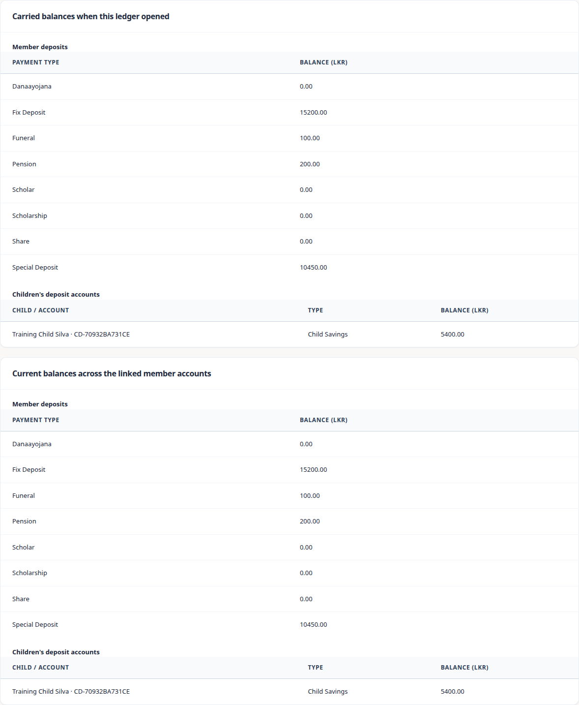

The training transfer preserved member balance **25,950.00**, child balance **5,400.00**, all five member journal entries, both child entries, the payment plan and the existing child account. After the transfer, the original officer could still work within authorized historical scope but could no longer open the member's current profile; the receiving Lager officer could open it. A missing current profile for the former officer can therefore be the expected access result.

### Change the ledger officer

On an active ledger, an authorized user can choose **Change officer**, select the responsible officer, enter the reason and save. Review the officer responsibility history afterward. Historical transferred pages remain read-only. Older records marked as awaiting officer assignment require the missing EPF/access setup before assignment and transfer.

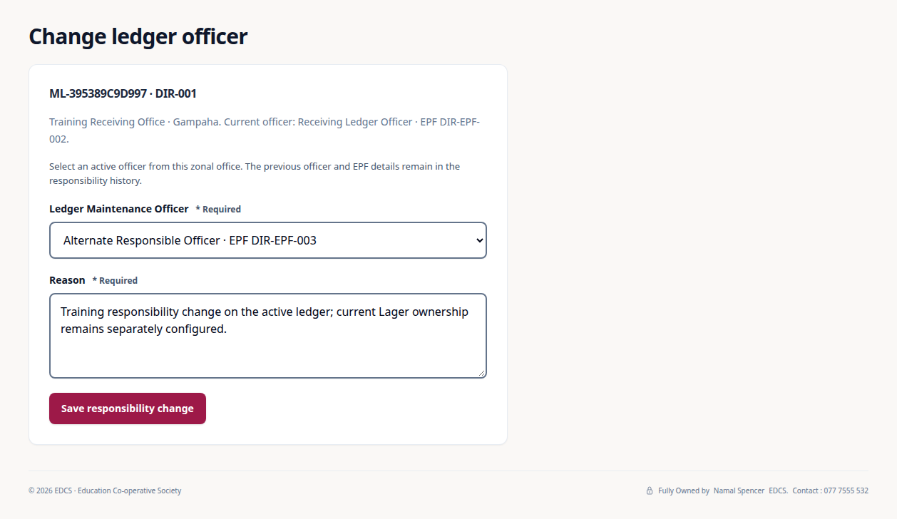

This action changes the ledger page's recorded responsibility and preserves the earlier officer/EPF history. It does **not** change the Lager master's current maintenance owner. Because current member access follows the Lager assignment as well, do not assume changing this page alone gives the new officer access to all current members. Coordinate any Lager ownership change through its authorized master workflow and check affected members.

## 14. Process retirement or mark a member inactive

Use **Process retirement** to record actual retirement. The expected retirement date calculated from birth date is a reference and does not replace this action.

1. Open the correct profile and choose **Process retirement**.
2. Enter the actual retirement date; it must be after birth and cannot be in the future.
3. Review the date and submit.
4. If the change is queued for member-edit approval, follow the request until final approval.
5. Verify that the member is Retired and that the recorded pension/retirement date is correct.

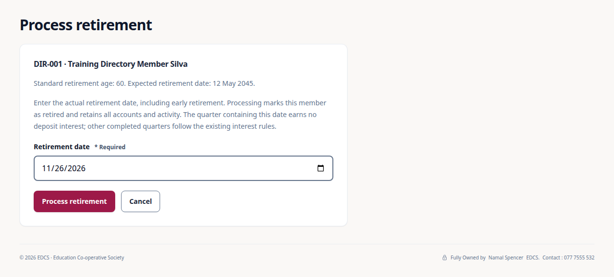

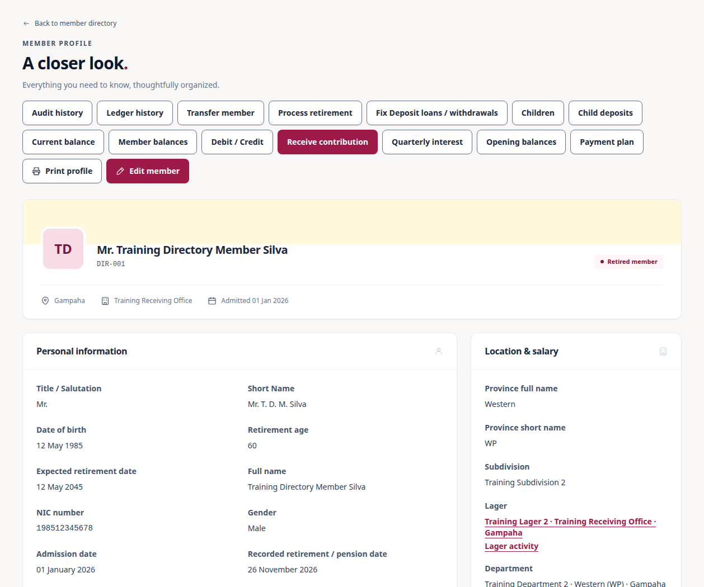

Retirement keeps the member, ledgers and financial history. It does not automatically pay out accounts or settle a loan. The recorded pension date affects applicable quarterly-interest eligibility, including its quarter. Check balances, liabilities and any approved settlement workflow separately. The training member is deliberately retired early to demonstrate the action; this is not a retirement-policy example.

For an administrative inactivity change, use **Edit member → Status → Inactive** when appropriate and authorized. Recheck approval status after saving. Inactive and Retired have different meanings; select the status that reflects the actual case. Neither is a substitute for a financial settlement.

## 15. Print the profile and understand protected deletion

### Print profile

1. Open the member's current profile and choose **Print profile**.
2. Review the browser print preview.
3. Select a printer or the browser's Save as PDF destination.
4. Check page layout, included details and destination before printing/saving.

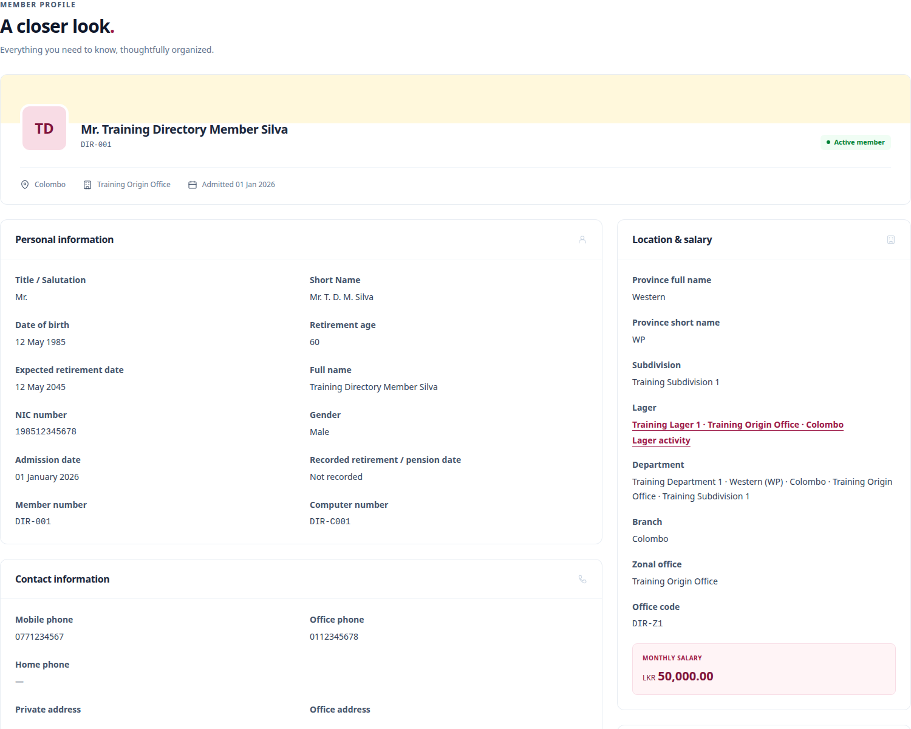

Print styles remove normal navigation and action controls. The output reflects authorized profile content and is not an account statement, signed approval or bank reconciliation. Use individual statement/export actions for those enquiries.

### Delete member record

The profile can show **Delete member record** to a user with Delete permission. Opening it displays a confirmation page. Choose Cancel when deletion is not justified.

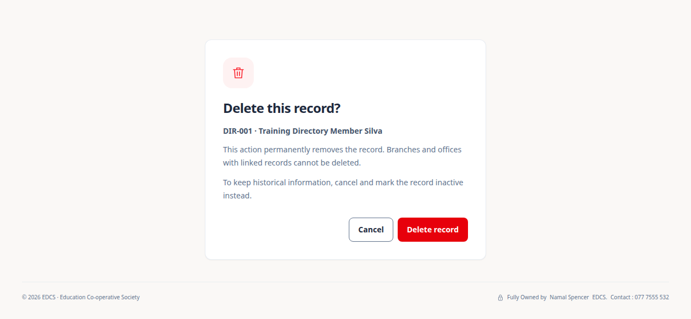

A registered member has a permanent ledger; financial and linked references also protect history. In the verified example, confirming deletion was blocked and the member remained in the directory. Delete permission does not allow erasing protected ledgers or accounts.

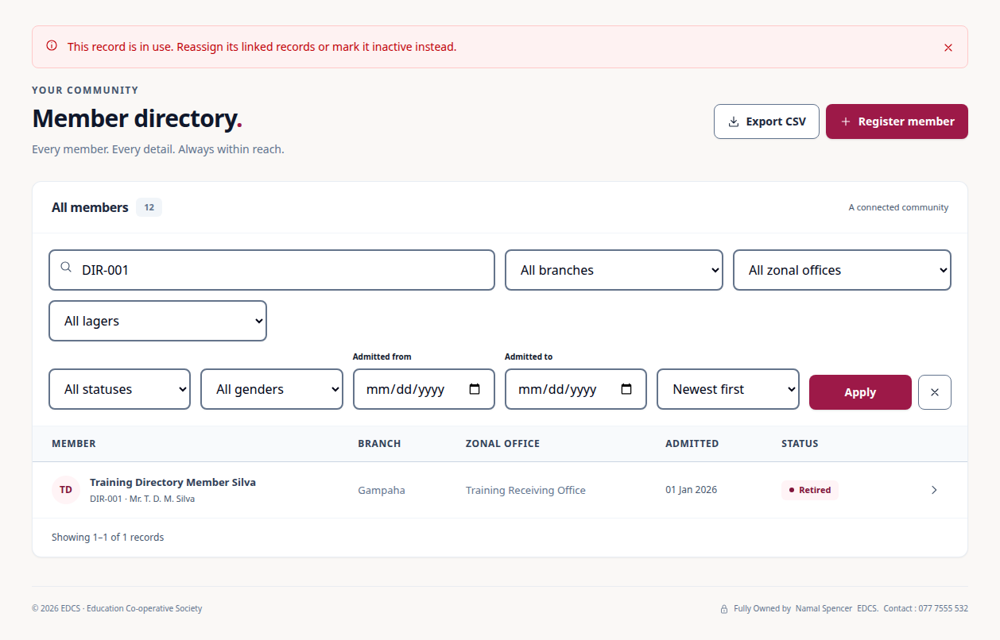

Use an appropriate status change or authorized correction workflow for historical members. Do not delete dependent transactions or ledgers to force removal. If registration was mistaken, have an administrator assess the existing links and the supported correction path.

## 16. Troubleshooting, completion checklist and related guides

| Problem or message                                        | What to check                                                                                                                          |
| --------------------------------------------------------- | -------------------------------------------------------------------------------------------------------------------------------------- |
| Member is missing from the directory                      | Clear search/status/date filters; check branch, zonal-office access and current Lager ownership; check whether the member transferred. |
| A profile button is missing                               | Verify that module's View/Add/Edit permission and whether its linked record exists.                                                    |
| Department or Lager is unavailable                        | Check active master status, receiving location, officer EPF and the user's branch/zonal-office assignments.                            |
| Computer number is rejected as blank                      | Supply the real unique computer number; the current form requires it despite its optional helper text.                                 |
| Duplicate identity error                                  | Search the existing member by number, NIC and computer number; correct the original record when appropriate.                           |
| Edit saved but values did not change                      | Check Approval requests and the final outcome; a pending request preserves the old values.                                             |
| Cannot change branch or department through Edit           | Use Transfer member and its approval process.                                                                                          |
| Receiving officer dropdown stays empty                    | Current browser limitation shown in Figure 29; have the maintainer repair the transfer selection before proceeding.                    |
| Transfer date is rejected                                 | Check opening date, previous transfer, latest transaction and today's date. Refresh a stale current ledger before retrying.            |
| Former officer cannot see the transferred current profile | Check the receiving Lager ownership and current access. Inspect authorized historical ledger pages instead.                            |
| Ledger officer changed but access did not                 | The Change officer action does not update Lager master ownership. Review both responsibilities.                                        |
| Balance differs from the payment plan                     | Plans schedule contributions; only paid/posted amounts affect the balance. Check account/date filters and child allocations.           |
| Receipt total exceeds own account credits                 | Some allocations may belong to child deposits. Inspect the receipt's allocation rows.                                                  |
| Child account missing or balance unclear                  | Confirm child registration, actual account, selected type, active status and child-module permission.                                  |
| Opening or posting correction is blocked                  | Check posted interest, fixed-deposit activity and year-end/period locks; use the authorized correction process.                        |
| Delete fails                                              | Permanent ledger or financial references protect the record; consider the appropriate status/correction workflow.                      |

For a new registration, record the member number, computer number, NIC check, department, Lager, officer/EPF, original ledger reference, payment-plan total and opening-balance verification. Confirm the child/account setup only where relevant.

For a transfer, record the original and receiving ledger references, effective date, reason, receiving location/officer, approval request and outcome. Compare each carried member and child balance and check that the original transactions remain linked. Verify the receiving user's access before completing the handover.

For an edit or retirement, record the reason, source evidence, approval request when required and the verified final profile values. Retain the appropriate audit or printed record according to your organization's process.

Related current-system documents supplied separately:

- **EDCS Master Data Adding Guide** — prerequisite master records, users, EPF and access setup.
- **EDCS Financial Year-End Approval Guide** — hierarchy levels, request review, account closing and annual interest controls.

Verification for this guide used twelve fictional members and checked registration, filtered CSV export, an approved contact edit, a paid receipt split between member and child accounts, separate debits, an approved transfer with unchanged balances and record identities, ledger officer history, retirement and blocked deletion. The temporary database was removed after capture. Screens are current as of 26 November 2026; permission-dependent buttons can vary by user.
