# Member Lagers & Ledgers User Guide

EDCS Member Management System

Prepared: 26 November 2026 · Time zone: Asia/Colombo · Current-system guide v1.0

This guide covers both **Master data → Lagers** and **Member Ledgers**, including Lager setup, member enquiries, original officer assignment, officer changes, EPF fields, activity filters, CSV downloads and transfer continuity. The current application calls the permanent member-history module **Member Ledgers**.

Screenshots show the current system with fictional training records. Saves, officer assignments, transfer approvals, CSV responses, retained balances and deletion protection were verified through the real application views in a disposable PostgreSQL database. Some forms were filled in the browser for illustration; completed transfer examples were verified through server views. Live users, members, Lagers, financial accounts and approval policies were not changed. The temporary database was removed after capture.

Related supplied guides: **Master Data Adding Guide** for prerequisites, **Member Directory User Guide** for registration and transfers, and **Financial Year-End Approval Guide** for creating approval levels.

### Contents

1. Understand Lagers, member ledgers and access
2. Find and add a Lager master
3. Edit a Lager and inspect registered members
4. View Lager activity and export CSV
5. Find member ledgers and understand the columns
6. Assign an original officer to a legacy ledger
7. Change a ledger officer and compare EPF fields
8. Inspect permanent activity and export ledger CSV
9. Transfer a member and follow approval
10. Verify original and receiving ledger balances
11. Inactivate or delete a Lager; preserve history
12. Troubleshooting and handover checklist

## 1. Understand Lagers, member ledgers and access

A **Lager** is a master record within a zonal office. It has a name, a unique **Ledger Code**, an assigned maintenance user and that user's EPF. Members are registered against a Lager.

A **member ledger** is one member's permanent history page. It has a generated **Ledger Record ID**, such as `ML-...`, location and officer snapshots, linked activity, carried balances and a status. Registration creates the original page; a completed transfer creates a receiving page and retains the original.

| Item                                       | Meaning                                                                                                         |
| ------------------------------------------ | --------------------------------------------------------------------------------------------------------------- |
| Lager / Ledger Code                        | The master code, for example DIR-L1. Multiple members can belong to the same Lager.                             |
| Ledger Record ID                           | A generated ML reference identifying one member's original or receiving ledger page. It is not the master code. |
| Member number                              | The registered person, for example DIR-001. The member identity continues through a transfer.                   |
| Maintenance officer recorded on the ledger | The officer name and EPF retained when responsibility was assigned to that page.                                |
| Assigned System User's EPF Number          | The current user EPF from the page's assigned Lager master. It may differ from the recorded responsibility EPF. |

An ordinary user needs the module permission **and** the relevant branch/zonal-office and Lager access. Current member access follows the Lager's assigned user, an active account, EPF and location assignments. Giving a user View permission alone does not assign them a Lager. Administrators have broader access than the ordinary officers illustrated by the access rules.

| Task                                            | Authority needed                                                                                                     |
| ----------------------------------------------- | -------------------------------------------------------------------------------------------------------------------- |
| Find Lagers and open activity                   | Lagers View and access to that Lager. Financial records require their own module View permissions.                   |
| Add / edit a Lager                              | Lagers Add / Edit respectively; the user must have appropriate scope.                                                |
| Open a registered member                        | Members View and current member access.                                                                              |
| List and inspect member ledgers                 | Member Ledgers View and authorized ledger scope.                                                                     |
| Assign a missing original officer               | Member Ledgers Add; an existing active ledger must be marked as awaiting assignment.                                 |
| Change an active ledger officer                 | Member Ledgers Edit; the selected officer must be eligible for the ledger's zonal office.                            |
| Transfer a member                               | Member Transfers Add, current member access and permitted receiving location. View is separate for transfer history. |
| Configure users, EPF, roles and approval levels | System administrator through Administration.                                                                         |

Prepare the branch, zonal office and officer user first. In **Administration → Users & access**, verify that the officer is active, has a unique EPF and has the intended branch and zonal-office assignments. Use the separate Master Data Adding Guide for the complete prerequisite workflow.

## 2. Find and add a Lager master

Open **Master data → Lagers**. Search by name or Ledger Code, then apply Branch and Zonal office filters where needed. Choose **Apply** to filter or **Clear filters** to start again. Lists are limited to the user's authorized records.

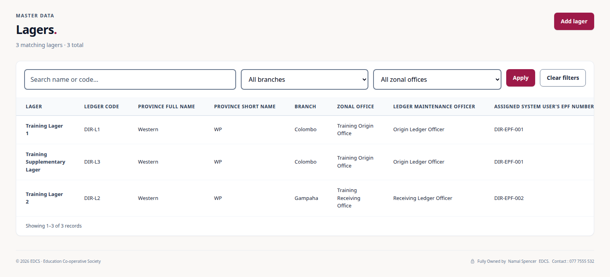

Scroll horizontally within the table to see Registered members, Status and Actions on the right.

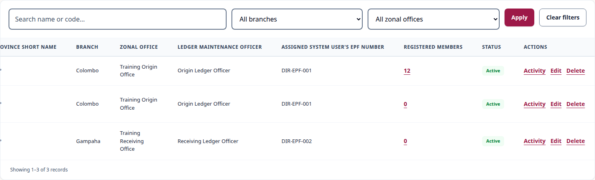

To add a Lager:

1. Search first to avoid creating a duplicate.
2. Choose **Add lager**.
3. Select Branch and Zonal office.
4. Enter the Lager name and unique code.
5. Select the active **Ledger Maintenance Officer** and confirm the automatically displayed EPF.
6. Keep **Active lager** selected for current registration use.
7. Choose **Save lager** and verify the saved row in the list.

| Field                                 | Current rule                                                                                                  |
| ------------------------------------- | ------------------------------------------------------------------------------------------------------------- |
| Branch                                | Required; narrows the zonal-office selection.                                                                 |
| Zonal office                          | Required; must belong to the selected branch.                                                                 |
| Name                                  | Required, up to 150 characters; unique within the same zonal office.                                          |
| Code / Ledger Code                    | Required, up to 20 characters; unique across Lager masters. The form normalizes it to uppercase.              |
| Ledger Maintenance Officer            | Required on the form; choose an active system user with a recorded EPF.                                       |
| Ledger Maintenance Officer EPF number | Read-only confirmation from the selected user's profile. Correct the profile through Administration if wrong. |
| Active lager                          | Makes the master available for new member registrations.                                                      |

The master form can list active officers with EPFs beyond a single office. For routine operations, verify the selected user's branch and zonal-office assignments as well; these affect their access and eligibility in ledger workflows.

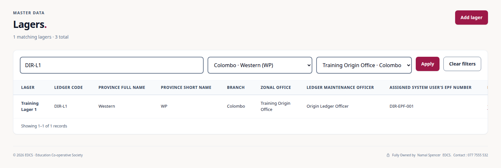

## 3. Edit a Lager and inspect registered members

From the Lager row, choose **Edit**. Review the name, code, location, assigned user, EPF and Active flag, then save the authorized correction. An ordinary user's change may be queued when an applicable approval hierarchy exists; verify the final outcome before assuming the assignment has changed. Administrator changes can apply directly.

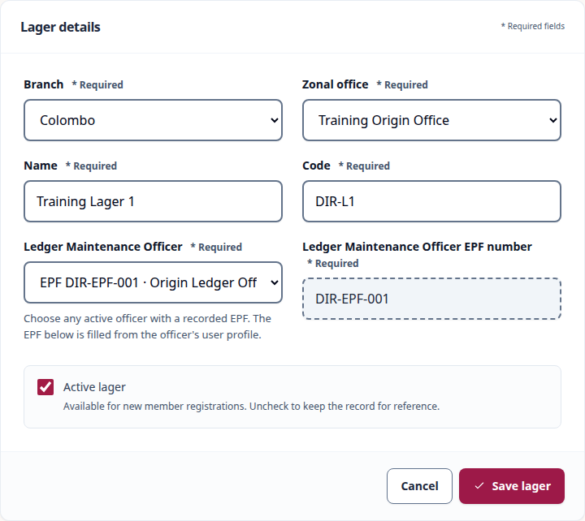

Changing the master maintenance user can change access for the members attached to that Lager. Review the affected member count and coordinate the handover before saving. A different user may need branch/zonal-office assignments and financial permissions before they can work with those members.

A Lager's zonal office cannot be changed once it has registered members or ledger references. Use member transfers for member location moves. Do not rename or move a master simply to bypass a transfer workflow.

Select the **Registered members** count to open Member Directory filtered to that Lager. This link requires Members View. Confirm the member number, status and current office before opening the profile. The count represents registered members attached to the Lager, not a deposit total or only active members.

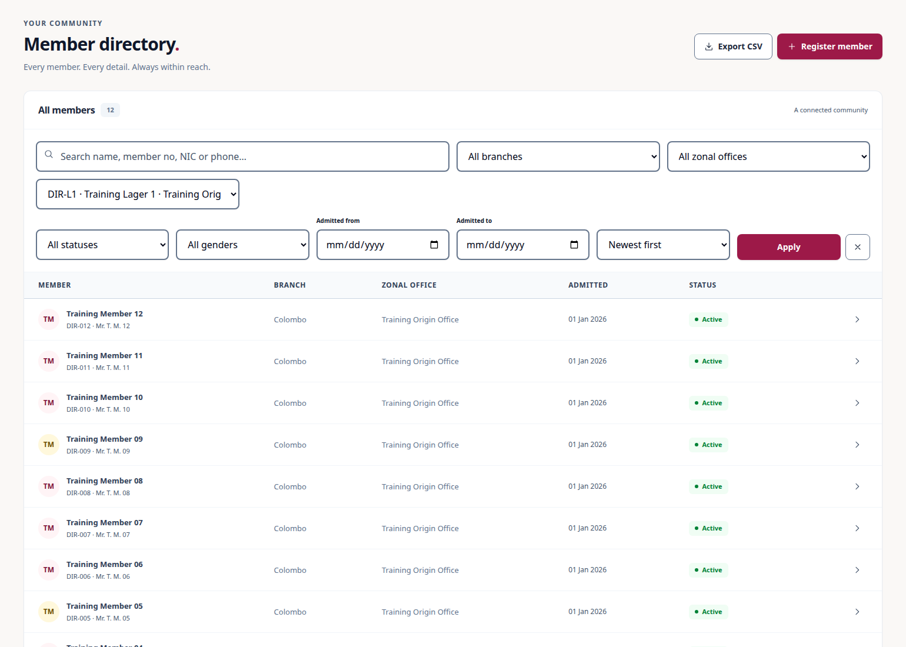

The Lager name and **Activity** action open the Lager activity enquiry. An **Edit lager** action on that page returns to the same master form when permitted. The **Members** button returns to its filtered directory.

## 4. View Lager activity and export CSV

1. Open **Activity** on the Lager row.
2. Leave Member blank for the whole Lager or select one current member.
3. Choose an Activity type if you need a specific category.
4. Set From/To dates; leave From blank for all history. To defaults to today.
5. Choose **Show activity**.
6. Review the account summaries and activity rows; choose **Reset** to clear the enquiry.

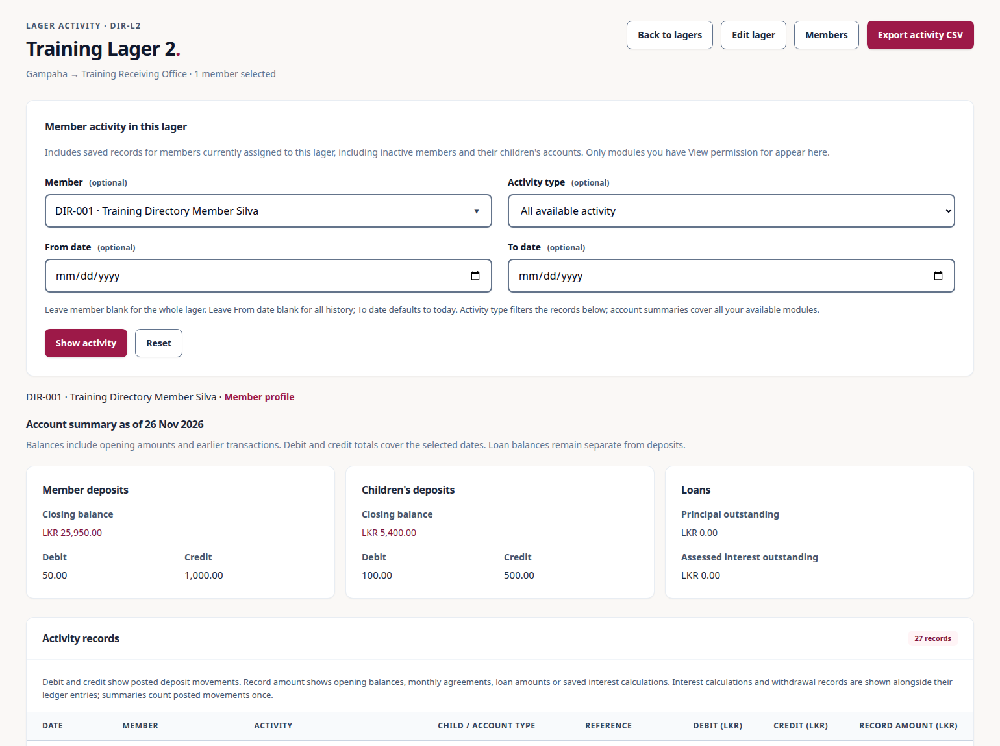

This enquiry follows **members currently assigned to the Lager**, including inactive members and their linked child accounts. Their available historical records can appear here after a transfer. The original member-ledger page is the place to inspect the retained source-ledger history; the Lager activity enquiry is based on current membership assignment.

Member-deposit and child-deposit balances remain separate. Loan principal and assessed interest are also separate from deposit funds. Closing balances include openings and earlier transactions through the To date; debit/credit totals cover the selected date range. Activity type filters the rows, while summaries cover all available permitted modules.

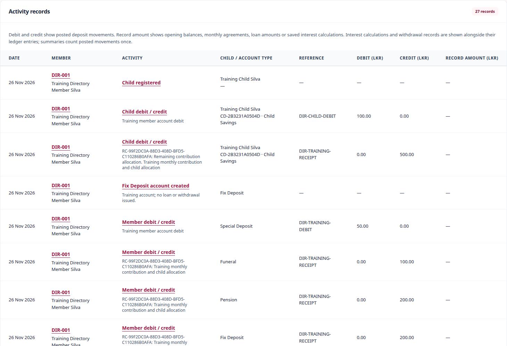

Rows can include member records, monthly agreements, original openings, paid transactions, child activity, loans, withdrawals and saved interest calculations according to permissions. A record amount is not automatically an additional cash credit. Saved interest calculations and their posted entries can both appear; summaries count the posted movements once.

Choose **Export activity CSV** after checking the filters. It exports all authorized matching activity, not only the current page of 25 rows. Member, activity-type and date filters still apply. Numeric CSV columns retain machine-readable amounts; on-screen currency uses comma separators and two decimal places. CSV is not an approval or a bank reconciliation.

If the page says **No activity to display**, check the filters and the relevant financial View permissions. Lagers View alone does not reveal every member or financial module.

## 5. Find member ledgers and understand the columns

Open **Member Ledgers** in the sidebar, or choose **Ledger history** on an authorized member profile.

1. Select a member when needed; the selection supports searching.
2. Select Branch and Status.
3. Choose **Filter ledgers**.
4. Open the **Ledger Record ID** link to inspect that page.
5. Use **Reset** to clear filters and the pagination controls to reach other results.

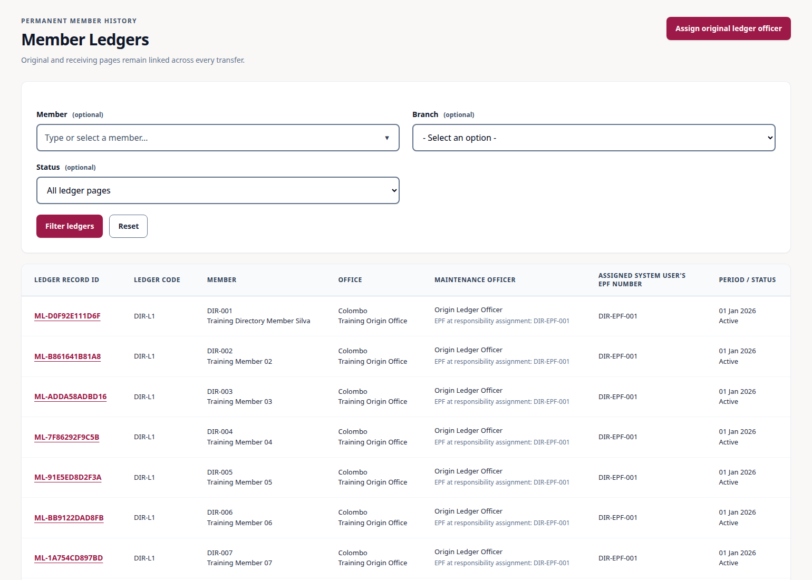

The list shows ten ledger pages per page. A single member can have several pages after transfers. The Member selector can use a retained name/number from visible ledger history, so historical text can differ from a corrected current profile.

| Column / filter                    | How to read it                                                                                                                         |
| ---------------------------------- | -------------------------------------------------------------------------------------------------------------------------------------- |
| Ledger Record ID                   | Unique ML reference; choose it to open the ledger.                                                                                     |
| Ledger Code                        | Code of the assigned Lager. An active page follows the member's current Lager; a historical page uses the Lager retained on that page. |
| Member                             | Member number and retained name. The historical number comes from retained profile information.                                        |
| Office                             | Retained branch and zonal office for that ledger page.                                                                                 |
| Maintenance officer                | Officer name and EPF recorded when ledger responsibility was assigned.                                                                 |
| Assigned System User's EPF Number  | Current EPF of the maintenance user attached to that page's assigned Lager master.                                                     |
| Period / status                    | Opening date, closing date when applicable, and Active or Transferred / historical.                                                    |
| Officer assignment required filter | Active legacy pages with a missing original responsibility assignment. This is a pending flag, not a third financial account status.   |

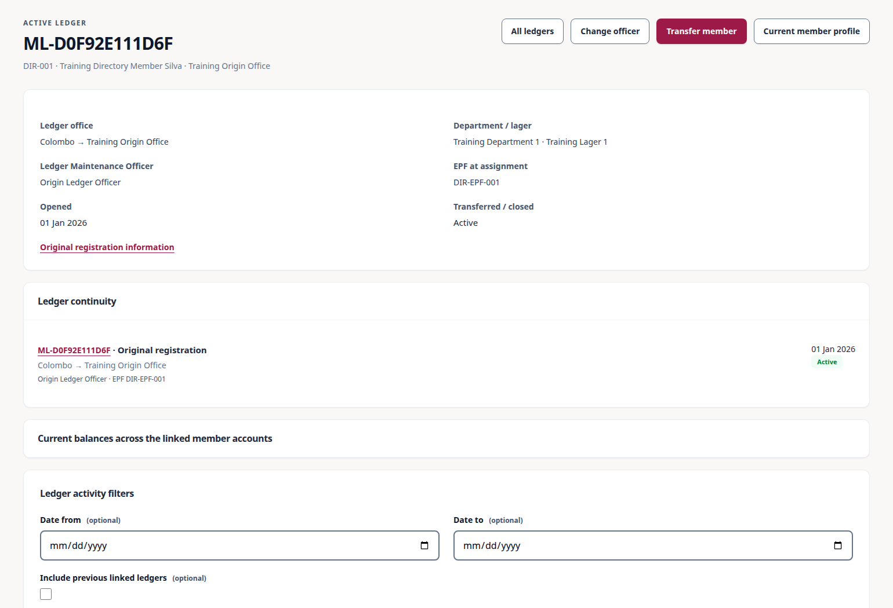

The detail page can show **All ledgers**, **Change officer**, **Transfer member** and **Current member profile**, according to status, permissions and current member access. Expand **Original registration information** to review the retained registration snapshot. Changes to the current profile do not rewrite all historical information on the original page.

## 6. Assign an original officer to a legacy ledger

New registrations already create an original ledger with their assigned officer. **Assign original ledger officer** is for existing active legacy pages marked as requiring assignment. It does not register a member or create a second ledger.

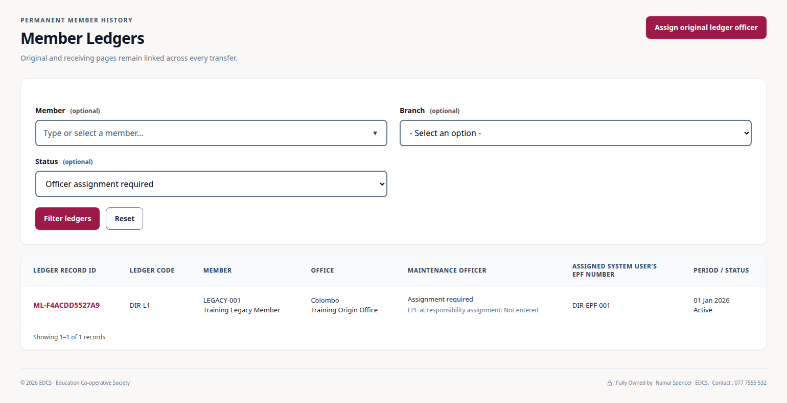

1. Choose **Assign original ledger officer** from Member Ledgers.
2. Select the member requiring assignment and choose **Select member**.
3. Check the existing ledger reference and zonal office.
4. Select an eligible active officer with an EPF and the required office access.
5. Enter the reason for the initial responsibility assignment.
6. Choose **Assign original ledger officer** and inspect the result.

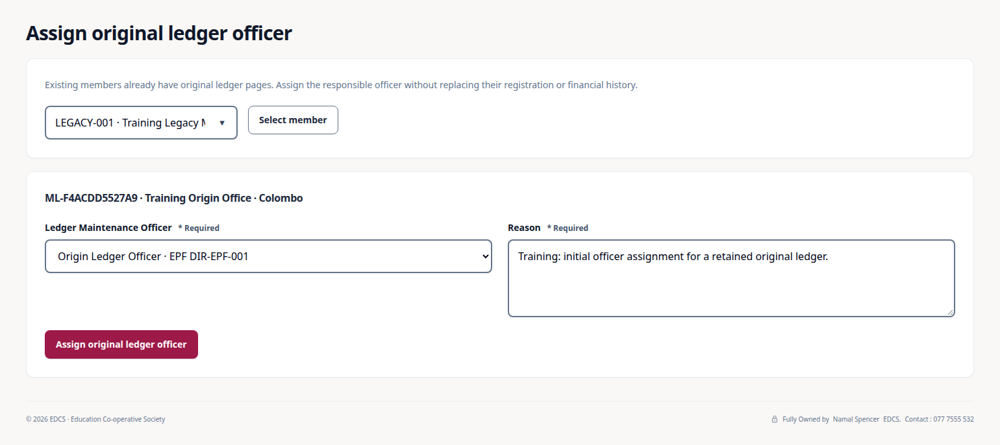

The guide's legacy member is a fictional retained-record fixture, not a new-registration method. After assignment, the existing member and original ledger reference are preserved, the pending flag is cleared and a responsibility-history row records the officer and reason. In the verified example, the member still had exactly one ledger page afterward.

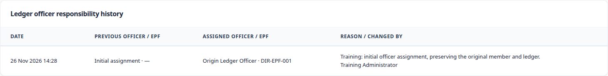

If the member is absent from this selection, check the pending filter, access and whether responsibility has already been assigned. Use **Change officer** for an already-assigned active page.

## 7. Change a ledger officer and compare EPF fields

1. Open the active member-ledger page.
2. Choose **Change officer**.
3. Verify the current officer, retained EPF and zonal office.
4. Select the new eligible officer and enter a clear reason.
5. Choose **Save responsibility change**.
6. Read the saved or pending-approval outcome and verify the final officer/history.

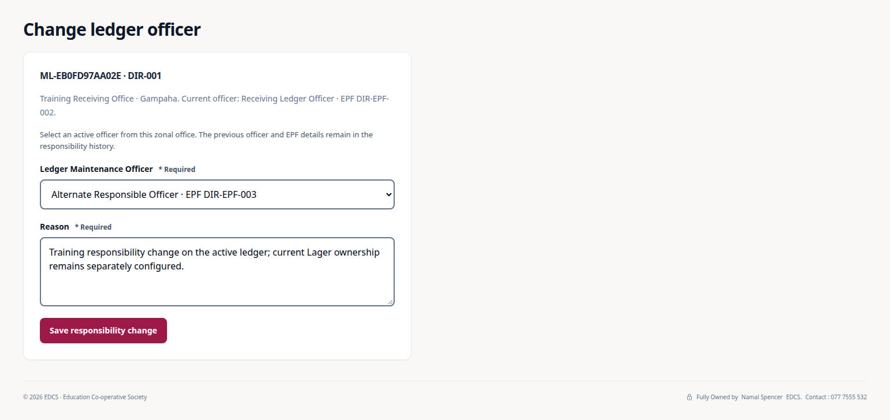

The selection is limited to eligible officers for this ledger's zonal office. The officer must be active, have an EPF and the appropriate branch/zonal-office assignments. Historical transferred pages cannot be changed through this action.

For ordinary users, an applicable **Member Ledgers / Edit** hierarchy can queue the change. Configure levels through **Administration → Approval hierarchies** and review requests through **Approval requests**. Current responsibility remains until final approval. Administrators can apply direct changes or review/override pending requests. The change shown here was saved by the training administrator.

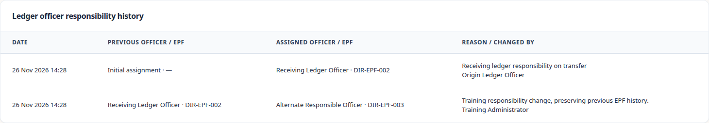

**Change officer does not update the Lager master's assigned maintenance user.** It changes the responsibility recorded on this member-ledger page. If a handover also requires current-member access, coordinate the appropriate master user assignment and permissions separately.

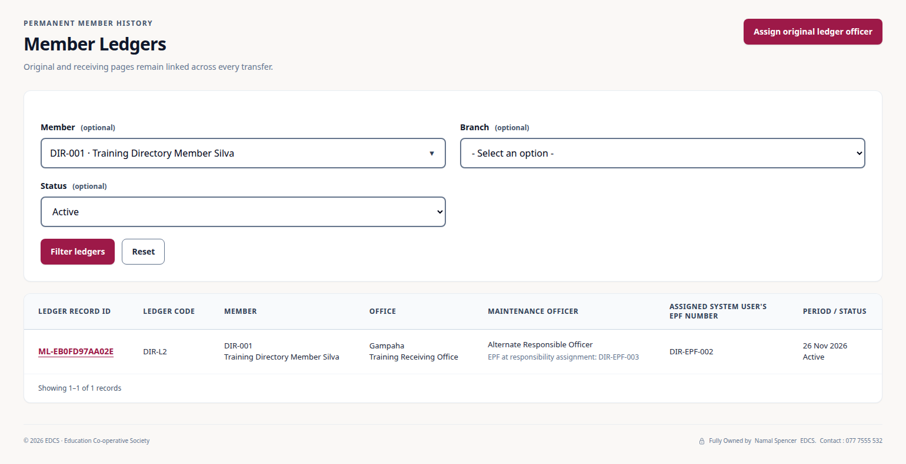

In the training example, the page responsibility changed to **Alternate Responsible Officer / DIR-EPF-003**, while the receiving Lager remained assigned to **Receiving Ledger Officer / DIR-EPF-002**. This is why the two EPF values can legitimately differ. Do not overwrite history merely to make the columns match.

Updating a user's current EPF also does not retroactively rewrite a historical responsibility snapshot. Confirm which column and assignment date the enquiry is referring to before treating a difference as an error.

## 8. Inspect permanent activity and export ledger CSV

Scroll to **Ledger activity filters** on the ledger detail page.

1. Enter From and To dates for the activity period.
2. Select **Include previous linked ledgers** when you need the earlier authorized ledger pages.
3. Choose **Show activity**.
4. Review **Permanent activity record** and open a **Record #...** disclosure for its retained field details.
5. Check the recorded time, financial/effective date, originating ledger, actor and EPF.

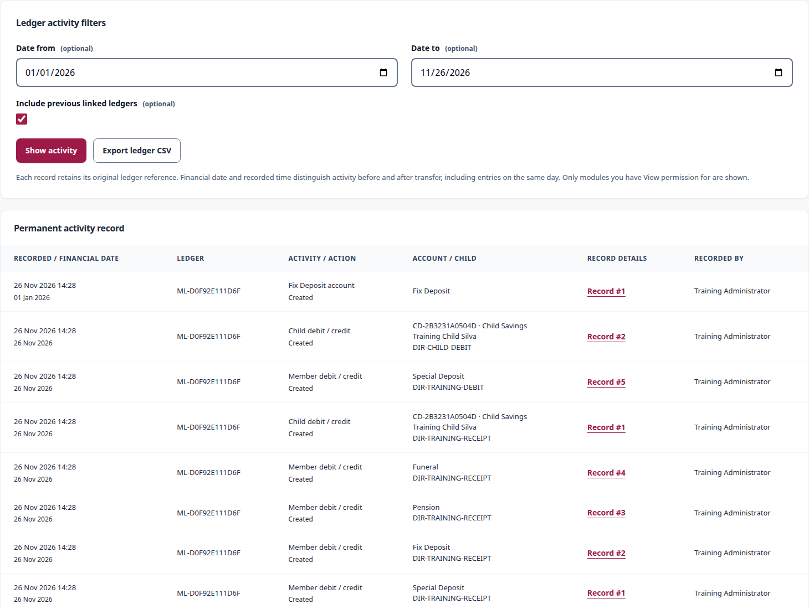

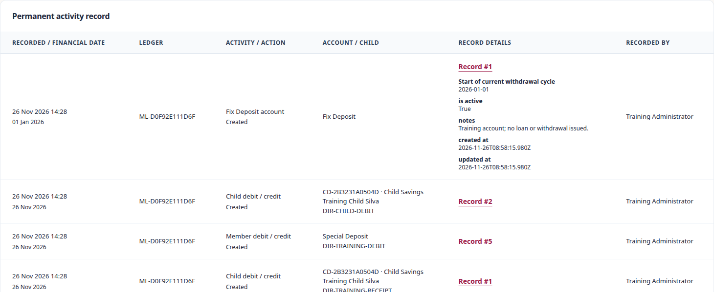

Recorded time is when the history entry was saved; the effective date is the financial/business date used by the filter. Each row identifies the originating ledger, so including previous pages does not reclassify an old transaction as a new receiving-ledger credit.

Ledger history is append-only operational history for tracked modules. It can show additions, changes and retained source details. Opening a Record disclosure expands the stored record; it is not an edit or delete action. View permissions for the source modules control which activity and balances are visible.

Choose **Export ledger CSV** to download all authorized rows matching the enquiry, including previous linked ledgers when selected. The CSV contains ledger reference, recorded/effective dates, action, source record, account/child details and actor/EPF. Source details are retained as structured text in the Details column. It is a history export, not a standalone debit/credit statement.

The activity filters do **not** recalculate the carried/current balance panels above. Those panels show the ledger's retained opening snapshot and either its frozen closing position or the current linked-account position. Use the dedicated balance/statement module for a financial balance at another date.

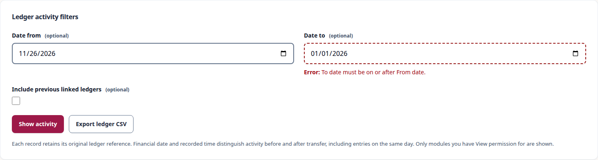

To must be on or after From. A blank From/To means unrestricted ledger-event dates, unlike the separate Lager activity page whose To defaults to today. Correct filter errors before exporting; the system does not silently export all data for an invalid range.

## 9. Transfer a member and follow approval

Choose **Transfer member** on the active ledger or current profile. Use the existing member and current ledger, then select the receiving branch, zonal office, Lager, department, optional subdivision and maintenance officer. Review the effective date and reason.

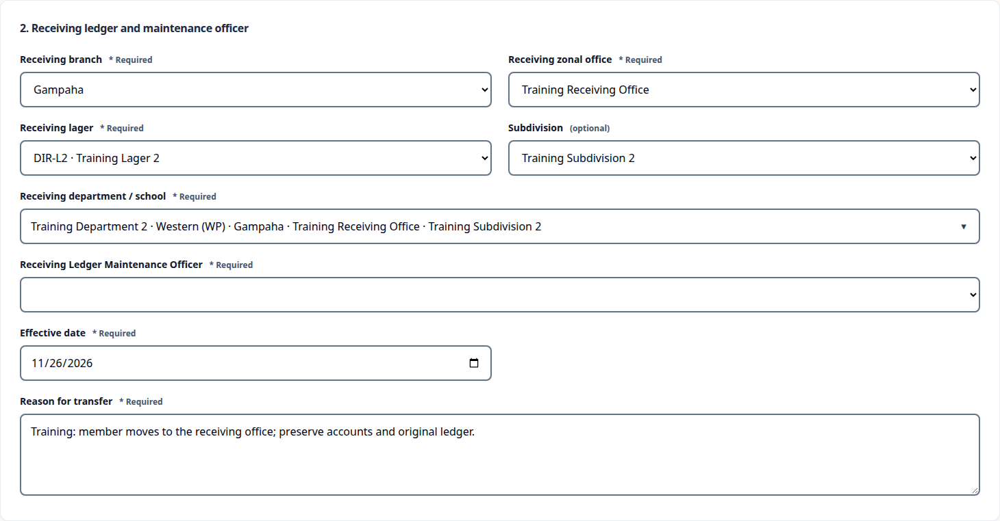

**Current browser limitation:** the receiving-officer dropdown remained empty in the transfer form during capture. The transfer template does not provide the officer data expected by the shared browser script. Have the system maintainer resolve that selection issue before completing transfers through the browser. Do not register a duplicate member or copy opening balances as a workaround. The completed-transfer examples in this guide were verified through the real server views with valid fictional selections, not through an end-to-end browser submission.

Use a date on or before today, consistent with ledger opening, previous transfers and the latest activity. The receiving selections must agree, and the submitter needs the required current and receiving-location access. A stale current-ledger selection requires reloading and review.

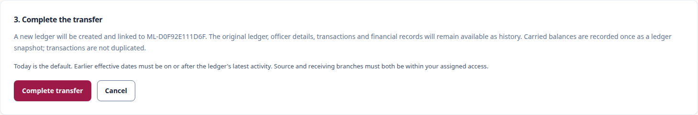

For ordinary users, an applicable **Member Transfers / Add** hierarchy can queue the transfer. The current ledger remains active until final approval. Assigned reviewers use **Administration → Approval requests**; the hierarchy must provide any required receiving-office sign-off. That sign-off is not automatically added independently of the configured levels. Administrators can bypass a hierarchy or review/override a request.

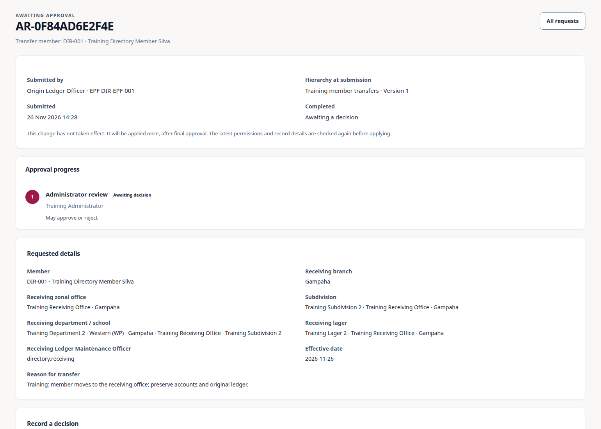

After final approval, open the transfer detail and confirm source and receiving references, offices, officer identities, date and reason.

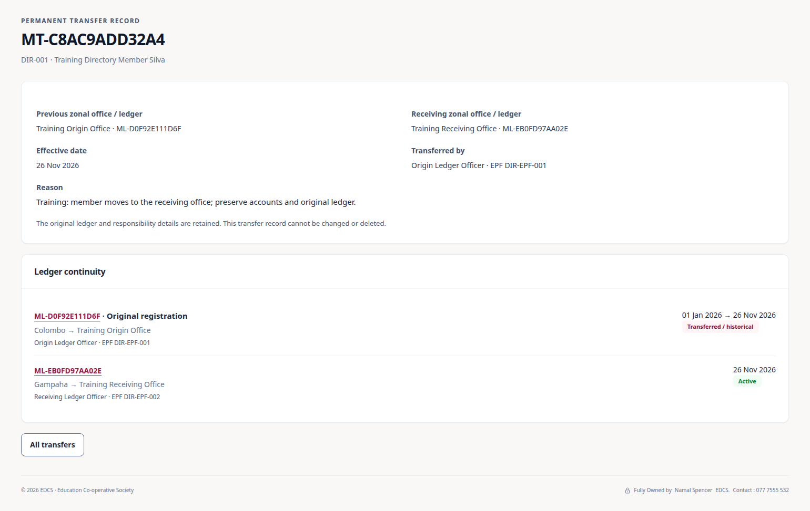

## 10. Verify original and receiving ledger balances

A completed transfer changes the original page to **Transferred / historical** and creates a linked **Active** receiving page. The original transaction records and account identities continue with the same member.

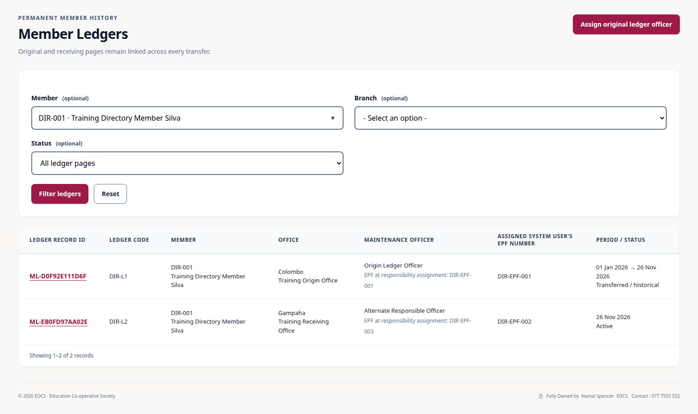

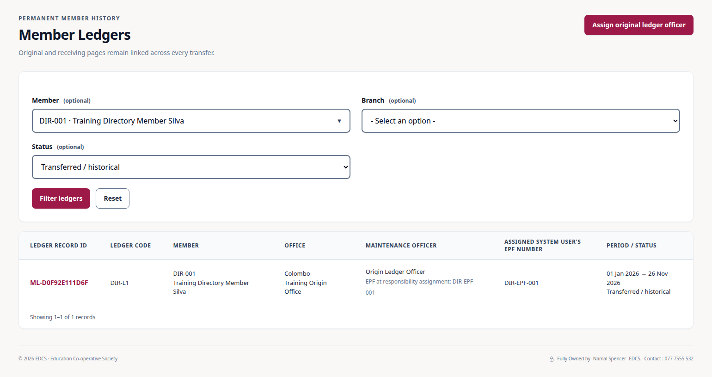

Open the original page. Its office, officer details, closed date and **Frozen closing balances at transfer** describe the retained source position. It is read-only. The current-member-profile link can be absent for a former officer who no longer has current access.

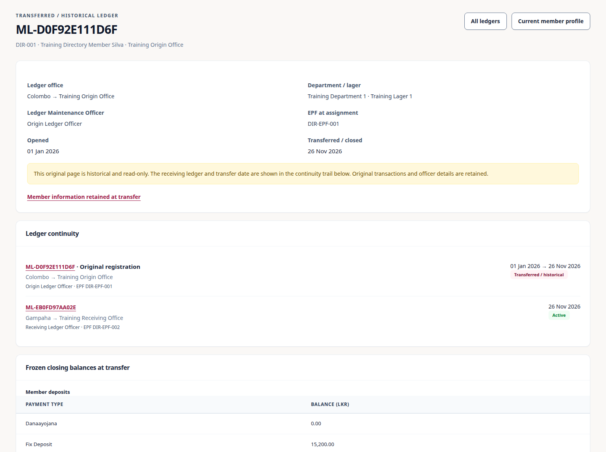

Open the receiving page. The continuity trail identifies the previous ledger. **Carried balances when this ledger opened** is the transfer-opening snapshot. **Current balances across the linked member accounts** reflects subsequent account activity through the current date. They can differ after later receipts, debits or posted interest.

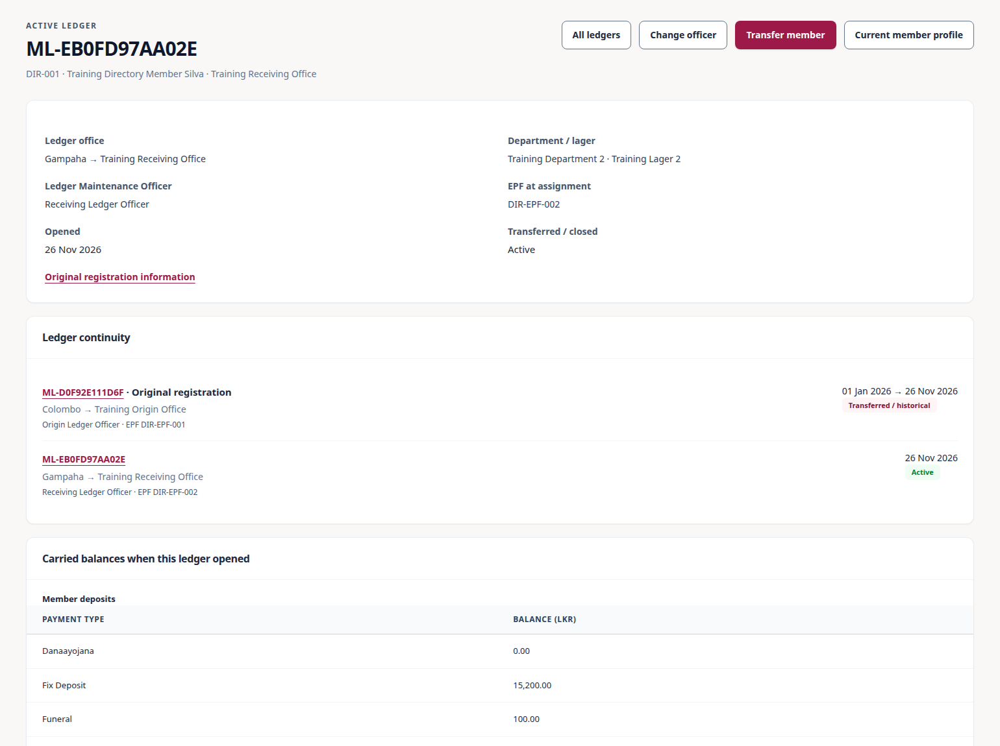

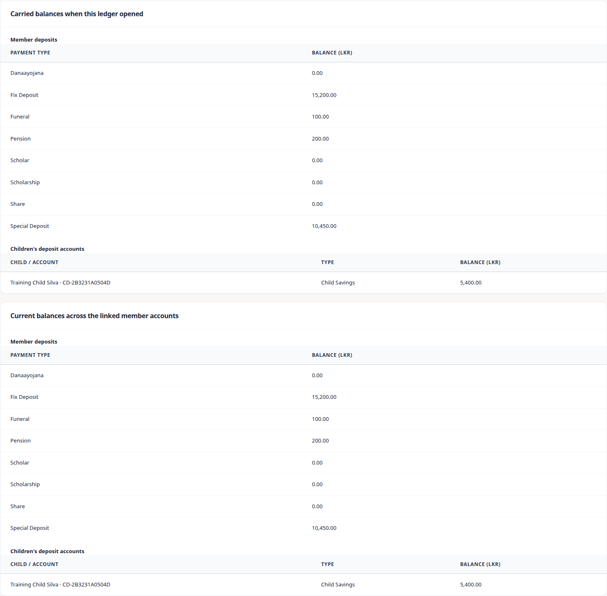

The verified training transfer preserved:

- Member deposits **25,950.00**: original openings 25,000.00 + paid member allocations 1,000.00 − debit 50.00.
- Child deposit **5,400.00**: opening 5,000.00 + paid child allocation 500.00 − debit 100.00.
- All five member transaction entries, both child entries, the payment plan, member identity and existing child account.

Carried balances are ledger snapshots, not new receipt credits. Do not enter another opening or credit to reproduce them. Loans remain separate; a transfer does not repay or erase a liability. Unpaid scheduled contributions are not cash balances.

Former and receiving officers can have different access: the training former officer could not open the current profile after transfer, while the receiving Lager officer could. Historical ledger access is still checked against authorized retained/current scope. The continuity trail can display an unlinked reference for a page the user is not authorized to open.

## 11. Inactivate or delete a Lager; preserve history

To stop a master being offered for new registrations, open **Edit lager**, clear **Active lager** and save through the applicable authority/approval process. Existing references remain. Inactivation is not a member transfer, account settlement or deletion of history.

The master list can expose **Delete** to an authorized user. It opens a confirmation page; use **Cancel** if the record should be retained.

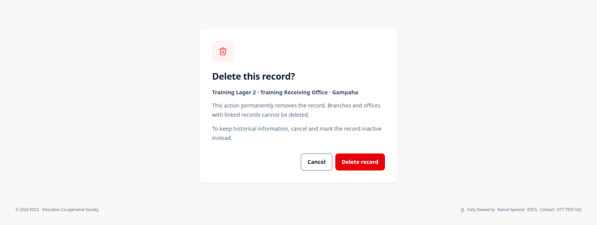

A Lager referenced by registered members or ledger pages is protected. In the training check, confirming deletion was blocked and the master remained available. Delete authority does not override dependent financial or ledger references.

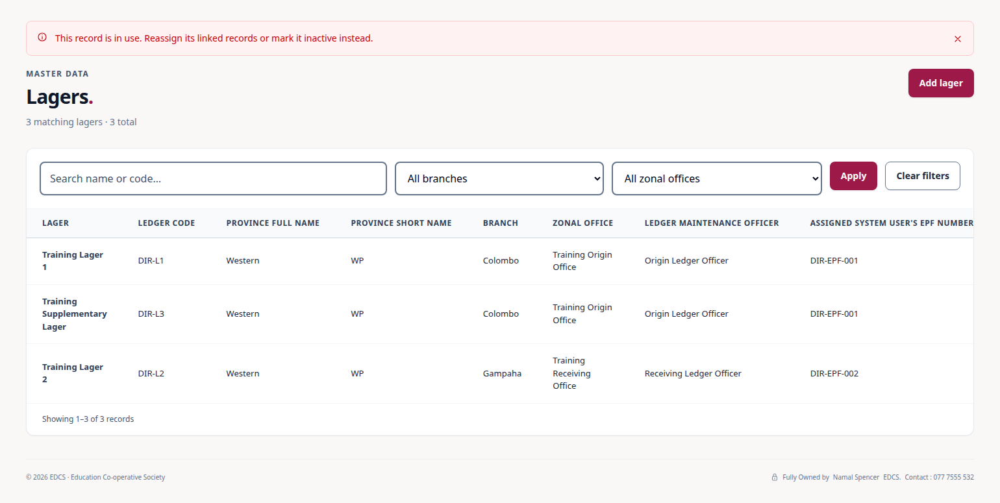

Member ledger pages and completed transfers have permanent-history protection. There is no ordinary action to delete them or rewrite historical officer details. Use Change officer for active responsibility, Member Transfers for a move, and the relevant approved correction workflow for financial errors. Do not delete dependencies to force removal.

## 12. Troubleshooting and handover checklist

| Problem or message                                 | What to check                                                                                                                                 |
| -------------------------------------------------- | --------------------------------------------------------------------------------------------------------------------------------------------- |
| A Lager or member is missing                       | Clear filters; verify the user's active status, EPF, branch, zonal office and current Lager assignment. Check whether the member transferred. |
| The master officer selector is empty               | Confirm an active officer account with an EPF; verify administration setup and permitted locations.                                           |
| Original assignment selector has no member         | Only active legacy pages requiring assignment appear. For an assigned page, use Change officer.                                               |
| Change officer is missing                          | Check Member Ledgers Edit and whether the page is Active. Historical pages retain their old responsibility.                                   |
| Officer is absent from Change officer              | Check their active status, EPF and matching branch/zonal-office assignments.                                                                  |
| Recorded EPF differs from assigned system-user EPF | Compare the page responsibility snapshot with the assigned Lager master. A difference does not itself mean money or history is missing.       |
| Responsibility changed but current access did not  | Change officer does not update Lager master ownership. Review master assignment and permissions separately.                                   |
| Edit or transfer is still pending                  | Check Approval requests and the final decision. The current record remains until final approval.                                              |
| Receiving transfer officer is blank                | Current browser limitation in section 9; the maintainer must correct the selection before browser submission.                                 |
| Activity or balances are absent                    | Check module View permissions and date/member/type filters. Member Ledgers or Lagers View alone does not grant all financial access.          |
| Activity dates differ from balance panels          | Activity filters select event dates; carried/current balances follow their own snapshot/current-date basis.                                   |
| Export is rejected                                 | Correct invalid dates or selections and retry the page enquiry first.                                                                         |
| Master location edit is blocked                    | A used Lager cannot be moved to another zonal office; review the member transfer workflow.                                                    |
| Delete is blocked                                  | Members, ledgers or financial links protect the record. Consider inactivation or an authorized correction instead.                            |

For a Lager setup/handover, record the Ledger Code, name, branch, zonal office, assigned system user, EPF, Active status and affected member count. Verify the receiving user's actual access after any master reassignment.

For a member-ledger responsibility change, record the ML reference, member number, original/receiving status, prior officer/EPF, new officer/EPF, reason, approval outcome and the resulting responsibility-history row. Check the master assignment separately if access should also change.

For a transfer, retain the transfer reference, both ML references, date, reason, offices, officers, approval record and separate member/child/loan balances. Confirm that the previous records remain linked and that no duplicate opening or credit has been posted.
