# Member Ledgers User Manual

EDCS Member Management System

Prepared: 26 November 2026 · Time zone: Asia/Colombo · Current-system manual v1.0

This manual explains how to use **Member Ledgers** to find a member's permanent ledger page, inspect balances and recorded activity, export CSV, assign or change the responsible officer, and follow original and receiving pages after a transfer. It also covers the membership activation/inactivation history now shown on ledger pages.

Screenshots show the current application with fictional training members, officers, locations and financial records. Completed officer assignments, approvals, membership status changes, transfers and CSV responses were checked through the real application in a uniquely named disposable database. Forms filled in the browser illustrate the values used in the worked examples. Live members, balances, users and approval policies were not changed.

### Contents

1. Understand ledger pages and access
2. Find a member and open the ledger
3. Read member, child and loan balances
4. Inspect activity, apply dates and export CSV
5. Assign the original officer for an existing ledger
6. Change responsibility and compare EPF fields
7. Transfer a member and follow linked ledger pages
8. Review membership activation and inactivation history
9. Troubleshooting and daily-use checklist

## 1. Understand ledger pages and access

Choose **Member Ledgers** in the workspace sidebar. This module brings together the member's permanent ledger references, recorded responsibilities, linked financial records and transfer continuity.

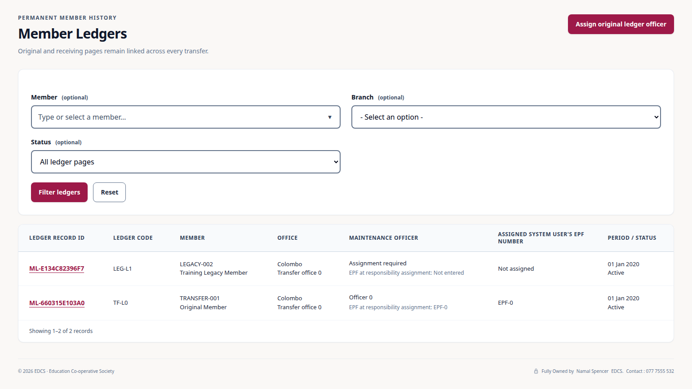

| Term                     | Meaning                                                                                                                                |
| ------------------------ | -------------------------------------------------------------------------------------------------------------------------------------- |
| Ledger Record ID         | Generated ML reference for one member's original or receiving page. Click it to open that page.                                        |
| Ledger Code              | Code of the assigned Lager master. Several members can belong to the same Lager.                                                       |
| Original ledger          | First permanent page created for the member. Registration creates this automatically; existing records can need an officer assignment. |
| Receiving ledger         | New linked page created when a member transfer completes.                                                                              |
| Active ledger            | Current ledger page for continuing activity. This is different from the member's Active/Inactive membership status.                    |
| Transferred / historical | Retained original page after a transfer, with frozen closing balances and original responsibility details.                             |

An officer needs the appropriate module permissions and assigned branch, zonal-office and Lager access. For ordinary users, current member access follows the Lager's assigned active user, EPF and location assignments. View permission alone does not assign a Lager. Administrators have broader access.

| Task                                 | Required access                                                                                           |
| ------------------------------------ | --------------------------------------------------------------------------------------------------------- |
| List/open pages and export activity  | Member Ledgers View plus access to the relevant ledger.                                                   |
| Assign a missing original officer    | Member Ledgers Add. The selected existing page must still need an assignment.                             |
| Change the officer on an active page | Member Ledgers Edit/change.                                                                               |
| Start a member transfer              | Member Transfers Add and the necessary source/receiving access.                                           |
| View underlying financial categories | View permission for each relevant module, such as Debit / Credit, Child Deposits or Fix Deposit accounts. |
| Open the current member profile      | Members View and current access to that member.                                                           |
| Review membership status history     | Membership Status View, Add or Edit/review permission, in addition to ledger access.                      |

The permanent record cannot be deleted or rewritten through this module. An applicable approval workflow can queue an ordinary user's assignment, responsibility change or transfer. The administrator configures the levels and reviewers; always check whether the action has actually applied.

## 2. Find a member and open the ledger

1. Open **Member Ledgers**.
2. Type/select the member by membership number or name.
3. Optionally choose **Branch** and **Status**.
4. Choose **Filter ledgers**.
5. Click the required **Ledger Record ID**.
6. Use **Reset** to clear the list filters, or the page controls to inspect further results.

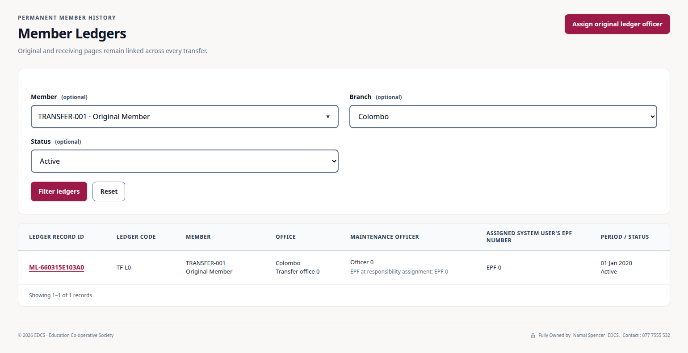

| Status filter               | When to use it                                                                           |
| --------------------------- | ---------------------------------------------------------------------------------------- |
| All ledger pages            | Find original and receiving pages within your available access.                          |
| Active                      | Find the current page. This filter does not mean that the member's membership is Active. |
| Transferred / historical    | Inspect retained pages from earlier offices.                                             |
| Officer assignment required | Find active existing pages awaiting an original responsibility assignment.               |

The list shows the member, ledger office, recorded maintenance officer, EPF at responsibility assignment, current assigned Lager user's EPF, and the opening/closing period. These fields serve different purposes; section 6 explains why the two EPFs can differ.

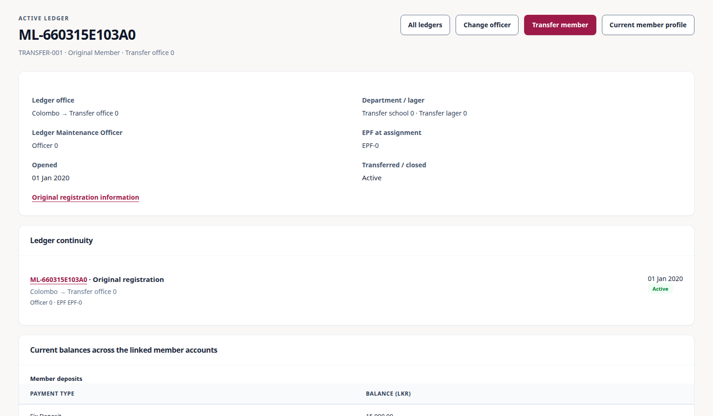

At the top of the ledger, confirm the ML reference, member number/name, branch, zonal office, department/Lager, officer and opening date. Use **All ledgers** to return to the list. **Current member profile** opens the member's current record when permitted. **Change officer** and **Transfer member** appear only on active pages when the user has the relevant permission.

Expand **Original registration information** to read the retained registration fields. On a historical page, the equivalent disclosure is **Member information retained at transfer**. Retained information may differ from the current member profile after later changes; check the heading before treating a value as current.

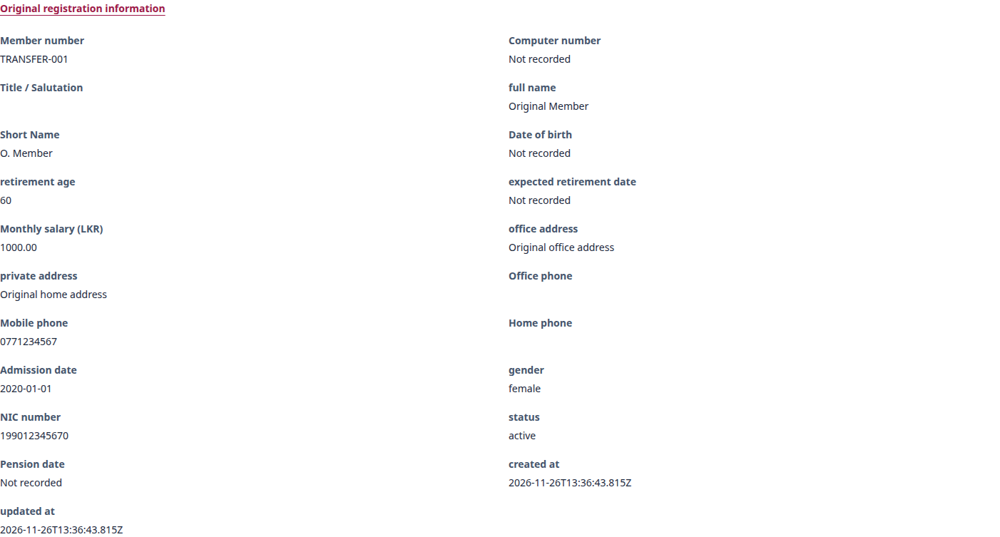

## 3. Read member, child and loan balances

The active page shows **Current balances across the linked member accounts**. Review each category independently. The enquiry displays only the balance categories that your module permissions allow.

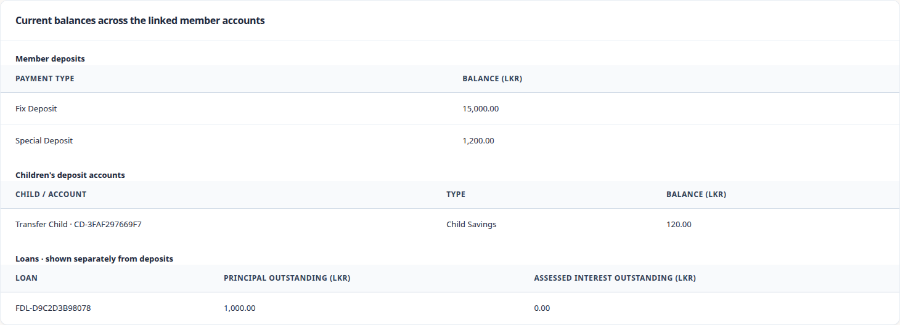

| Balance group               | How to read it                                                                                                                     |
| --------------------------- | ---------------------------------------------------------------------------------------------------------------------------------- |
| Member deposits             | Balance for each payment type, including saved openings and posted credits/interest, less debits through the current enquiry date. |
| Children's deposit accounts | Separate child name, account number, deposit type and account balance. These funds remain distinct from the member's own deposits. |
| Loans                       | Principal outstanding and assessed interest outstanding, displayed separately from deposit funds.                                  |

In this worked example, Special Deposit is **LKR 1,200.00**: an opening of LKR 1,000.00 plus a posted credit of LKR 200.00. The saved monthly plan of LKR 25.00 is a reference and does not add unpaid contributions to the bank balance. Fix Deposit is **LKR 15,000.00**. The child account is **LKR 120.00**, and loan principal outstanding is **LKR 1,000.00**. The training loan rate is fictional and is not a recommendation for configuring live accounts.

These groups are separate account positions. Loan principal and assessed interest should not be added to deposit money. Quarterly interest increases the account only when the relevant interest is posted. Use **Member Balance** or the relevant account statement for detailed debit/credit amounts and a running bank balance; the permanent ledger activity table is a record-history enquiry.

On a receiving page, **Carried balances when this ledger opened** records the transfer opening position. On a transferred page, **Frozen closing balances at transfer** retains the departure position. These are snapshots of the same linked accounts, not an instruction to post another opening or duplicate the cash. Section 7 shows the comparison.

## 4. Inspect activity, apply dates and export CSV

Scroll to **Permanent activity record**. It includes records from the available permitted modules, such as opening balances, payment plans, member debit/credit, children and child deposits, interest calculations, fixed deposit accounts/loans and applied membership status changes.

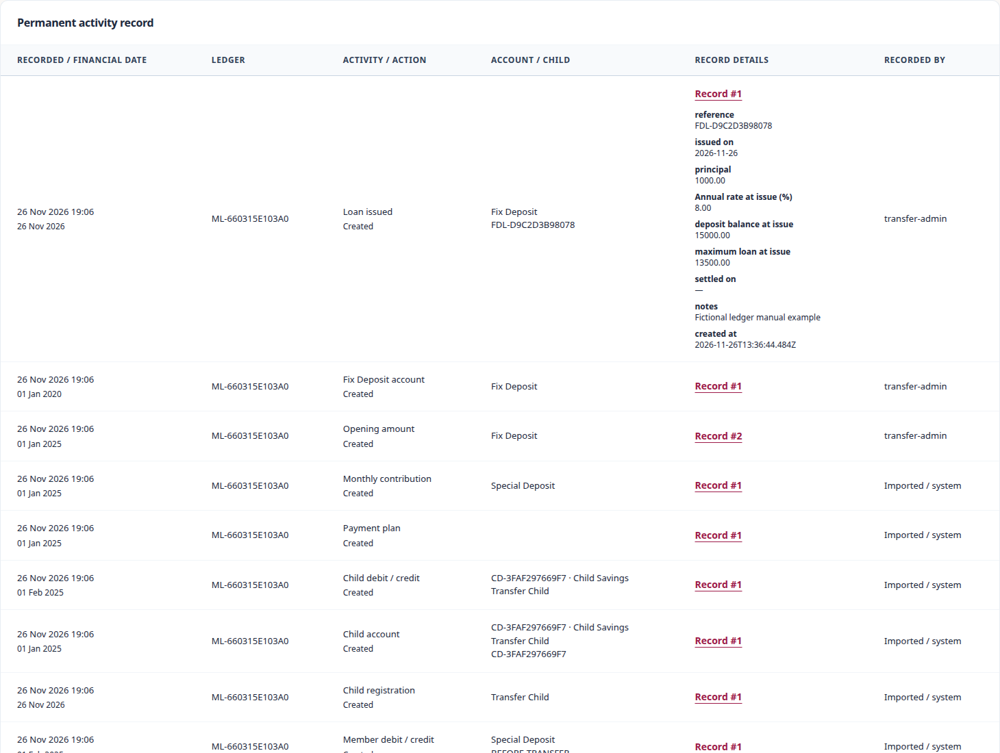

| Column                    | Meaning                                                                                                                 |
| ------------------------- | ----------------------------------------------------------------------------------------------------------------------- |
| Recorded / financial date | Recorded date/time on the first line; the record's financial/effective date beneath it.                                 |
| Ledger                    | Original ML reference attached to that record, retained after transfers.                                                |
| Activity / action         | Record category and whether it was created, updated or otherwise recorded. An approval reference appears when captured. |
| Account / child           | Payment type, child/account or record reference where relevant.                                                         |
| Record details            | Expand **Record #...** to inspect retained values for that event.                                                       |
| Recorded by               | Captured actor name and EPF, or Imported / system where no actor was recorded.                                          |

An activity row is a recorded event. A changed record can have multiple events, and payment-plan or child-registration events are not cash receipts. Do not sum all events as though each were a new financial transaction.

To narrow the enquiry:

1. Enter **Date from** and/or **Date to** under **Ledger activity filters**.
2. On a receiving page, select **Include previous linked ledgers** when you need earlier linked activity.
3. Choose **Show activity** to apply the filters.
4. Check the returned events and their Ledger references.
5. Choose **Export ledger CSV** after applying the required filters.

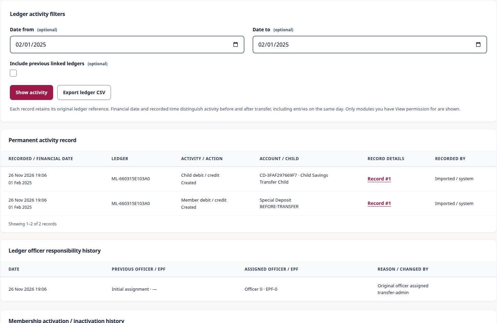

Date filters use the financial/effective date, not the recorded timestamp. Leaving dates blank includes all matching dates. **Include previous linked ledgers** adds earlier pages in the same chain that you are authorized to view; it does not grant access to another office's restricted page. It does not pull later receiving pages into an original page's enquiry.

The balance panels are not recalculated by these activity-date filters. Active-page balances show the current account position; transfer opening/closing panels remain their saved snapshots. Changing the activity dates narrows the event table and CSV.

The CSV downloads with a name like `ledger-ML-....csv`. Open it in Excel or another spreadsheet tool. It contains Ledger, Recorded at, Effective date, Action, Source record, Activity, Account, Child, Details, Recorded by and EPF. **Details** is a structured data value containing the captured record fields.

CSV exports include all matching permitted events, across result pages. They do not export only the page currently visible on screen. If dates are invalid, correct them and choose Show activity before exporting.

## 5. Assign the original officer for an existing ledger

Existing/imported members already have their original ledger pages. **Assign original ledger officer** records responsibility on that existing page. It does not register the member again or replace financial history.

1. In Member Ledgers, choose Status **Officer assignment required** and select **Filter ledgers**.
2. Confirm the member requiring attention.
3. Choose **Assign original ledger officer** at the top of the list.

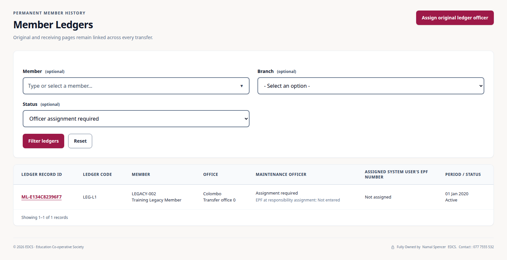

4. Select the member in the assignment screen and choose **Select member**.
5. Confirm the existing ML reference and zonal office.
6. Select an eligible active **Ledger Maintenance Officer**. The choice includes the officer's EPF.
7. Enter a meaningful **Reason**.
8. Choose **Assign original ledger officer**, then verify the applied assignment or pending approval outcome.

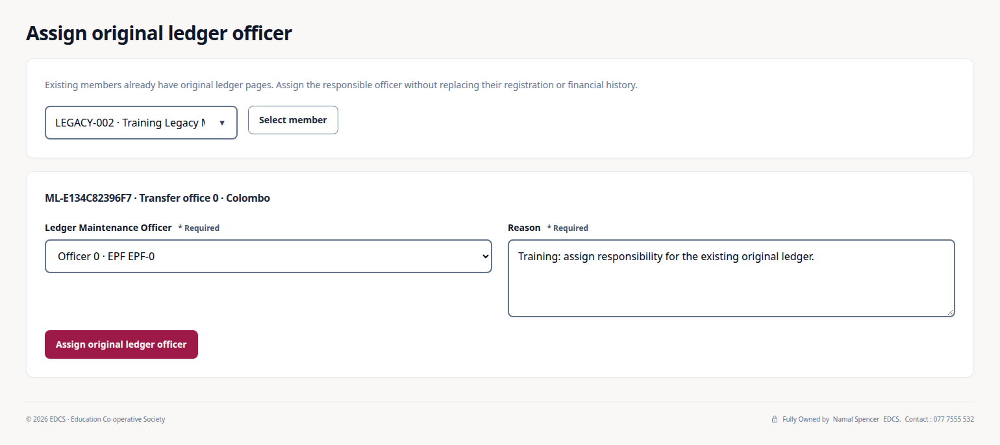

An eligible officer needs an active user account, a recorded EPF and the relevant branch/zonal-office access. The administrator maintains these in **Users & access**. If no officer is available, ask the administrator to correct that setup before continuing.

The member selector here is limited to accessible existing active pages that still need an officer. A member who already has an assignment will not be offered for initial assignment. Use **Change officer** for a later responsibility change.

An original officer must be assigned before transferring a member whose page is still pending. After the assignment applies, confirm the warning has cleared, the ML reference has stayed the same and responsibility history contains the new entry.

## 6. Change responsibility and compare EPF fields

Open the **active** ledger page, then:

1. Choose **Change officer**.
2. Check the ledger reference, member number, zonal office and current officer.
3. Select the replacement active officer with a recorded EPF and the required office access.
4. Enter the handover/correction reason.
5. Choose **Save responsibility change**.
6. Follow any required approval and verify the final result.

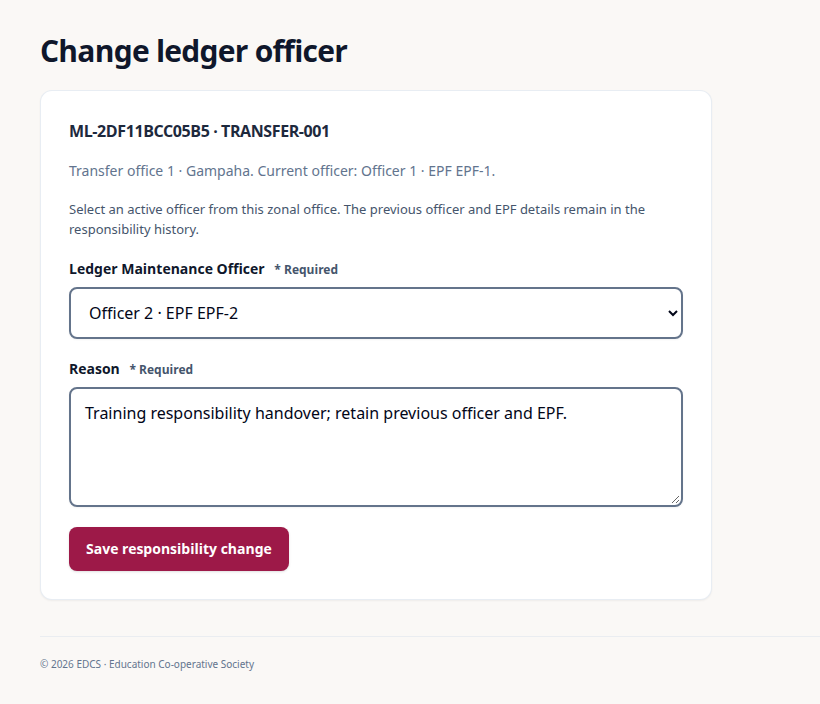

**Ledger officer responsibility history** retains the previous and assigned officer names/EPFs, the change date/time, reason and person who recorded the change. The previous assignment is retained when the new one applies. Historical/transferred pages keep their original responsibility details; change responsibility on the current active page.

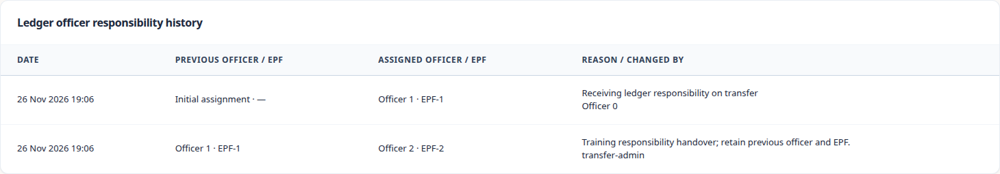

The ledger page's responsible officer and the Lager master's assigned user are separate assignments:

| Field                                                  | Source and purpose                                                              |
| ------------------------------------------------------ | ------------------------------------------------------------------------------- |
| Maintenance officer / EPF at responsibility assignment | Name and EPF recorded for responsibility on that individual member-ledger page. |
| Assigned System User's EPF Number                      | Current EPF of the user assigned to the page's Lager master.                    |

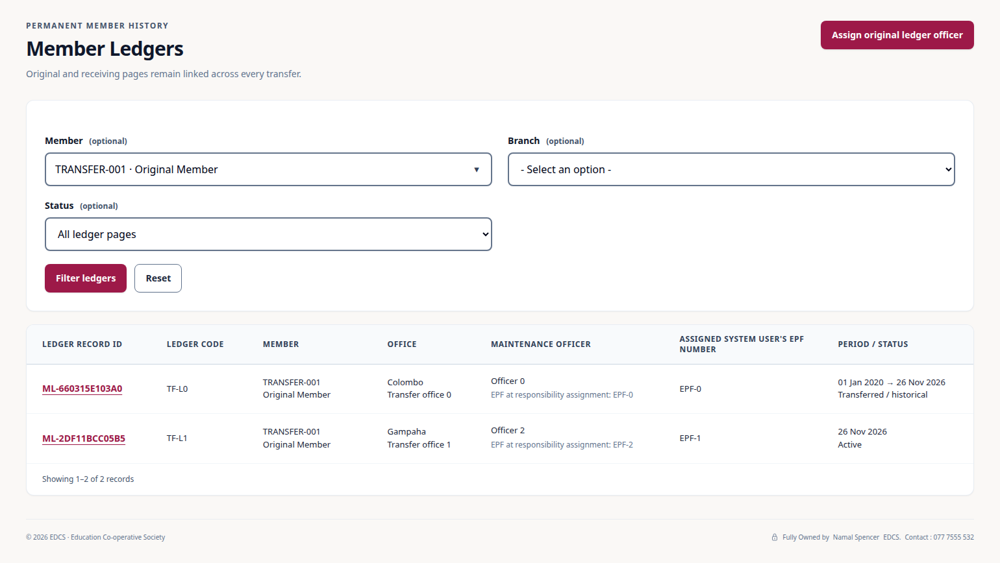

In the example, changing the receiving page to **Officer 2 / EPF-2** leaves its Lager master assigned to **Officer 1 / EPF-1**. This is why the two displayed values differ. Changing an individual page's officer does not reassign the entire Lager or automatically transfer current member access to that officer. To change the Lager's assigned system user, the administrator/authorized master-data user must update **Master data → Lagers** and verify the new user's permissions and location access.

## 7. Transfer a member and follow linked ledger pages

A transfer is for an authorized change to the member's office/department/Lager location. A simple responsibility change within the existing ledger uses Change officer. Before transfer, verify the current member and original officer assignment, and review the linked account positions.

From the active ledger, choose **Transfer member**:

1. Confirm the member and current source-ledger details.
2. Select the receiving Branch, Zonal office, Lager and Department; select a Subdivision if applicable.
3. Confirm the receiving **Ledger Maintenance Officer** and EPF.
4. Enter an allowed **Effective date** and a clear **Reason**.
5. Review the final transfer section and choose **Complete transfer**.
6. If queued, follow the approval request and wait for its successful application before treating the transfer as complete.

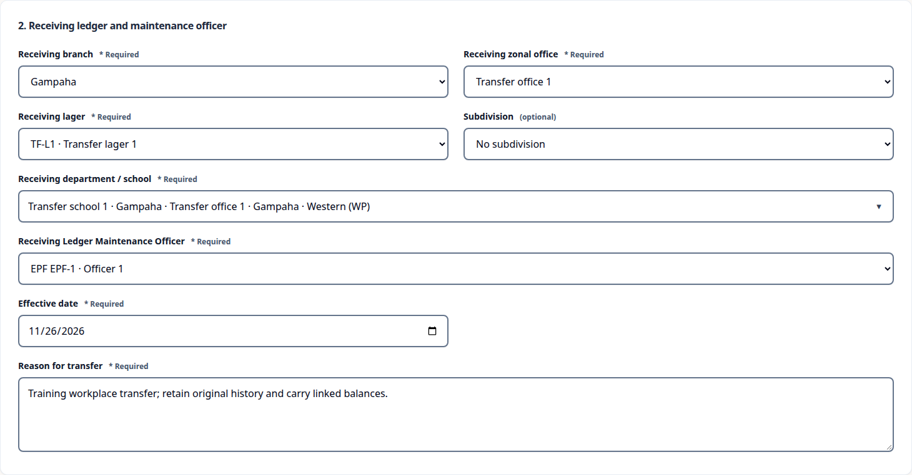

The receiving department, Lager and optional subdivision must match the selected office and branch. The receiving officer must be eligible for that location. The effective date cannot be in the future or precede the current page's opening; later recorded activity and earlier transfers impose additional date checks. Correct a validation message before resubmitting.

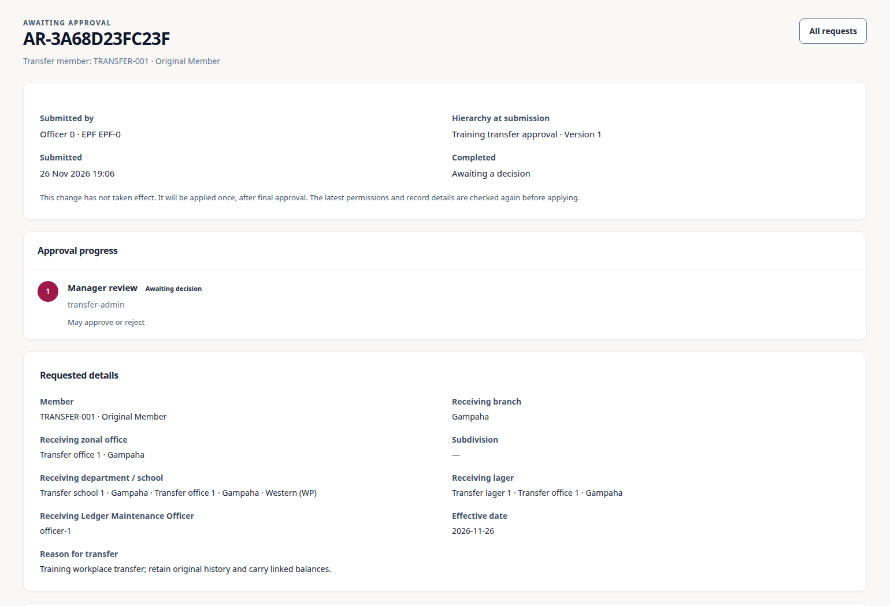

Approval levels and reviewers are configured by the system administrator. A reviewer opens **Approvals**, checks the transfer details and records an authorized decision. For a queued request, inspect the final approval status and outcome; a submitted or partially reviewed request is not a completed transfer. This manual's single manager level is a fictional training configuration.

After a successful transfer, the original page becomes **Transferred / historical**. It keeps its reference, source office, officer history, original records and frozen closing account positions. It is read-only for ordinary editing and responsibility changes.

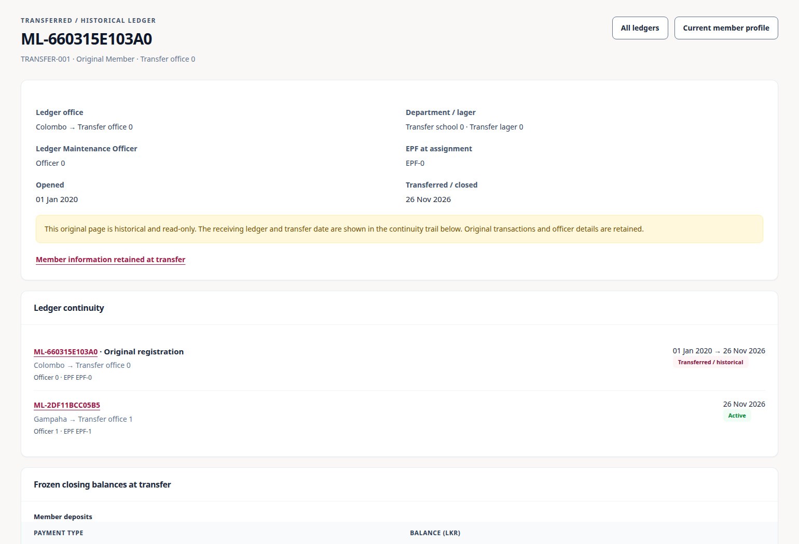

The receiving page becomes **Active** and links back to the original page in the **Ledger continuity**. Open permitted ML references in that trail to compare the pages. Current member-profile access follows the receiving Lager assignment. A source officer may retain access to the historical source page while losing access to the current member profile or receiving page.

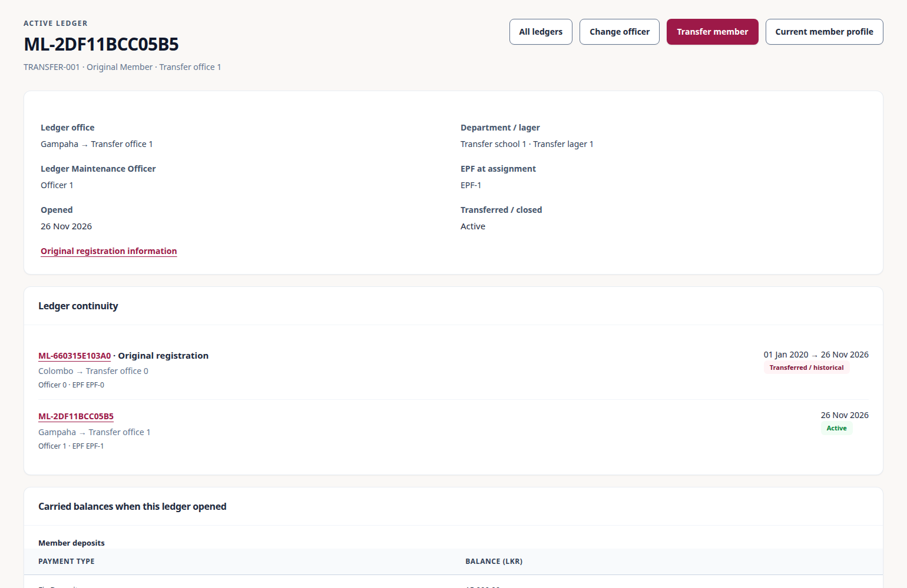

The same member and financial accounts continue. Transfer does not create duplicate member transactions or duplicate child accounts. The receiving page's **Carried balances when this ledger opened** match the original page's frozen closing balances at transfer.

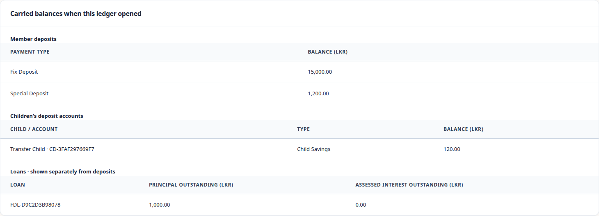

In the worked example, Special Deposit remains LKR 1,200.00 across the transfer; child savings remain LKR 120.00, Fix Deposit remains LKR 15,000.00 and loan principal remains LKR 1,000.00. These carried figures were verified before and after transfer. No additional transaction is needed to recreate them.

A later posted credit of **LKR 50.00** belongs to the receiving page and increases the current Special Deposit balance to **LKR 1,250.00**. The earlier page's LKR 1,200.00 transfer snapshot stays frozen.

To review the full permitted history from the receiving page, select **Include previous linked ledgers**, apply the dates and choose **Show activity**. The Ledger column still identifies whether a row came from the original or receiving page. Export ledger CSV uses the same applied scope and retains those references.

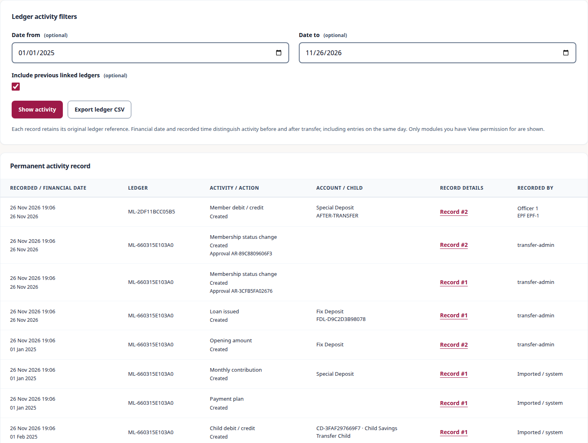

## 8. Review membership activation and inactivation history

Scroll to **Membership activation / inactivation history** on the ledger page. This section records applied membership status changes associated with that page. It shows the effective time, status transition, reason/description, request reference and reviewer identity/EPF where recorded.

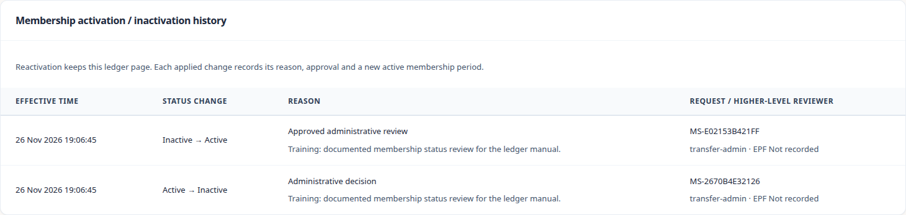

Use **Membership Status** to submit activation, inactivation/deactivation or reactivation requests, supply a valid reason and follow the configured higher-level approval. The ledger history panel is for reading completed status changes; it is not the submission or approval form. Pending or rejected requests do not appear as applied status changes here.

An inactive member can retain an **Active ledger** because ledger-page status describes the current page in the transfer chain. The member's membership status is a separate state. Reactivation keeps the same ledger page, balances and history and starts a new active membership period when the approved change is applied. It does not create a transfer page or erase the earlier inactive period.

If a member has several ledger pages, applied changes appear on the page associated with each change. Use the transfer trail and the member's Membership Status history when checking the wider sequence. The separate **Member Activation & Deactivation User Manual** explains reasons, supporting documents, effective dates, approvals and active-period history in detail.

## 9. Troubleshooting and daily-use checklist

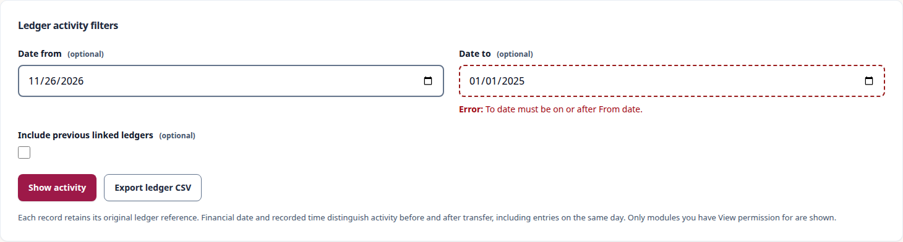

| Problem or message                               | What to check                                                                                                                  |
| ------------------------------------------------ | ------------------------------------------------------------------------------------------------------------------------------ |
| Member Ledgers menu is missing                   | Member Ledgers View permission and active user access.                                                                         |
| Member or ledger is absent                       | Assigned Lager, branch and zonal office, status filter, and current versus historical access. Reset the filters.               |
| Some balances or activity categories are missing | View permissions for the underlying financial/status modules. Empty results do not by themselves prove a zero account balance. |
| Original assignment selector is empty            | The screen lists only accessible active pages that still need an original officer. Assigned pages use Change officer.          |
| No suitable replacement officer                  | Active account, EPF and assigned branch/zonal-office eligibility. Ask the administrator to correct user setup.                 |
| Saved change is not visible                      | Check whether it was queued for approval, and inspect its final status/outcome. Refresh after successful application.          |
| Officer EPFs differ                              | Compare individual-page responsibility with the current Lager-master assignment; section 6 explains the distinction.           |
| Earlier activity is absent on the receiving page | Select Include previous linked ledgers, apply an appropriate date range, and confirm access to the previous page/modules.      |
| Export does not match newly typed dates          | Choose Show activity first; then export the applied enquiry.                                                                   |
| Date validation or CSV error                     | To date must be on/after From date. Correct filters and apply them again.                                                      |
| Historical page cannot be edited/deleted         | History is retained. Change responsibility on the active page; use a properly approved transfer for a location move.           |
| Current profile link is absent after transfer    | Current member access follows the receiving Lager. The source page may remain visible as history.                              |
| Ledger says Active while membership is Inactive  | These are distinct states. Review Membership Status and the applied history.                                                   |

For a routine enquiry, confirm the member and ML reference, check whether the page is current or historical, read each balance group separately, apply the activity filters, and review the record's financial date and original reference before exporting. For a handover or transfer, also verify officer eligibility, EPF, reason, approval outcome, continuity links and the preserved account balances.
