# Payment Plan User Manual

EDCS Member Management System

Prepared: 26 November 2026 · Time zone: Asia/Colombo · Current-system manual v1.0

This manual explains how to select a member, create and edit a monthly payment plan, use reusable templates, understand fixed amounts, follow approval where configured, and receive the contribution actually paid. It also explains how plans appear in Member Balance and why an unpaid plan amount does not increase the bank balance.

Screenshots show the current application with fictional training members, users, templates and payments. The worked examples were verified through real application views in a uniquely named disposable database, including template copying, approval, fixed-amount validation, receipt posting and deletion protection. Some forms are filled in the browser to illustrate the worked values. Live records, accounts and approval settings were not changed.

### Contents

1. Understand payment plans and access
2. Find a member and create a custom plan
3. Create and apply a reusable template
4. Edit a plan and follow approval
5. Maintain templates without changing member plans
6. Receive paid contributions and verify the balance
7. Delete a plan and understand retained history
8. Validation, troubleshooting and completion checklist

## 1. Understand payment plans and access

Open **Payment Plan** in the workspace sidebar. Registered members appear here automatically within your permitted access. Each member can have one saved payment plan. The plan records the agreement date and monthly contribution for each payment type.

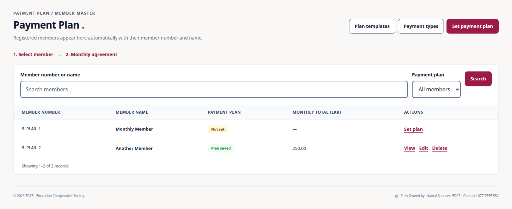

| Item                  | Meaning                                                                                                           |
| --------------------- | ----------------------------------------------------------------------------------------------------------------- |
| Not set               | This member has no saved payment-plan agreement.                                                                  |
| Plan saved            | An agreement exists. This does not mean a contribution has been received or paid.                                 |
| Monthly total         | Sum of the member's saved monthly category amounts. It is an agreed contribution amount, not the account balance. |
| Agreement date        | Date recorded for this member's agreement. A receipt using the plan must be on or after this date.                |
| Payment plan template | Reusable starting amounts copied into a member's own independent plan.                                            |
| Fixed amount          | Amount locked by a template and retained as fixed in the saved member plan.                                       |

| Task                                   | Required permission/access                                                                                  |
| -------------------------------------- | ----------------------------------------------------------------------------------------------------------- |
| List members and view a plan           | Payment Plan View and the member's permitted Lager/location access.                                         |
| Set a new plan                         | Payment Plan Add. The member must not already have a plan.                                                  |
| Edit an existing plan                  | Payment Plan Edit/change. Applicable workflows can require review before an ordinary user's change applies. |
| Delete a plan                          | Payment Plan Delete, subject to approval where applicable and retained-history protection.                  |
| Create or maintain templates           | Relevant View/Add/Edit/Delete permissions for Payment plan templates.                                       |
| Manage contribution categories         | Authorized Payment Types permissions.                                                                       |
| Receive contributions and see receipts | Relevant Debit / Credit & contributions Add/View permissions.                                               |
| View the opening-balance summary       | Opening Balances View.                                                                                      |

Ordinary users need the assigned Lager, active account, EPF and required branch/zonal-office access as well as module permission. A user with access to Members alone does not automatically have Payment Plan access. Administrators have broader access. Template and Payment Types permissions are separate from permission to set an individual member's plan.

## 2. Find a member and create a custom plan

1. Open **Payment Plan**.
2. Enter a membership number or member name and choose **Search**.
3. Use the **Payment plan** filter to choose All members, Not set or Plan saved.
4. For a member marked Not set, choose **Set plan**. Alternatively, choose **Set payment plan** at the top and select the member from the next screen.
5. Confirm the member number and name before entering the agreement.

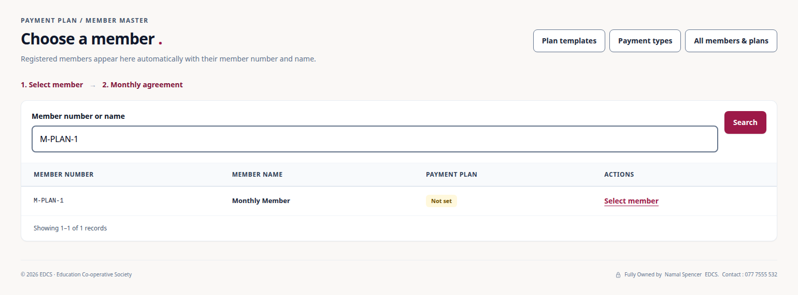

The member selector for a new plan excludes members who already have an agreement. Open **View** or **Edit** on the existing plan rather than creating a second agreement. The member identity is carried into the plan form and cannot be reassigned by editing the agreement.

To create a custom plan:

1. Leave **Payment plan template** at **Custom plan / keep current amounts**.
2. Enter the **Agreement date**.
3. Enter each required monthly contribution in LKR.
4. Leave unused types blank or enter 0.
5. Check **Total monthly deposit**.
6. Choose **Save payment plan**, then review the saved amounts and total.

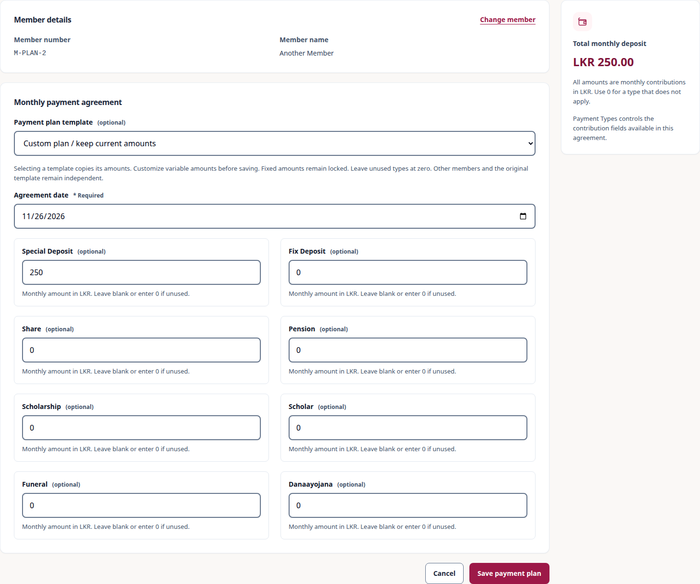

| Field or control      | Current rule                                                                                                       |
| --------------------- | ------------------------------------------------------------------------------------------------------------------ |
| Member details        | Confirm number and name. Choose Change member before saving a new plan if the wrong person was selected.           |
| Payment plan template | Optional. A template copies starting values; Custom keeps the current draft values.                                |
| Agreement date        | Required. Check it against the actual agreement and intended receipt dates.                                        |
| Monthly amounts       | Nonnegative amounts, with at most two decimal places. Enter plain numbers such as 2000.00 in numeric input fields. |
| Unused category       | Blank or zero contributes nothing to the monthly total.                                                            |
| Total monthly deposit | Updates as the contribution values are entered. Displayed currency uses comma separators and two decimals.         |
| Manage payment types  | Authorized users maintain the contribution categories separately.                                                  |

The fields come from active **Payment Types**, such as Special Deposit, Fix Deposit, Share, Pension, Scholarship, Scholar, Funeral and Danaayojana. Your system's configured categories may differ. A new active type becomes available without creating a new member. Existing plans can retain previously used inactive types, identified as inactive.

The form can save zero amounts, but receiving a contribution requires at least one positive applicable plan amount. Do not treat an all-zero saved plan as ready to receive the monthly payment. Opening balances, when shown beneath the form, are separate from the monthly agreement.

## 3. Create and apply a reusable template

Choose **Plan templates** from Payment Plan. The template list shows the name/description, category amounts, total, Active/Inactive status and the available actions.

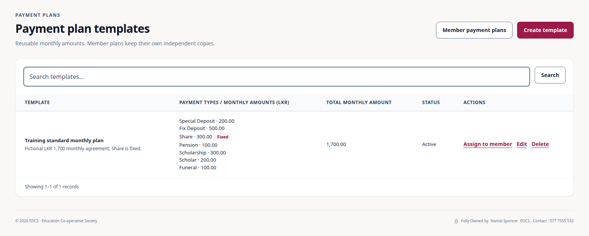

To create a template:

1. Choose **Create template**.
2. Enter a unique, meaningful Name and an optional Description.
3. Keep **Is active** selected when the template should be available for assignment.
4. Enter the monthly amounts for the required payment types.
5. Select **Fixed amount** only for a positive amount that must remain locked after saving.
6. Review **Total monthly deposit** and choose **Save template**.

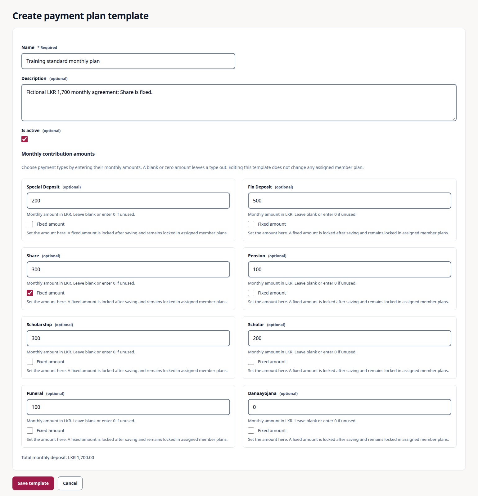

This worked template totals **LKR 1,700.00**:

| Payment type    | Monthly amount (LKR) | Rule in the example |
| --------------- | -------------------- | ------------------- |
| Special Deposit | 200.00               | Variable            |
| Fix Deposit     | 500.00               | Variable            |
| Share           | 300.00               | Fixed               |
| Pension         | 100.00               | Variable            |
| Scholarship     | 300.00               | Variable            |
| Scholar         | 200.00               | Variable            |
| Funeral         | 100.00               | Variable            |
| Danaayojana     | 0.00                 | Unused              |

A template needs at least one positive contribution. A fixed row must have a positive amount. A saved fixed row cannot be changed or unlocked by an ordinary edit, including editing the template itself. Review fixed choices carefully before saving. A fixed rule is a restriction on the agreed monthly plan amount; receiving a different actual payment follows the contribution/exception workflow described in section 6.

To apply the template to a member:

1. On the template row, choose **Assign to member**, then select a member without a plan; or open that member's new plan and choose the template in **Payment plan template**.
2. Wait for the copied values to appear.
3. Review the member identity, agreement date and all copied amounts.
4. Adjust variable categories if this member's agreement differs.
5. Keep fixed categories at their required amount.
6. Choose **Save payment plan** and check the result.

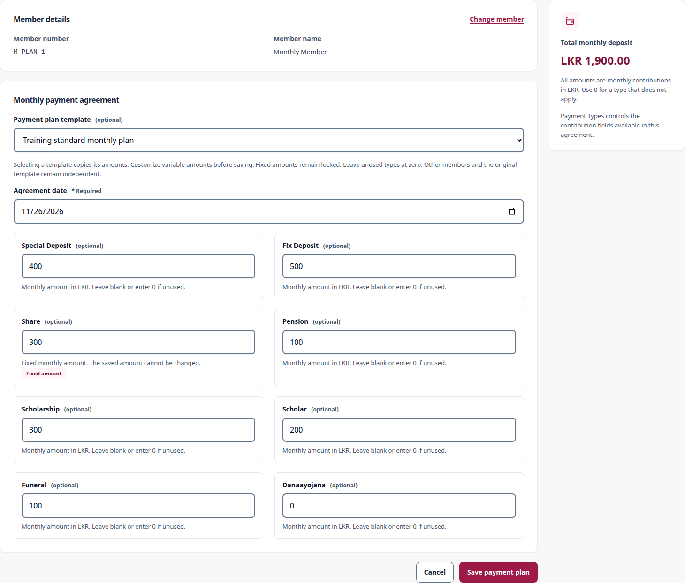

In this example, raising only Special Deposit from LKR 200.00 to LKR 400.00 changes this member's total to **LKR 1,900.00**. The reusable template remains LKR 1,700.00, and the other member's custom agreement remains LKR 250.00.

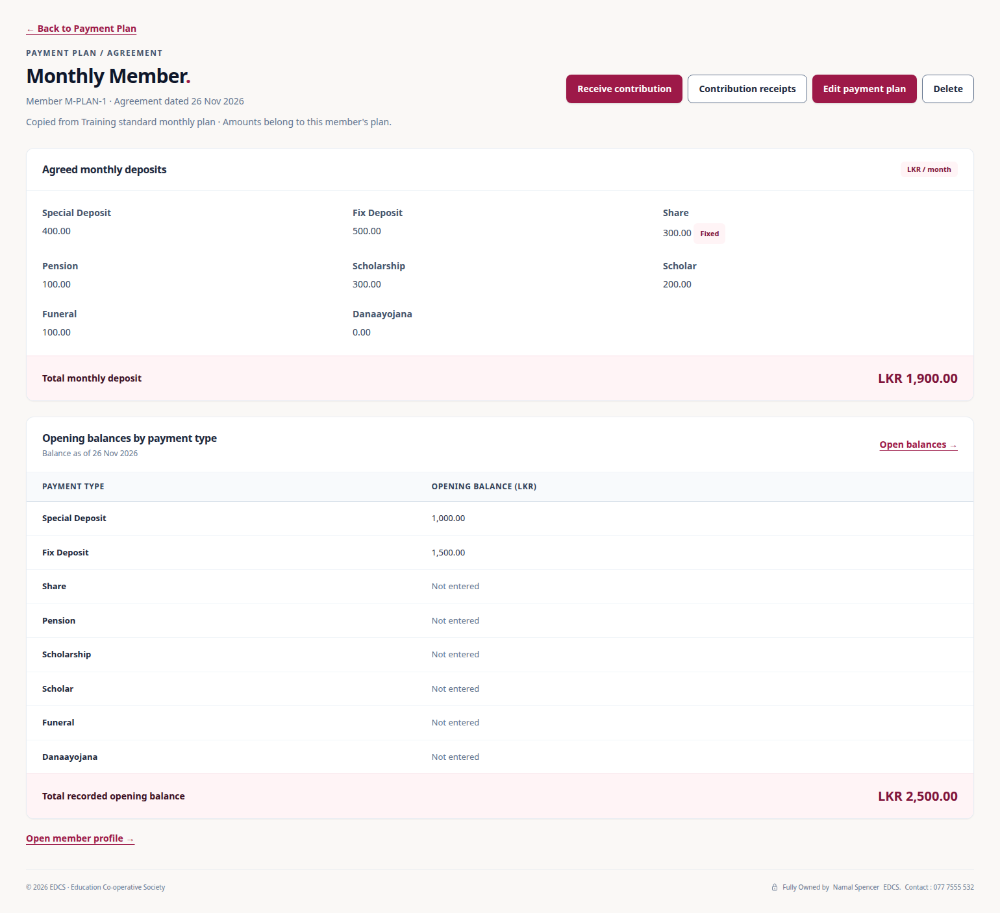

The saved detail page shows **Agreed monthly deposits**, a Fixed badge where applicable, and **Total monthly deposit**. **Copied from** identifies the original template source, while the saved category amounts belong to the member. The linked opening-balance summary is a different record and does not add to the monthly agreement total.

## 4. Edit a plan and follow approval

From the member's row choose **Edit**, or open the saved plan and choose **Edit payment plan**.

1. Confirm the member and saved agreement date.
2. Review the member's existing values. The form initially keeps the saved amounts.
3. Change only the authorized variable amounts.
4. Leave the template choice at Custom plan / keep current amounts when retaining the rest of the existing agreement.
5. Check fixed rows and the new total.
6. Choose **Save payment plan**.
7. If the change is queued, follow the approval request before relying on the new amounts.

Selecting a template while editing is a deliberate recopy operation. It can replace variable draft amounts with the selected template's active categories. Check every category afterward. Previously saved fixed amounts remain protected; changing templates or choosing Custom does not unlock them.

The system administrator decides which workflows and reviewers apply. If an applicable Payment Plan or general edit hierarchy requires approval, an ordinary user's save becomes an approval request. The existing plan values remain in force while the request is pending.

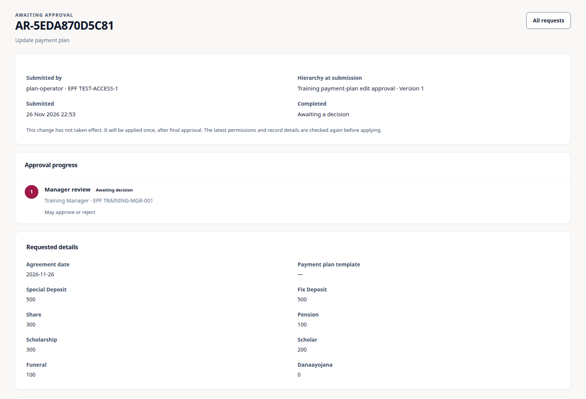

An assigned reviewer opens **Approvals**, checks the member, requested values and context, and records an authorized decision. All required levels must complete for the normal approval route. Requesters should check the final status and outcome: submitted, awaiting a later level or failed-to-apply does not mean the revised plan is in use. An authorized administrator can apply changes directly under the system's approval rules.

There is one current saved agreement per member. Editing it does not create another monthly account or post a receipt. In this worked example, the balance remains LKR 2,500.00 throughout creation and approval of the plan change. Posted contribution receipts retain the plan/allocation snapshot used when they were posted, so a later plan change does not recalculate those receipts.

## 5. Maintain templates without changing member plans

Open **Plan templates** and choose **Edit** on the relevant row. Update an allowed variable amount, description or Active setting, then choose **Save template** and follow any applicable approval. Saved fixed template amounts remain locked.

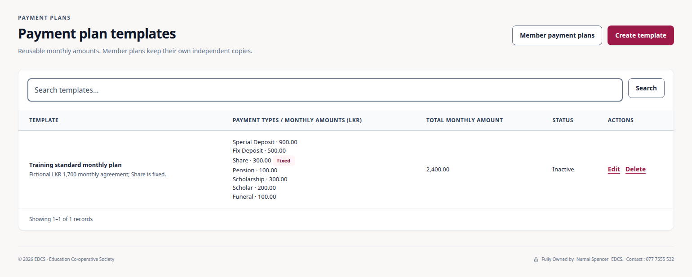

Here the template's Special Deposit changes from LKR 200.00 to LKR 900.00, making its template total **LKR 2,400.00**. The template is then Inactive. The member's saved plan still totals **LKR 2,000.00**, and its Share stays fixed at LKR 300.00.

| Template action                | Effect                                                                                                          |
| ------------------------------ | --------------------------------------------------------------------------------------------------------------- |
| Edit variable template amounts | Changes the reusable starting values for subsequent assignments. Existing member amounts remain as saved.       |
| Make Inactive                  | Removes the template from new selection/assignment. Existing copied member plans continue.                      |
| Make Active again              | Offers the template for assignment again, subject to permissions and active payment categories.                 |
| Delete template                | Removes the reusable template. Member plans retain their copied amounts and saved source-template name.         |
| Reapply to an existing member  | Explicitly copies values into that member's draft for review and saving. This is not automatic synchronization. |

If a template contains no active usable payment-type amounts, it cannot be copied. If a saved plan contains a positive inactive category, the contribution workflow asks for the plan to be reviewed instead of silently reallocating that money. Coordinate changes to Payment Types with the administrator and affected plan owners.

## 6. Receive paid contributions and verify the balance

Saving a payment plan records an agreement. To record money actually received, open the saved plan and choose **Receive contribution**. This opens the Debit / Credit contribution workflow with that member selected.

1. Confirm the member and **Received on** date.
2. Enter the **actual amount received**, reference and description.
3. Review the selected payment category or all-plan allocation.
4. Choose **Preview allocation**.
5. Check each allocated category, the total and any remaining-balance allocation.
6. Choose **Save contribution** when available, or **Submit for approval** and follow the required exception approval.
7. Open the posted receipt and confirm the credited amounts.

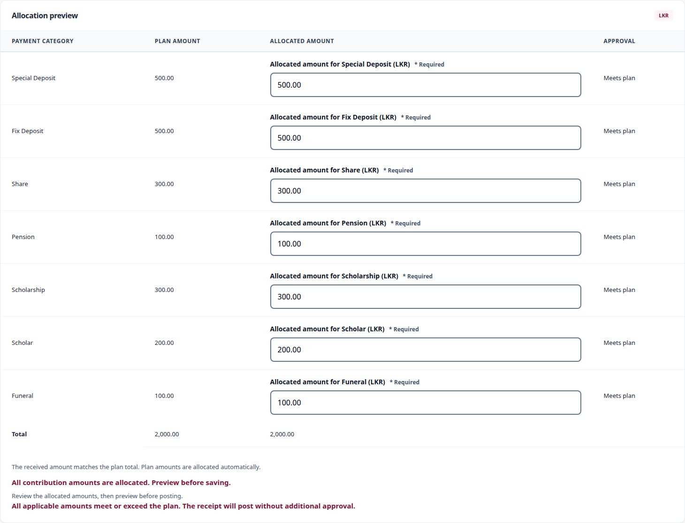

When the amount received equals the selected plan total, the configured plan amounts are allocated automatically. When it differs, enter the actual allocations and review any shortfall or remaining balance. The allocation must equal the amount received exactly. A below-plan receipt for an ordinary user can require **Payment exceptions** approval; no categories are credited while that entire receipt is awaiting final approval. The exact workflow depends on the applicable permissions and exception rules.

Any extra amount can be allocated through **Allocate remaining balance** to permitted member accounts or an existing child deposit account. Child allocations belong to the child's account, not the member's own deposit total. Check the account and child identity carefully. This manual's worked receipt has no remaining amount.

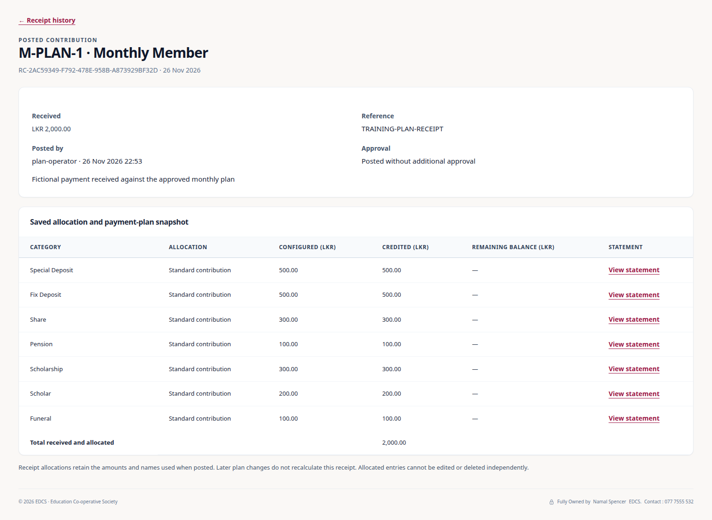

Use **Contribution receipts** on the plan detail page to review the member's saved receipt history. A receipt records the plan/category allocation used at posting. Later changes to the plan or template do not rewrite it. Allocated receipt entries cannot be edited or deleted independently.

The balance example is:

| Event                                                                    | Bank balance (LKR) |
| ------------------------------------------------------------------------ | ------------------ |
| Saved opening amounts: Special Deposit 1,000.00 and Fix Deposit 1,500.00 | 2,500.00           |
| Create the member's monthly plan at 1,900.00                             | 2,500.00           |
| Approve the revised monthly plan at 2,000.00                             | 2,500.00           |
| Post the contribution actually received: 2,000.00                        | 4,500.00           |

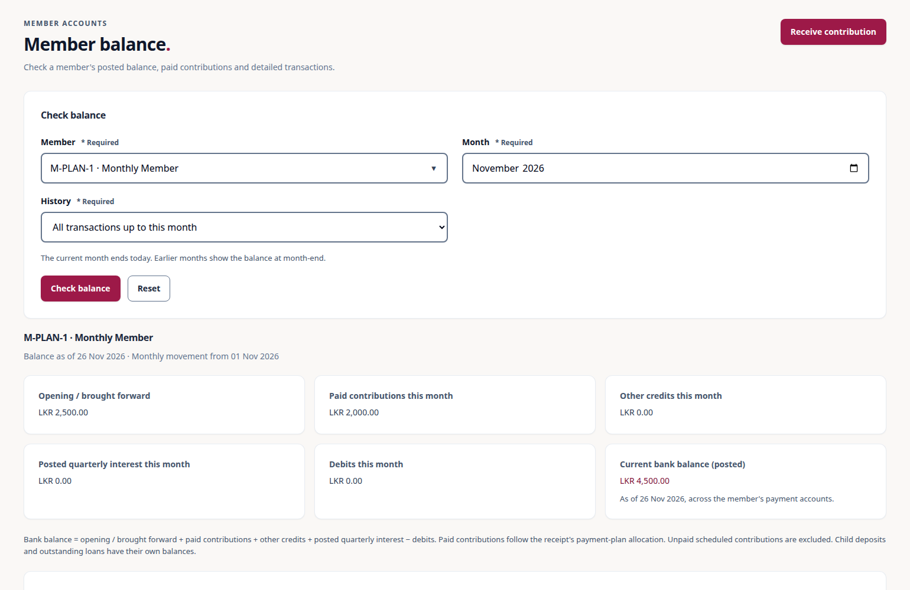

The bank balance includes opening/brought-forward amounts, paid contributions, other posted credits and posted interest, less debits. Unpaid scheduled contributions are excluded. Quarterly interest is processed through the interest module under the bank's configured rules; it is not added by saving a monthly plan. Child deposits and loan positions are shown separately from member deposits.

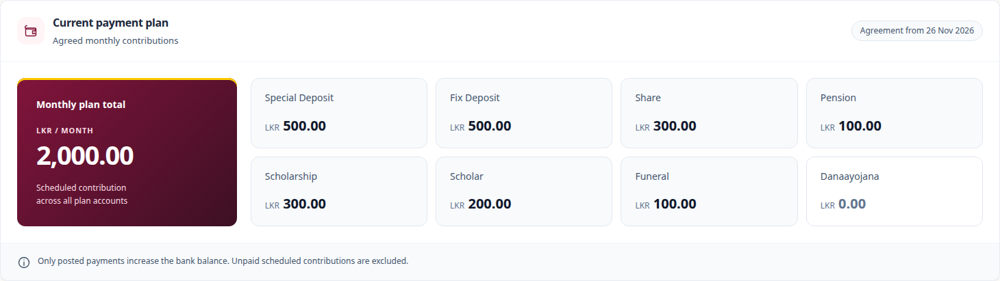

The **Current payment plan** section helps compare the member's present agreement with paid transactions. It is not another credit to add to the balance. Review the detailed transactions or contribution receipt for the money actually posted. A receipt date must be on/after the plan's agreement date and must satisfy the current ledger/transfer-date checks.

## 7. Delete a plan and understand retained history

Only authorized users can reach **Delete**. Use it only when deletion is permitted for the record; the current system retains plans referenced by contribution receipts or permanent ledger history.

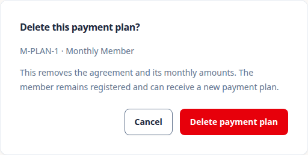

1. Confirm the member number/name and agreement.
2. Choose **Cancel** to keep the plan and return.
3. If deletion is authorized and intended, choose **Delete payment plan**.
4. Follow any applicable approval.
5. Read the resulting message. A history-protection message means the plan was retained.

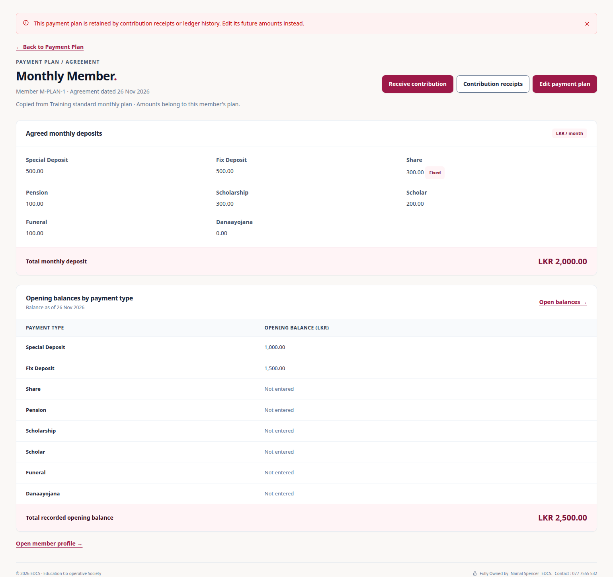

The worked plan has a posted contribution receipt, so deletion is blocked. Its member, agreement and receipt remain. Even a plan without receipts may be retained by permanent ledger history. Edit the permitted future amounts rather than trying to erase that history. A Delete link can appear on the list even when the final delete operation will be protected.

When an unused plan can be deleted, the member remains registered. Deleting a template is a different action: copied member agreements retain their saved amounts. Neither action reverses an already posted payment.

## 8. Validation, troubleshooting and completion checklist

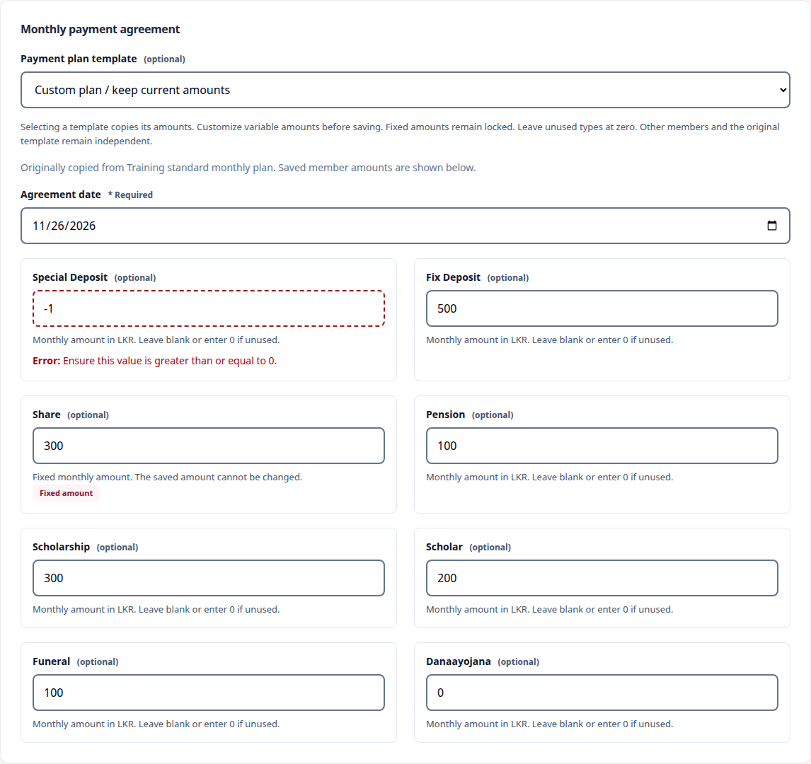

| Problem or message                                | What to check                                                                                                                                                                         |
| ------------------------------------------------- | ------------------------------------------------------------------------------------------------------------------------------------------------------------------------------------- |
| Payment Plan menu or action is missing            | Appropriate Payment Plan permission plus the user's member/Lager access.                                                                                                              |
| Member cannot be found                            | Membership number/name, filter, branch/zonal-office/Lager assignment and current user access.                                                                                         |
| Member is absent from Choose a member             | A saved plan may already exist. Open Payment Plan, search All members, then View/Edit it.                                                                                             |
| This member already has a payment plan            | Use the existing agreement. A duplicate submission cannot create a second plan.                                                                                                       |
| A payment type is missing                         | Active Payment Types setup; inactive types can remain visible on a previously saved plan.                                                                                             |
| Amount is invalid                                 | Use a nonnegative plain number, at most two decimal places, within the field limit. Do not type comma separators into the numeric input.                                              |
| Fixed amount cannot be changed                    | The saved fixed rule persists in the template/member plan. Another template or Custom does not unlock it. Ask the administrator/business owner for the authorized correction process. |
| Template cannot be selected/copied                | Active template, at least one active usable category, and Add/Edit plan permission. Wait for loading or select it again.                                                              |
| Template change did not update the member         | Expected: each member has an independent saved copy. Reapply deliberately and review before saving.                                                                                   |
| Save did not change the existing total            | Check Approvals for a pending or failed outcome. All required review levels must finish and the change must apply.                                                                    |
| Plan is saved but contribution cannot be received | At least one positive usable category, agreement date on/before receipt date, current ledger and applicable transaction permissions.                                                  |
| Below-plan receipt did not credit the accounts    | Check Payment exceptions approval and the final posting outcome. A pending receipt is not paid money in the bank balance.                                                             |
| Bank balance did not rise after saving a plan     | Expected: record and post money actually received through Receive contribution.                                                                                                       |
| Delete is blocked or its button is absent         | Receipt references or permanent ledger history protect the agreement. Use permitted edits for future amounts.                                                                         |

Before saving, confirm the member, agreement date, variable contributions, fixed rules and total. After a queued edit, verify the final approved plan. Before posting money, confirm the actual amount, receipt date, account allocation and reference; afterward, verify the receipt and the resulting bank balance. Use **Approvals**, **Member Ledgers** and authorized **Audit Logs** to trace saved changes and their recorded actors.

Related supplied manuals cover Member Ledgers, Member Activation & Deactivation, and Master Data Adding. Screens and behaviour were reviewed as of 26 November 2026.
