# User Manual

EDCS Member Management System

**For operational officers, finance officers, approvers and system administrators**

Document ID: EDCS-UM-001  
Version: 1.1  
Prepared: 15 November 2026  
Language: English  
Application baseline: current workspace, including lager officer assignments, mandatory EPFs, contribution receipts and administrator approval exemptions

This manual explains how to use the system through its browser screens. Menu names and button labels are shown in **bold**. Your available screens depend on your permissions and assigned districts. Active system administrators perform supported operations immediately without waiting for approval. Required data, eligibility rules and permanent-history protections still apply. All screenshots show fictional training records; example rates and amounts are for instruction. Use your organization's approved financial rules when working with real records.

The manual is supplied as an editable Word document, a searchable PDF and Markdown source. The PDF contents links and bookmarks help you move between chapters. Screenshots illustrate the part of a page being discussed; scroll in the application to reach fields outside the captured area.

### How to use this manual

| Your work                                              | Start with     |
| ------------------------------------------------------ | -------------- |
| First sign-in and everyday navigation                  | Chapters 1–3   |
| Configure users and organizational records             | Chapters 4–5   |
| Register and maintain members                          | Chapters 6–7   |
| Set plans, record contributions and reconcile balances | Chapters 8–13  |
| Maintain children and their savings accounts           | Chapters 14–16 |
| Review and post deposit interest                       | Chapter 17     |
| Service Fix Deposit accounts, loans and withdrawals    | Chapters 18–21 |
| Maintain ledger responsibility and transfer members    | Chapters 22–23 |
| Configure or process approvals                         | Chapters 24–25 |
| Reports, routine checks and problem solving            | Chapters 26–29 |

### Contents

- [1. Sign in, manage your session and sign out](#1-sign-in-manage-your-session-and-sign-out)
- [2. Find your way around the workspace](#2-find-your-way-around-the-workspace)
- [3. Understand access, forms and saved records](#3-understand-access-forms-and-saved-records)
- [4. Administration: roles, users and district access](#4-administration-roles-users-and-district-access)
- [5. Organizational master data](#5-organizational-master-data)
- [6. Register and maintain a member](#6-register-and-maintain-a-member)
- [7. Record an actual retirement](#7-record-an-actual-retirement)
- [8. Configure and review Payment Types](#8-configure-and-review-payment-types)
- [9. Reuse Payment Plan Templates](#9-reuse-payment-plan-templates)
- [10. Create and maintain a member Payment Plan](#10-create-and-maintain-a-member-payment-plan)
- [11. Enter and review Opening Balances](#11-enter-and-review-opening-balances)
- [12. Receive salary deductions and contributions](#12-receive-salary-deductions-and-contributions)
- [13. Member Debit / Credit entries, statements and balances](#13-member-debit--credit-entries-statements-and-balances)
- [14. Register and maintain Children](#14-register-and-maintain-children)
- [15. Configure Child Deposit Types](#15-configure-child-deposit-types)
- [16. Open and service Child Deposits](#16-open-and-service-child-deposits)
- [17. Calculate Quarterly Interest and post annual carry-forward](#17-calculate-quarterly-interest-and-post-annual-carry-forward)
- [18. Configure Fix Deposit Rules](#18-configure-fix-deposit-rules)
- [19. Register and review a Fix Deposit account](#19-register-and-review-a-fix-deposit-account)
- [20. Issue, service and settle a Fix Deposit loan](#20-issue-service-and-settle-a-fix-deposit-loan)
- [21. Request, review and release a Fix Deposit withdrawal](#21-request-review-and-release-a-fix-deposit-withdrawal)
- [22. Review Member Ledgers and officer responsibility](#22-review-member-ledgers-and-officer-responsibility)
- [23. Transfer a member between organizational locations](#23-transfer-a-member-between-organizational-locations)
- [24. Administration: configure Approval hierarchies](#24-administration-configure-approval-hierarchies)
- [25. Submit, approve, reject, cancel and override requests](#25-submit-approve-reject-cancel-and-override-requests)
- [26. Reporting, Lager activity, exports and printing](#26-reporting-lager-activity-exports-and-printing)
- [27. Routine work checklists and practice exercises](#27-routine-work-checklists-and-practice-exercises)
- [28. Troubleshooting and common questions](#28-troubleshooting-and-common-questions)
- [29. Quick references, glossary and administrator handover](#29-quick-references-glossary-and-administrator-handover)

## 1. Sign in, manage your session and sign out

### 1.1 Before you start

Obtain the application address, your individual username and an initial password from your administrator. Use the address provided for your organization. On a local installation the usual address is `http://127.0.0.1:8000/`; that address works only on the computer running the application.

Have the member documents, approved payment instructions or source references needed for your task. The system records the signed-in officer against relevant activity, so use your own account.

### 1.2 Sign in

1. Open the application address in your browser.
2. Enter **Username** and **Password** on the sign-in page.
3. Select **Sign in to your workspace**.
4. Check the signed-in identity and the available navigation. Administrators arrive at the control center; ordinary users arrive in their permitted workspace.
5. Open the module you need. If there is a district-assignment message or an expected menu is missing, follow Chapter 28.

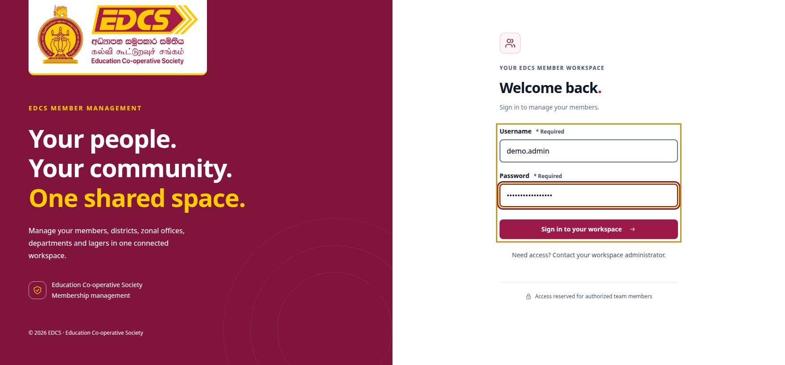

An inactive account cannot sign in. If the password is forgotten, ask an administrator to reset it through **Users & access**. There is no public user registration or self-service email password-reset workflow in the reviewed application.

### 1.3 Session inactivity

The default inactivity limit is 15 minutes; an administrator may configure a different limit. Keyboard, pointer, touch and scroll activity across open tabs keeps the session active. When it expires, sign in again. Unsaved form entries may need to be entered again, so check the saved record or approval request before repeating a financial submission.

Closing one tab does not sign out other tabs. Browser session restoration can also reopen an earlier session. Use the explicit **Sign out** control when finishing work.

### 1.4 Sign out and password changes

Select the **Sign out** control in the sidebar. Confirm that the browser returns to sign-in before leaving a shared computer. Administrators can change their own password through **Advanced Django administration → Change password**. Other users should contact an administrator for a reset.

## 2. Find your way around the workspace

### 2.1 Navigation and overview

Use the left navigation to switch modules. On a smaller screen, select the menu button to open navigation and close it after selecting a page. The module heading and active navigation item identify your current location. Profile pages also offer shortcuts to permitted financial and service screens.

**Overview** summarizes authorized member records, location counts, recent registrations and admission trends. Users with member viewing access see figures within their assigned districts. Users without that access may receive a task workspace instead of the full member dashboard.

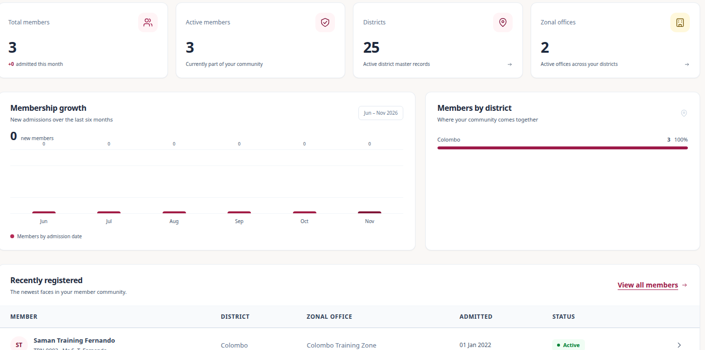

### 2.2 Module guide

| Module or menu                  | Main use                                                               |
| ------------------------------- | ---------------------------------------------------------------------- |
| Member directory / Members      | Register, search, view, edit, print and export member information      |
| Payment Plan                    | Maintain each member's monthly contribution agreement                  |
| Opening Balances                | Enter starting amounts by member payment category                      |
| Debit / Credit                  | Record dated member entries, receive contributions and read statements |
| Quarterly Interest              | Calculate member and child interest and post annual carry-forward      |
| Children                        | Register children linked to a member                                   |
| Child Deposits                  | Open child accounts and record their separate transactions             |
| Member Transfers                | Move organizational assignment with linked permanent ledgers           |
| Member Ledgers                  | Review permanent pages, balances, activity and responsible officers    |
| Fix Deposit Loans & Withdrawals | Register deposit-backed accounts and service loans and withdrawals     |
| Master data                     | Maintain locations, payment types, templates and financial rules       |
| Approvals                       | Review your submissions or requests assigned to you                    |
| Approval hierarchies            | Administrator configuration of business approval levels                |
| Administration                  | Administrator control center, Users & access, Roles & permissions      |

Contribution receipts are reached from **Debit / Credit**, a member profile or a payment plan. They use the existing Debit / Credit permissions.

### 2.3 Search, filters and pagination

1. Enter a name, number or other supported search term in the page's search field.
2. Choose relevant district, office, lager, account or date filters.
3. Select the page's search/show button to apply the filters.
4. Review the selected filters before interpreting totals or exporting.
5. Use pagination to read the remaining results. To widen a search, clear restrictive fields and apply it again.

Searchable dropdowns allow typing part of a name or number. Select an actual result; typed text alone may not select a record. Where supported, use arrow keys and Enter. The member **Department** dropdown can be searched by name or code.

## 3. Understand access, forms and saved records

### 3.1 Actions and districts work together

Each permission module has independent **View**, **Add**, **Edit** and **Delete** actions where supported. Edit does not automatically grant View, and Add does not grant report access. A user can receive permissions through roles and direct grants; the combined permissions determine effective access.

District assignments determine which district records the user can work with. A role never adds districts. An ordinary user with no districts assigned cannot access district records. Active system administrators have access to every district.

Shared templates and financial rule masters apply across districts. Changes to Payment Types, Child Deposit Types and Fix Deposit Rules are reserved for administrators. Creating districts is also administrator-only. Staff status alone does not grant the control center or advanced administration.

### 3.2 Complete and save a form

1. Confirm the selected member or account before entering amounts.
2. Complete fields marked with an asterisk. Read help text beside date, amount and relationship fields.
3. Review automatically filled and read-only values.
4. Select **Save**, **Register**, **Post** or the specific action shown.
5. Read the success message or highlighted errors.
6. Confirm the resulting record. If redirected to an approval request, the proposed change remains pending until final approval.

A form with errors has not completed the operation. Fix the highlighted fields and resubmit. Financial previews and eligibility reports are read-only; a separate save/post action records the result.

### 3.3 Keep the different financial records clear

| Record                     | Meaning                                              | Effect on money recorded                          |
| -------------------------- | ---------------------------------------------------- | ------------------------------------------------- |
| Monthly salary             | Member information                                   | Does not credit an account                        |
| Payment plan               | Agreed monthly amounts and allocation weights        | Does not credit an account                        |
| Opening balance            | Imported or agreed starting position at a date       | Establishes the account's starting amount         |
| Contribution receipt       | Actual amount received and its allocation            | Creates category credits when posted              |
| Debit / Credit entry       | A dated increase or decrease for one member category | Changes the member statement                      |
| Child deposit entry        | A dated movement on one child account                | Changes that child's account only                 |
| Loan entry                 | Principal repayment or assessed interest activity    | Changes loan balances separately from the deposit |
| Interest calculation draft | Saved quarterly calculation                          | Does not credit annual interest yet               |
| Posted annual interest     | Final annual credit and carry-forward                | Credits the relevant member or child ledger once  |

### 3.4 Editing and deletion

Where permitted, open **Edit**, correct the values and save. Configured edit hierarchies may send the change to approval. Delete actions require a confirmation screen and submission. A linked master, a historical ledger entry, posted annual interest or a contribution receipt can be protected even when Delete permission is granted.

Use inactive status when a supported record must remain in history. A posted contribution receipt and its generated credits are permanent; they have no direct edit/delete workflow. If a correction is needed, provide the receipt reference to the finance administrator for an approved corrective transaction. The current interface does not provide an automated receipt reversal action.

## 4. Administration: roles, users and district access

**Who can use this:** active system administrators. Open **Administration** from the navigation or the control center at `/admin/`.

### 4.1 Create or maintain a role

1. Open **Roles & permissions**.
2. Select the new-role action or open an existing role.
3. Enter a clear role name, such as “Member Registration Officer”.
4. Select only the required View/Add/Edit/Delete actions in the module matrix.
5. Save and review the role.
6. Assign the role to users through **Users & access**.

A registration-only example grants **Members → View** and **Members → Add**. Assign the user's districts separately. A role is reusable and its changes affect every user assigned to it.

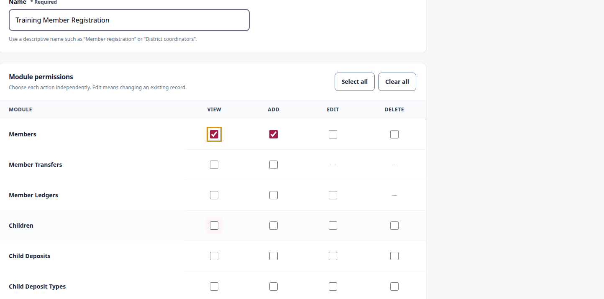

### 4.2 Create a user

1. Open **Users & access** and choose the new-user action.
2. Enter a unique username, the employee's first and last names, and an email address if available.
3. Enter and confirm a password that meets the displayed validation rules.
4. Keep **Active** selected for an account that should be able to sign in.
5. Select one or more **Assigned districts**.
6. Select the required roles and review any direct module permissions.
7. For a ledger officer, enter the unique **EPF number** and, where applicable, the primary **Ledger officer zonal office** with its district access. The Lagers master can select any active officer with an EPF; a master assignment does not grant additional district permissions.
8. Save the account, review its effective permissions and provide sign-in details through your organization's normal process.

When an email address is supplied for a new user, the system attempts a welcome email containing the username and sign-in link. Share the password separately. Blank email skips delivery. A delivery warning does not mean the account failed to save; verify the user before creating another account. Editing an existing user does not send another welcome message.

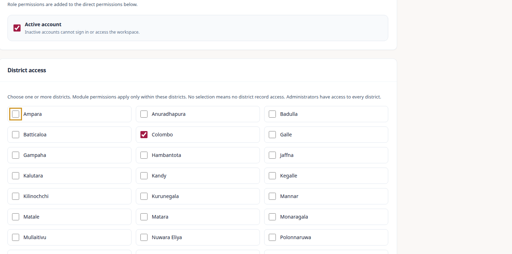

### 4.3 Edit access or reset a password

1. Search for the account in **Users & access** and open it.
2. Review roles, direct grants, districts and the effective-access display.
3. To keep the password, leave both password fields blank. To reset it, enter the same new password in both fields.
4. Save. Access changes apply on subsequent requests, including an existing session.

To revoke an action, remove it from every assigned role and direct grant that provides it. Removing a district prevents access to its records but does not remove shared-module permissions.

### 4.4 Deactivate or delete a user

Reassign every active ledger maintained by the employee before deactivating the account, changing its ledger office or removing its district access. Then clear **Active** and save. Inactive accounts cannot continue normal authenticated work.

The custom panel prevents deleting superusers, deleting your own account and deactivating superusers. Permanent ledger or approval references may also prevent account deletion. Use deactivation to retain the employee's history. The administration activity feed records user and role changes.

### 4.5 Advanced administration

**Advanced Django administration** at `/admin/django/` is reserved for administrators. Use the normal workspace for business workflows. Advanced administration retains protections for posted and permanent records. Supported administrator operations save directly without edit or below-plan payment approval. Approval records and receipt history are read-only there. Ordinary new accounts created through the custom panel do not become system administrators.

## 5. Organizational master data

**Purpose:** prepare consistent locations for registration, reporting, officer responsibility and transfers. Use authorized master-data permissions and assigned districts. Set up the location hierarchy before registering a member.

### 5.1 Recommended order

**District → Zonal office → Department / Lager → Member**

A department belongs to a district and zonal office, optionally through a subdivision. A lager belongs to a zonal office. Members require both a department and a lager in the correct zone.

### 5.2 Districts and provinces

1. Open **Master data → Districts**.
2. Search for the district and open **Edit**. Administrators can create a new district where necessary.
3. Complete the district's name/code and the **Province full name** and separate **Province short name**.
4. Save and verify the displayed province. For example, use “Western” for the full name and “WP” for the short name.

The application provides Sri Lankan district records. Review existing records before adding duplicates. Province values on member forms come from the district master.

### 5.3 Zonal offices

1. Open **Zonal offices** and select **Add zonal office**.
2. Choose the district and enter the office name, code and available contact information.
3. Set the active status and save.
4. Use the office's links to inspect its departments, lagers or members.

An office with linked records cannot move to a conflicting district. Member office addresses and phone numbers are entered separately during registration; selecting a zone does not copy these contact fields.

### 5.4 Subdivisions

Open **Subdivisions**, add or edit a record, select its district and zonal office, enter its name/code and save. Subdivision is optional on a member. If selected, it must match the zone and any applicable department relationship.

### 5.5 Departments

1. Open **Departments** and check for the department by name or code.
2. Choose Add, select the district and zonal office, and optionally select the subdivision.
3. Enter the department name, code and available address information.
4. Save, then confirm the relationships in the list.

Registration uses the department to fill its district, zone and province information. The application label is **Department**, although some older references and URLs use “school”.

### 5.6 Lagers

1. Open **Lagers** and filter by district or zonal office.
2. Choose Add and select the district and zonal office.
3. Enter a name and globally unique code. Select the **Ledger Maintenance Officer**; all active officers with recorded EPFs are available. Confirm the automatically filled required **Ledger Maintenance Officer EPF number**, set active status and save.
4. Confirm the member count and the **Activity** link where available.

Lager names must be unique within one zone but may repeat in different zones. A lager with registered members cannot change zone or be deleted. Deactivate an obsolete lager where appropriate. Inactive existing assignments can remain visible during editing, but inactive locations are normally excluded from new assignments.

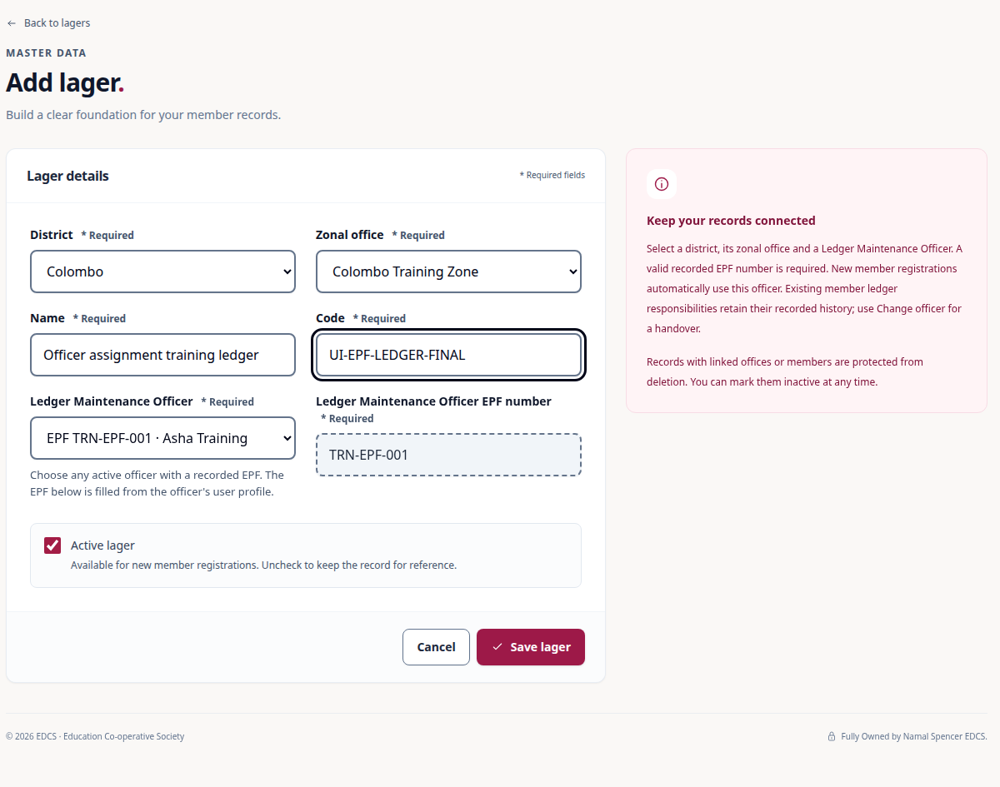

### 5.7 Maintain master records without losing history

Check linked records before changing a master. Protected deletion or a parent-change error means the relationship is already used. Correct the intended assignment through the appropriate operational process; use **Member Transfers** for a member location move. Editing an existing master may enter an approval workflow when an applicable hierarchy is active.

## 6. Register and maintain a member

**Access:** Members → Add to register, View to browse/profile/print/export, Edit to change details, and the relevant district access.

### 6.1 Prepare the registration

Confirm that the district, zonal office, department and lager are active. In **Master data → Lagers**, an administrator must assign an active **Ledger Maintenance Officer** with a valid recorded EPF. Existing unassigned lagers require this setup before registration. Selecting the lager automatically fills its officer and EPF; the dropdown lists all active officers with recorded EPFs.

### 6.2 Register a member

1. Open **Member directory → Register member**.
2. Search **Department** by name or code and select the correct result. Alternatively, select a district and zone first to narrow the choices.
3. Check the automatically filled district, full/short province names and zonal office.
4. Select a **Lager** from that zone and an optional subdivision. Changing the zone clears an incompatible lager.
5. Confirm the automatically selected **Ledger Maintenance Officer** and EPF for the chosen lager. The server uses the lager's saved officer assignment. To change that assignment for new registrations, update the master first.
6. Enter the member identity and contact fields described below.
7. Review the admission date, salary and status.
8. Select **Register member**, or **Register & set payment plan** when that action is available.
9. Verify the member profile and original ledger. If redirected to payment-plan entry, complete Chapter 10.

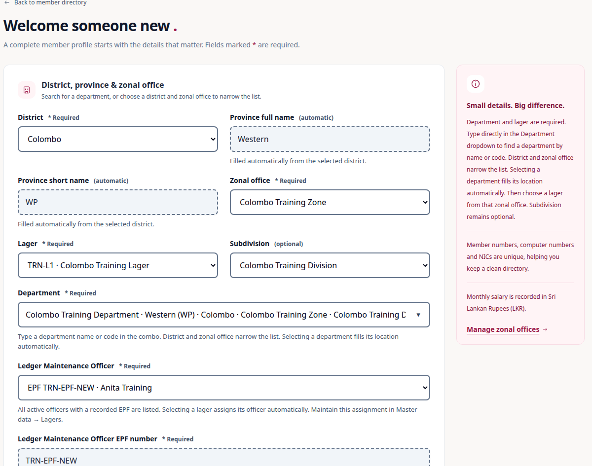

### 6.3 Member fields

| Field                                     | What to enter or check                                                          |
| ----------------------------------------- | ------------------------------------------------------------------------------- |
| Member number                             | Required unique identifier; enter the approved organizational number            |
| Computer number                           | Optional; must be unique when supplied                                          |
| Title / Salutation                        | Optional Mr., Miss, Mrs., Ms. or Rev.                                           |
| Full name                                 | Required complete name; keep it separate from the title                         |
| Short Name                                | Automatically generated from the title, initials and final name                 |
| Date of birth                             | Optional where unknown; must not be in the future                               |
| Retirement age / Expected retirement date | Read-only; standard age 60 and date calculated from birth date                  |
| NIC number                                | Required unique NIC: 12 digits, or 9 digits followed by V/X                     |
| Gender                                    | Choose the appropriate displayed value                                          |
| Admission date                            | Required; today or an earlier date                                              |
| Monthly salary (LKR)                      | Required nonnegative salary; this does not post a contribution                  |
| Mobile phone                              | Required; telephone fields accept 7–15 digits with common formatting            |
| Office / Home phone                       | Optional                                                                        |
| Office address / Private address          | Required; enter the member's actual contact addresses                           |
| Status                                    | Active, Inactive or Retired, according to the approved record                   |
| Recorded retirement / pension date        | Optional actual or scheduled date; affects pension-quarter interest eligibility |

Member, computer and NIC identifiers are normalized to uppercase. Duplicate identifiers are rejected. Generated names and retirement dates update from the saved title, name and birth date.

### 6.4 Find, review and edit a member

1. Open **Member directory** and search by the supported identifiers or name.
2. Apply district, office, lager and status filters as needed.
3. Open the member's profile and confirm identity before using its service links.
4. Select **Edit**, update permitted fields and save.
5. If an approval request appears, check its requested values and track it in **Approvals**; the existing record stays unchanged while pending.

Use **Member Transfers** for organizational moves to preserve permanent location and ledger history.

### 6.5 Print or export

Select the profile's Print action or export the filtered directory with **Export CSV**. Exports include all authorized matches across pages; see Chapter 26.

## 7. Record an actual retirement

**Access:** Members → Edit and the member's assigned district.

### 7.1 Expected retirement and recorded retirement

The expected retirement date is planning information calculated from birth date at age 60. Reaching that date does not automatically retire the member. The **Recorded retirement / pension date** controls the existing pension-quarter interest rule and may be maintained for an actual or scheduled date.

### 7.2 Process retirement

1. Open the member profile and select **Process retirement**.
2. Review the identity and enter the actual retirement date.
3. Use today or an earlier date, after the member's birth date when recorded.
4. Submit the form and complete any configured approval.
5. Verify that the member status is **Retired** and the recorded retirement/pension date is correct.

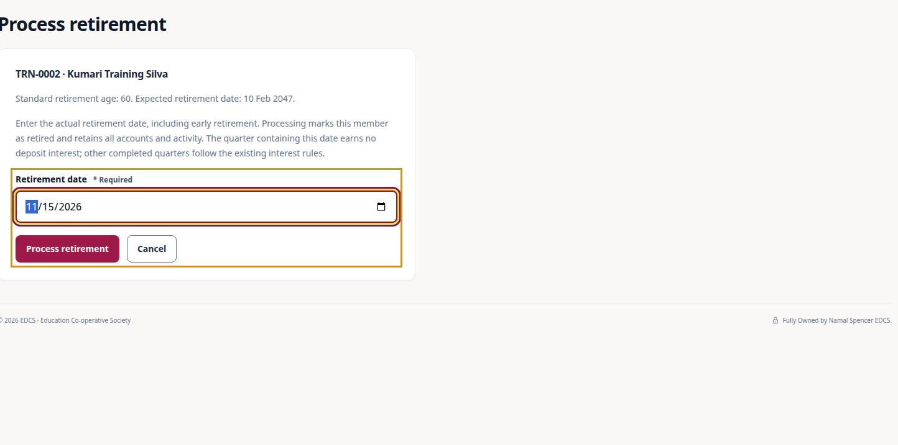

The operation retains plans, accounts and financial history. A retirement/pension date cannot be changed when that would alter an already posted interest year's eligibility. Ask the finance administrator to review such a case; changing the expected date alone does not bypass the protection.

## 8. Configure and review Payment Types

**Access:** administrators maintain the shared master; users need Payment Types → View to open its list.

### 8.1 Add or edit a type

1. Open **Master data → Payment Types**.
2. Review existing types before adding one. Typical categories include Special Deposit, Fix Deposit, Share, Pension, Funeral and Scholarship.
3. Enter the unique name, approved annual **Interest rate (%)**, display order and active status.
4. Select the bank's interest reference frequency: Daily, Monthly, Quarterly, Yearly or Custom period.
5. For a custom repeating period, enter a positive whole-number interval and days/months/years. For a custom date range, supply both dates with the end on or after the start.
6. Save and confirm the setting in the list. If an edit hierarchy applies, finish its approval first.

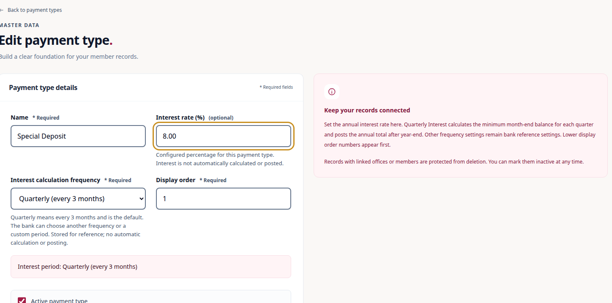

The annual deposit rate can be 0–100% with two decimal places. A zero rate earns zero interest. The **Quarterly Interest** module uses the quarterly minimum-month-end method for member payment categories; the other frequency/custom-period settings are reference settings and do not select a different calculation algorithm there.

### 8.2 Inactive and used types

Inactive types retain recorded history. New ordinary transactions require active types. Existing plan or opening records may still show their saved inactive categories. A positive inactive category in a contribution allocation blocks posting until the plan or master is reviewed. Used types are protected from deletion.

## 9. Reuse Payment Plan Templates

**Access:** Payment Plan Templates actions as granted. This is a shared module across districts.

### 9.1 Create a template

1. Open **Master data → Payment Plan Templates**, or **Payment Plan → Plan templates**.
2. Choose the new-template action.
3. Enter a clear name, description and active status.
4. Enter monthly LKR amounts for the relevant payment types. Blank or zero excludes a type.
5. Ensure at least one amount is positive, then save.

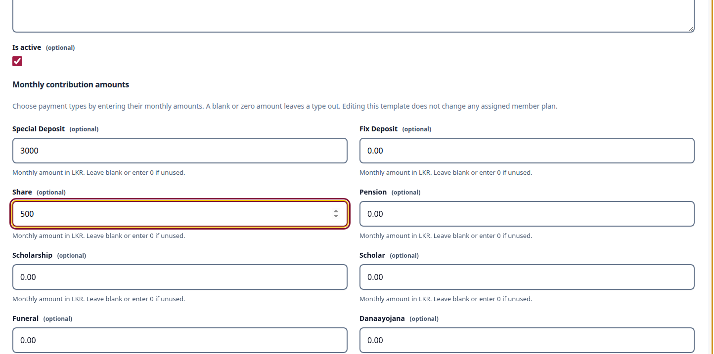

### 9.2 Apply and maintain templates

Select an active template on a member's payment-plan form. Its amounts load into the draft, where you can adjust them before saving. Selecting a template again replaces the draft amounts, so review the whole form.

Saved member plans contain independent copies. Editing or deleting the template does not change plans already assigned to members. Inactive templates cannot be newly applied. Inactive payment types are omitted from new template copies. Edit approval requirements can apply to template changes.

## 10. Create and maintain a member Payment Plan

**Purpose:** record the monthly agreement and the weights used to allocate received contributions. A plan does not itself credit money.

**Access:** Payment Plan → Add/Edit/View as required and the member's district access.

### 10.1 Set the plan

1. From the member profile select **Set payment plan**, or open **Payment Plan** and choose a member without a plan.
2. Confirm the member number and name.
3. Enter the **Agreement date**.
4. Select an active template if useful, or enter custom category amounts.
5. Enter nonnegative monthly LKR values, leaving unused categories blank or zero. Include at least one positive amount.
6. Check the total and any opening-balance information available to your permissions.
7. Save and review the agreement page.

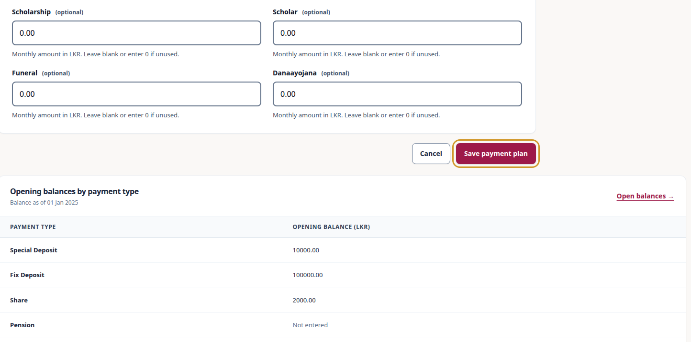

Each member has one current plan record. If the member already has a plan, open that plan rather than creating a second one. The agreement must be effective on the date used to receive a contribution.

### 10.2 Change the agreement

Open **Edit payment plan**, review the date and amounts, and save or submit for approval. Template changes do not update this agreement automatically. Previously posted contribution receipts retain their original allocation snapshots when the plan changes. A plan referenced by permanent receipts/history is protected from deletion; edit future amounts through the supported plan workflow.

## 11. Enter and review Opening Balances

**Purpose:** establish a member's starting amounts by payment type on a stated date. Opening balances are separate from monthly plan amounts.

**Access:** Opening Balances → View/Add/Edit as needed and district access.

### 11.1 Enter a member's opening amounts

1. Open **Opening Balances**.
2. Select the member in **Member number / name** and select **Show balances**.
3. If no opening exists, choose **Set opening balances**. If one exists, review or edit that record according to your permissions.
4. Enter **Balance as of** and the opening LKR amount for each payment category.
5. Leave unused amounts blank or zero, check the displayed total and save.
6. Reopen the member summary to verify the amounts and effective date.

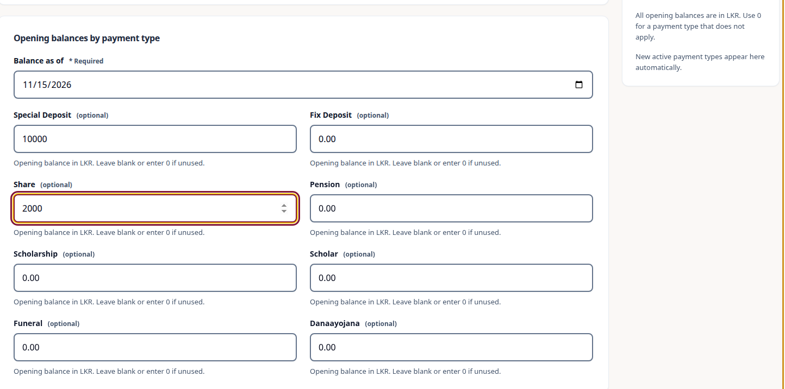

Each member has one opening-balance record. Newly active categories appear in forms. A new category on an existing record can show **Not entered** until saved. Previously saved inactive categories remain available on the existing record.

### 11.2 How opening dates affect balances

An opening amount is the starting position on its balance date. For a type with a saved opening amount, entries before that date are excluded from later balances to avoid counting imported history twice. For a date before the opening date, balances use the relevant transactions only. A type with no saved opening amount uses its transaction history.

For example, an opening of LKR 10,000 on 1 January and a credit of LKR 2,000 on 5 January produce LKR 12,000 before any later movements. Do not enter the same imported amount again as a credit.

### 11.3 Protected openings and annual carry-forward

Posted annual interest protects relevant historic opening details. Fix Deposit loan/withdrawal history can also lock its opening date and amount. The Opening Balances summary shows annual carried-forward values separately after interest posting. Retain the original opening record; annual posting handles carry-forward without replacing imported history.

## 12. Receive salary deductions and contributions

**Purpose:** enter money actually received and automatically allocate it to the member's payment categories.

**Access:** Debit / Credit → Add to receive; View to browse receipts/statements; assigned district access. A valid effective payment plan and a current member ledger are required.

### 12.1 Preview and post a contribution

1. Open **Debit / Credit → Receive contribution**. The action is also available from a member profile and saved payment plan when permitted.
2. Select the member and check the number/name.
3. Enter **Received on**, using today or an earlier permitted date. It cannot be before the plan agreement or the current transfer boundary.
4. Enter the actual **Salary deduction / contribution received (LKR)** as a positive amount with at most two decimal places.
5. In **Allocation**, leave **Proportionally across my payment plan** to distribute across the plan, or select one configured category for a category-only payment.
6. Enter a source **Reference** and **Description** where useful.
7. Select **Preview allocation**. This calculates without posting money.
8. Review the plan amount, ratio, allocated amount and approval indication for every category. Confirm the total equals the amount received.
9. Select **Post contribution** when all categories meet the plan. Ordinary users select **Submit for approval** for a below-plan payment; system administrators select **Post contribution** and post immediately.
10. Verify the saved receipt or approval request. After posting, confirm the category credits in the member's statements.

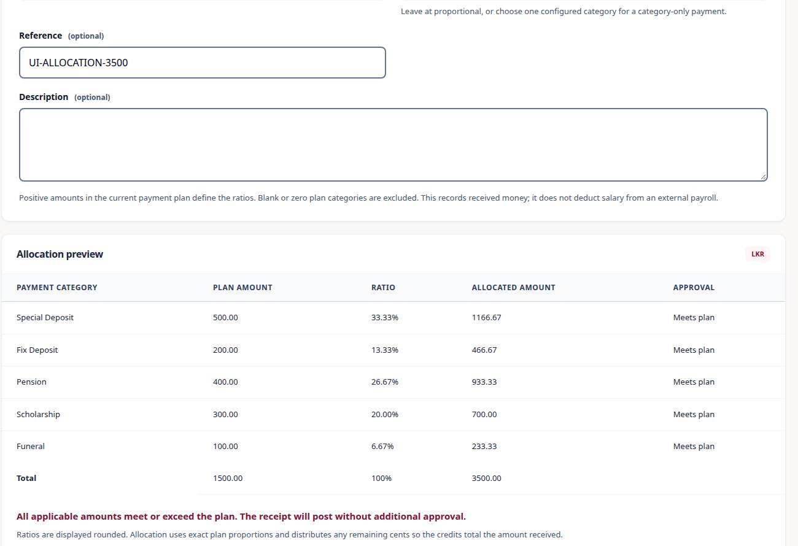

This form records actual received money. It does not connect to an external payroll or deduct salary from a bank account. The member's salary field also does not trigger receipt posting.

### 12.2 Proportional example

| Category        | Plan amount (LKR) | Displayed ratio | Allocation of 3,500 (LKR) |
| --------------- | ----------------- | --------------- | ------------------------- |
| Fix Deposit     | 200.00            | 13.33%          | 466.67                    |
| Special Deposit | 500.00            | 33.33%          | 1,166.67                  |
| Pension         | 400.00            | 26.67%          | 933.33                    |
| Funeral         | 100.00            | 6.67%           | 233.33                    |
| Scholarship     | 300.00            | 20.00%          | 700.00                    |
| Total           | 1,500.00          | 100%            | 3,500.00                  |

The system uses the configured amounts as exact weights and distributes remaining cents so the final total matches the receipt. The displayed rounded percentages do not drive the arithmetic. Blank and zero plan amounts are excluded. Very small receipts can leave some allocations at zero; those allocation details are retained without zero-value ledger entries.

### 12.3 Below-plan contributions

For ordinary users, if any applicable allocation is below its configured plan amount, the entire receipt waits for the dedicated **Payment exceptions** approval hierarchy. No category is credited before final approval. A missing or incomplete hierarchy blocks ordinary-user posting; an administrator must configure it as described in Chapter 24. System administrators may post directly without this hierarchy or an approval request.

For a category-only payment, selecting Pension and entering LKR 250 against a LKR 400 configured Pension amount requires approval. Selecting Special Deposit with LKR 500 or LKR 800 against a LKR 500 configured amount posts automatically. Proportional allocation of LKR 750 against the LKR 1,500 example plan requires approval.

The rule applies to each payment, rather than adding all payments in a month together. Equal/greater contributions post without an additional payment-exception approval. A global edits hierarchy is not a substitute for the dedicated Payment exceptions hierarchy.

### 12.4 Receipt history and corrections

Open **Debit / Credit → Contribution receipts** or the form's **Receipt history** link. Search by member number/name or reference and open the receipt. Review the receipt number, received date, amount, original poster, frozen category allocations, linked transactions and approval information where visible.

Pending contribution requests are shown separately for requests you are allowed to see; **Approval history** opens the full request list. A pending request is not a posted receipt. Rejected, cancelled or failed requests do not credit the ledger.

Receipts and generated category credits cannot be directly edited or deleted. Preserve their references for any finance correction. If the amount, plan or member ledger changes after preview, choose **Preview allocation** again before posting. If a browser retry reports that the contribution was already posted, open the existing receipt; do not start a new receipt for the same received money.

## 13. Member Debit / Credit entries, statements and balances

**Access:** Debit / Credit actions and district access. These permissions also govern the new contribution receipt screens.

### 13.1 Record a single-category entry

Use **Receive contribution** for automatic allocation of a received total. Use **Add entry** when you need a permitted dated transaction for one category.

1. Open **Debit / Credit → Add entry**.
2. Search for and select the member.
3. Select an active payment type and the transaction date.
4. Review **Saved member balance**, including the selected category breakdown and displayed rate/reference period.
5. Enter a positive **Debit** or **Credit**, leaving the other side blank or zero.
6. Enter an appropriate reference and description, then save.
7. Verify the statement entry, or review the approval request if one was created.

A credit increases the member category balance; a debit decreases it. Both positive sides together, both zero, negative amounts and invalid precision are rejected. Saved-balance previews exclude your unsaved amount and exclude the original entry while editing it.

Ordinary users' below-plan category credits through this form also enter the dedicated payment-exception approval workflow. System administrators post directly without approval. Annual interest uses its own posting rules. Managed Fix Deposit withdrawals must use **Fix Deposit Loans & Withdrawals**; manually entering a debit is not the release process.

### 13.2 Read a member/category statement

1. Open **Debit / Credit**.
2. Choose the member and payment type.
3. Use **Single date** for one day, or **From date / To date** for an inclusive range. Clear the unused date fields.
4. Select **Show debit / credit**.
5. Review starting/brought-forward balance, period debits, credits, final balance, running balances and any ledger references.

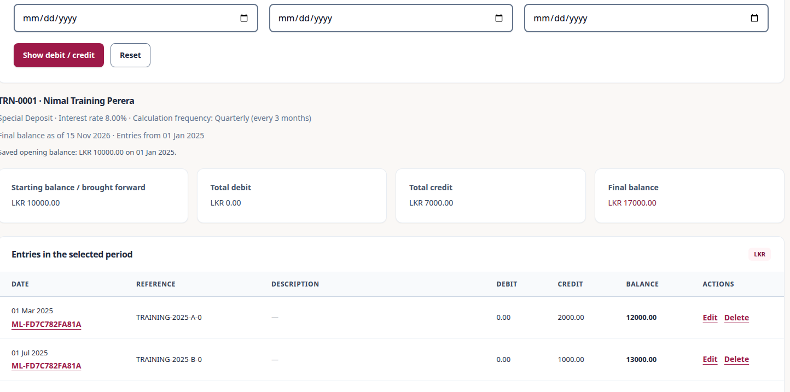

**Final balance = starting balance + period credits − period debits.** Earlier amounts carry into the starting balance; choosing a later From date does not reset it to zero. With no end date, the statement ends today. A no-transaction day can still show a balance. Pagination does not restart the running calculation.

### 13.3 Review Member balances

Open **Debit / Credit → Member balances**, or the permitted member-profile link. Optionally select a member and/or payment type, choose the date or range and run the report. Blank member/type filters include all authorized matching accounts. Totals cover all filtered pages. Use **View statement** to open the corresponding detailed account with its date selection preserved.

The report includes accounts with saved openings or transactions, including inactive category history. Negative balances can appear. If a balance seems wrong, check the category, date range, opening date, pending approvals and transfer ledger references before adding an adjustment.

### 13.4 Correct ordinary entries

An editable existing entry retains its original member, payment type and creator. Correct its permitted date, amount, reference or description and complete any required approval. Historical ledger entries, receipt allocations, posted-interest credits and managed withdrawals are protected. After Fix Deposit loan/withdrawal activity, amount/date changes can also be locked while note/reference corrections remain available under the applicable rules.

## 14. Register and maintain Children

**Access:** Children permissions and the parent member's district access. Child Deposit viewing is a separate permission.

### 14.1 Add a child

1. Open the member profile and choose **Children → Add child**, or use **Children → Add child** from navigation.
2. Select the parent member and confirm the member number/name.
3. Enter the child's name and date of birth.
4. Set active status and save.
5. Review the child profile. Choose **Open deposit for this child** when an account is needed.

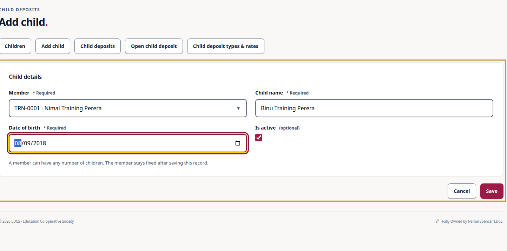

A member can have several children and each child can have several accounts. The saved child's member selection stays fixed. Future birth dates are rejected. Existing posted child interest can protect birth-date changes because age controls interest eligibility.

### 14.2 Edit or deactivate

Open the child profile, select Edit and correct permitted details. Complete any configured edit approval. Set inactive status when appropriate to preserve history; used child records cannot simply be deleted. A user with Children → View alone does not receive child deposit balances.

## 15. Configure Child Deposit Types

**Access:** administrators maintain this shared master; Child Deposit Types → View permits reading the rules.

### 15.1 Set the age-based rule

1. Open **Master data → Child Deposit Types**.
2. Add or edit a unique deposit type name.
3. Enter **Rate changes at age**, **Rate below this age (%)** and **Rate from this age (%)**.
4. Set display order and active status, then save or submit the configured edit for approval.
5. Confirm the displayed rule before opening accounts or calculating interest.

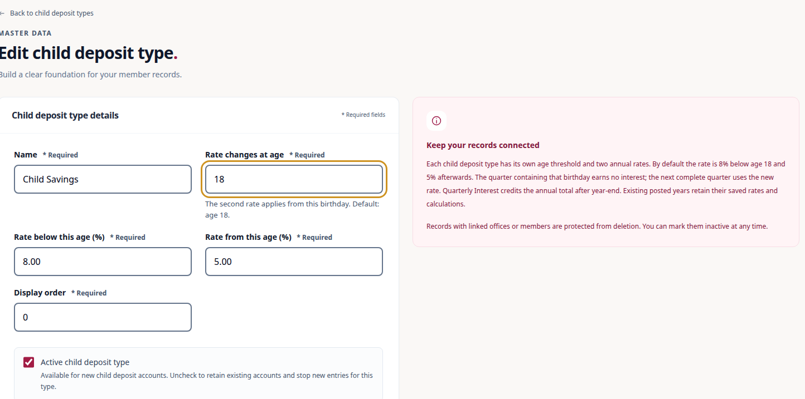

The initial Child Savings example is 8% below age 18 and 5% from age 18; actual organizational settings may differ. Types can use different ages and rates. The child account's displayed rate follows completed age on the selected date.

The whole calendar quarter containing the rate-change birthday is excluded from quarterly interest. Complete earlier quarters use the below-threshold rate and later eligible quarters use the from-threshold rate. For a leap-day child in a non-leap year, the age change is on 1 March. Chapter 17 explains calculation and posting.

### 15.2 Maintain used types

Changing a rule affects current displays and new work while saved entry-rate snapshots and posted year history remain retained. Used types are protected from deletion. Deactivate a type to stop new use while preserving records, following the bank's approved procedure.

## 16. Open and service Child Deposits

**Access:** Child Deposits → Add to open accounts/add entries, View to read accounts/statements, Edit/Delete for supported corrections; parent district access applies.

### 16.1 Open an account

1. Open the child profile and choose **Open deposit for this child**, or use the Child Deposits account-creation action.
2. Select the correct child and active deposit type.
3. Enter the opening date and nonnegative opening amount.
4. Review the rate preview for the child's age at opening.
5. Save and note the unique deposit reference.
6. Verify the opening amount and identity on the account page.

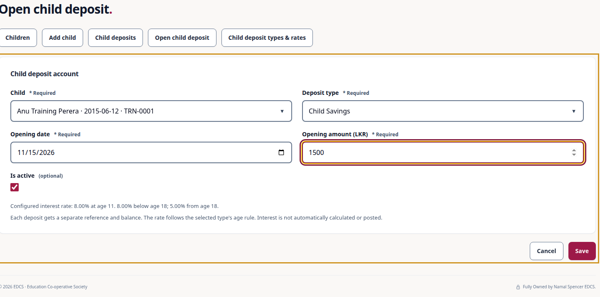

The same child may have more than one account of the same type. The account reference identifies the specific balance. Child deposits remain separate from the parent's member payment balances.

### 16.2 Record debit or credit

1. Open the specific account and select **Add debit / credit**.
2. Enter a transaction date on or after the account's opening date and within other ledger/closed-period rules.
3. Review the saved balance and configured rate for that date.
4. Enter one positive debit or credit, with the other side blank or zero.
5. Supply reference/description as appropriate and save.
6. Check the account statement or resulting approval request.

### 16.3 Read account lists and statements

In **Child Deposits**, choose the balance-as-of date and optionally filter by member, child or deposit type. If member and child are both selected, they must match. Totals cover all filtered accounts, including those beyond the displayed page.

Open the account to read its statement. Use a single date or an inclusive range. Earlier amounts carry forward; the final balance equals opening plus saved credits minus debits through the selected date. Annual interest and carried openings appear on the account's own history.

### 16.4 Correct or close ordinary activity

Opening date and amount are fixed after dated transactions or posted annual interest. The child and deposit type stay fixed on a saved account. An entry retains its saved rate when only notes or amount are edited; changing its transaction date refreshes the rate from current rules when the period is open. Posted years and historical ledgers impose further protections.

Deactivate supported account/child records to preserve their histories. Used accounts and children are protected from deletion. New accounts or entries may be blocked by inactive related records.

## 17. Calculate Quarterly Interest and post annual carry-forward

**Access:** Quarterly Interest → View for reports, Add for Calculate & save, Edit for annual posting, Delete for an unposted draft. District access applies to both member and child accounts.

### 17.1 Review the account selection

1. Open **Quarterly Interest**.
2. Select **Financial year starting in** and the account group: member payments, child deposits or both.
3. Optionally filter by member and member payment type, or by child/deposit type/deposit reference.
4. Keep filters compatible: child filters require child accounts or both groups; a member payment-type filter is not a child deposit-type filter.
5. Select **Show quarterly interest** to preview.

The default financial year is January–December. An installation may use another configured start month. Always check the actual start/end dates displayed for the year before calculating or posting it.

### 17.2 Understand the calculation

For each account and completed quarter, the system finds the three month-end closing balances and uses their minimum:

**Quarterly interest = minimum month-end balance × annual rate ÷ 100 ÷ 4.**

At an 8% annual rate, month-end balances of LKR 2,000, 3,000 and 1,500 produce LKR 30.00 for that quarter. A zero or negative minimum earns zero. A month before the account exists has a zero balance. Incomplete quarters remain pending. Interest rounds to cents and accumulates without quarterly capitalization.

Member balances include recorded Fix Deposit top-ups and released withdrawals. A payment plan does not earn interest until actual money is recorded. Each child account is calculated independently.

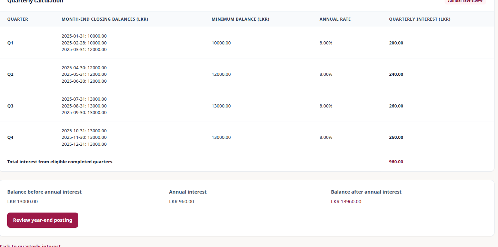

### 17.3 Check exclusions

The whole calendar quarter containing a child's rate-threshold birthday is **Excluded**. The whole calendar quarter containing a member's recorded pension date earns no interest for that member's payment accounts. A parent's pension date does not exclude the child's separate accounts. Review displayed exclusion dates and the member/child birth and pension data before closing the year.

### 17.4 Save a calculation

Select **Calculate & save** after reviewing the preview. This stores calculation details but does not credit annual interest. Open the saved account/year to inspect its month-end balances, rates, annual total and projected next opening.

Open-year drafts can refresh from the current approved rates. After year-end, a saved historical rate is retained so a new year's rate does not revalue that saved prior year. If a historical year has never been saved, finance must confirm the applicable rate before calculating it.

### 17.5 Post after year-end

1. Ensure the financial year has ended and source transactions, rates and exclusions have been checked.
2. Open the saved account/year and select **Review year-end posting**.
3. Review the closing balance before annual interest, annual interest and next-year opening balance.
4. Select **Post annual interest & carry forward**.
5. Complete any configured approval and confirm the posted date/status.
6. Verify the annual credit on the relevant member category or child account, and check its next-year brought-forward amount.

The annual credit is dated on the financial year's last day. It is posted once; zero-interest years close without a zero-value transaction. The original opening and transaction history remain retained. Child interest stays on the child's own account.

If balances or rates changed after review, review again. Earlier draft years must be posted or removed before closing a later year. Posted years and their journal entries cannot be edited/deleted; relevant earlier opening details and transactions become protected.

### 17.6 Administrator-managed scheduled processing

If your technical administrator has enabled the interest scheduler, it refreshes calculations and posts ended years through the same interest rules. Ordinary users do not enable a scheduler from the report screen. Confirm that scheduling is active and check posted account/year records rather than assuming that a year closed automatically. Give the technical administrator the affected year/account if expected processing is missing; see Chapter 29 for the maintenance reference.

## 18. Configure Fix Deposit Rules

**Access:** administrators maintain the shared **Fix Deposit Rules** master. Read access is separately grantable.

### 18.1 Create or review a rule

1. Open **Master data → Fix Deposit Rules**, or the rules link from Fix Deposit accounts.
2. Add or edit the rule and choose its linked Payment Type.
3. Enter the approved cycle, withdrawal percentage, loan-security percentage and months between loan issues.
4. Configure the bank's annual loan interest rate before issuing loans.
5. Set active status, save or complete approval, then verify the values.

| Setting                    | Supported value / effect                                                      |
| -------------------------- | ----------------------------------------------------------------------------- |
| Withdrawal cycle           | At least 36 months; a released withdrawal restarts it                         |
| Maximum withdrawal         | Positive percentage up to 75%                                                 |
| Maximum loan security      | Positive percentage up to 90% of the deposit, including outstanding principal |
| Months between loan issues | At least 12 months                                                            |
| Annual loan interest rate  | Positive rate up to 100%; must be configured before lending                   |
| Payment Type               | The member category supplying the deposit balance                             |

These are system limits, not an instruction to choose their maxima. Use approved bank policy. Existing accounts or balances protect a used rule's linked payment type from being changed. Deactivate an obsolete rule rather than trying to delete protected history.

Deposit interest and loan interest are separate. Loan interest charges are assessed by the bank and entered explicitly; the annual loan rate does not generate an automatic daily loan-interest schedule in the reviewed system.

## 19. Register and review a Fix Deposit account

**Access:** Fix Deposit Loans & Withdrawals → Add/View/Edit as needed and district access.

### 19.1 Register an account

1. Open **Fix Deposit Loans & Withdrawals → Register account**.
2. Select the member and the approved active rule.
3. Enter **Start of current withdrawal cycle** using the actual cycle start, even if balances were imported at a later date.
4. Set active status, add notes and save.
5. Open the account and verify the rule, member and cycle date.

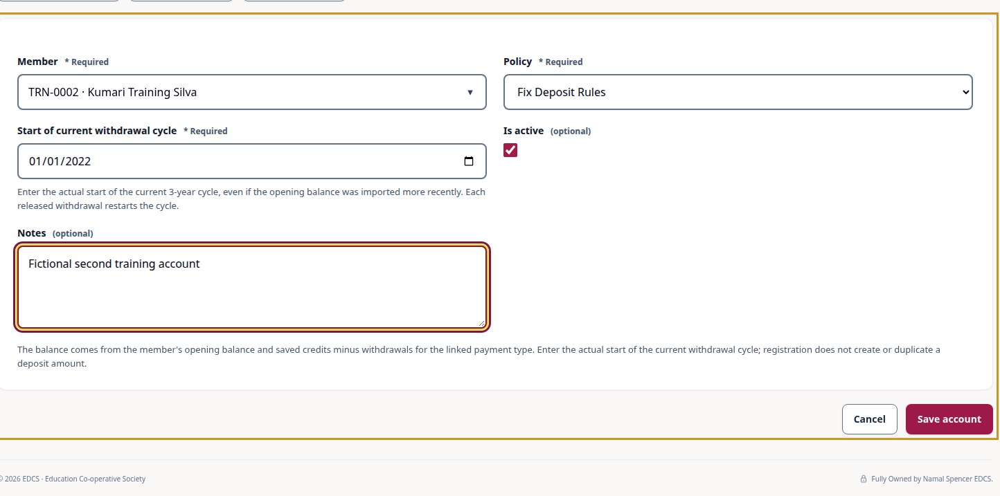

An account uses the member's existing opening amount and transactions for the rule's Payment Type; registering it does not duplicate the deposit. A member can have only one account for a given rule. The saved member and rule remain fixed. Loan or withdrawal history locks the cycle-start field.

### 19.2 Show eligibility

Choose an **As of date** and select **Show eligibility**. Read the deposit balance, outstanding principal/interest, maturity date, next loan date, maximum additional loan, withdrawal limit and any blocking reasons. Eligibility is recalculated for the action date; an earlier preview does not reserve an amount.

**Additional loan capacity = deposit × configured security percentage − outstanding principal**, with a floor of zero. **Withdrawal limit = deposit × configured withdrawal percentage**, subject to maturity and settlement rules. Limits round down to cents.

Example: a LKR 100,000 deposit at 90% security with LKR 20,000 principal due leaves LKR 70,000 loan capacity. A 75% withdrawal setting gives a LKR 75,000 limit, subject to maturity and formal loan settlement.

## 20. Issue, service and settle a Fix Deposit loan

**Access:** Fix Deposit Loans & Withdrawals → Add to issue; Edit to record loan entries or settlement; View to read the loan. Settlement can require hierarchy approval. Recording a new repayment or interest-charge entry follows the immediate entry workflow even though it requires Edit permission.

### 20.1 Issue a loan

1. Open the deposit account and check eligibility at the intended issue date.
2. Resolve any inactive-rule, missing-rate, date-interval or capacity message.
3. Select **Issue Fix Deposit Loan**.
4. Enter the date, positive amount within the displayed additional limit and notes.
5. Submit and verify the loan reference and principal on the loan detail page.

The loan stores the issue-time deposit security, limit and rate. Issuing the loan creates a loan record; principal repayments are maintained separately from member deposit credits. The selected date cannot predate the latest posted loan, repayment, settlement or withdrawal activity on the account.

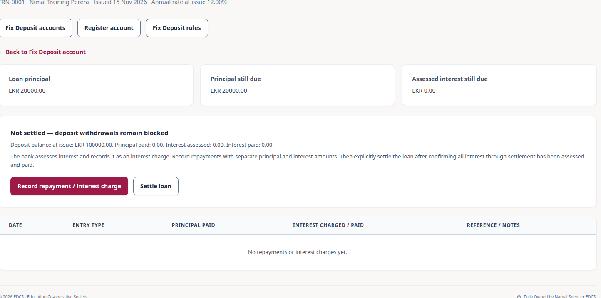

### 20.2 Record an assessed interest charge

1. Open the loan and choose **Record loan repayment or interest charge**.
2. Select the interest-charge kind.
3. Enter the date and bank-assessed interest in **Interest charged or paid (LKR)**.
4. Leave principal at zero, enter the source reference/notes and save.
5. Check that assessed interest due increases by the expected amount.

The system records the approved assessed charge; it does not calculate it merely from the number of days since issue.

### 20.3 Record repayment

1. Open the same entry action and select repayment.
2. Enter the date, **Principal paid (LKR)** and/or **Interest charged or paid (LKR)** as appropriate.
3. Enter a reference and notes, then save.
4. Review the principal due and assessed interest due. Principal and interest are separate and cannot be overpaid through the entry.

For example, a LKR 10,000 principal and LKR 100 assessed interest can be repaid with principal 10,000 and interest 100. Entering all LKR 10,100 as principal does not settle both components.

### 20.4 Settle formally

1. Confirm principal due and assessed interest due are both zero.
2. Have the bank assess and collect any remaining interest through the settlement date.
3. Select **Settle Fix Deposit Loan** and enter the date.
4. Select the required confirmation that all interest through that date has been assessed and fully paid.
5. Submit, complete any configured approval and verify the loan is marked settled.

A zero balance alone is not formal settlement. An unmarked loan can still block withdrawal. Settled loans do not accept further ordinary loan entries. Preserve loan references when requesting a correction to protected activity.

## 21. Request, review and release a Fix Deposit withdrawal

**Access:** Fix Deposit Loans & Withdrawals → Add to request; Edit to review/release or reject; View to inspect history.

### 21.1 Prepare and request

1. Open the account and check eligibility at the intended request date.
2. Verify that the withdrawal cycle has matured, the balance is positive and every loan is fully paid and formally settled.
3. Ensure there is no other pending withdrawal for the account.
4. Select **Request withdrawal**.
5. Enter the request date, amount within the limit and notes, then submit.
6. Confirm the request is pending. A request alone does not debit the deposit.

### 21.2 Review and release or reject

1. Open the pending withdrawal's review action from the account.
2. Check the requested amount, current balance and eligibility.
3. Enter a review date from the request date through today, consistent with the account's latest recorded activity.
4. Select **Approve and release to member** or **Reject request** and enter relevant notes.
5. Submit. If a Fix Deposit edit hierarchy applies, finish its approval before the result is applied.
6. Confirm the final request status and, for a release, the linked deposit debit and new cycle start.

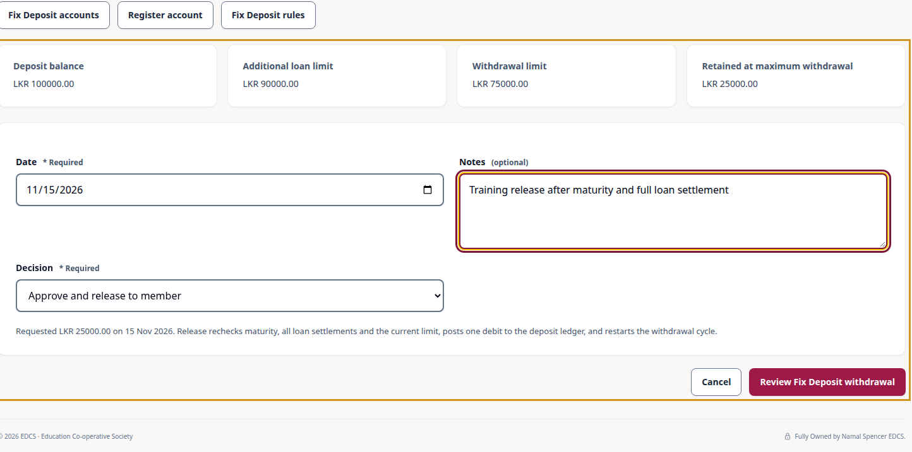

Release rechecks the current limit and settlement conditions. It records one debit against the linked member Payment Type, stores the balance/limit evidence and restarts the withdrawal cycle from the release date. A rejected request does not debit the deposit. A completed request cannot be reviewed a second time.

The release records the approved withdrawal in the system. Follow your organization's separate cash/bank disbursement and reconciliation procedure. Do not duplicate the release debit through **Debit / Credit**; the linked entry is managed by this workflow.

## 22. Review Member Ledgers and officer responsibility

**Purpose:** retain permanent member pages and financial context across office changes.

**Access:** Member Ledgers → View to inspect/export, Add for supported original-ledger setup, Edit for officer responsibility changes. Financial sections also require the corresponding financial View permissions.

### 22.1 Find a ledger

1. Open **Member Ledgers** and filter by member, district or page status.
2. Open a ledger reference.
3. Review its original/receiving status, office/department/lager information, responsible officer name and EPF, and opening/closing dates.
4. Read the linked sequence, balances, saved record snapshots and activity events.
5. Select **Include previous linked ledgers** when you need predecessor activity.
6. Apply date filters and use the ledger's CSV export where permitted.

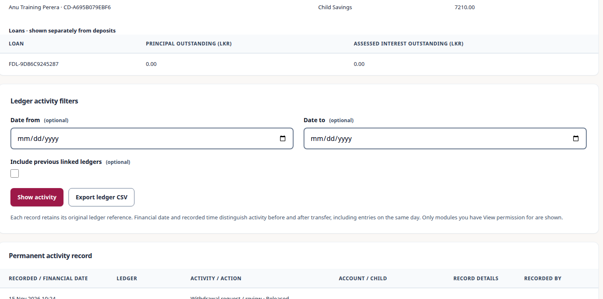

Current ledgers accept permitted new activity. Transferred pages retain frozen member information and balances. Carried-forward ledger amounts are continuity snapshots, not duplicate transactions or a new imported opening balance.

### 22.2 Assign a missing original officer

Imported or older records may show **Officer assignment required**. Open the original-ledger setup/assignment action, choose an eligible zone-matched officer, enter the required reason and save. Do not guess a historical officer; confirm responsibility through your organization's records.

### 22.3 Change the current officer

1. Open the active ledger and select **Change officer**.
2. Choose an active officer with the matching zonal office, EPF and district access.
3. Enter a reason for the handover or updated assignment.
4. Save and complete any configured approval.
5. Check that the previous/new officer identities and the reason appear in responsibility history.

Historical closed pages cannot be reassigned. Correcting a user's name or EPF does not rewrite earlier assignment snapshots. Active pages must be reassigned before an officer is deactivated, moved to another office or loses required district access.

### 22.4 What each office can see

Current ordinary member/financial screens follow the member's current district. Source offices retain their historical ledger pages; the receiving district can follow predecessor pages for continuity. A source-only user cannot use a historical page to read later receiving-office activity.

Ledger access alone does not reveal every balance. Debit / Credit, Opening Balances, Payment Plan, Child Deposits, Fix Deposit and Quarterly Interest values require their own View permissions. Member registration details require Members → View.

## 23. Transfer a member between organizational locations

**Access:** Member Transfers → Add and assigned access to both source and receiving districts. View is separately required for browsing transfer history. An eligible receiving ledger officer is required.

### 23.1 Prepare and submit

1. Open **Member Transfers → Transfer member**, or the member-profile action.
2. Select the existing member and review the source ledger, office and officer.
3. Select the receiving district and zonal office.
4. Select the receiving department/school, lager and optional matching subdivision.
5. Select the receiving **Ledger Maintenance Officer**.
6. Enter the effective date and a clear reason.
7. Recheck the source and destination before submitting.
8. If a transfer hierarchy is configured, review the new approval request and wait for final approval.
9. Verify the completed transfer and its linked original/receiving ledger references.

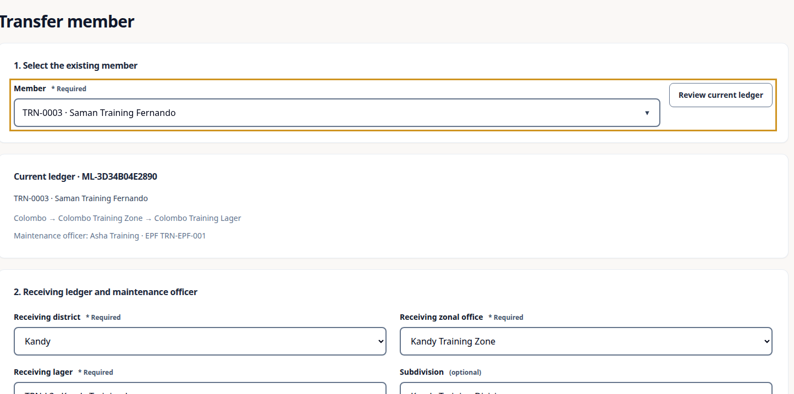

The workflow also supports a department/school change within the same zone. Use it to preserve the member's location history rather than recreating the member or importing balances again.

### 23.2 Date and consistency rules

Transfers default to today and cannot be future-dated. An earlier effective date must be on/after the current page's opening and latest recorded activity. Subsequent transfers must be after the previous transfer date. If another operator changed the source ledger, reload and review the form.

Completing the transfer closes the source page, freezes its snapshots, creates a linked receiving page and records the officer change together. Member IDs, identifiers, plans, child accounts, transactions and loans remain linked to the same member. Existing same-day activity stays on its original page; later postings use the receiving page.

### 23.3 Check the result

Open the receiving page, follow its predecessor link and confirm the ledger chain. Review the member's new organizational assignment and current officer. Transfer and permanent ledger histories have no ordinary edit/delete actions. Normal new financial postings cannot be backdated before the current transfer boundary. Late annual interest follows its dedicated posting rules and does not rewrite the source page's frozen closing snapshot.

## 24. Administration: configure Approval hierarchies

**Access:** active system administrators. Open **Approval hierarchies** from the navigation.

### 24.1 Choose the approval scope

| Module selection                              | Action selection                     | Effect                                                                   |
| --------------------------------------------- | ------------------------------------ | ------------------------------------------------------------------------ |
| Member Transfers                              | Member transfer / below-plan payment | Routes member transfers through the configured levels                    |
| All modules — edits only                      | Edit existing records                | Applies the shared hierarchy to supported workspace edits/processes      |
| A specific ordinary module                    | Edit existing records                | Uses a module-specific edit hierarchy ahead of the shared edit hierarchy |
| Payment exceptions — below-plan contributions | Member transfer / below-plan payment | Mandatory dedicated approval for below-plan member credits/receipts      |

These approval hierarchies apply to ordinary users. Active system administrators perform supported operations directly without entering the queue, including transfers, existing-record edits and below-plan contributions. The combined action label serves transfers and payment exceptions; its meaning depends on the selected module. Other ordinary creates and deletes follow existing permissions and domain protections. Passwords and user/role administration do not enter the business approval queue. The reviewed configuration is not a universal “approve every creation/deletion” feature.

### 24.2 Create the hierarchy

1. Choose the add-hierarchy action and enter a descriptive name.
2. Select the module/scope and its corresponding action from the table above.
3. Set active status and enter **Reason for configuration**.
4. Add at least one level, each with a distinct **Approval order** and a **Level name**.
5. Select one or more active designated approvers at every level.
6. Set whether assigned users may reject at that level.
7. Add more ordered levels as required, up to 20 levels.
8. Save and review the resulting levels and configuration history.

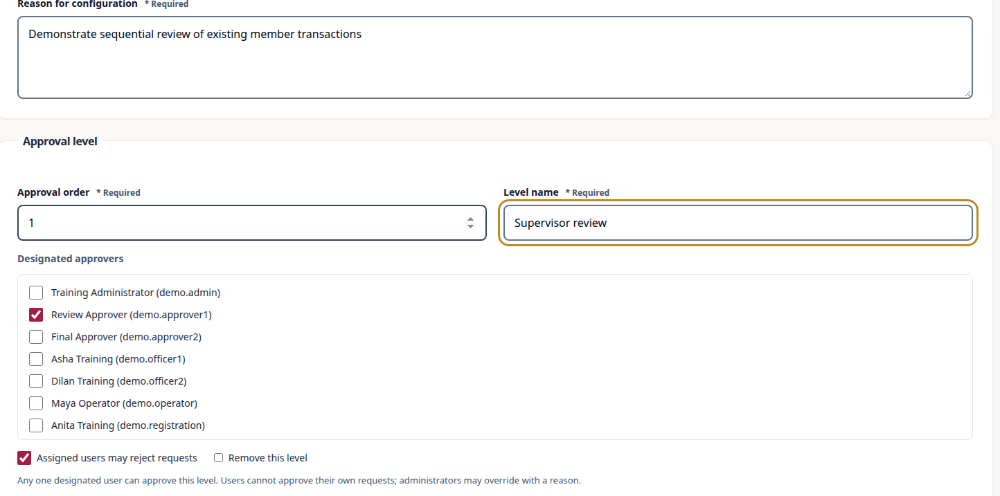

Any one designated user completes a level; the request then advances to the next level. This is not an “every selected officer must sign” configuration. Avoid assigning only the expected requester as the approver, since ordinary users cannot approve their own submissions.

### 24.3 Configure payment exceptions before receiving underpayments

Create an active hierarchy with **Payment exceptions — below-plan contributions**, the **Member transfer / below-plan payment** action, valid levels and designated officers. A global edit policy does not cover this requirement. Until this configuration exists, below-plan payments can be previewed but cannot post successfully through the exception workflow.

### 24.4 Change or deactivate a hierarchy

Open Edit, update the scope/levels/assignments or active status, enter the configuration reason and save. History retains before/after details and the version. Only one active hierarchy for the same scope/action can be configured.

Existing requests retain the hierarchy version and officer assignments captured at submission. Editing the hierarchy does not rewrite them. Deactivate an officer to revoke approval access immediately, then have an administrator resolve affected pending requests by rejection or an appropriate override. Deactivating an ordinary edit/transfer policy restores immediate processing where no other matching hierarchy applies; below-plan payment exceptions still require their dedicated active configuration.

## 25. Submit, approve, reject, cancel and override requests

### 25.1 Follow a submission

When an ordinary user's supported form enters approval, the user is taken to a request reference beginning **AR-**. New administrator operations apply immediately and do not create approval requests. Administrators can still review or override existing pending requests. Open **Approvals** later to review your own requests or those assigned to you. Administrators can review the request set available to their full privileges.

1. Open the request and check its description, submitted-by identity and hierarchy version.
2. Read **Requested details** carefully, including member, amounts, dates and source context.
3. Inspect **Approval progress** to find the current level and designated officers.
4. Check the status and outcome before assuming that the business record has changed.

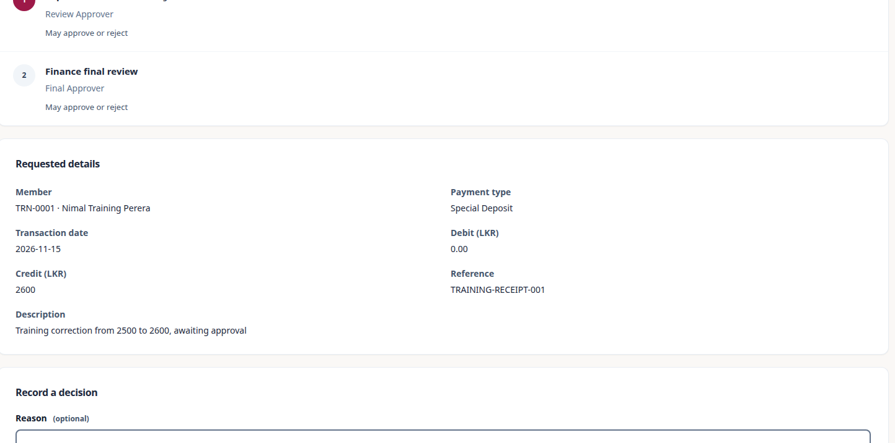

### 25.2 Approve a level

1. Sign in with your own designated approver account.
2. Open **Approvals** and the pending request assigned to your current level.
3. Review the requested details and supporting business record.
4. Enter a reason/comment when required or useful and select **Approve this level**.
5. Confirm that the request moved to the next level or reached **Approved and applied**.

Only a designated officer at the current level can normally approve. An ordinary requester cannot approve their own submission. A later level cannot approve ahead of an earlier level. Administrator decisions require a reason.

### 25.3 Reject or cancel

An assigned current-level approver may select **Reject request** when rejection is enabled at that level. Enter a reason explaining the required correction. Administrators may reject at any level with a reason.

The requester may select **Cancel request** while it is pending and must give a reason. Rejected/cancelled submissions do not change saved business data. To propose corrected values, reopen the relevant module and submit a new operation.

### 25.4 Administrator override

An administrator can approve/reject at any level, including their own request, and can choose **Approve all remaining levels**. Enter the required reason explaining the decision. The permanent audit identifies the administrator, override, time and reason. This authority does not remove current business validations at final application.

### 25.5 Interpret the status

| Status shown         | Meaning / next action                                                                                       |
| -------------------- | ----------------------------------------------------------------------------------------------------------- |
| Awaiting approval    | No business change yet; follow the current level or cancel if appropriate                                   |
| Approved and applied | The final validated operation completed; use Continue in module when offered                                |
| Rejected             | No business change; review the reason and submit corrected work if needed                                   |
| Cancelled            | The pending proposal was withdrawn; no business change                                                      |
| Could not apply      | Final application failed validation; read the outcome, inspect current data and resubmit after resolving it |

Final approval checks the original requester's current permissions, district access and the current business record/rules. A changed plan, ledger, target record, balance, account rule or revoked access can cause **Could not apply**. Approval does not force stale values into current data. For contributions, no category is credited when the final application fails.

Decision history retains the officer name, EPF where recorded, level, decision, time, reason and override details. It also records the final result. Use this history when answering who approved an operation; the original transaction creator remains the posting requester.

## 26. Reporting, Lager activity, exports and printing

### 26.1 Choose the right report

| What you need                          | Where to look                           | Main interpretation                                        |
| -------------------------------------- | --------------------------------------- | ---------------------------------------------------------- |
| Authorized member population           | Overview / Member directory             | Current member assignments and selected filters            |
| Member identity/contact file           | Member profile Print / directory CSV    | Registration information within member View access         |
| Received contribution breakdown        | Debit / Credit → Contribution receipts  | Frozen allocation and linked approval/credits              |
| Member category movements              | Debit / Credit statement                | Brought forward, selected-period movements and end balance |
| Member category balances               | Debit / Credit → Member balances        | Filtered account balances and totals across pages          |
| Child savings position                 | Child Deposits list / account statement | Independent child-account balances at the selected date    |
| Interest eligibility and carry-forward | Quarterly Interest / saved year         | Draft versus posted annual calculation                     |
| Loan or withdrawal position            | Fix Deposit account / loan detail       | Loan principal/interest separate from deposit balance      |
| Activity across a lager                | Lagers → Activity                       | Saved records for members currently assigned to that lager |
| Historical office continuity           | Member Ledgers                          | Permanent source/receiving pages and dated snapshots       |
| Approval/configuration decisions       | Approvals / hierarchy History           | Permanent proposal, decision and configuration history     |

### 26.2 Use Lager activity

1. Open **Lagers**, find the lager and select its name or **Activity** link.
2. Review the selected lager, members and summary dates.
3. Optionally filter by member, activity type and date range.
4. Inspect the records and the permitted summaries.
5. Select **Export CSV** to download all matching permitted records, including those beyond the displayed page.

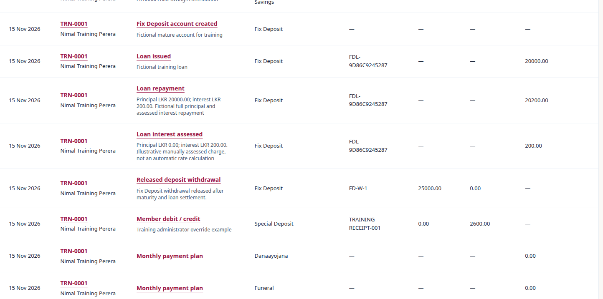

Lager activity requires Lagers → View plus each section's module View permission. It can include opening amounts, plans, member transactions, child accounts/entries, Fix Deposit activity and saved interest calculations. The activity-type filter narrows the records table; summary cards cover the modules you can view for the selected member set.

The report follows each member's current lager assignment. Moving a member carries their existing saved activity into the receiving lager's report. It is not a permanent audit of previous edits or deleted records. Use Member Ledgers for historical office continuity and Approvals for approval decisions.

### 26.3 Reconcile without counting the same money twice

Compare the same member/account/category and end date. A plan total is an agreement, not a received deposit. A receipt's category credit appears in Debit / Credit; do not add the receipt total again to that statement balance. A released withdrawal appears as a linked debit; its request record is not another debit. Interest calculation snapshots are not separate credits in addition to posted annual interest. Loan balances are reported separately from deposit balances.

### 26.4 Export and print

CSV export is provided on the member directory, Lager activity and permanent ledger pages where authorized. Use the export control actually shown on that screen; the reviewed application does not provide a universal CSV/PDF export button on every report.

For profile printing use the dedicated print view. Browser Print/Save as PDF can also be used where a readable printout is needed. Check page previews, visible filters, totals and any pagination before treating a browser printout as a complete report. CSV files follow their source filters and permitted data; spreadsheet formula prefixes in member exports are escaped.

## 27. Routine work checklists and practice exercises

### 27.1 Start-of-day checks

1. Sign in with your own account and confirm the expected modules/districts.
2. Review pending requests you submitted or must approve.
3. Check source documents before entering a member, payment or account operation.
4. Confirm the working date and the member/account identity.
5. Resolve missing master data or officer configuration before starting dependent work.

### 27.2 Contribution processing checklist

1. Confirm actual funds received and a source reference.
2. Check the member's current plan, effective date and category configuration.
3. Enter the received amount and preview the allocation.
4. Check the allocation total and whether approval is required.
5. Post or submit, then retain the receipt or AR reference.
6. For approved exceptions, confirm **Approved and applied** and check category statements.
7. Reconcile the received-money source total against posted receipts without also counting pending requests.

### 27.3 Before closing an interest year

Confirm rates, opening dates, member pension dates and child birthdays. Review incomplete/excluded quarters and earlier drafts. Confirm source corrections are finished, review the year-end calculation and complete the required approval. Verify the annual credit and next opening after posting.

### 27.4 Finish-of-day checks

Review successful postings and unresolved approval outcomes. Reconcile financial records against your organization's source totals. Note pending work with member/account and request references, save required authorized reports and sign out.

### 27.5 Practice in an approved training environment

Use fictional records in a training copy, with an administrator arranging officers and rules. Do not enter practice money into operational accounts.

| Exercise             | Action                                                                                | Expected result                                                    |
| -------------------- | ------------------------------------------------------------------------------------- | ------------------------------------------------------------------ |
| Register a member    | Select a valid department, lager and officer; complete required identity/contact data | Member profile and original ledger are created                     |
| Configure a plan     | Save the five-category LKR 1,500 plan from Chapter 12                                 | Monthly agreement is saved without adding funds                    |
| Receive LKR 3,500    | Preview and post proportional allocation                                              | Five category credits total LKR 3,500 exactly                      |
| Submit an exception  | Enter Pension-only LKR 250 against LKR 400                                            | Approval request appears and no money posts before final approval  |
| Complete approval    | Use designated officers in order, or a reasoned administrator decision                | Status becomes Approved and applied; one final payment is recorded |
| Cancel a proposal    | Cancel another pending exception with a reason                                        | Status becomes Cancelled; balances do not change                   |
| Read a statement     | Filter the training member/category and dates                                         | Opening, credits, debits and final balance reconcile               |
| Open a child account | Register a child and open a deposit                                                   | Independent account reference and balance are created              |
| Transfer a member    | Select valid receiving locations/officer and effective date                           | Source and receiving permanent ledgers remain linked               |

The supplied training video covers the broad system workflows. This manual additionally covers the newer contribution receipt workflow; use Chapter 12 for its current steps.

## 28. Troubleshooting and common questions

| Problem or message                               | What to check / do                                                                                                                |
| ------------------------------------------------ | --------------------------------------------------------------------------------------------------------------------------------- |
| Cannot sign in                                   | Check the application address, username and password; ask an administrator whether the account is active or needs a reset         |
| Returned to sign-in while working                | Session may have expired; sign in, inspect whether the record/request saved, then repeat only missing work                        |
| Expected menu or action is missing               | Ask the administrator to check the specific module action, all role/direct grants and account status                              |
| No districts assigned / empty authorized records | Ask for the correct district assignments; granting a role alone does not add districts                                            |
| A record URL is unavailable                      | Check current permissions/district and whether the member transferred; use authorized ledger history for the source office        |
| Department not found                             | Clear restrictive district/zone filters; search by name/code; check that the master and its parent locations are active           |
| Lager disappears after changing a zone           | Select a lager belonging to the new zone; mismatched selections are cleared intentionally                                         |
| No maintenance officer is available              | Administrator must check active user, unique EPF, matching ledger zone and district access                                        |
| Duplicate member/computer/NIC                    | Search for the existing member and verify the document; do not change the identifier merely to force another record               |
| Phone/NIC/date validation fails                  | Follow the field format, required indicators and permitted date range; see Chapter 6                                              |
| Saved form opens an AR request                   | A hierarchy applies; the business change waits for final approval                                                                 |
| Approve button is missing                        | Check current level assignment, self-approval restriction, request status and whether the account is active                       |
| Could not apply                                  | Read the request outcome; check changed data/rules/access and submit a fresh proposal after resolving it                          |
| Below-plan payment cannot post                   | For ordinary-user payments, an administrator must configure an active dedicated Payment exceptions hierarchy with levels/officers |
| No effective plan for contribution               | Create/review the member's plan and agreement date; receive only against a plan effective on the receipt date                     |
| Contribution has an inactive category error      | Review the positive inactive plan category and approved plan/master settings; its share cannot silently be reassigned             |
| Allocation changed after preview                 | Use Preview allocation again after reviewing current amount, plan and member ledger                                               |
| Category-only payment rejected                   | Select an active category with a positive amount configured in that member's plan                                                 |
| Receipt/credit cannot be edited                  | It is permanent receipt history; refer its number to finance for the approved corrective-entry procedure                          |
| Credit appears missing                           | Check receipt status, pending approvals, category, statement dates and current/historical ledger; preview alone does not post     |
| Balance differs from expected                    | Check opening effective date, end date, earlier brought-forward amounts, unsaved/pending work and separate child/loan balances    |
| Date-filter error                                | Use Single date or a range, not both; To date must be on/after From date                                                          |
| Child opening details are disabled               | Dated entries or posted interest lock the opening; retain history and review permitted correction options                         |
| Interest is Pending or Excluded                  | Quarter is incomplete, or birthday/pension exclusion applies; inspect the account/year detail                                     |
| Cannot post annual interest                      | Financial year may still be open, earlier drafts may remain, data may have changed or Edit permission/approval may be required    |
| Older transaction/opening cannot change          | Posted interest, a historical ledger or Fix Deposit servicing history protects it                                                 |
| No loan capacity / loan action missing           | Check active account/rule/type, configured loan rate, interval since last issue, security balance and Add permission              |
| Withdrawal blocked despite zero loan balances    | Every loan must also be formally marked settled; check maturity and any pending withdrawal                                        |
| Requested withdrawal exceeds current limit       | Current deposit/eligibility changed; inspect the account and review the request against current approved rules                    |
| User deactivation or office change blocked       | Reassign all that officer's active ledgers first                                                                                  |
| Delete is blocked                                | Linked/permanent records must remain; use supported inactive status or ask the administrator to review the relationship           |
| Welcome email failed                             | Check whether the user saved successfully; administrator/technical support should review email settings before retrying delivery  |
| Export has fewer records than expected           | Review search, date, district and module filters and permissions; compare the export's intended source set                        |

### 28.1 Why is POST /session/activity/ returning 204?

The browser uses this request to tell the server that a signed-in user is active. **204** means the request succeeded with no response body; it is not an application error. It creates some request/header traffic, while the response body is empty. The activity mechanism supports inactivity expiry and coordination across tabs. An ordinary user does not need to take action. If its frequency needs investigation, ask technical support to review session activity behavior in the installed version.

### 28.2 What to include in a support request

Provide the page/module, your username, the time, member/account/receipt or AR reference, selected dates/filters, the exact message and the expected result. Describe whether the operation was a preview, save, post or approval. A screenshot of the relevant message can help; follow your organization's rules for personal/financial information. Do not send passwords or private configuration files.

## 29. Quick references, glossary and administrator handover

### 29.1 Common routes

Use your organization's application address before the path below. A path does not grant access; the normal permissions still apply.

| Task                                            | Path                                                               |
| ----------------------------------------------- | ------------------------------------------------------------------ |
| Sign in / Overview                              | `/login/` / `/`                                                    |
| Administration / Users / Roles                  | `/admin/` / `/admin/users/` / `/admin/roles/`                      |
| Member directory                                | `/members/`                                                        |
| Districts / Zonal offices                       | `/districts/` / `/offices/`                                        |
| Subdivisions / Departments / Lagers             | `/subdivisions/` / `/schools/` / `/lagers/`                        |
| Payment Types / Plan Templates / Payment Plan   | `/payment-types/` / `/payment-plan-templates/` / `/payment-plans/` |
| Opening Balances                                | `/opening-balances/`                                               |
| Debit / Credit / Member balances                | `/debit-credit/` / `/debit-credit/balances/`                       |
| Contribution receipts / Receive contribution    | `/contributions/` / `/contributions/new/`                          |
| Children / Child Deposit Types / Child Deposits | `/children/` / `/child-deposit-types/` / `/child-deposits/`        |
| Quarterly Interest                              | `/deposit-interest/`                                               |
| Fix Deposit accounts / Rules                    | `/fix-deposits/` / `/fix-deposit-rules/`                           |
| Member Ledgers / Transfers                      | `/member-ledgers/` / `/member-transfers/`                          |
| Approvals / Approval hierarchies                | `/approvals/` / `/approval-hierarchies/`                           |
| Advanced Django administration                  | `/admin/django/`                                                   |

### 29.2 Permission reference

All 19 registered permission modules are covered in this manual: Members; Member Transfers; Member Ledgers; Children; Child Deposits; Child Deposit Types; Districts; Zonal offices; Subdivisions; Departments; Lagers; Payment Plan; Payment Plan Templates; Quarterly Interest; Debit / Credit; Opening Balances; Payment Types; Fix Deposit Loans & Withdrawals; and Fix Deposit Rules.

Member Transfers supports View/Add; permanent transfers have no Edit/Delete. Member Ledgers supports View/Add/Edit; Edit means a responsibility change and there is no Delete. Contributions use Debit / Credit permissions. Quarterly Interest uses Add for calculations and Edit for annual posting. Child Deposits covers accounts and their entries. Fix Deposit account permissions also control loan/withdrawal operations. Users/roles and hierarchy configuration require system administrator access rather than another ordinary module grant.

### 29.3 Glossary

| Term            | Meaning in this system                                                                       |
| --------------- | -------------------------------------------------------------------------------------------- |
| LKR             | Sri Lankan Rupees; financial amounts use cents                                               |
| EPF             | Employee identifier recorded for ledger/approval responsibility                              |
| District access | The set of district records an ordinary user's actions can reach                             |
| Role            | A reusable group of module permissions, combined with direct grants                          |
| Department      | Required organizational assignment; legacy code/URLs may call it school                      |
| Lager           | Organizational grouping within a zonal office                                                |
| Payment Type    | Member financial category, such as Special Deposit or Pension                                |
| Payment plan    | Member's monthly contribution agreement and allocation weights                               |
| Template        | Shared starting amounts copied into an independent member plan                               |
| Receipt         | Permanent record of an actual received contribution and its allocations                      |
| Debit / Credit  | Decrease / increase in the relevant deposit category balance                                 |
| Brought forward | Balance from before the selected report period                                               |
| Carry-forward   | Annual closing amount including posted interest carried to the next year                     |
| Quarter         | Three-month calculation period; eligibility also uses the bank's calendar-quarter exclusions |
| Ledger page     | Permanent member record at an office with officer responsibility and linked snapshots        |
| AR reference    | Permanent identifier of a submitted approval request                                         |
| Override        | Reasoned administrator decision completing or bypassing remaining approval levels            |
| Could not apply | Approval reached final processing but current validations prevented the operation            |

### 29.4 Administrator handover checklist

Record the application address, technical support contact and business owner in your organization's handover records. Confirm that locations, active officers, district assignments, roles, financial rates, plans and the dedicated Payment exceptions hierarchy are configured. Verify how pending requests are handled during officer leave or departure. Confirm the expected interest schedule, backup/restore owner and email delivery configuration with technical support.

The commands below are technical maintenance references, for an authorized technical administrator on the application host. They are not browser tasks or a request to change deployment settings while following this manual.

| Maintenance task                         | Existing application command / reference                                  |
| ---------------------------------------- | ------------------------------------------------------------------------- |
| Review system configuration              | `python manage.py check`                                                  |
| Apply released database schema changes   | `python manage.py migrate` after normal release preparation               |
| Refresh and post ended interest years    | `python manage.py process_deposit_interest --post-ended`                  |
| Include a specific earlier starting year | `python manage.py process_deposit_interest --post-ended --from-year 2025` |
| Display interest scheduler installation  | `python manage.py install_interest_schedule`                              |
| Install the supported Linux cron entry   | `python manage.py install_interest_schedule --install`                    |

The supported installed schedule runs at minute 15 each hour and logs to `.interest-scheduler.log`; the host and scheduling service must be running. The first ordinary processor run starts in the current financial year unless an earlier starting year is explicitly supplied. After moving the application, technical support must review the schedule path. Existing deployment and email setup details are in the project README.

### 29.5 Document baseline and related material

This manual was checked against the current application navigation, form definitions, validation rules, permissions, ledger/transfer services, approval workflows and contribution implementation on 15 November 2026. Screenshots use the isolated fictional training installation. A deployment with different permissions, rates, configured hierarchies or later software changes can show different choices.

Related project documents are **EDCS_SRS**, **EDCS_Automation_Assessment** and the **EDCS Complete User Training** video/transcript in `docs/training/`. The automation assessment identifies potential improvements; it is not evidence that a proposed feature already exists. Use the current interface and this manual's operational steps for present workflows.

Document version 1.1 includes lager-based automatic officer assignment, required master EPFs and administrator approval exemptions, as well as the contribution receipts introduced after the broad training recording. The officer screenshots have been refreshed; other captures illustrate the relevant training screens. Update this manual when screens or business rules change.
